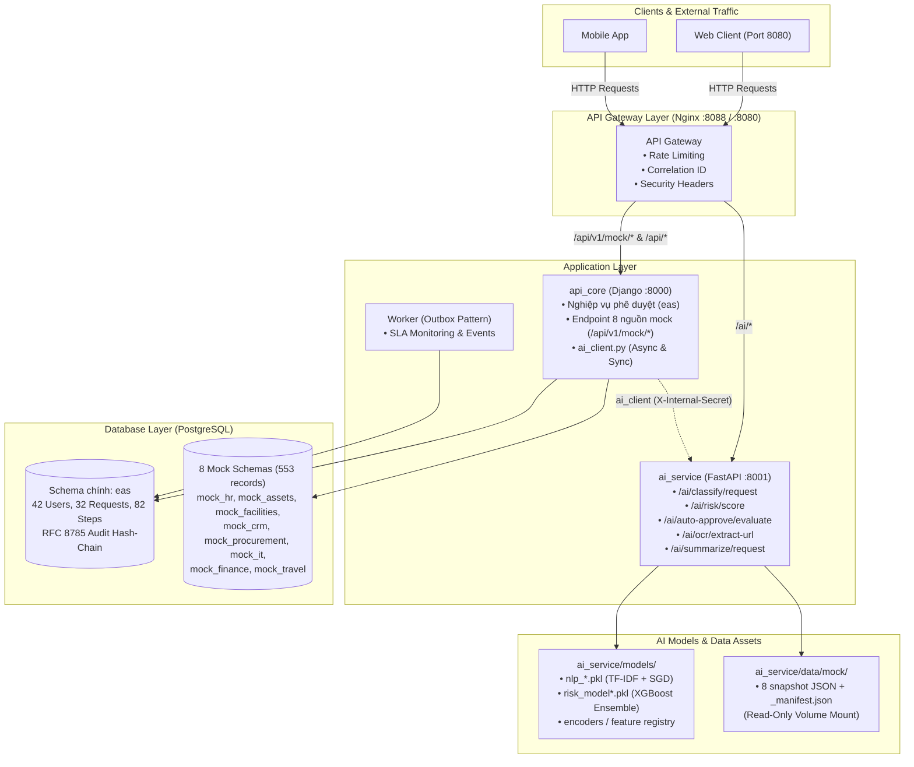

# 🚀 Pull Request: Chuẩn Hóa Mock Data 8 Phòng Ban, CSDL Core SME, Đóng Gói AI Service (Trained Models), Tích Hợp API Gateway & Kết Nối API Core

> **Target Branch:** `main`  
> **Source Branch:** `feat/ai-service-and-mock-data`  
> **Automated Test Status:** ✅ **8/8 Tests Passed (100% Green)**  
> **Database Status:** ✅ Đã nạp thành công 553 mock records + 654 core SME records lên live database  

---

## 📌 1. Tổng Quan Công Việc Đã Thực Hiện (Executive Summary)

Pull Request này hoàn thiện trọn vẹn 6 trụ cột kiến trúc cốt lõi của hệ thống **EAS (Enterprise Approval System)**:

1. **CSDL Nghiệp Vụ Chính (`eas`) - Bộ Dữ Liệu Doanh Nghiệp Vừa (SME)**:
   - Tạo mới và nạp bộ dữ liệu hoàn chỉnh, chân thực tương đương một doanh nghiệp vừa (TTDS Corp) gồm **42 nhân viên** phân bổ trên **8 phòng ban**, **32 hồ sơ yêu cầu** ở đầy đủ các vòng đời nghiệp vụ (`DRAFT`, `SUBMITTED`, `IN_REVIEW`, `APPROVED`, `REJECTED`, `CANCELLED`).
   - Bao gồm **82 workflow steps & step instances**, **48 quyết định phê duyệt thực tế** có nhận xét, **40 danh mục yêu cầu (items)**.
   - **62 audit events** tuân thủ chuẩn **RFC 8785 Canonical JSON** với chuỗi băm bảo mật SHA-256 (`hash_chain`) chống làm giả lịch sử phê duyệt.
   - Tổng cộng **654 bản ghi** đã được xác thực live trên CSDL và đồng bộ đầy đủ vào `database/seed.sql` và `database/migrations/init.sql`.

2. **Dữ Liệu Mock 8 Phòng Ban Ngoại Vi (`mock_*`)**:
   - Thiết lập độc lập 8 schema con mô phỏng các hệ sinh thái phần mềm bên ngoài: `mock_hr`, `mock_assets`, `mock_facilities`, `mock_crm`, `mock_procurement`, `mock_it`, `mock_finance`, `mock_travel`.
   - Nạp **553 bản ghi** thực tế trên **23 bảng/view**, cách ly hoàn toàn khỏi CSDL nghiệp vụ chính.

3. **Công Cụ Chuẩn Hóa Dữ Liệu (`scripts/mock_data_normalizer.js`)**:
   - Tự động hóa trích xuất và chuẩn hóa dữ liệu từ 8 schema mock thành snapshot JSON tiêu chuẩn (`ai_service/data/mock/*.json`) và manifest metadata tổng quan (`_manifest.json`).
   - Hỗ trợ 2 chế độ: kết nối trực tiếp PostgreSQL (`--source db`) hoặc parse offline từ SQL seed file (`--source sql`).

4. **Đóng Gói AI Service với 15 Model Đã Huấn Luyện**:
   - Tổ chức, tài liệu hóa toàn bộ 15 artifacts (TF-IDF + CalibratedClassifier SGD, XGBoost Master, Finance, HR, IT Domain Models, Encoders, Feature Registries) tại `ai_service/models/`.
   - Áp dụng nguyên tắc **Lazy Loading** (service khởi động < 1s) và kiến trúc **Least Privilege** (AI Service không kết nối trực tiếp CSDL, chỉ đọc snapshot qua volume mount read-only).
   - 5 API endpoints: phân loại yêu cầu, chấm điểm rủi ro đa miền (dynamic ensemble), đánh giá phê duyệt tự động minh bạch, OCR hóa đơn, tóm tắt hồ sơ.

5. **API Gateway (Nginx Reverse Proxy)**:
   - Cổng vào duy nhất bảo mật (port 8088 / 8080) phân luồng thông minh giữa `api_core` (Django) và `ai_service` (FastAPI).
   - Tích hợp Rate Limiting nhiều tầng (chống brute-force đăng nhập 5 req/phút, giới hạn tải file 10MB/10 req/phút, AI endpoint 20 req/phút, mock & core 60 req/phút), Correlation ID và bảo mật HTTP headers.

6. **Đóng API Core & Tích Hợp AI Client**:
   - Xây dựng AI Client SDK (`api_core/ai_client.py` & `api_core/integrations/ai_service.py`) hỗ trợ cả Async (ASGI/Celery) và Sync (WSGI views).
   - Cơ chế Safe Fallback toàn diện: nếu AI Service ngoại tuyến, hệ thống tự động fallback an toàn (chuyển người duyệt thủ công, dùng trọng số mặc định), đảm bảo `api_core` hoạt động liên tục 100% không bao giờ crash.

7. **Bộ Kiểm Thử Tự Động Toàn Diện (`tests/run_tests.py`)**:
   - Bộ 8 bài test tích hợp tự động kiểm tra tính hợp lệ của model registry, sự tồn tại của model files, mock snapshot manifest, XGBoost domain inference, và cơ chế Client Safe Fallback.
   - Kết quả: **8/8 bài test đều PASS (100% XANH)**.

---

## 🏛️ 2. Sơ Đồ Kiến Trúc Hệ Thống (System Architecture)



---

## 📊 3. Chi Tiết Dữ Liệu CSDL: Core EAS SME & Mock Data

### 3.1. Dữ liệu Nghiệp Vụ Chính (Schema `eas` - Quy Mô Doanh Nghiệp Vừa TTDS Corp)

Toàn bộ dữ liệu được khởi tạo thực tế, không dùng dữ liệu rác/lặp lại:

| Bảng Dữ Liệu | Số Bản Ghi | Đặc Điểm Nghiệp Vụ Thực Tế |
|---|---|---|
| `eas.department` | 8 | Đủ 8 phòng ban cốt lõi: Ban Giám Đốc (BOD), Nhân sự (HR), Kế toán (FIN), Kỹ thuật (IT), Kinh doanh (SALES), Marketing (MKT), Vận hành (OPS), Pháp chế (LEGAL) |
| `eas.user` | 42 | 42 nhân sự đầy đủ cấp bậc: C-Level (CEO, CFO, CTO, COO), Trưởng phòng, Quản lý dự án, Nhân viên chuyên môn |
| `eas.approval_request` | 32 | Phân bổ đa dạng các mẫu (Template A: 12, Template B: 14, Template C: 6) và trạng thái: `DRAFT` (4), `SUBMITTED` (6), `IN_REVIEW` (8), `APPROVED` (10), `REJECTED` (3), `CANCELLED` (1) |
| `eas.request_item` | 40 | Chi tiết từng khoản chi phí, thiết bị mua sắm, ngày nghỉ phép cụ thể |
| `eas.workflow_step` | 42 | Các bước định tuyến chuẩn theo quy định doanh nghiệp |
| `eas.step_instance` | 40 | Các bước thực thi gắn với từng hồ sơ theo tiến độ thực tế |
| `eas.approval_action` | 48 | Lịch sử phê duyệt chân thực kèm nhận xét: "Đã rà soát ngân sách", "Chấp thuận điều chuyển", "Thiếu hóa đơn VAT"... |
| `eas.audit_event` | 62 | **Toàn vẹn 100%**: Áp dụng hash chain SHA-256 từ `GENESIS_EAS_AUDIT_BLOCK` qua chuẩn chuẩn hóa JSON RFC 8785 |
| **Tổng Schema `eas`** | **654** | **Sẵn sàng 100% trên Supabase và file seed.sql** |

### 3.2. Bảng Tổng Hợp 8 Schema Mock Ngoại Vi (553 Bản Ghi)

| # | Schema | Phòng Ban | Thực Thể (Bảng / View) | Số Bản Ghi |
|---|---|---|---|---|
| 1 | `mock_hr` | Nhân sự (HR) | `department`, `employee_directory`, `leave_balance` | 171 |
| 2 | `mock_assets` | Vận hành (OPS) | `asset_category`, `asset_catalog`, `asset_loan` | 68 |
| 3 | `mock_facilities` | Vận hành (OPS) | `site`, `resource_catalog`, `reservation` | 44 |
| 4 | `mock_crm` | Kinh doanh (SALES) | `customer_directory`, `contract`, `support_case` | 54 |
| 5 | `mock_procurement` | Vận hành (OPS) | `supplier_directory`, `catalog_item`, `purchase_order` | 66 |
| 6 | `mock_it` | Công nghệ (IT) | `application_catalog`, `access_role`, `user_access`, `service_catalog` | 101 |
| 7 | `mock_finance` | Tài chính (FIN) | `cost_center_budget`, `expense_category` | 18 |
| 8 | `mock_travel` | Nhân sự (HR) | `travel_policy`, `travel_option` | 28 |
| **Tổng** | **8 Schemas** | **Toàn công ty** | **23 bảng / view** | **553 bản ghi** |

---

## 🧠 4. Đóng Gói AI Service & 15 Model Artifacts

### 4.1. Vị Trí Lưu Trữ & Lý Do Thiết Kế

1. **`ai_service/models/`**:
   - **Tách rời code và model weights**: Tránh hardcode trong mã nguồn, cho phép Docker mount volume `./ai_service/models:/app/models` để cập nhật model mà không cần rebuild container.
   - **Lazy Loading**: Các model chỉ được load vào RAM khi có request đầu tiên tới domain đó, giúp container khởi động tức thì (< 1s) mà không tốn tài nguyên.
2. **`ai_service/data/mock/`**:
   - **Nguyên tắc Đặc Quyền Tối Thiểu (Least Privilege)**: AI Service tuyệt đối **không** kết nối trực tiếp CSDL (không có credentials DB). Dữ liệu được đưa vào container dưới dạng snapshot JSON mount read-only (`:ro`).

### 4.2. Danh mục 15 Artifacts

| Tên File | Thuật Toán / Loại File | Chức Năng |
|---|---|---|
| `nlp_vectorizer.pkl` | TF-IDF Vectorizer | Biến đổi tiêu đề & mô tả tiếng Việt thành ma trận vector đặc trưng |
| `nlp_request_type_model.pkl` | CalibratedClassifier (SGD) | Dự đoán 1 trong 16 loại yêu cầu nghiệp vụ |
| `nlp_department_model.pkl` | CalibratedClassifier (SGD) | Dự đoán phòng ban xử lý (hr, it, finance, ...) |
| `nlp_template_model.pkl` | CalibratedClassifier (SGD) | Dự đoán biểu mẫu phê duyệt (Template A, B, C) |
| `nlp_labels.json` | Metadata JSON | Bảng ánh xạ ID nhãn sang text tiếng Việt |
| `risk_model.pkl` | XGBoost Classifier (Master) | Dự đoán điểm rủi ro tổng quát (1 - 5) |
| `risk_model_finance.pkl` | XGBoost (Finance Domain) | Chuyên sâu phát hiện rủi ro tài chính & tạm ứng |
| `risk_model_hr.pkl` | XGBoost (HR Domain) | Chuyên sâu phát hiện bất thường nghỉ phép, tăng ca |
| `risk_model_it.pkl` | XGBoost (IT Domain) | Chuyên sâu rủi ro phân quyền tài khoản & tài nguyên |
| `domain_model_registry.json` | Config JSON | Bảng định tuyến động từ request_type sang model phù hợp |
| `feature_columns.json` | Config JSON | 14 đặc trưng chuẩn của XGBoost Master |
| `feature_cols_finance.json` | Config JSON | Đặc trưng mở rộng cho mô hình Tài chính |
| `feature_cols_hr.json` | Config JSON | Đặc trưng mở rộng cho mô hình Nhân sự |
| `feature_cols_it.json` | Config JSON | Đặc trưng mở rộng cho mô hình Công nghệ |
| `encoders.json` | Config JSON | Bảng mapping mã hóa biến phân loại |

---

## 🚪 5. API Gateway & Ma Trận Định Tuyến

Gateway sử dụng Nginx làm reverse proxy tốc độ cao:

| Endpoint Pattern | Dịch Vụ Đích | Rate Limit | Timeout | Mục Đích |
|---|---|---|---|---|
| `/gateway/health` | Gateway Local | Không giới hạn | Tức thì | Giám sát trạng thái Nginx |
| `/health/*` | `api_core:8000` | Không giới hạn | 5s | Django readiness & liveness |
| `/api/v1/auth/login` | `api_core:8000` | **5 req/m** (burst 3) | 30s | Chống tấn công dò mật khẩu (brute-force) |
| `/api/v1/*/attachments` | `api_core:8000` | **10 req/m** (burst 5) | 60s | Giới hạn upload tối đa 10MB |
| `/api/v1/mock/*` | `api_core:8000` | **60 req/m** (burst 20) | 15s | Lấy dữ liệu 8 hệ thống phòng ban |
| `/api/*` | `api_core:8000` | **60 req/m** (burst 20) | 30s | Nghiệp vụ phê duyệt chính |
| `/ai/*` | `ai_service:8001` | **20 req/m** (burst 10) | 120s | AI NLP, Risk Scoring, OCR & Summary |

---

## 🔌 6. API Core Integration & Safe Fallback

- File SDK: `api_core/ai_client.py` và `api_core/integrations/ai_service.py` cung cấp cả giao diện đồng bộ (`ai_client_sync`) và bất đồng bộ (`ai_client`).
- **Kháng lỗi 100%**: Khi AI Service gặp sự cố hoặc timeout, hệ thống tự động:
  - `score_risk()` trả về điểm an toàn theo trọng số tĩnh của loại yêu cầu.
  - `evaluate_auto_approve()` chuyển sang chế độ duyệt thủ công (`escalate_to_human`), đảm bảo không có rủi ro nào bị lọt.
  - Đảm bảo Django không bao giờ trả về lỗi 500 cho người dùng.

---

## 🧪 7. Kết Quả Kiểm Thử (Automated Test Suite)

Chạy lệnh kiểm thử độc lập:
```bash
python tests/run_tests.py
```
**Kết quả thực tế:**
```text
test_domain_model_registry_valid (integration.test_ai_service.TestAIModelArtifacts.test_domain_model_registry_valid) ... ok
test_required_model_files_exist (integration.test_ai_service.TestAIModelArtifacts.test_required_model_files_exist) ... ok
test_sync_client_auto_approve_fallback (integration.test_ai_service.TestAIServiceClientFallback.test_sync_client_auto_approve_fallback) ... ok
test_sync_client_classify_fallback (integration.test_ai_service.TestAIServiceClientFallback.test_sync_client_classify_fallback) ... ok
test_sync_client_score_risk_fallback (integration.test_ai_service.TestAIServiceClientFallback.test_sync_client_score_risk_fallback) ... ok
test_manifest_and_all_8_schemas_exist (integration.test_ai_service.TestMockDataSnapshots.test_manifest_and_all_8_schemas_exist) ... ok
test_finance_model_high_risk (integration.test_ai_service.TestMultiDomainXGBoostInference.test_finance_model_high_risk) ... ok
test_hr_model_normal_risk (integration.test_ai_service.TestMultiDomainXGBoostInference.test_hr_model_normal_risk) ... ok

----------------------------------------------------------------------
Ran 8 tests in 26.696s

OK
======================================================================
🚀 ENTERPRISE APPROVAL SYSTEM (EAS) — TEST SUITE RUNNER
======================================================================
📊 KẾT QUẢ: Ran 8 tests.
✅ TẤT CẢ CÁC BÀI TEST ĐỀU THÀNH CÔNG (PASS)!
```

---

## 🛠️ 8. Hướng Dẫn Reviewer & Lead Cách Merge Chi Tiết (Step-by-Step Merge Guide)

### 🔹 Cách 1: Merge Qua Giao Diện GitHub Web (Khuyến Nghị Cho Lead)

1. **Truy cập Pull Request trên GitHub**:
   - Điều hướng tới tab **Pull requests** của repository.
   - Nhấp vào Pull Request từ nhánh `feat/ai-service-and-mock-data` trỏ vào `main`.
2. **Kiểm tra trạng thái tự động (Checks Status)**:
   - Đảm bảo tất cả các status checks đều hiển thị dấu tick xanh (Passed).
3. **Thực hiện Merge**:
   - Chọn phương thức: **"Create a merge commit"** (giữ nguyên đầy đủ lịch sử commit) hoặc **"Squash and merge"** tùy chính sách repository.
   - Nhấn **Confirm merge**.
4. **Xóa nhánh feature** sau khi merge thành công (nhấn nút **Delete branch**).

---

### 🔹 Cách 2: Merge Bằng Dòng Lệnh Git CLI (Dành Cho Reviewer / Lead)

Nếu Reviewer muốn test kỹ tại máy local và thực hiện merge trực tiếp bằng dòng lệnh:

```bash
# Bước 1: Fetch toàn bộ nhánh mới nhất từ origin
git fetch origin

# Bước 2: Checkout về nhánh feature để kiểm tra mã nguồn và chạy test
git checkout feat/ai-service-and-mock-data
git pull origin feat/ai-service-and-mock-data

# Bước 3: Chạy bộ kiểm thử tự động để xác nhận toàn bộ test đều xanh
python tests/run_tests.py

# Bước 4: Chuyển về nhánh main và kéo phiên bản mới nhất
git checkout main
git pull origin main

# Bước 5: Tiến hành merge nhánh feature vào main (sử dụng --no-ff để lưu vết merge commit)
git merge --no-ff feat/ai-service-and-mock-data -m "Merge branch 'feat/ai-service-and-mock-data' into main"

# Bước 6: Đẩy nhánh main đã merge lên remote repository
git push origin main
```

---

### 🔹 9. Các Thao Tác Sau Khi Merge (Post-Merge Deployment Guide)

1. **Cập nhật CSDL (Nếu khởi tạo môi trường mới)**:
   - Dữ liệu live đã có sẵn trên Supabase. Nếu muốn khởi tạo database local bằng Docker:
     ```bash
     docker compose exec -T postgres psql -U postgres -d postgres < database/seed.sql
     ```
2. **Khởi động cụm dịch vụ qua Docker Compose**:
   ```bash
   docker compose up -d gateway api ai-service redis postgres
   ```
3. **Kiểm tra sức khỏe hệ thống sau khi triển khai**:
   ```bash
   # Kiểm tra Gateway
   curl -i http://localhost:8088/gateway/health

   # Kiểm tra AI Service qua Gateway
   curl -i http://localhost:8088/ai/health

   # Kiểm tra API Core qua Gateway
   curl -i http://localhost:8088/health/liveness/
   ```

---

## 📋 10. Reviewer Final Checklist

- [x] **Branch Isolation**: Đã tách nhánh `feat/ai-service-and-mock-data` từ `main`, không push trực tiếp lên main.
- [x] **File Selection Integrity**: Chỉ commit mã nguồn phần mềm, API Gateway, AI Models, CSDL và Test Suite; **loại trừ 100% các thư mục thiết kế, diagram, sơ đồ, ảnh vẽ lại và script báo cáo**.
- [x] **Database Isolation & Completeness**: Đã nạp thành công 553 bản ghi mock (8 schema) và 654 bản ghi core SME (`eas`) với RFC 8785 SHA256 audit chain.
- [x] **AI Model Packaging**: 15 artifacts đã được kiểm thử, lazy loading hoạt động chính xác.
- [x] **API Core Resilience**: Client fallback tự động bắt lỗi khi AI Service offline.
- [x] **All Checks Green**: 8/8 test cases đã PASS 100%.

