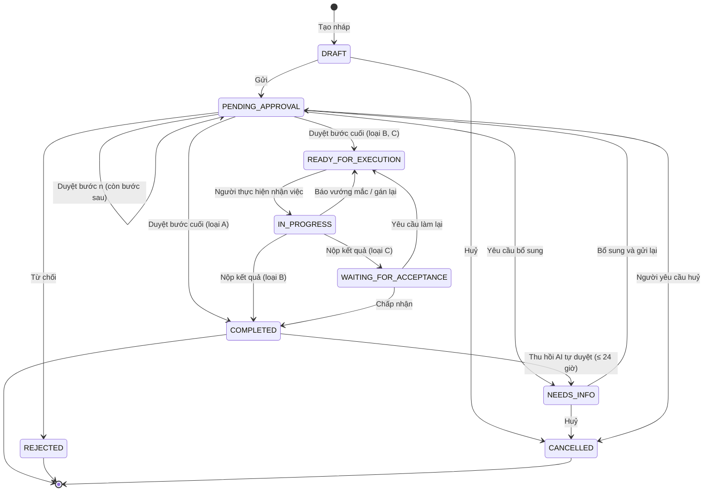

# Vòng đời yêu cầu A/B/C và cơ chế tự động gán người

| Thuộc tính | Giá trị |
|---|---|
| Trạng thái | BẢN THIẾT KẾ để chủ dự án đọc, chỉnh sửa và chốt |
| Ngày | 03/11/2026 |
| Phạm vi | Lõi nghiệp vụ: từ lúc tạo yêu cầu đến khi nghiệm thu/đóng hồ sơ; ai làm từng bước; hệ thống tự gán và tự điều chỉnh người xử lý |
| Liên quan | `docs/CHUC_NANG_UI_VA_PHAN_QUYEN.md` (giao diện, phân quyền) |

Cách đọc: mục 1 là ý của chủ dự án được làm rõ thành nguyên tắc. Mục 2–4 mô tả vòng đời đầy đủ. Mục 5 là thiết kế động cơ tự động gán (phần cốt lõi). Mục 8 so sánh với mã hiện tại và nêu lộ trình. Mục 10 là các câu hỏi cần chốt.

---

## 1. Làm rõ yêu cầu của chủ dự án

Diễn giải lại ý của chủ dự án thành 7 nguyên tắc thiết kế:

| # | Nguyên tắc | Ý nghĩa cụ thể |
|---|---|---|
| N1 | **Hệ thống tự gán người cho mọi giai đoạn** | Người tạo yêu cầu không chọn người duyệt. Admin không gán việc hằng ngày. Khi một giai đoạn bắt đầu, hệ thống tự xác định người xử lý. |
| N2 | **Tự điều chỉnh khi người được gán không có mặt** | "Không có mặt" = nghỉ phép, công tác, nghỉ ốm, ngoài giờ dài ngày, tài khoản bị khoá hoặc đã nghỉ việc. Hệ thống tự chuyển việc cho người thay thế hợp lệ, không chờ ai thao tác. |
| N3 | **Admin chỉ cấu hình, không vận hành** | Admin có thể **ghim**: "loại yêu cầu X ở bước Y luôn do phòng Z xử lý" hoặc "…luôn do người P duyệt". Admin cũng có quyền **điều chuyển khẩn** một hồ sơ cụ thể. Ngoài 2 việc đó, mọi phân công là tự động. |
| N4 | **Gán đúng lúc, không gán trước** | Người xử lý của một bước được quyết định khi bước đó bắt đầu, theo tình hình **thời điểm đó**. Không chốt sẵn cả tuyến lúc gửi, vì sau 2 ngày người đó có thể đã đi công tác. |
| N5 | **Không bao giờ phá vỡ kiểm soát** | Việc tự gán không được vi phạm tách biệt nhiệm vụ (SoD). Người tạo không tự duyệt. Một người không giữ hai bước duyệt của cùng hồ sơ. Người thực hiện không nghiệm thu. Người được gán phải đúng vai trò và đúng phạm vi. |
| N6 | **Mọi phân công phải giải thích được** | Mỗi lần gán hoặc gán lại đều ghi lý do và hiển thị cho người dùng. Ví dụ: "Giao cho Trần B vì Nguyễn A (Trưởng phòng Nhân sự) đang nghỉ phép 05–07/11". |
| N7 | **AI hỗ trợ, con người quyết định** | AI chấm rủi ro, đề xuất người phù hợp nhất và được tự duyệt các hồ sơ loại A rủi ro thấp đúng quy định. Mọi quyết định khác do người có thẩm quyền đưa ra. Quyết định của AI thu hồi được trong 24 giờ. |

> "AI tự gán người" trong tài liệu này nghĩa là **động cơ phân công có chấm điểm và giải thích được** (mục 5.5): tính theo sự có mặt, khối lượng việc, kinh nghiệm và độ đúng hạn. Mô hình ngôn ngữ (LLM) **không** quyết định ai được giao việc, vì quyết định phân công phải lặp lại được, kiểm toán được và không bị "ảo giác".

---

## 2. Các vai trò trong một hồ sơ

| Vai trò trong hồ sơ | Là ai | Được làm gì |
|---|---|---|
| Người yêu cầu | Nhân viên tạo hồ sơ | Tạo, sửa nháp, gửi, bổ sung khi được yêu cầu, huỷ trước khi duyệt xong. Ở loại C mặc định cũng là người nghiệm thu. |
| Người duyệt bước n | Do hệ thống gán (mục 5) | Duyệt / Từ chối / Yêu cầu bổ sung khi đến lượt mình. Từ chối và yêu cầu bổ sung bắt buộc nêu lý do. |
| Người thực hiện | Do hệ thống gán, người duyệt cuối có thể chọn lại | Nhận việc, báo vướng mắc, nộp kết quả kèm tệp. |
| Người nghiệm thu | Mặc định là người yêu cầu (loại C) | Chấp nhận, hoặc yêu cầu làm lại (bắt buộc lý do). |
| EAS AI (tài khoản hệ thống) | Không đăng nhập được | Chấm rủi ro mọi hồ sơ. Tự duyệt hồ sơ loại A rủi ro thấp đúng quy định. |
| Người được uỷ quyền | Người duyệt khác do người duyệt chỉ định trong khoảng thời gian (≤ 90 ngày) | Duyệt thay trong thời gian uỷ quyền. |
| Admin (`admin@eas.com`) | Quản trị hệ thống | Cấu hình quy tắc phân công (ghim). Điều chuyển khẩn. Không tạo, không duyệt yêu cầu nghiệp vụ. |

---

## 3. Vòng đời chung và ba loại quy trình

### 3.1 Trạng thái hồ sơ



Các chuyển trạng thái trên được **cơ sở dữ liệu cưỡng chế** (trigger `eas.guard_request`): mọi chuyển khác đều bị từ chối, kể cả khi gọi thẳng vào DB. Hồ sơ đã kết thúc (`COMPLETED`, `REJECTED`, `CANCELLED`) không sửa được. Ngoại lệ duy nhất là thu hồi AI tự duyệt trong 24 giờ.

Năm giai đoạn hiển thị cho người dùng:

| Giai đoạn | Trạng thái tương ứng |
|---|---|
| 1. Yêu cầu | `DRAFT`, `NEEDS_INFO` |
| 2. Phê duyệt | `PENDING_APPROVAL` |
| 3. Thực hiện | `READY_FOR_EXECUTION`, `IN_PROGRESS` |
| 4. Nghiệm thu | `WAITING_FOR_ACCEPTANCE` |
| 5. Hoàn thành | `COMPLETED` (và kết thúc khác: `REJECTED`, `CANCELLED`) |

### 3.2 Ba loại quy trình

| | Loại A — Chỉ phê duyệt | Loại B — Phê duyệt + thực hiện | Loại C — Phê duyệt + thực hiện + nghiệm thu |
|---|---|---|---|
| Ví dụ | Nghỉ phép, điều chỉnh chấm công, làm việc từ xa, thanh toán chi phí | Hỗ trợ CNTT, cấp tài khoản, công tác, tạm ứng, đóng dấu văn bản | Mua sắm thiết bị, cấp máy tính, hợp đồng, dự án, sửa chữa văn phòng |
| Giai đoạn | Yêu cầu → Phê duyệt (1–5 bước) → **Hoàn thành** | Yêu cầu → Phê duyệt → Thực hiện → **Hoàn thành** | Yêu cầu → Phê duyệt → Thực hiện → Nghiệm thu → **Hoàn thành** |
| Người duyệt | Hệ thống gán theo quy tắc của loại | Như A | Như A |
| Người thực hiện | — | Hệ thống gán (bộ phận chuyên trách) | Như B |
| Người nghiệm thu | — | — | Người yêu cầu (mặc định) |
| AI tự duyệt | **Được**, nếu rủi ro ≤ 2/5 và quy định không bắt buộc duyệt tay | Không | Không |
| SLA điển hình (cấu hình theo loại) | Duyệt 24 giờ | Duyệt 24 giờ + thực hiện 48 giờ | Duyệt + thực hiện + nghiệm thu, tổng khoảng 96 giờ |
| Hoàn thành khi | Bước duyệt cuối đồng ý | Người thực hiện nộp kết quả | Người nghiệm thu chấp nhận |

---

## 4. Từng bước trong vòng đời

Mỗi bước được mô tả theo cùng khuôn: **Ai làm · Hệ thống tự làm gì · Điều kiện · Kết quả · Thông báo**.

### Bước 0 — Cấu hình (một lần, do admin)
- **Ai làm:** Admin, trong mục "Yêu cầu & Quy trình".
- **Nội dung:** Với mỗi loại yêu cầu, admin cấu hình biểu mẫu, phân loại A/B/C, SLA từng giai đoạn và **tuyến duyệt**. Tuyến duyệt mô tả bằng *vị trí* chứ không bằng *tên người*: "Quản lý trực tiếp → Trưởng phòng Nhân sự", và "từ 50 triệu thêm Ban giám đốc". Admin cũng cấu hình bộ phận thực hiện và các **ghim** (mục 5.2), nếu có.
- **Kết quả:** Một phiên bản cấu hình được kiểm tra rồi công bố. Hồ sơ gửi sau thời điểm công bố dùng phiên bản mới. Hồ sơ đang chạy giữ nguyên phiên bản cũ.

### Bước 1 — Tạo nháp
- **Ai làm:** Người yêu cầu.
- **Hệ thống:** Chỉ hiện các loại yêu cầu mà người đó được phép tạo. Loại phụ thuộc hệ thống tích hợp đang bị tắt (ví dụ API Nhân sự) bị khoá kèm lý do.
- **Kết quả:** `DRAFT`. Người yêu cầu được sửa tự do.

### Bước 2 — Gửi yêu cầu
- **Ai làm:** Người yêu cầu (có bước xác nhận trước khi gửi).
- **Hệ thống tự làm, trong cùng một giao dịch:**
  1. Kiểm tra biểu mẫu, quyền tạo, tích hợp còn bật.
  2. Chụp **phiên bản nội dung** (revision) và phiên bản cấu hình đang áp dụng. Nội dung đã gửi không đổi được nữa; mỗi lần bổ sung là một phiên bản mới.
  3. **AI chấm rủi ro** từ 1 đến 5, theo số tiền, số ngày, loại yêu cầu và lịch sử.
  4. **Chọn tuyến duyệt** theo cấu hình. Ví dụ: tạm ứng trên 50 triệu thì thêm bước Ban giám đốc.
  5. **Gán người cho bước duyệt 1** theo động cơ ở mục 5. Các bước sau chưa gán (nguyên tắc N4).
- **Kết quả:** `PENDING_APPROVAL`; mở đồng hồ SLA của bước 1.
- **Thông báo:** Người duyệt bước 1 nhận "Có yêu cầu chờ bạn duyệt".

### Bước 3 — Phê duyệt (lặp cho từng bước 1…n)
- **Ai làm:** Người được hệ thống gán cho bước hiện tại, hoặc người được người đó uỷ quyền.
- **Hệ thống tự làm khi bước bắt đầu:** gán người theo mục 5, ghi lý do gán, mở đồng hồ SLA.
- **Ba lựa chọn của người duyệt:**

  | Lựa chọn | Kết quả |
  |---|---|
  | Duyệt | Còn bước sau: hệ thống **gán người cho bước kế tiếp tại thời điểm này** và hồ sơ vẫn ở giai đoạn Phê duyệt. Đây là bước cuối: loại A → `COMPLETED`; loại B/C → sang bước 4. |
  | Yêu cầu bổ sung (bắt buộc lý do) | `NEEDS_INFO`. Người yêu cầu sửa và gửi lại; tuyến duyệt chạy lại từ bước 1 với phiên bản nội dung mới. |
  | Từ chối (bắt buộc lý do) | `REJECTED` — kết thúc. |

- **AI tự duyệt (chỉ loại A):** Bước duyệt được giao cho tài khoản EAS AI khi đủ 3 điều kiện: rủi ro ≤ 2/5, không có luật nào trong quy định công ty buộc duyệt tay, và các kiểm tra nghiệp vụ đạt (ví dụ còn đủ ngày phép). AI duyệt ngay, hồ sơ mang huy hiệu "AI duyệt". Trong 24 giờ sau đó, bất kỳ người duyệt hợp lệ nào (khác người yêu cầu) có thể **thu hồi**: hồ sơ quay lại duyệt tay.
- **Đặc biệt — nghỉ phép / công tác:** Khi duyệt xong, hệ thống ghi lịch nghỉ/công tác. Trạng thái làm việc của người đó đổi ngay ("Nghỉ làm" / "Công tác"), và **động cơ gán dùng chính thông tin này** để không giao việc cho họ trong thời gian đó (mục 5.3).

### Bước 4 — Chọn người thực hiện (loại B, C)
- **Ai làm:** Hệ thống, ngay khi bước duyệt cuối đồng ý.
- **Hệ thống tự làm:** Lấy bộ phận thực hiện theo cấu hình loại yêu cầu (ví dụ Hỗ trợ CNTT → bộ phận CNTT), rồi chọn người trong bộ phận theo mục 5.5. Người duyệt cuối **được chọn lại** người thực hiện trong danh sách hợp lệ khi bấm Duyệt; khi đó hệ thống kiểm tra lại người được chọn có mặt và đúng phạm vi.
- **Kết quả:** `READY_FOR_EXECUTION`; mở SLA thực hiện. Người thực hiện nhận thông báo.

### Bước 5 — Thực hiện
- **Ai làm:** Người thực hiện được gán.
- **Thao tác:** **Nhận việc** → `IN_PROGRESS`. **Báo vướng mắc** (thiếu thông tin, ngoài khả năng) → hệ thống gán lại người khác trong bộ phận, hồ sơ về `READY_FOR_EXECUTION`. **Nộp kết quả** kèm tệp.
- **Kết quả:** Loại B → `COMPLETED`. Loại C → `WAITING_FOR_ACCEPTANCE`.

### Bước 6 — Nghiệm thu (loại C)
- **Ai làm:** Người nghiệm thu, mặc định là người yêu cầu.
- **Thao tác:** **Chấp nhận** → `COMPLETED`. **Yêu cầu làm lại** (bắt buộc lý do) → lượt thực hiện mới (`READY_FOR_EXECUTION`). Hệ thống gán lại người thực hiện theo mục 5.5, ưu tiên người đã làm lượt trước nếu người đó có mặt.
- **Ràng buộc:** Người thực hiện không được nghiệm thu chính kết quả của mình.

### Bước 7 — Kết thúc
- `COMPLETED`, `REJECTED`, `CANCELLED` là trạng thái cuối. Hồ sơ chỉ còn xem được, kèm toàn bộ lịch sử và nhật ký có chuỗi băm chống sửa.

### Nhánh phụ dùng chung
- **Huỷ:** Người yêu cầu huỷ được khi hồ sơ ở `DRAFT`, `NEEDS_INFO` hoặc `PENDING_APPROVAL`; bắt buộc nêu lý do.
- **Điều chuyển khẩn:** Admin chuyển một bước duyệt hoặc thực hiện đang mở cho người khác hợp lệ. Bắt buộc lý do; ghi nhật ký.
- **Nhắc hạn / quá hạn:** Xem mục 5.6.

---

## 5. Động cơ tự động gán người (cốt lõi)

### 5.1 Hệ thống cần gán cho những "vị trí" nào

Tuyến duyệt và bộ phận thực hiện được cấu hình bằng **vị trí**. Động cơ gán đổi vị trí thành **người cụ thể** tại thời điểm cần.

| Nhóm vị trí | Vị trí | Cách tìm người |
|---|---|---|
| Theo quan hệ | Quản lý trực tiếp | Cấp trên trực tiếp của người yêu cầu (`app_user.manager_id`) |
| Theo chức năng | Trưởng phòng Nhân sự, Trưởng phòng CNTT, Tài chính, Pháp chế, Ban giám đốc, Giám đốc Công nghệ, Giám đốc An ninh thông tin, Trưởng phòng Marketing / Vận hành / Mua sắm, Quản lý dự án, Quản lý kho, Bộ phận An ninh | Người đang giữ chức năng đó trong phòng ban phụ trách. Có thể là một người, hoặc một **nhóm** người cùng chức năng. |
| Thực hiện | Bộ phận CNTT, Tài sản, Hành chính, Tài chính, Nhân sự, Pháp chế, Marketing, Mua sắm, Kỹ thuật, Kho | Nhân viên có vai trò Người thực hiện trong bộ phận đó |
| Nghiệm thu | Người yêu cầu (mặc định); Quản lý trực tiếp, Quản lý dự án, Pháp chế, Giám đốc Công nghệ (tuỳ loại) | Như trên |

### 5.2 Thứ tự quyết định người — từ cụ thể đến chung

Với mỗi bước, động cơ đi theo thứ tự dưới đây và dừng ở mức đầu tiên tìm được người **hợp lệ và có mặt**:

| Mức | Nguồn | Ai đặt | Ví dụ |
|---|---|---|---|
| 1 | **Ghim người cụ thể** | Admin | "Hợp đồng > 500 triệu: bước Pháp chế luôn do Phan Anh Tuấn duyệt" |
| 2 | **Ghim phòng ban** | Admin | "Cấp quyền dữ liệu nhạy cảm: bước An ninh do phòng CNTT xử lý" → chọn người trong phòng theo 5.5 |
| 3 | **Quy tắc vị trí** (mặc định) | Cấu hình loại yêu cầu | Quản lý trực tiếp; Trưởng phòng Nhân sự của công ty |
| 4 | **Chuỗi thay thế** khi mức 1–3 không ai có mặt | Hệ thống | Mục 5.4 |
| 5 | **Leo thang cuối** | Hệ thống | Ban giám đốc. Nếu vẫn không ai hợp lệ: báo admin, hồ sơ đứng chờ, có cảnh báo |

Ghim có 2 kiểu:
- **Ghim cứng:** chỉ người hoặc phòng đó được xử lý. Nếu họ vắng, việc chờ họ quay lại; quá hạn thì báo admin. Dùng cho thẩm quyền pháp lý không được thay.
- **Ghim mềm** (mặc định): ưu tiên người hoặc phòng đó; vắng thì đi tiếp chuỗi thay thế.

### 5.3 Thế nào là "có mặt"

Một người **có mặt** cho một bước khi thoả **tất cả**:

1. Tài khoản đang hoạt động (không khoá, không nghỉ việc).
2. Không có **đơn nghỉ phép / nghỉ không lương / công tác đã duyệt** phủ thời điểm hiện tại. Nguồn là `eas.user_leave_and_trips`, chính là dữ liệu tạo nên trạng thái làm việc "Nghỉ làm" / "Công tác" trên giao diện.
3. Không bị chấm công **vắng** hôm nay trong hệ thống HRM (nếu tích hợp HRM đang bật).
4. Nếu bước có hạn SLA ngắn: người đó **không vắng trong phần lớn thời hạn SLA**. Ví dụ, nghỉ từ chiều nay đến hết tuần thì không giao việc hạn 24 giờ.

Một nguồn sự thật duy nhất: hàm `is_available(user, from, to)` dùng chung cho gán người duyệt, gán người thực hiện và hiển thị trạng thái làm việc. Không để mỗi chỗ một cách tính.

> Đi muộn / về sớm (nửa ngày) **không** làm người đó mất tư cách xử lý một bước có hạn nhiều giờ. Chỉ nghỉ cả ngày trở lên mới tính là vắng.

### 5.4 Chuỗi thay thế khi người được chọn vắng

| Thứ tự | Người thay | Áp dụng cho |
|---|---|---|
| a | **Người được uỷ quyền** mà chính người vắng đã chỉ định (đang trong thời gian uỷ quyền) | Bước duyệt |
| b | **Người cùng chức năng** trong cùng phòng (nhóm), chọn theo 5.5 | Duyệt theo chức năng; thực hiện |
| c | **Cấp trên trực tiếp** của người vắng | Bước duyệt |
| d | **Trưởng phòng** của phòng phụ trách | Bước duyệt |
| e | **Ban giám đốc** | Bước duyệt |

Mỗi ứng viên phải qua **bộ lọc hợp lệ** (mục 5.7) trước khi được nhận.

### 5.5 Chọn người trong một nhóm (chấm điểm có giải thích)

Khi có nhiều người hợp lệ và có mặt (một phòng, một nhóm chức năng), động cơ chấm điểm:

| Tiêu chí | Trọng số đề xuất | Ghi chú |
|---|---|---|
| Khối lượng việc đang mở (ít hơn → điểm cao) | 40% | Đếm bước duyệt đang chờ và việc thực hiện READY/RUNNING |
| Độ đúng hạn SLA 90 ngày gần nhất | 25% | Ưu tiên người xử lý đúng hạn |
| Kinh nghiệm cùng loại yêu cầu | 20% | Số hồ sơ cùng loại đã xử lý; người làm lượt trước được ưu tiên khi "làm lại" |
| Gần về tổ chức (cùng phòng / cùng nhánh với người yêu cầu) | 15% | |

- Bằng điểm thì chọn người được giao việc lâu nhất, để luân phiên.
- Kết quả lưu kèm điểm từng tiêu chí. Hồ sơ hiển thị dạng "Được gán cho Trần B — ít việc nhất nhóm (2 việc), đúng hạn 96%".
- Admin chỉnh được trọng số. Đây là chỗ "AI" có thể học dần: đề xuất trọng số từ dữ liệu lịch sử, admin duyệt rồi mới áp dụng.

### 5.6 Khi nào hệ thống gán và gán lại

| Thời điểm | Hệ thống làm gì |
|---|---|
| Bước bắt đầu | Gán người theo 5.2–5.5 |
| **Kiểm tra định kỳ (15 phút/lần)** | Với mọi bước đang mở: người đang giữ không còn có mặt (đơn nghỉ vừa được duyệt, tài khoản bị khoá, chấm công vắng) → **tự gán lại** theo chuỗi thay thế. Ngoại lệ: người đó đã bắt đầu làm (việc ở `IN_PROGRESS`) thì không gán lại. |
| Đơn nghỉ/công tác được duyệt | Ngay lúc đó, chuyển các bước đang chờ người này mà hết hạn trước ngày họ quay lại |
| Còn 50% thời hạn SLA | Nhắc người đang giữ |
| Quá hạn SLA | Báo người đang giữ và cấp trên của họ |
| Quá hạn SLA + 50% thời hạn | **Leo thang**: gán thêm hoặc chuyển cho cấp trên theo chuỗi 5.4 (cấu hình theo loại; mặc định chỉ báo, không tự chuyển) |
| Người được giao nghỉ việc | Tự gán lại mọi việc đang mở của người đó |

### 5.7 Bộ lọc hợp lệ — không bao giờ vi phạm

Một ứng viên chỉ được nhận nếu thoả **tất cả**:

1. Có đúng vai trò (Người phê duyệt / Người thực hiện / Người nghiệm thu) và **đúng phạm vi** (phòng ban, loại yêu cầu) còn hiệu lực.
2. **Không phải người yêu cầu** (trừ vị trí Người nghiệm thu = người yêu cầu).
3. **Chưa giữ bước duyệt nào khác** của cùng hồ sơ: một người không duyệt hai lần.
4. Người thực hiện **không phải người đã duyệt** hồ sơ đó; người nghiệm thu **không phải người thực hiện**.
5. Không phải tài khoản quản trị, không phải tài khoản hệ thống (riêng EAS AI chỉ nhận bước duyệt loại A theo bước 3).

Cơ sở dữ liệu cưỡng chế lại các ràng buộc 3–4 bằng trigger, nên ngay cả lỗi phần mềm cũng không tạo ra phân công sai.

### 5.8 Minh bạch và kiểm toán

- Mỗi lần gán hoặc gán lại tạo một sự kiện nhật ký: bước, người cũ, người mới, lý do (`DELEGATED`, `ON_LEAVE`, `ON_TRIP`, `ABSENT_HRM`, `INACTIVE`, `SLA_ESCALATED`, `PINNED`, `SCORED`, `MANUAL_REASSIGN`), điểm chấm.
- Tab "Tiến độ" của hồ sơ hiển thị ai đang giữ từng bước, vì sao, và lịch sử thay đổi.
- Người bị lấy lại việc nhận thông báo. Người được giao nhận thông báo kèm lý do.

---

## 6. Admin trong vòng đời

| Việc | Ở đâu | Ghi chú |
|---|---|---|
| Cấu hình tuyến duyệt theo vị trí, SLA, bộ phận thực hiện | Yêu cầu & Quy trình → Phiên bản cấu hình | Soạn → kiểm tra → công bố; có lịch sử phiên bản |
| **Ghim** người/phòng cho một loại yêu cầu ở một bước (cứng/mềm, có thời hạn) | Yêu cầu & Quy trình → **Phân công** (tab mới) | Danh sách ghim, ai tạo, hiệu lực đến khi nào |
| Chỉnh trọng số chấm điểm | Phân công → Cài đặt | Có giá trị mặc định (5.5) |
| Điều chuyển khẩn một hồ sơ | Tổng quan → Vận hành | Bắt buộc lý do |
| Xem hồ sơ đứng chờ vì không có người hợp lệ | Tổng quan → Vận hành | Có cảnh báo trên Tổng quan |

Admin **không** tạo, duyệt, thực hiện hay nghiệm thu hồ sơ nghiệp vụ.

---

## 7. AI ở đâu trong vòng đời

| Điểm | AI làm gì | Quyết định cuối |
|---|---|---|
| Gửi yêu cầu | Chấm rủi ro 1–5; tóm tắt nội dung cho người duyệt | Thông tin tham khảo |
| Phê duyệt loại A | Tự duyệt khi đủ điều kiện (bước 3) | AI; người duyệt thu hồi được trong 24 giờ |
| Phê duyệt loại B/C | Gợi ý "nên duyệt / cần xem kỹ" kèm lý do theo quy định | Con người |
| Phân công | Chấm điểm và giải thích (5.5); đề xuất trọng số từ lịch sử | Động cơ quy tắc; trọng số do admin duyệt |
| Quy định thay đổi | Học lại bộ luật; khoá cổng nhân viên đến khi áp dụng xong | Như hiện tại |

---

## 8. Hiện trạng mã so với thiết kế

| Hạng mục | Đã có | Còn thiếu |
|---|---|---|
| Máy trạng thái A/B/C, SoD ở DB | Có (`eas.guard_request` và các trigger SoD) | — |
| Tuyến duyệt theo điều kiện (số tiền, số ngày, mã ứng dụng) | Có (`api_core/domain/routing.py`) | — |
| Quản lý trực tiếp | Động theo `manager_id` | — |
| Vị trí theo chức năng (Trưởng phòng Nhân sự…) | **Ghim cứng một người cho mỗi phòng** trong `actor_bindings` của phiên bản cấu hình | Nhóm người cùng chức năng; tìm theo chức năng; chuyển ghim ra bảng riêng cho admin chỉnh (5.2) |
| Gán đúng lúc | Bước sau chỉ kích hoạt khi bước trước xong | Người của các bước sau đang được **chốt từ lúc gửi**; cần quyết định lại khi bước kích hoạt (N4) |
| Thay người vắng | Có cho bước duyệt (uỷ quyền → cấp trên) và người thực hiện (người cùng phòng ít việc nhất) | Chỉ kiểm tra **khi bước bắt đầu**; nguồn vắng mặt là **chấm công HRM giả lập**, chưa dùng đơn nghỉ/công tác đã duyệt; thiếu bậc trưởng phòng → Ban giám đốc |
| Gán lại định kỳ khi vắng giữa chừng | Không | Thêm vào worker (5.6) |
| Leo thang khi quá hạn | Chỉ gửi nhắc / báo quá hạn | Tự leo thang theo cấu hình (5.6) |
| Chấm điểm nhóm | Chỉ tiêu chí "ít việc nhất" cho người thực hiện | Đủ 4 tiêu chí, có giải thích (5.5) |
| AI tự duyệt loại A + thu hồi 24 giờ | Có | — |
| Duyệt nghỉ phép → trạng thái làm việc | Có (`leave_sync.py`) | Dùng làm nguồn "có mặt" cho động cơ gán |
| Ghi lý do thay người | Có sự kiện `APPROVER_SUBSTITUTED` | Hiển thị lý do trên tab Tiến độ; thêm các mã lý do 5.8 |

### 8.1 Lộ trình triển khai đề xuất

| Đợt | Nội dung | Kết quả kiểm chứng |
|---|---|---|
| 1 | Hàm `is_available()` duy nhất (đơn nghỉ/công tác + HRM + tài khoản); động cơ gán dùng hàm này | Nhân viên có đơn nghỉ đã duyệt hôm nay không nhận việc mới |
| 2 | Gán đúng lúc cho mọi bước; chuỗi thay thế đủ bậc a–e | Đổi trưởng phòng giữa 2 bước → bước sau tới người mới |
| 3 | Worker kiểm tra 15 phút/lần + gán lại khi đơn nghỉ được duyệt | Duyệt đơn nghỉ của người đang giữ việc → việc chuyển trong ≤ 15 phút, có lý do |
| 4 | Bảng ghim (người/phòng, cứng/mềm, thời hạn) + tab "Phân công" cho admin | Admin ghim, hồ sơ mới đi đúng người/phòng |
| 5 | Chấm điểm 4 tiêu chí + hiển thị lý do + leo thang quá hạn theo cấu hình | Hồ sơ hiển thị "vì sao là người này"; quá hạn tự leo thang |

Đề xuất cấu trúc dữ liệu cho ghim (đợt 4):

```sql
-- eas.assignment_rule: ghim phân công do admin đặt
id uuid PK, type_id uuid NULL (NULL = mọi loại), slot varchar(40) NOT NULL,
department_id uuid NULL,            -- ghim phòng ban (chọn người trong phòng theo điểm)
user_id uuid NULL,                  -- ghim người cụ thể
strict boolean NOT NULL DEFAULT false,   -- cứng: không thay khi vắng
priority smallint NOT NULL DEFAULT 100,
valid_from timestamptz NOT NULL, valid_to timestamptz NULL,
created_by uuid NOT NULL, reason text NOT NULL,
CHECK (num_nonnulls(department_id, user_id) = 1)
```

---

## 9. Ví dụ đi trọn vòng đời

**Loại A — Nghỉ phép 2 ngày (Lan, phòng Tài chính).**
1. Lan gửi đơn. AI chấm rủi ro 1/5. Quy định không bắt buộc duyệt tay. Kiểm tra quỹ phép đạt. AI tự duyệt, hồ sơ `COMPLETED`.
2. Hệ thống ghi lịch nghỉ: trạng thái làm việc của Lan thành "Nghỉ làm" trong 2 ngày đó.
3. Trong 2 ngày đó, mọi việc mới cần Lan xử lý được gán cho người khác. Việc Lan đang giữ nhưng chưa bắt đầu được chuyển, có lý do "Nguyễn Lan nghỉ phép 05–06/11".

**Loại B — Hỗ trợ CNTT (Trọng, phòng Kinh doanh).**
1. Gửi: tuyến "Quản lý trực tiếp". Quản lý trực tiếp của Trọng đang công tác và đã uỷ quyền cho Phó phòng, nên bước duyệt giao cho Phó phòng, lý do "Uỷ quyền".
2. Phó phòng duyệt. Bộ phận thực hiện là CNTT, 3 người có mặt. Hệ thống chọn người ít việc nhất, đúng hạn 98%.
3. Người thực hiện nhận việc rồi nộp kết quả: `COMPLETED`.

**Loại C — Mua máy tính 60 triệu (Hà, trưởng nhóm phòng Công nghệ).**
1. Gửi: số tiền trên 50 triệu nên tuyến là "Quản lý trực tiếp → Tài chính → Ban giám đốc". Bước 1 gán cho Quản lý trực tiếp.
2. Bước 1 duyệt. Bước 2 kích hoạt **lúc này**: Trưởng phòng Tài chính nghỉ ốm hôm nay (HRM) và không uỷ quyền, nên chuyển cho người cùng chức năng trong phòng Tài chính.
3. Bước 3 (Ban giám đốc) duyệt. Bộ phận thực hiện Mua sắm chọn người. Người thực hiện nộp kết quả, hồ sơ chờ nghiệm thu.
4. Hà nghiệm thu, yêu cầu làm lại vì sai cấu hình. Lượt thực hiện mới ưu tiên người cũ (đang có mặt). Nộp lại, Hà chấp nhận: `COMPLETED`.

---

## 10. Câu hỏi cần chủ dự án chốt

1. **Ghim mặc định là mềm?** (đề xuất: mềm; chỉ dùng cứng cho thẩm quyền pháp lý như ký hợp đồng.)
2. **Quá hạn SLA có tự chuyển việc không**, hay chỉ báo? (đề xuất: mặc định chỉ báo; bật tự leo thang theo từng loại yêu cầu.)
3. **Người nghiệm thu vắng dài ngày** (loại C): chờ, hay chuyển cho Quản lý trực tiếp của người yêu cầu sau khi quá hạn? (đề xuất: chuyển sau khi quá hạn.)
4. **Trọng số chấm điểm** ở 5.5 có hợp lý không?
5. **Nghỉ nửa ngày** có tính là vắng với bước có hạn dưới 8 giờ không? (đề xuất: có.)
6. **"AI tự gán"** theo nghĩa động cơ chấm điểm có giải thích (mục 1) đúng với mong muốn chưa, hay chủ dự án muốn AI có quyền tự quyết nhiều hơn?
