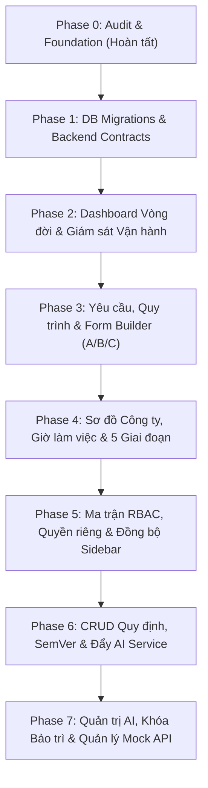

# Kế hoạch Triển khai: Nâng cấp Toàn diện 9 Chức năng Quản trị EAS (7 Phases)

| Thuộc tính | Giá trị |
|---|---|
| **Mã kế hoạch** | `EAS-PLAN-2026-11-03-01` |
| **Ngày khởi tạo** | 03/11/2026 |
| **Trạng thái** | `ACTIVE` (Giai đoạn hiện tại: Phase 0 - Hoàn tất Audit) |
| **Nhánh Git** | `huy` |
| **Vai trò** | Senior Fullstack Developer, Data Engineer, AI Engineer, UI/UX Designer |
| **Phạm vi** | `web_admin/`, `web_client/`, `api_core/`, `ai_service/`, `supabase/migrations/` |
| **Nguyên tắc an toàn** | **ZERO-DESTRUCTION RULES**: Không xóa file, không DROP TABLE/TRUNCATE, không xóa dữ liệu không điều kiện, bảo toàn 100% logic đang chạy |

---

## 1. TỔNG QUAN KIẾN TRÚC & KẾT QUẢ AUDIT (PHASE 0)

### 1.1 Cấu trúc hiện tại của `web_admin` và `web_client`
- **Framework & Công nghệ**:
  - React 19 (`19.3.0`) + Vite 8 (`8.3.4`).
  - Thiết kế UI: Pure CSS Design System theo token doanh nghiệp (`design-system.css`, `eas-enhancements.css`, `styles.css`), không phụ thuộc thư viện UI bên ngoài (không dùng Tailwind, MUI, AntD), đảm bảo tốc độ tải cực nhanh và kích thước bundle tối ưu.
  - Cấu trúc Code-Splitting: `web_admin` tái sử dụng `App.jsx` từ `web_client` với cờ `portal="admin"` và tiêm danh sách màn hình quản trị thông qua `AdminScreensContext` (`adminScreens.jsx`). Nhờ đó, người dùng thông thường tại `web_client` hoàn toàn không bị tải dư mã nguồn quản trị (bundle client chỉ ~303 KB gzipped).
- **Cơ chế kết nối & Xác thực Supabase / Database**:
  - Trình duyệt (`web_client` & `web_admin`) **tuyệt đối không kết nối trực tiếp đến Supabase qua Supabase Client SDK**, tuân thủ nghiêm ngặt nguyên tắc bảo mật trong `AGENTS.md`.
  - Mọi giao tiếp đi qua Django Backend API (`api_core`) tại cổng `8000` thông qua `api.js` bằng Session Cookie bảo mật (`httpOnly`, `SameSite=Lax`, `secure` ở production) kết hợp mã bảo vệ CSRF (`X-CSRFToken`).
  - Phía Database (PostgreSQL / Supabase): Bảng trong schema `eas.*` và `mock_*` đều bật Row Level Security (RLS) với chính sách được phân quyền chặt chẽ cho vai trò backend chuyên dụng (`eas_api`, `eas_worker`, `eas_privacy`, `eas_backup`). Quyền hạn cụ thể của người dùng được kiểm soát tại tầng ứng dụng (`require_actor`, `rolePolicy.js`, điều kiện sở hữu dữ liệu).

### 1.2 Đánh giá hiện trạng 9 Chức năng Quản trị
1. **Tổng quan (Dashboard)**:
   - *Hiện trạng*: Đã có `AdminDashboard` gọi `/api/v1/admin/overview` và `/api/v1/admin/diagnostics`.
   - *Điểm cần nâng cấp*: Chưa tổng hợp số liệu theo 3 nhóm vòng đời nghiệp vụ (A - Tự động/Đơn cấp, B - Đa cấp 5 giai đoạn, C - Hội đồng rủi ro cao); thiếu widget cảnh báo điểm nghẽn SLA theo thời gian thực; chưa có banner đồng bộ trạng thái bảo trì/huấn luyện AI.
2. **Yêu cầu & Quy trình (Phân loại A/B/C, mẫu form, trọng số)**:
   - *Hiện trạng*: Đã có danh mục 10 nhóm / 58 loại (`catalog_v2.json`, `eas.request_type`) hiển thị ở `PlanCatalog.jsx`.
   - *Điểm cần nâng cấp*: Chưa có giao diện Admin CRUD mẫu biểu động (Form schema JSON), cấu hình phân loại vòng đời A/B/C và điều chỉnh trọng số rủi ro/mức phê duyệt trực quan.
3. **Sơ đồ công ty (Org chart)**:
   - *Hiện trạng*: `OrgChart.jsx` hiển thị cây phân cấp ban giám đốc và phòng ban dựa trên `eas.department` và `eas.app_user`.
   - *Điểm cần nâng cấp*: Chưa tích hợp trạng thái làm việc trực tuyến/trong ca của nhân sự trên từng thẻ; thiếu thao tác điều chuyển phòng ban nhanh chóng cho nhà quản trị.
4. **Người dùng (Quản lý user, trạng thái làm việc 8h-17h30, thống kê 5 giai đoạn)**:
   - *Hiện trạng*: `IdentityAdmin.jsx` hỗ trợ CRUD người dùng, kích hoạt/vô hiệu hóa, đặt lại mật khẩu.
   - *Điểm cần nâng cấp*: Chưa hiển thị trạng thái giờ làm việc (08:00 - 17:30 VN, thứ 2 đến thứ 6) kết hợp dữ liệu chấm công `mock_hr.attendance`; API chưa trả về aggregated stats 5 giai đoạn yêu cầu (Bản nháp, Chờ duyệt, Đang thực hiện, Chờ nghiệm thu, Hoàn tất) theo từng nhân sự.
5. **Phân quyền (Ma trận RBAC + Cấp quyền riêng từng user + Đồng bộ ẩn/hiện Sidebar `web_client`)**:
   - *Hiện trạng*: Hệ thống quản lý 7 roles qua `eas.role_membership`; client kiểm tra qua `rolePolicy.js` và cập nhật bằng `sessionRefresh.js` (`eas:permissions-changed`).
   - *Điểm cần nâng cấp*: Cần bảng lưu trữ phân quyền năng lực riêng lẻ cho từng User (`eas.user_capability`); giao diện ma trận phân quyền tương tác trực tiếp; cơ chế thông báo cập nhật tức thời giúp Sidebar trên `web_client` ẩn/hiện ngay khi Admin đổi quyền mà không cần đăng xuất.
6. **Quy định (CRUD quy định + Semantic Versioning Major/Minor + Đẩy sang `ai_service`)**:
   - *Hiện trạng*: Bảng `eas.ai_policy_version` lưu JSON quy chế; có endpoint kích hoạt và đẩy sang FastAPI `ai_service` (`/ai/policy/rules`).
   - *Điểm cần nâng cấp*: `AiPolicyAdmin.jsx` mới chỉ cho upload raw JSON; cần giao diện Form Builder CRUD từng điều luật (loại yêu cầu, ngưỡng tiền, số ngày, cấp rủi ro, auto-approve); quy chuẩn phân định Semantic Versioning Major (thay đổi luật phê duyệt cốt lõi) vs Minor (thay đổi tham số/ngưỡng).
7. **Quản trị AI (Provider/Model, tiến trình học quy định mới, tự động khóa/đá user khỏi `web_client` khi đang học)**:
   - *Hiện trạng*: `ai_service` có pipeline huấn luyện và đánh giá rủi ro; `api_core/maintenance.py` đã có cấu trúc cache bảo trì nhưng chưa được kích hoạt thành endpoint hay cắm middleware.
   - *Điểm cần nâng cấp*: Admin UI chọn AI Provider/Model (Google Gemini, OpenAI, Local Scikit-learn Pipeline); kích hoạt và giám sát tiến trình học; kích hoạt cờ bảo trì toàn hệ thống khiến `web_client` tự động khóa hoặc đăng xuất người dùng không phận sự kèm thông báo rõ ràng cho đến khi AI hoàn tất việc học.
8. **Quản lý API (Bật/tắt các Mock API trong Supabase và khóa yêu cầu liên quan khi tắt)**:
   - *Hiện trạng*: `ApiAdministration.jsx` hiển thị danh mục API tĩnh và ma trận truy cập.
   - *Điểm cần nâng cấp*: Tạo bảng `eas.system_api_service` lưu trạng thái bật/tắt của 8 mock services (`mock_hr`, `mock_assets`, `mock_facilities`, `mock_crm`, `mock_procurement`, `mock_it`, `mock_finance`, `mock_travel`); xây dựng cơ chế tự động khóa tạo/xử lý hồ sơ liên quan khi một mock service bị tắt; giao diện Admin toggle an toàn.
9. **Phiên bản hệ thống (Changelog/Audit log toàn hệ thống)**:
   - *Hiện trạng*: Đã có `eas.admin_event` và `eas.audit_log`.
   - *Điểm cần nâng cấp*: Trang hiển thị Lịch sử phiên bản hệ thống (Changelog) thống nhất: liên kết Database migrations, AI policy releases, cập nhật cấu hình hệ thống và audit logs theo dòng thời gian trực quan.

---

## 2. KẾ HOẠCH TRIỂN KHAI CHI TIẾT 7 GIAI ĐOẠN TIẾP THEO

### Phase 1: Database Schema Expansion, Safe Migrations & Core Backend Contracts
- **Mục tiêu**: Bổ sung cấu trúc dữ liệu trên Supabase/PostgreSQL và xây dựng các API hợp đồng cốt lõi, bảo đảm tuyệt đối không ảnh hưởng đến dữ liệu cũ.
- **Nội dung công việc**:
  1. Viết migration an toàn trong `supabase/migrations/`:
     - Bảng `eas.system_api_service`: Quản lý trạng thái 8 Mock APIs (`service_key`, `name`, `is_enabled`, `description`, `updated_at`, `updated_by`).
     - Bảng `eas.user_capability`: Lưu trữ quyền hạn bổ sung riêng biệt theo từng User (`user_id`, `capability_key`, `is_granted`, `granted_at`).
     - Cập nhật an toàn bảng `eas.request_type`: Thêm trường `form_schema` (JSONB) và `sla_hours` với điều kiện `IF NOT EXISTS`.
  2. Xây dựng Service & Views trong `api_core`:
     - Quản trị trạng thái API Services: `GET /api/v1/admin/api-services`, `PATCH /api/v1/admin/api-services/<key>`.
     - Quản trị User Capabilities: `GET /api/v1/admin/users/<id>/capabilities`, `PATCH /api/v1/admin/users/<id>/capabilities`.
     - Cập nhật truy vấn `system_overview` và `users` để hỗ trợ thống kê 5 giai đoạn.
  3. Kiểm thử an toàn: Kiểm tra migration idempotent, xác nhận RLS và chạy test backend.

### Phase 2: Admin Dashboard Tổng quan & Hệ thống Giám sát Vòng đời A/B/C
- **Mục tiêu**: Nâng cấp màn hình Tổng quan thành trung tâm điều hành thời gian thực.
- **Nội dung công việc**:
  1. Frontend `AdminDashboard`:
     - Thêm nhóm số liệu phân loại vòng đời A (Duyệt nhanh/Tự động), B (Quy trình 5 bước), C (Hội đồng/Rủi ro cao).
     - Widget cảnh báo thời gian thực: Danh sách hồ sơ quá hạn SLA, hồ sơ đang chờ duyệt lâu nhất.
     - Widget trạng thái hoạt động của các dịch vụ Mock API và trạng thái học của AI.
  2. Tối ưu trải nghiệm: Đồ thị trạng thái phản hồi nhanh, bộ lọc linh hoạt theo phòng ban và khoảng thời gian.

### Phase 3: Quản lý Yêu cầu & Quy trình Nâng cao (Phân loại A/B/C, Form Builder, Trọng số)
- **Mục tiêu**: Cung cấp công cụ toàn diện để cấu hình danh mục yêu cầu mà không cần can thiệp mã nguồn.
- **Nội dung công việc**:
  1. Nâng cấp `PlanCatalog.jsx`:
     - Bổ sung tab/chế độ Quản trị Yêu cầu (`RequestTypeAdmin`).
     - Form Builder: Trực quan hóa cấu trúc trường nhập liệu (Schema JSON), cho phép bật/tắt trường bắt buộc, nhãn hiển thị, thứ tự trường.
     - Bộ cấu hình Vòng đời A/B/C: Điều chỉnh số cấp duyệt tối đa, điều kiện kích hoạt duyệt hội đồng hoặc tự động.
     - Cấu hình trọng số rủi ro (Risk Weight 1-5) và mức độ ưu tiên xử lý.
  2. Backend: Tích hợp kiểm tra tính toàn vẹn, ghi nhật ký kiểm toán quản trị (`eas.admin_event`) cho mọi thay đổi cấu hình loại yêu cầu.

### Phase 4: Sơ đồ Công ty & Quản lý Người dùng (Giờ làm việc 8h-17h30 + Thống kê 5 Giai đoạn)
- **Mục tiêu**: Quản trị nhân sự gắn liền với hoạt động vận hành và quy chuẩn làm việc thực tế.
- **Nội dung công việc**:
  1. Sơ đồ Công ty (`OrgChart.jsx`):
     - Hiển thị tổng số nhân sự trên từng phòng ban (Headcount badge).
     - Trạng thái ca làm việc (Trong ca / Ngoài ca / Đã điểm danh) trực tiếp trên từng thẻ nhân sự.
     - Thao tác nhanh cho Admin: Chọn nhân viên và điều chuyển phòng ban trực tiếp.
  2. Quản lý Người dùng (`IdentityAdmin.jsx`):
     - Thêm cột & bộ lọc: Trạng thái làm việc thực tế (08:00 - 17:30 VN, thứ 2 đến thứ 6) kết hợp dữ liệu chấm công từ `mock_hr.attendance`.
     - Thẻ thống kê 5 giai đoạn cho từng nhân sự: Bản nháp, Chờ duyệt, Đang thực hiện, Chờ nghiệm thu, Đã hoàn tất.
     - Bổ sung bộ lọc tìm kiếm người dùng theo phòng ban, trạng thái làm việc và khối lượng công việc.

### Phase 5: Ma trận Phân quyền RBAC, Cấp quyền Riêng biệt & Đồng bộ Sidebar Client
- **Mục tiêu**: Hệ thống phân quyền động, trực quan và đồng bộ tức thì giữa Admin và Client.
- **Nội dung công việc**:
  1. Giao diện Ma trận Phân quyền (`RolePermissionMatrix`):
     - Lưới trực quan 7 vai trò × các quyền hạn nghiệp vụ cốt lõi.
     - Cấp quyền riêng biệt (User Custom Capabilities): Giao diện tìm kiếm người dùng và tích chọn quyền riêng lẻ (ví dụ: `special_approval`, `extended_audit_view`, `bypass_department_scope`).
  2. Cơ chế Đồng bộ Sidebar `web_client`:
     - Khi Admin thay đổi vai trò hoặc cấp quyền riêng cho người dùng, backend cập nhật `auth_version` hoặc phát sự kiện.
     - `web_client` định kỳ kiểm tra hoặc lắng nghe tín hiệu làm mới phiên làm việc; lập tức ẩn/hiện các tab trên Sidebar theo quyền hạn mới mà không cần F5 hay đăng xuất.

### Phase 6: Quản trị Quy định Nghiệp vụ (CRUD Rules, SemVer Major/Minor, Đẩy AI Service)
- **Mục tiêu**: Quản lý bộ luật quy chế doanh nghiệp có phiên bản và đồng bộ tức thì sang AI Service.
- **Nội dung công việc**:
  1. Giao diện `AiPolicyAdmin.jsx`:
     - Chuyển đổi từ tải file JSON thô sang Trình dựng quy tắc trực quan (Visual Rule Builder).
     - Cho phép thêm mới, sửa, xóa từng Rule với các điều kiện: Loại yêu cầu, ngưỡng số tiền (`amount_gt`), số ngày (`days_gt`), mức rủi ro tối thiểu (`min_risk`), cờ tự động phê duyệt (`auto_approve`).
  2. Quy chuẩn Phiên bản Semantic Versioning:
     - Major: Tự động đề xuất tăng phiên bản Major khi có thay đổi cấu trúc cốt lõi (thay đổi cơ chế auto-approve, bổ sung điều kiện loại trừ lớn).
     - Minor: Tự động đề xuất tăng phiên bản Minor khi chỉ tinh chỉnh tham số ngưỡng tiền hoặc số ngày.
  3. Đồng bộ AI Service:
     - Dry-run validation kiểm tra bộ luật trước khi công bố.
     - Đẩy tự động sang `ai_service` qua endpoint `POST /ai/policy/rules` kèm báo cáo trạng thái thành công/thất bại theo thời gian thực.

### Phase 7: Quản trị AI, Khóa Bảo trì Hệ thống & Quản lý Mock API
- **Mục tiêu**: Làm chủ cấu hình AI, điều khiển Mock APIs và bảo vệ dữ liệu hệ thống trong thời gian huấn luyện.
- **Nội dung công việc**:
  1. Quản trị AI:
     - Màn hình chọn AI Provider & Model (Google Gemini, OpenAI, Local Pipeline).
     - Nút kích hoạt tiến trình học quy định mới (`enterprise_policy_ai_pipeline.py`) và thanh tiến trình hiển thị tỷ lệ % hoàn thành.
  2. Khóa bảo trì & Tự động đá người dùng:
     - Kích hoạt middleware `api_core/maintenance.py`: Khi AI đang học, hệ thống tự động trả về trạng thái bảo trì cho các endpoint của người dùng thông thường.
     - `web_client`: Tự động nhận tín hiệu bảo trì, hiển thị toàn màn hình thông báo *"Hệ thống đang cập nhật quy định và huấn luyện AI, vui lòng quay lại sau..."* và tạm thời vô hiệu hóa thao tác của nhân viên. Quản trị viên (`OPS_ADMIN`) vẫn giữ quyền truy cập `web_admin` để theo dõi tiến độ.
     - Sau khi AI học xong, hệ thống tự động mở lại trạng thái hoạt động bình thường cho toàn bộ nhân viên.
  3. Quản lý Mock API & Khóa yêu cầu liên quan:
     - Giao diện Admin toggle bật/tắt 8 Mock Services.
     - Tích hợp logic ràng buộc: Khi tắt một Mock Service (ví dụ Mock HR), mọi yêu cầu thuộc loại tương ứng (Nghỉ phép, Công tác, Nhân sự) sẽ tự động bị KHÓA không cho tạo mới hoặc xử lý, hiển thị cảnh báo dịch vụ tích hợp đang tạm ngừng.
  4. Nhật ký Phiên bản Hệ thống (Changelog):
     - Giao diện dòng thời gian thống nhất ghi nhận: Lịch sử migration cơ sở dữ liệu, các bản phát hành quy chế AI, thay đổi cấu hình bảo trì và nhật ký thao tác quản trị.

---

## 3. RÀNG BUỘC KIỂM THỬ VÀ NGHIỆM THU (QUALITY GATES)

Mọi Phase khi thực hiện bắt buộc phải vượt qua toàn bộ các cổng kiểm định sau trước khi báo cáo hoàn thành:
1. **Secret Gate**: `python scripts/check_repository_secrets.py` (0 leak).
2. **Docs Gate**: `python scripts/validate_docs.py` (0 link gãy).
3. **Environment Gate**: `python scripts/validate_env.py --allow-placeholders`.
4. **Linter & Formatter**: `ruff check` và `ruff format` 100% sạch; ESLint `web_client` 0 error.
5. **Automated Tests**: Toàn bộ unit tests và E2E tests (`npm test` client, `python manage.py test`) 100% PASS.
6. **Zero-Destruction**: Không làm mất mát hoặc gián đoạn bất kỳ tính năng cũ nào của cả `web_client` và `web_admin`.

