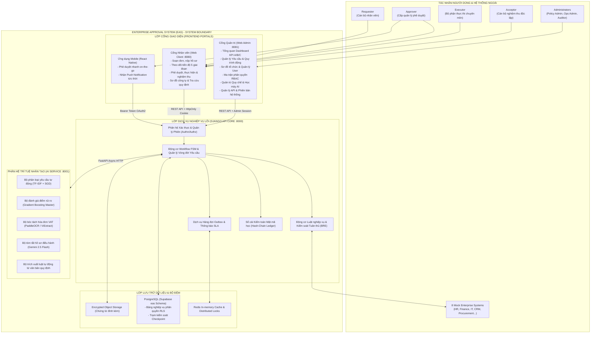
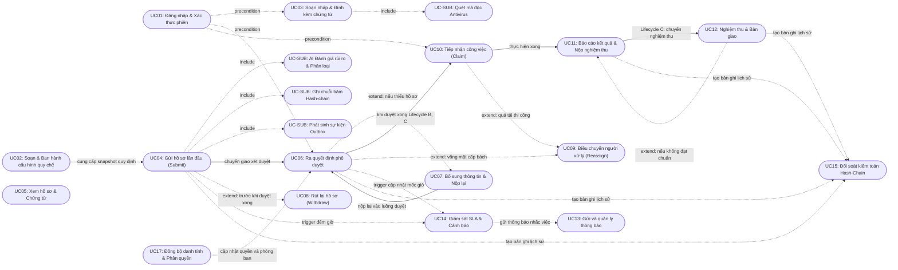
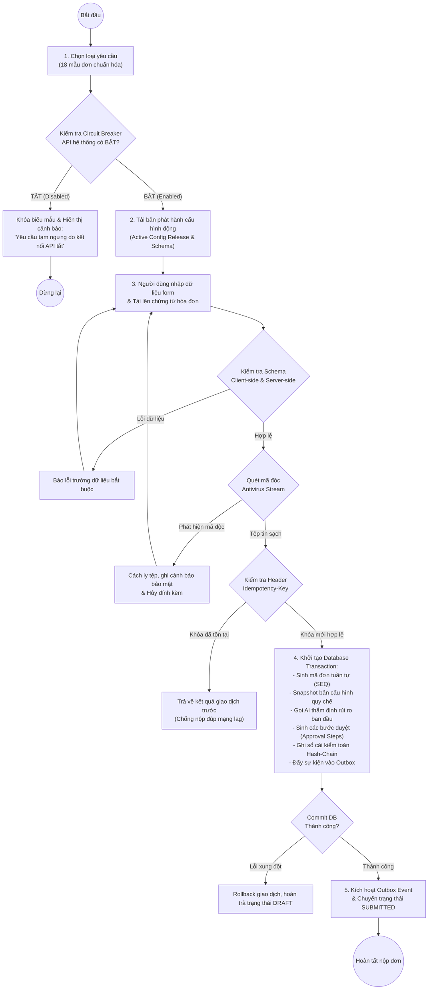
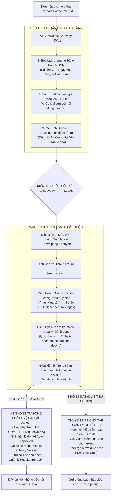
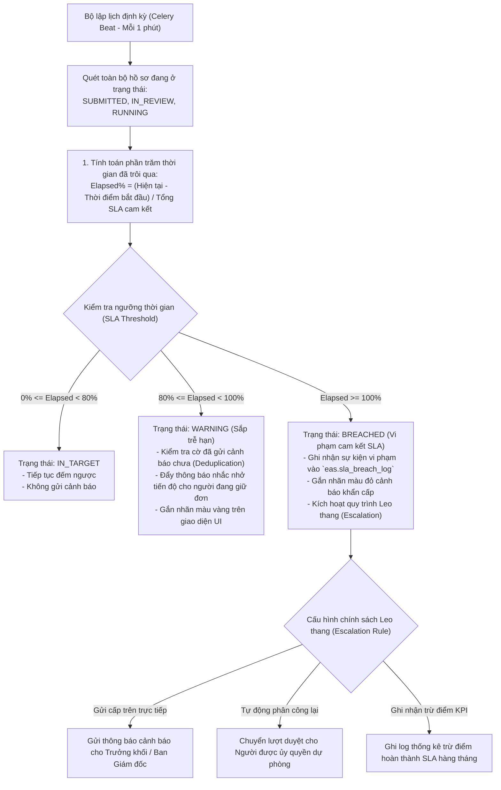
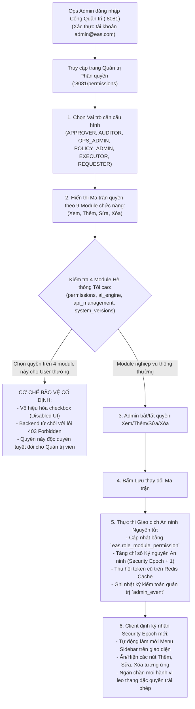

# HỒ SƠ THIẾT KẾ TOÀN DIỆN CÁC CA SỬ DỤNG (USE CASE DIAGRAMS)
## DỰ ÁN: HỆ THỐNG TỰ ĐỘNG HÓA QUY TRÌNH XỬ LÝ YÊU CẦU NỘI BỘ ĐA CẤP (EAS)
### HỘI ĐỒNG THẨM ĐỊNH IT 15 NĂM KINH NGHIỆM: BA, PM, DEV, UI/UX, AI, QA, PO

---

## 1. TỔNG QUAN HỆ THỐNG TÁC NHÂN (ACTORS)

Theo Bảng 2.1 của Báo cáo Đồ án tốt nghiệp và đối soát thực tế với mô hình phân quyền đa tầng trong `api_core/authn/service.py` và `eas.role_membership`, hệ thống EAS xác định 8 nhóm tác nhân với ranh giới trách nhiệm (Separation of Duties - SoD) nghiêm ngặt:

| Mã Tác Nhân | Danh Xưng Tác Nhân | Loại Tác Nhân | Trách Nhiệm Nghiệp Vụ Cốt Lõi | Cơ Chế Xác Thực & Phân Quyền |
|:---:|:---|:---:|:---|:---|
| **REQ** | **Requester** | Con người (Cán bộ nhân viên) | Khởi tạo đơn, điền biểu mẫu động, đính kèm chứng từ, theo dõi tiến độ, thu hồi hoặc nộp lại đơn khi được yêu cầu bổ sung. | JWT / Session Cookie `HttpOnly`, kiểm tra quyền sở hữu `owner_id == actor.id`. |
| **APP** | **Approver** | Con người (Quản lý cấp 1..N) | Thẩm định nội dung hồ sơ, xem điểm rủi ro và khuyến nghị AI, đưa ra quyết định: Phê duyệt (Approve), Từ chối (Reject), Yêu cầu bổ sung (Needs Info). | Phân quyền theo ma trận vai trò phòng ban (`role_membership`), ngăn chặn tự duyệt (Self-approval). |
| **EXE** | **Executor** | Con người (Bộ phận nghiệp vụ) | Tiếp nhận hồ sơ đã duyệt hoàn tất (Lifecycle B & C), tiến hành mua sắm, cấp quyền IT, giải ngân tài chính và nộp biên bản thực hiện. | Phân quyền theo vai trò chuyên trách (`EXECUTOR`), khóa tranh chấp bằng cơ chế nhận việc (Claim Lease). |
| **ACC** | **Acceptor** | Con người (Nghiệm thu độc lập) | Kiểm tra kết quả bàn giao thực tế của Executor đối với Lifecycle C, xác nhận hoàn thành (Accept) hoặc yêu cầu làm lại (Rework). | Độc lập hoàn toàn với Executor (Four-Eyes Principle / Ngăn chặn Executor tự nghiệm thu). |
| **POL** | **Policy Admin** | Con người (Pháp chế & Nhân sự) | Soạn thảo quy chế mẫu đơn, thiết lập ma trận phê duyệt đa cấp theo hạn mức ngân sách, ban hành bản phát hành cấu hình (`config_release`). | Quyền quản trị quy chế (`POLICY_ADMIN`), chỉ được sửa trên bản Draft/Clone, không sửa đè bản Live. |
| **OPS** | **Ops Admin** | Con người (Quản trị vận hành IT) | Điều phối phân công lại (Reassign) khi nhân sự vắng mặt, giám sát hàng đợi Outbox, quản lý kết nối 8 Mock API, kiểm soát Circuit Breaker. | Quyền vận hành hệ sinh thái (`OPS_ADMIN`), không can thiệp thay đổi nội dung chứng từ tài chính. |
| **AUD** | **Auditor** | Con người (Kiểm toán nội bộ) | Tra cứu toàn bộ hồ sơ, xem báo cáo KPI phân tích, đối soát chuỗi băm bảo mật SHA-256 Hash-chain và trạm kiểm soát Checkpoint. | Quyền chỉ đọc toàn quyền (`AUDITOR`), mọi thao tác tra cứu đều bị ghi nhật ký kiểm toán thứ cấp. |
| **SYS** | **System Worker** | Hệ thống (Celery / Background) | Quét vi phạm SLA, xử lý phát tán thông báo Outbox, gửi cảnh báo leo thang (Escalation), quét Antivirus tệp tin và dọn dẹp phiên hết hạn. | Tác nhân máy an toàn (Service Account `eas_worker`), kết nối qua socket nội bộ có ký định danh. |

---

## 2. DANH MỤC TẤT CẢ 11 SƠ ĐỒ USE CASE TRONG HỆ THỐNG EAS

Toàn bộ 11 sơ đồ (4 sơ đồ trong Chương 2 và 7 sơ đồ phân rã trong Phụ lục A) được mô hình hóa chi tiết bằng mã nguồn Mermaid chuẩn:

---

### SƠ ĐỒ 1: HÌNH 2.1 - SƠ ĐỒ NGỮ CẢNH TÁC NHÂN VÀ BIÊN CHỨC NĂNG HỆ THỐNG (UC-CTX-01)
*Mô tả biên giới hệ thống (System Boundary), các kênh tương tác ngoại vi và phân định rõ Cổng Nhân viên (:8080) và Cổng Quản trị (:8081).*



---

### SƠ ĐỒ 2: HÌNH 2.2 - SƠ ĐỒ QUAN HỆ NGHIỆP VỤ GIỮA CÁC CA SỬ DỤNG CỐT LÕI (UC-REL-01)
*Mô tả mối liên kết kế thừa, include và extend giữa 16 Ca sử dụng P0.*



---

### SƠ ĐỒ 3: HÌNH 2.3 - SƠ ĐỒ CA SỬ DỤNG NGHIỆP VỤ CHÍNH THEO TÁC NHÂN (UC-BIZ-01)
*Nhóm các ca sử dụng tác nghiệp trực tiếp của Requester, Approver, Executor, Acceptor.*

```mermaid
flowchart TD
    subgraph ACTORS["TÁC NHÂN TÁC NGHIỆP"]
        ACT_REQ["Requester\n(Người tạo đơn)"]
        ACT_APP["Approver\n(Người phê duyệt)"]
        ACT_EXE["Executor\n(Người thực hiện)"]
        ACT_ACC["Acceptor\n(Người nghiệm thu)"]
    end

    subgraph BIZ_USE_CASES["CÁC CA SỬ DỤNG NGHIỆP VỤ CHÍNH"]
        UC_CREATE["UC03: Tạo đơn & Nhập form động"]
        UC_ATTACH["UC03.1: Đính kèm hóa đơn / chứng từ"]
        UC_SUBMIT["UC04: Nộp hồ sơ vào luồng duyệt"]
        UC_CANCEL["UC08: Rút đơn / Hủy yêu cầu"]
        UC_RESUBMIT["UC07: Cập nhật thông tin bổ sung"]
        UC_TRACK["UC05: Theo dõi tiến độ hồ sơ 5 giai đoạn"]

        UC_REVIEW["UC06.1: Thẩm định hồ sơ & Xem điểm AI"]
        UC_APPROVE["UC06.2: Chấp thuận phê duyệt (Approve)"]
        UC_REJECT["UC06.3: Bác bỏ yêu cầu (Reject)"]
        UC_REQUEST_INFO["UC06.4: Yêu cầu bổ sung chứng từ"]
        UC_DELEGATE["UC06.5: Thiết lập ủy quyền phê duyệt"]

        UC_CLAIM["UC10: Nhận việc thực hiện (Claim Lease)"]
        UC_REPORT_ISSUE["UC11.1: Báo cáo vướng mắc thi công"]
        UC_COMPLETE_WORK["UC11.2: Nộp biên bản hoàn tất công việc"]

        UC_INSPECT["UC12.1: Thẩm định kết quả bàn giao"]
        UC_ACCEPT["UC12.2: Nghiệm thu hoàn tất đơn"]
        UC_REWORK["UC12.3: Bác bỏ nghiệm thu & Bắt làm lại"]
    end

    ACT_REQ --> UC_CREATE
    ACT_REQ --> UC_ATTACH
    ACT_REQ --> UC_SUBMIT
    ACT_REQ --> UC_CANCEL
    ACT_REQ --> UC_RESUBMIT
    ACT_REQ --> UC_TRACK

    ACT_APP --> UC_REVIEW
    ACT_APP --> UC_APPROVE
    ACT_APP --> UC_REJECT
    ACT_APP --> UC_REQUEST_INFO
    ACT_APP --> UC_DELEGATE
    ACT_APP --> UC_TRACK

    ACT_EXE --> UC_CLAIM
    ACT_EXE --> UC_REPORT_ISSUE
    ACT_EXE --> UC_COMPLETE_WORK
    ACT_EXE --> UC_TRACK

    ACT_ACC --> UC_INSPECT
    ACT_ACC --> UC_ACCEPT
    ACT_ACC --> UC_REWORK
    ACT_ACC --> UC_TRACK
```



---

### SƠ ĐỒ 4: HÌNH 2.4 - SƠ ĐỒ CA SỬ DỤNG PHÂN HỆ QUẢN TRỊ VÀ KIỂM SOÁT TUÂN THỦ (UC-ADM-01)
*Nhóm các ca sử dụng dành riêng cho Policy Admin, Ops Admin, Auditor và System Worker.*

```mermaid
flowchart TD
    subgraph ADMIN_ACTORS["TÁC NHÂN QUẢN TRỊ & HỆ THỐNG"]
        ADM_POL["Policy Admin\n(Quản trị quy chế)"]
        ADM_OPS["Ops Admin\n(Quản trị vận hành)"]
        ADM_AUD["Auditor\n(Kiểm toán nội bộ)"]
        SYS_WRK["System Worker\n(Tiến trình tự động Celery)"]
    end

    subgraph ADM_USE_CASES["CÁC CA SỬ DỤNG QUẢN TRỊ & TUÂN THỦ"]
        UC_TPL_MGT["UC02.1: Quản lý mẫu đơn & Vòng đời A/B/C"]
        UC_BRE_RULE["UC02.2: Cấu hình ma trận duyệt & Ngưỡng tiền"]
        UC_PUB_CONF["UC02.3: Ban hành phiên bản Config Release"]
        UC_AI_RULES["UC02.4: Quản lý Quy định & Kích hoạt AI Retrain"]

        UC_REASSIGN["UC09: Điều chuyển người xử lý (Reassign)"]
        UC_ORG_MGT["UC17.1: Quản trị Sơ đồ tổ chức phòng ban"]
        UC_USR_MGT["UC17.2: Quản lý người dùng & Trạng thái làm việc"]
        UC_RBAC_MGT["UC17.3: Cấu hình Ma trận phân quyền RBAC"]
        UC_API_MGT["UC-ADM-08: Giám sát 8 Mock API & Circuit Breaker"]
        UC_SYS_VER["UC-ADM-09: Theo dõi Phiên bản hệ thống & Diff"]

        UC_DASHBOARD["UC-ADM-01: Giám sát Dashboard điều hành KPI"]
        UC_HASH_VERIFY["UC15.1: Đối soát tính toàn vẹn Hash-Chain"]
        UC_EXPORT_AUDIT["UC15.2: Xuất hồ sơ kiểm toán phục vụ thanh tra"]
        UC_PRIVACY_MGT["UC-ADM-11: Quản lý Quyền riêng tư & Ẩn danh hóa"]

        UC_SLA_SCAN["UC14.1: Quét thời hạn cam kết SLA"]
        UC_ESCALATE["UC14.2: Tự động leo thang cảnh báo vượt cấp"]
        UC_OUTBOX_DISPATCH["UC13.1: Phân phối thông báo từ hàng đợi"]
        UC_AV_SCAN["UC03.2: Quét mã độc tệp đính kèm nền"]
    end

    ADM_POL --> UC_TPL_MGT
    ADM_POL --> UC_BRE_RULE
    ADM_POL --> UC_PUB_CONF
    ADM_POL --> UC_AI_RULES

    ADM_OPS --> UC_REASSIGN
    ADM_OPS --> UC_ORG_MGT
    ADM_OPS --> UC_USR_MGT
    ADM_OPS --> UC_RBAC_MGT
    ADM_OPS --> UC_API_MGT
    ADM_OPS --> UC_SYS_VER
    ADM_OPS --> UC_DASHBOARD

    ADM_AUD --> UC_DASHBOARD
    ADM_AUD --> UC_HASH_VERIFY
    ADM_AUD --> UC_EXPORT_AUDIT
    ADM_AUD --> UC_PRIVACY_MGT

    SYS_WRK --> UC_SLA_SCAN
    SYS_WRK --> UC_ESCALATE
    SYS_WRK --> UC_OUTBOX_DISPATCH
    SYS_WRK --> UC_AV_SCAN
```



---

### SƠ ĐỒ 5: HÌNH PL-01 - PHÂN RÃ UC SOẠN THẢO BIỂU MẪU VÀ NỘP HỒ SƠ (UC-DET-01)
*Chi tiết các bước từ khi người dùng mở form đến khi hoàn tất giao dịch Submit nguyên tử.*



---

### SƠ ĐỒ 6: HÌNH PL-02 - PHÂN RÃ UC ĐÁNH GIÁ RỦI RO VÀ PHÊ DUYỆT TỰ ĐỘNG BẰNG AI (UC-DET-02)
*Cơ chế cổng bảo vệ kép: Điểm số mô hình máy học + Ràng buộc luật nghiệp vụ tất định.*



---

### SƠ ĐỒ 7: HÌNH PL-03 - PHÂN RÃ UC PHÊ DUYỆT ĐA CẤP VÀ ỦY QUYỀN KHẨN CẤP (UC-DET-03)
*Quy trình xét duyệt theo ma trận phân quyền, phát hiện xung đột và xử lý ủy quyền hợp lệ.*

```mermaid
flowchart TD
    STEP_ACT["Lượt phê duyệt được kích hoạt\n(Approval Step: ACTIVE)"] --> RESOLVE_APPROVER["1. Phân giải danh tính Người duyệt\n(Dựa theo Sơ đồ tổ chức & Ma trận thẩm quyền)"]
    
    RESOLVE_APPROVER --> CHECK_DELEGATION{"Kiểm tra Ủy quyền\n(Delegation Rule)"}
    CHECK_DELEGATION -- Có ủy quyền còn hiệu lực -- --> DELEGATE_ACTOR["Gán quyền duyệt cho Người được ủy quyền\n(Kiểm tra không trùng Requester / SoD)"]
    CHECK_DELEGATION -- Không có ủy quyền -- --> DIRECT_ACTOR["Gán quyền duyệt cho Cán bộ quản lý trực tiếp"]

    DIRECT_ACTOR --> WAIT_DECISION["2. Người duyệt xem chi tiết hồ sơ\n(Dữ liệu đơn, tệp đính kèm, gợi ý rủi ro AI)"]
    DELEGATE_ACTOR --> WAIT_DECISION

    WAIT_DECISION --> DECISION_EVENT{"Quyết định của Người duyệt"}

    DECISION_EVENT -- CHẤP THUẬN (Approve) --> CHECK_FINAL{"Là cấp duyệt cuối cùng\ntrong ma trận?"}
    CHECK_FINAL -- Chưa phải cấp cuối --> SPAWN_NEXT["Tạo bước duyệt tiếp theo (Step N+1)\n& Thông báo cho cấp quản lý cao hơn"]
    CHECK_FINAL -- Đúng cấp cuối --> COMPLETE_LIFECYCLE{"Kiểm tra Mẫu vòng đời"}
    COMPLETE_LIFECYCLE -- Lifecycle A --> STATUS_COMPLETED["Đơn hoàn tất thành công (COMPLETED)"]
    COMPLETE_LIFECYCLE -- Lifecycle B hoặc C --> STATUS_READY_EXE["Chuyển sang Chờ thi công (READY_FOR_EXECUTION)"]

    DECISION_EVENT -- TỪ CHỐI (Reject) --> STATUS_REJECTED["Bác bỏ đơn (REJECTED)\n- Bắt buộc nhập lý do từ chối\n- Đóng toàn bộ các bước duyệt còn lại\n- Gửi thông báo quyết định cho Requester"]

    DECISION_EVENT -- YÊU CẦU BỔ SUNG (Needs Info) --> STATUS_NEEDS_INFO["Chuyển đơn về trạng thái NEEDS_INFO\n- Bắt buộc nhập yêu cầu cần bổ sung\n- Tạm dừng đồng hồ tính giờ SLA\n- Mở lại quyền chỉnh sửa cho Requester"]
```

---

### SƠ ĐỒ 8: HÌNH PL-04 - PHÂN RÃ UC TIẾP NHẬN, THI CÔNG VÀ NGHIỆM THU BÀN GIAO (UC-DET-04)
*Vòng đời thực thi chuyên môn dành cho Lifecycle B và Lifecycle C.*

```mermaid
flowchart TD
    ENTER_EXE["Đơn hoàn tất duyệt chuyển sang:\nREADY_FOR_EXECUTION"] --> POOL_QUEUE["Đưa hồ sơ vào Hàng đợi công việc của Bộ phận chuyên trách\n(IT Support, Mua sắm, Kế toán...)"]
    
    POOL_QUEUE --> CLAIM_WORK["1. Cán bộ chuyên môn bấm Tiếp nhận (Claim)"]
    CLAIM_WORK --> LEASE_LOCK{"Kiểm tra tranh chấp\n(Concurrency Lock)"}
    
    LEASE_LOCK -- Có người khác claim trước --> CLAIM_FAIL["Báo lỗi: Công việc đã có cán bộ tiếp nhận"]
    LEASE_LOCK -- Thành công --> ATTEMPT_RUNNING["Tạo Execution Attempt: RUNNING\n- Ghi nhận người thực thi (Executor)\n- Thiết lập thời hạn bàn giao cam kết"]

    ATTEMPT_RUNNING --> WORK_PROCESS["2. Tiến hành thực thi ngoài thực tế\n(Mua thiết bị, cài đặt máy tính, chuyển khoản)"]
    
    WORK_PROCESS --> ISSUE_CHECK{"Có phát sinh vướng mắc?"}
    ISSUE_CHECK -- Có sự cố không thể xử lý -- --> REPORT_ISSUE["Mở vướng mắc thi công (Execution Issue)\n- Báo cáo thiếu hàng / sai thông số kỹ thuật\n- Chuyển đơn sang trạng thái BLOCKED\n- Kích hoạt quy trình điều chuyển việc của Ops Admin"]
    
    ISSUE_CHECK -- Thi công thuận lợi -- --> SUBMIT_RESULT["3. Cán bộ chuyên môn nộp kết quả\n- Tải lên biên bản giao nhận / hóa đơn\n- Nhập ghi chú bàn giao"]

    SUBMIT_RESULT --> CHECK_LC{"Kiểm tra mẫu vòng đời"}
    CHECK_LC -- Lifecycle B (Không cần nghiệm thu) --> B_DONE["Đơn hoàn thành viên mãn (COMPLETED)"]
    CHECK_LC -- Lifecycle C (Bắt buộc nghiệm thu) --> C_WAIT_ACC["Chuyển sang: WAITING_FOR_ACCEPTANCE\n- Thông báo cho Người nghiệm thu (Acceptor)\n- Khóa hồ sơ chống Executor tự sửa đổi"]

    C_WAIT_ACC --> ACC_INSPECT["4. Cán bộ nghiệm thu kiểm tra thực tế bàn giao"]
    ACC_INSPECT --> ACC_DECISION{"Đạt yêu cầu bàn giao?"}
    ACC_DECISION -- KHÔNG ĐẠT --> ACC_REWORK["Yêu cầu làm lại (Rework)\n- Ghi rõ lỗi kỹ thuật chưa đạt\n- Chuyển đơn về READY_FOR_EXECUTION\n- Tăng số lần thử nghiệm thu"]
    ACC_REWORK --> CLAIM_WORK

    ACC_DECISION -- ĐẠT CHUẨN --> ACC_SUCCESS["Xác nhận Nghiệm thu thành công\n- Đơn vị nghiệm thu ký xác nhận số\n- Đơn chính thức chuyển sang COMPLETED\n- Ghi sổ cái kiểm toán đóng toàn bộ vòng đời"]
```

---

### SƠ ĐỒ 9: HÌNH PL-05 - PHÂN RÃ UC GIÁM SÁT VI PHẠM SLA VÀ ESCALATION (UC-DET-05)
*Tiến trình quét nền tự động kiểm soát cam kết dịch vụ thời gian thực.*



---

### SƠ ĐỒ 10: HÌNH PL-06 - PHÂN RÃ UC QUẢN TRỊ MA TRẬN PHÂN QUYỀN VÀ TÀI KHOẢN (UC-DET-06)
*Cơ chế kiểm soát an toàn bảo mật danh tính, phân quyền vai trò và khóa kỷ nguyên bảo mật.*



---

### SƠ ĐỒ 11: HÌNH PL-07 - PHÂN RÃ UC TRUY VẾT KIỂM TOÁN VÀ XUẤT BÁO CÁO TUÂN THỦ (UC-DET-07)
*Quy trình đối soát chuỗi băm mật mã học SHA-256 bảo đảm tính chống chối bỏ.*

```mermaid
flowchart TD
    AUDITOR_REQ["Kiểm toán viên yêu cầu thẩm định tính toàn vẹn hồ sơ"] --> OPEN_AUDIT_CONSOLE["Truy cập Nhật ký kiểm toán (:8081/system_versions & Audit Log)"]
    
    OPEN_AUDIT_CONSOLE --> SELECT_TARGET["1. Chọn Hồ sơ yêu cầu hoặc Mốc thời gian cần kiểm tra"]
    
    SELECT_TARGET --> QUERY_LOGS["2. Truy vấn danh sách bản ghi `eas.audit_log` liên quan:\n(Theo thứ tự `event_seq` tăng dần)"]

    QUERY_LOGS --> HASH_VERIFIER["3. KHỞI CHẠY TIẾN TRÌNH XÁC MINH CHUỖI BĂM (HASH-CHAIN VERIFIER)"]
    
    subgraph CRYPTO_VERIFY["TIẾN TRÌNH XÁC THỰC MẬT MÃ HỌC"]
        HASH_VERIFIER --> GET_HEAD["Lấy giá trị Hash ban đầu (`prev_hash`)"]
        GET_HEAD --> LOOP_RECORDS["Lặp qua từng bản ghi sự kiện:"]
        LOOP_RECORDS --> COMPUTE_HASH["Tính toán: Current_Hash = SHA256(prev_hash + Canonical_Payload + Timestamp)"]
        COMPUTE_HASH --> COMPARE_STORED{"Current_Hash == Stored_Hash?"}
        
        COMPARE_STORED -- Sai khác -- --> TAMPER_DETECTED["CẢNH BÁO: DỮ LIỆU BỊ XÂM PHẠM!\n- Xác định chính xác vị trí `event_seq` bị sửa lén\n- Tạo biên bản vi phạm an ninh dữ liệu"]
        
        COMPARE_STORED -- Trùng khớp -- --> NEXT_CHAIN["Gán prev_hash = Current_Hash\n& Tiếp tục bản ghi sau"]
    end

    NEXT_CHAIN --> CHECKPOINT_VALIDATE{"Kiểm tra Trạm khóa Chốt\n(Hash Checkpoint đối chiếu)"}
    CHECKPOINT_VALIDATE -- Khớp với Checkpoint độc lập --> PROVE_INTEGRITY["XÁC NHẬN CHUỖI BĂM TOÀN VẸN 100%\n(Chứng cứ pháp lý không thể chối bỏ)"]

    PROVE_INTEGRITY --> EXPORT_PACKAGE["4. Đóng gói Hồ sơ Kiểm toán:\n- File PDF báo cáo đóng dấu ký số\n- Dữ liệu thô JSON kèm chứng chỉ băm\n- Lịch sử đối soát Before/After Diff"]
    
    EXPORT_PACKAGE --> DOWNLOAD_LEGAL["Tải báo cáo kiểm toán phục vụ thanh tra"]
```

---

## 3. BẢNG ĐỐI SOÁT CHI TIẾT GIỮA ĐẶC TẢ DOCX VÀ HIỆN THỰC CODEBASE

| Mã UC | Tên Ca Sử Dụng | Hiện Thực Backend | Hiện Thực Frontend | Hiện Thực Database | Đánh Giá Chuyên Gia IT 15 Năm |
|:---:|:---|:---|:---|:---|:---|
| **UC01** | Đăng nhập & Quản lý phiên | `api_core/authn/views.py` | `web_client/src/App.jsx`, `web_admin/src/main.jsx` | `eas.app_user`, `eas.admin_account` | **Đã nâng cấp an toàn:** Tách biệt cổng 8080 (Client) và 8081 (Admin), cô lập session, chặn admin đăng nhập cổng nhân viên và ngược lại. |
| **UC02** | Ban hành cấu hình quy chế | `api_core/workflow/config_service.py` | `web_client/src/components/AdminPages.jsx` | `eas.config_release`, `eas.approval_route` | **Đúng chuẩn Enterprise:** Sử dụng cơ chế phát hành bất biến (Immutable Releases), clone draft rồi publish nguyên tử, chống conflict. |
| **UC03** | Soạn nháp & Tải chứng từ | `api_core/workflow/attachments.py` | `web_client/src/components/RequestEditor.jsx` | `eas.request_revision`, `eas.attachment` | **Bảo mật tuyệt đối:** Đổi tên file sang UUID server-side, kiểm tra Magic Bytes, quét virus, phân quyền truy cập Scoped Access. |
| **UC04** | Gửi đơn nguyên tử (Submit) | `api_core/workflow/service.py` | `web_client/src/components/RequestEditor.jsx` | `eas.request`, `eas.approval_step`, `eas.outbox_event` | **Chống nộp đúp:** Tích hợp `Idempotency-Key`, snapshot phiên bản release tại thời điểm gửi, gọi AI chấm rủi ro trong một transaction. |
| **UC05** | Xem hồ sơ & Chi tiết | `api_core/workflow/views.py` | `web_client/src/components/RequestDetail.jsx` | `eas.request`, `eas.step_decision` | **Chống lỗ hổng IDOR:** Server-side xác minh quyền sở hữu (`owner_id`) và quyền tham gia luồng duyệt trước khi trả dữ liệu. |
| **UC06** | Phê duyệt, Từ chối, Bổ sung | `api_core/workflow/service.py` | `web_client/src/components/RequestDetail.jsx` | `eas.approval_step`, `eas.step_decision` | **Đầy đủ 3 nhánh:** Approve -> Tiếp tục/Hoàn tất; Reject -> Bác bỏ kèm lý do; Needs Info -> Trả về DRAFT mở quyền sửa. |
| **UC07** | Bổ sung và nộp lại | `api_core/workflow/service.py` | `web_client/src/components/RequestEditor.jsx` | `eas.request_revision` | **Truy vết phiên bản:** Tăng số `revision_number`, giữ nguyên định danh đơn `request_id`, ghi nhận nhật ký làm rõ. |
| **UC08** | Rút lại hồ sơ (Withdraw) | `api_core/workflow/service.py` | `web_client/src/components/RequestDetail.jsx` | `eas.request` | **Ràng buộc trạng thái:** Chỉ cho phép rút khi đơn chưa duyệt xong; đã hoàn thành hoặc đang thi công thì cấm rút. |
| **UC09** | Phân công lại (Reassign) | `api_core/workflow/ops_service.py` | `web_client/src/components/AdminPages.jsx` | `eas.approval_step`, `eas.audit_log` | **Kiểm soát SoD:** Ops Admin điều chuyển phải chọn nhân sự cùng quyền và không vi phạm nguyên tắc tự duyệt. |
| **UC10** | Tiếp nhận việc (Claim) | `api_core/workflow/service.py` | `web_client/src/components/RequestDetail.jsx` | `eas.execution_attempt` | **Khóa tranh chấp:** Cơ chế Claim Lease độc quyền, chống tình huống 2 chuyên viên cùng thi công 1 đơn hàng. |
| **UC11** | Nộp kết quả thi công | `api_core/workflow/service.py` | `web_client/src/components/RequestDetail.jsx` | `eas.execution_attempt`, `eas.execution_issue` | **Phân biệt vòng đời:** Lifecycle B hoàn tất ngay; Lifecycle C chuyển tiếp cho Acceptor nghiệm thu. Hỗ trợ mở issue vướng mắc. |
| **UC12** | Nghiệm thu bàn giao | `api_core/workflow/service.py` | `web_client/src/components/RequestDetail.jsx` | `eas.acceptance_record` | **Nguyên tắc Four-Eyes:** Acceptor bắt buộc khác Executor; hỗ trợ trả về bắt làm lại (Rework) kèm lý do. |
| **UC13** | Quản lý thông báo | `api_core/workflow/views.py` | `web_client/src/components/SystemUpdates.jsx` | `eas.outbox_event`, `eas.notification` | **Mô hình Outbox Pattern:** Đảm bảo tin nhắn không bị thất lạc kể cả khi worker crash; tự động đồng bộ unread badge. |
| **UC14** | Giám sát SLA & Cảnh báo | `api_core/worker.py` | `web_client/src/components/AdminPages.jsx` | `eas.sla_stage`, `eas.sla_breach_log` | **Tự động 3 mức:** In-target (xanh) -> Warning 80% (vàng) -> Breached 100% (đỏ) kèm gửi thông báo nhắc việc. |
| **UC15** | Kiểm toán & Chuỗi băm | `api_core/audit.py` | `web_admin/src/pages/AuditLogPage.jsx` | `eas.audit_log`, `eas.audit_head` | **Toàn vẹn mật mã học:** Mỗi sự kiện được băm chuỗi SHA-256 nối tiếp; hỗ trợ lệnh `verify_hash_chain` phát hiện can thiệp lén. |
| **UC17** | Phân quyền RBAC & Đồng bộ | `api_core/administration/org_users_rbac.py` | `web_client/src/components/RolePermissionMatrixPage.jsx` | `eas.role_module_permission`, `eas.user_permissions` | **Bảo vệ 4 module tối cao:** Khóa cứng quyền hệ thống; tăng `security_epoch` để ép client làm mới phiên tức thì. |
