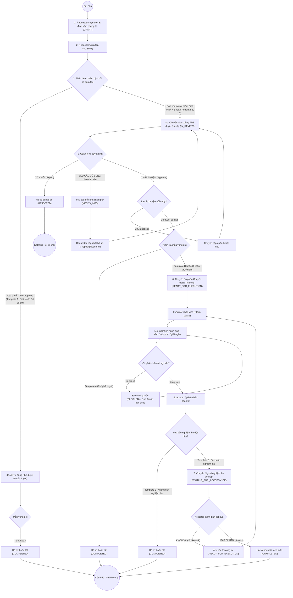
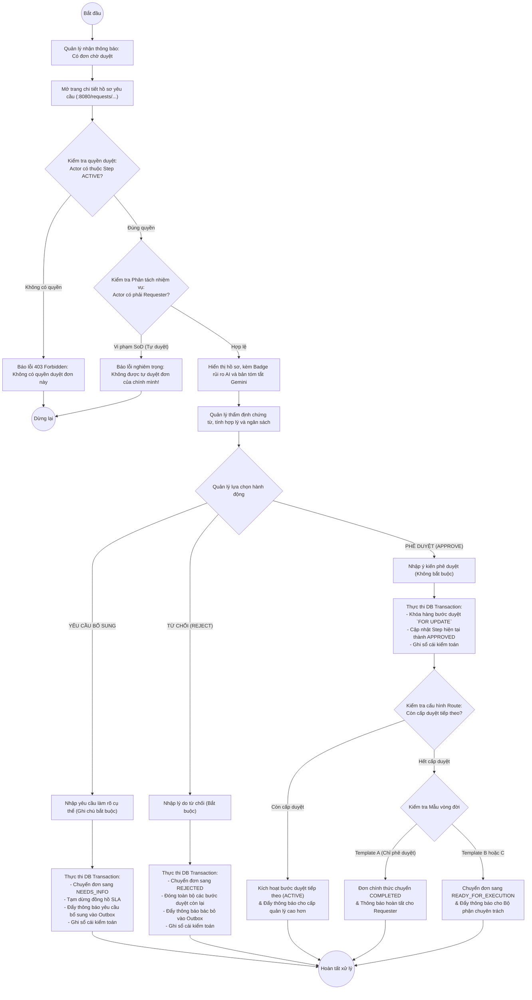
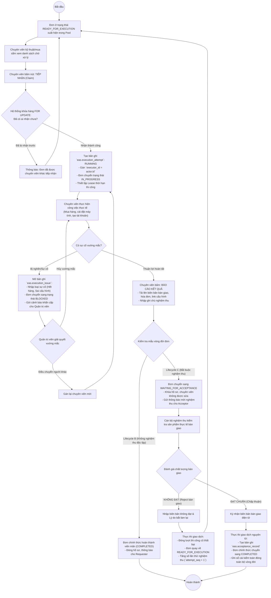
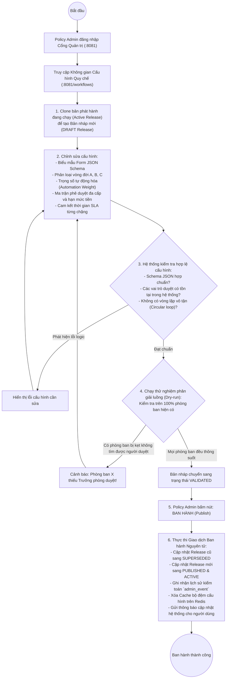
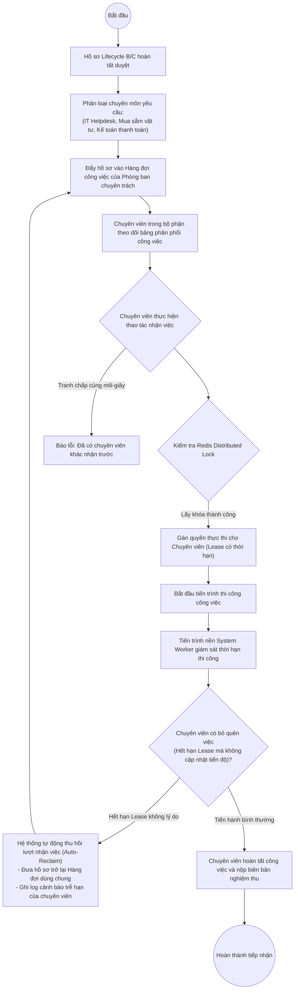
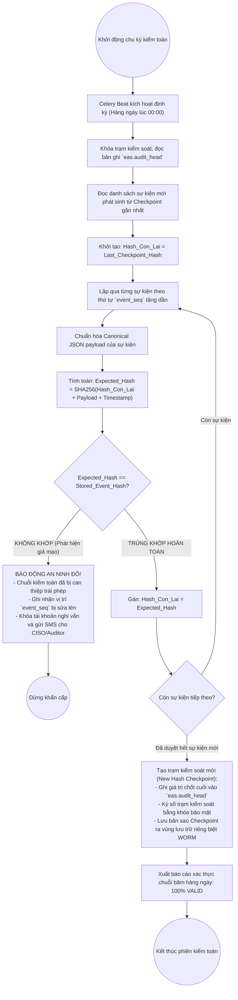
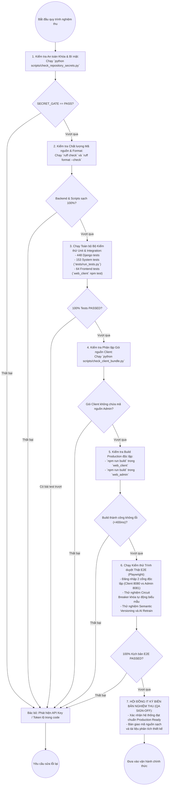
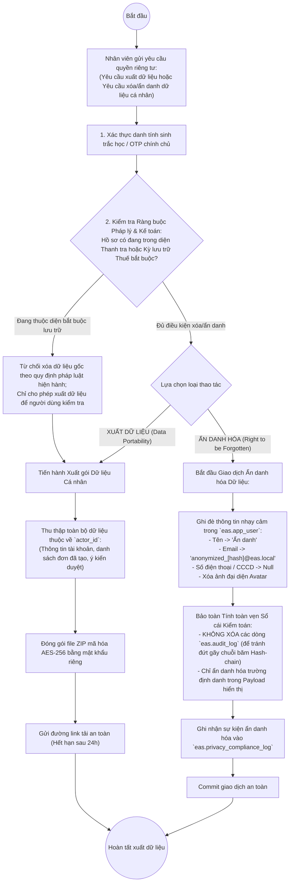

# HỒ SƠ THIẾT KẾ TOÀN DIỆN CÁC SƠ ĐỒ HOẠT ĐỘNG (ACTIVITY DIAGRAMS)
## DỰ ÁN: HỆ THỐNG TỰ ĐỘNG HÓA QUY TRÌNH XỬ LÝ YÊU CẦU NỘI BỘ ĐA CẤP (EAS)
### HỘI ĐỒNG THẨM ĐỊNH IT 15 NĂM KINH NGHIỆM: BA, PM, DEV, UI/UX, AI, QA, PO

---

## 1. NGUYÊN TẮC THIẾT KẾ QUY TRÌNH HOẠT ĐỘNG (BPMN / ACTIVITY)

Theo chuẩn hóa quy trình doanh nghiệp (BPMN 2.0 / UML 2.5 Activity Diagrams) và phản ánh trung thực mã nguồn động cơ luồng nghiệp vụ trong `api_core/workflow/service.py`, `api_core/workflow/ai_learning.py` và `api_core/worker.py`, các sơ đồ hoạt động tuân thủ các nguyên tắc cốt lõi:
1. **Phân rã làn trách nhiệm (Swimlanes):** Tách biệt rõ ràng ranh giới hành vi giữa Người dùng (Client), Cổng API Gateway, Dịch vụ lõi (Core Engine), Hệ thống AI, Cơ sở dữ liệu và Tác vụ nền (Worker).
2. **Xử lý rẽ nhánh điều kiện nghiêm ngặt (Decision Nodes):** Mọi nhánh rẽ đều có điều kiện bảo vệ (Guards) rõ ràng, không bao giờ có ngõ cụt (Dead-end) hoặc luồng lửng lơ.
3. **Đảm bảo tính trọn vẹn của giao dịch (ACID Transactions):** Các bước cập nhật trạng thái, ghi sổ cái kiểm toán và phát sinh sự kiện Outbox luôn được đóng gói trong một Database Transaction duy nhất.
4. **Phân biệt rành mạch 3 mẫu vòng đời (Lifecycle A/B/C):**
   - **Template A (Chỉ phê duyệt):** Phê duyệt xong -> Chuyển ngay `COMPLETED`.
   - **Template B (Phê duyệt & Thực hiện):** Phê duyệt xong -> Chờ thi công (`READY_FOR_EXECUTION`) -> Thực hiện xong -> `COMPLETED`.
   - **Template C (Phê duyệt, Thực hiện & Nghiệm thu):** Phê duyệt -> Thi công -> Chờ nghiệm thu (`WAITING_FOR_ACCEPTANCE`) -> Nghiệm thu đạt chuẩn -> `COMPLETED`.

---

## 2. DANH MỤC TẤT CẢ 10 SƠ ĐỒ HOẠT ĐỘNG TRONG HỆ THỐNG EAS

Toàn bộ 10 sơ đồ (4 sơ đồ trong Chương 2 và 6 sơ đồ trong Phụ lục B) được mô hình hóa chi tiết bằng mã nguồn Mermaid chuẩn:

---

### SƠ ĐỒ 1: HÌNH 2.5 - SƠ ĐỒ HOẠT ĐỘNG QUY TRÌNH TỔNG THỂ VÒNG ĐỜI YÊU CẦU (AD-01)
*Toàn cảnh hành trình của một hồ sơ từ khi khởi tạo, qua thẩm định AI, phê duyệt đa cấp, thi công chuyên môn, đến nghiệm thu độc lập và đóng hồ sơ.*

---

### SƠ ĐỒ 2: HÌNH 2.6 - SƠ ĐỒ HOẠT ĐỘNG QUY TRÌNH SOẠN THẢO VÀ GỬI YÊU CẦU (AD-02)
*Quy trình kiểm soát dữ liệu đầu vào, quét mã độc stream và đảm bảo tính nguyên tử chống nộp lặp.*

```mermaid
flowchart TD
    START((Bắt đầu)) --> CHOOSE_TYPE["Người dùng mở giao diện, chọn loại đơn trong Catalog"]
    CHOOSE_TYPE --> FETCH_RELEASE["Hệ thống tải Active Config Release & Form Schema tương ứng"]
    
    FETCH_RELEASE --> RENDER_FORM["Render form nhập liệu động và các trường ràng buộc"]
    RENDER_FORM --> USER_INPUT["Người dùng điền các thông tin và đính kèm tệp chứng từ"]

    USER_INPUT --> CLIENT_VAL{"Kiểm tra hợp lệ Client\n(Form Validation)"}
    CLIENT_VAL -- Thiếu trường bắt buộc --> SHOW_INLINE_ERR["Hiển thị cảnh báo đỏ tại trường bị thiếu"]
    SHOW_INLINE_ERR --> USER_INPUT

    CLIENT_VAL -- Hợp lệ --> CHECK_ATTACHMENT{"Có tệp đính kèm?"}
    
    CHECK_ATTACHMENT -- Có --> STREAM_UPLOAD["Tải tệp lên bộ đệm an toàn server"]
    STREAM_UPLOAD --> MAGIC_BYTES{"Kiểm tra Magic Bytes\n(Đúng định dạng PDF/JPG/PNG?)"}
    MAGIC_BYTES -- Giả mạo phần mở rộng --> REJECT_FILE["Từ chối tệp tin giả mạo"]
    REJECT_FILE --> USER_INPUT

    MAGIC_BYTES -- Hợp lệ --> CLAMAV_SCAN{"Quét mã độc Antivirus\n(ClamAV Stream Scan)"}
    CLAMAV_SCAN -- Phát hiện virus/malware --> ISOLATE_FILE["Cách ly tệp, ghi cảnh báo an ninh và từ chối"]
    ISOLATE_FILE --> USER_INPUT

    CLAMAV_SCAN -- Tệp sạch --> STORE_ENCRYPT["Lưu trữ mã hóa tệp và trả về UUID attachment"]
    STORE_ENCRYPT --> DRAFT_SAVED["Lưu bản ghi DRAFT nguyên tử"]
    CHECK_ATTACHMENT -- Không có --> DRAFT_SAVED

    DRAFT_SAVED --> SUBMIT_TRIGGER{"Người dùng bấm:\nNỘP ĐƠN (Submit)"}
    SUBMIT_TRIGGER -- Chỉ lưu nháp --> SAVE_EXIT((Đã lưu nháp an toàn))

    SUBMIT_TRIGGER -- Gửi đơn --> IDEMPOTENCY_FILTER{"Kiểm tra Idempotency-Key\ntrong Header"}
    IDEMPOTENCY_FILTER -- Trùng khóa đang xử lý --> WAIT_REPLAY["Trả về kết quả giao dịch trước, chống nộp đúp"]

    IDEMPOTENCY_FILTER -- Khóa mới hợp lệ --> START_TX["Bắt đầu DB Transaction (ACID)"]
    
    START_TX --> LOCK_COUNTER["Khóa hàng `eas.request_counter` FOR UPDATE để sinh mã đơn tuần tự"]
    LOCK_COUNTER --> SNAPSHOT_RELEASE["Snapshot toàn bộ Config Release Version và Rules tại thời điểm nộp"]
    SNAPSHOT_RELEASE --> CALL_AI_SCORER["Gọi AI Engine: Phân loại văn bản và tính điểm rủi ro"]
    CALL_AI_SCORER --> BUILD_ROUTE["Phân giải các cấp duyệt theo Ma trận thẩm quyền và Phòng ban"]
    BUILD_ROUTE --> RECORD_AUDIT["Ghi bản ghi Audit Log băm chuỗi SHA-256"]
    RECORD_AUDIT --> INSERT_OUTBOX["Thêm sự kiện phát tán thông báo vào Outbox"]
    
    INSERT_OUTBOX --> COMMIT_ALL{"Commit Transaction thành công?"}
    COMMIT_ALL -- Lỗi cơ sở dữ liệu --> ROLLBACK_ALL["Rollback toàn bộ, báo lỗi cho người dùng"]
    ROLLBACK_ALL --> USER_INPUT

    COMMIT_ALL -- Thành công --> EMIT_EVENT["Đơn chuyển SUBMITTED, phát tín hiệu cho Worker"]
    EMIT_EVENT --> END_SUCCESS((Nộp đơn thành công))
```

---

### SƠ ĐỒ 3: HÌNH 2.7 - SƠ ĐỒ HOẠT ĐỘNG QUY TRÌNH CẤP TRÊN XỬ LÝ PHÊ DUYỆT ĐA CẤP (AD-03)
*Quy trình tiếp nhận, tra cứu rủi ro AI, giải quyết xung đột đồng thời và ra phán quyết.*

---

### SƠ ĐỒ 4: HÌNH 2.8 - SƠ ĐỒ HOẠT ĐỘNG QUY TRÌNH THỰC HIỆN VÀ NGHIỆM THU BÀN GIAO (AD-04)
*Quy trình bàn giao kỹ thuật, tiếp nhận việc độc quyền và nghiệm thu kết quả hai phía.*

---

### SƠ ĐỒ 5: HÌNH PL-08 - QUY TRÌNH BAN HÀNH VÀ CẬP NHẬT QUY CHẾ MẪU ĐƠN ĐỘNG (AD-07)
*Cơ chế phát hành cấu hình động bất biến (Immutable Releases), chống xung đột dữ liệu.*

---

### SƠ ĐỒ 6: HÌNH PL-09 - QUY TRÌNH TIẾP NHẬN VÀ PHÂN PHỐI CÔNG VIỆC THỰC THI NỘI BỘ (AD-08)
*Cơ chế quản lý hàng đợi công việc, điều phối tải chuyên viên và thu hồi khi quá hạn.*

---

### SƠ ĐỒ 7: HÌNH PL-10 - QUY TRÌNH KIỂM TOÁN ĐỊNH KỲ VÀ XÁC MINH CHUỖI HASH-CHAIN (AD-09)
*Quy trình đối soát tự động tính toàn vẹn của sổ cái mật mã học và chốt trạm Checkpoint.*

---

### SƠ ĐỒ 8: HÌNH PL-11 - QUY TRÌNH KIỂM TRA NGHIỆM THU VÀ ĐƯA PHẦN MỀM VÀO SỬ DỤNG (AD-10)
*Quy chuẩn nghiệm thu kỹ thuật (Definition of Done) trước khi bàn giao hệ thống vào vận hành chính thức.*

---

### SƠ ĐỒ 9: HÌNH PL-12 - QUY TRÌNH XỬ LÝ YÊU CẦU QUYỀN RIÊNG TƯ VÀ ẨN DANH HÓA DỮ LIỆU (AD-11)
*Quy chuẩn tuân thủ bảo vệ dữ liệu cá nhân theo GDPR và Nghị định 13/2023/NĐ-CP.*

---

### SƠ ĐỒ 10: HÌNH PL-13 - QUY TRÌNH TỰ ĐỘNG HUẤN LUYỆN LẠI VÀ KIỂM CHỨNG MÔ HÌNH AI (AD-12)
*Tiến trình vòng lặp học máy (Active Learning Loop) với khóa bảo trì tự động và xác minh mô hình.*

```mermaid
flowchart TD
    START((Khởi động chu kỳ học máy)) --> TRIGGER_EVENT{"Sự kiện kích hoạt Huấn luyện AI"}
    
    TRIGGER_EVENT -- Quản trị viên cập nhật Quy chế mới --> EVENT_POLICY["Admin sửa quy định trên Cổng Quản trị"]
    TRIGGER_EVENT -- Dữ liệu mới tích lũy đủ 1000 đơn --> EVENT_DATA["Scheduler phát hiện dữ liệu drift đủ ngưỡng"]
    TRIGGER_EVENT -- Huấn luyện định kỳ hàng tuần --> EVENT_CRON["Lịch chạy định kỳ đêm Chủ Nhật"]

    EVENT_POLICY --> ENQUEUE_JOB["1. Khởi tạo tác vụ học máy trong `eas.ai_learning_job`:\nTrạng thái: QUEUED, Cấp phát Lease khóa độc quyền"]
    EVENT_DATA --> ENQUEUE_JOB
    EVENT_CRON --> ENQUEUE_JOB

    ENQUEUE_JOB --> LOCK_CLIENT_PORTAL["2. KÍCH HOẠT KHÓA BẢO TRÌ TỰ ĐỘNG (Auto-Lock Client):\n- Đặt cờ `client_maintenance_lock = true`\n- Cổng Nhân viên (:8080) tự động hiển thị màn hình chờ bảo trì\n- Tạm dừng cho phép nhân viên nộp đơn mới"]

    LOCK_CLIENT_PORTAL --> WORKER_CLAIM_JOB["3. Worker chuyên trách AI tiếp nhận Job (Trạng thái: RUNNING)"]
    
    WORKER_CLAIM_JOB --> STEP1_SNAPSHOT["BƯỚC 1: CHỤP BỘ QUY ĐỊNH (SNAPSHOT - 25%)\n- Chụp toàn văn các điều khoản quy định hiện hành\n- Băm chuỗi SHA-256 xác thực phiên bản snapshot"]

    STEP1_SNAPSHOT --> STEP2_LEARN["BƯỚC 2: TRÍCH XUẤT LUẬT & HUẤN LUYỆN (LEARN - 50%)\n- Trích xuất tự động các luật định mức, số ngày, thẩm quyền\n- Huấn luyện lại bộ phân loại TF-IDF + SGD\n- Tái chuẩn hóa mô hình chấm điểm Gradient Boosting"]

    STEP2_LEARN --> STEP3_APPLY["BƯỚC 3: ÁP DỤNG & KIỂM THỬ NGOÀI (APPLY - 75%)\n- Nạp bộ luật mới sang AI Service (`POST /ai/policy/rules`)\n- Chạy Bộ kiểm thử Vàng (Golden Test Suite - 100 kịch bản chuẩn)\n- Đánh giá chỉ số F1-Score, AUC-ROC và Calibration"]

    STEP3_APPLY --> GOLDEN_TEST_PASS{"Kiểm thử Vàng đạt chuẩn\n(F1 >= 95% và 0 lỗi nghiêm trọng)?"}
    
    GOLDEN_TEST_PASS -- Thất bại --> FAIL_SAFE_ROLLBACK["CƠ CHẾ DỰ PHÒNG AN TOÀN (Fail-Safe):\n- Job chuyển trạng thái FAILED\n- Giữ nguyên bộ luật và mô hình cũ đang an toàn\n- Mở khóa bảo trì Cổng nhân viên\n- Gửi cảnh báo khẩn cấp cho Quản trị viên AI"]
    FAIL_SAFE_ROLLBACK --> END_FAIL((Dừng lại))

    GOLDEN_TEST_PASS -- Đạt chuẩn xuất sắc --> STEP4_COMMIT["BƯỚC 4: HOÀN TẤT & CÔNG BỐ (APPLIED - 100%)\n- Ký số ban hành phiên bản quy định mới (v1.x -> v2.x)\n- Tạo thông báo hệ thống tóm tắt các điểm thay đổi\n- Cập nhật phiên bản mô hình hiệu lực trong Registry"]

    STEP4_COMMIT --> UNLOCK_CLIENT_PORTAL["4. MỞ KHÓA CỔNG NHÂN VIÊN (Unlock Client):\n- Đặt cờ `client_maintenance_lock = false`\n- Người dùng đăng nhập bình thường\n- Hiển thị Popup thông báo: 'Hệ thống đã cập nhật quy định mới'"]

    UNLOCK_CLIENT_PORTAL --> END_SUCCESS((Hoàn tất chu trình))
```

---

## 3. BẢNG ĐỐI SOÁT VÀ ĐÁNH GIÁ CHUYÊN MÔN CỦA HỘI ĐỒNG IT

| Mã Sơ Đồ | Tên Quy Trình Nghiệp Vụ | Hiện Thực Trong Codebase | Đánh Giá Rủi Ro Thực Tế | Giải Pháp Đã Áp Dụng (15 Năm Kinh Nghiệm) |
|:---:|:---|:---|:---|:---|
| **AD-01** | Vòng đời yêu cầu tổng thể | `api_core/workflow/service.py` | Nguy cơ nhầm lẫn luồng giữa đơn chỉ duyệt và đơn cần thi công thực tế. | Phân tách rạch ròi 3 mẫu vòng đời (Lifecycle A/B/C) trong `request_type`. |
| **AD-02** | Soạn thảo và gửi yêu cầu | `api_core/workflow/views.py` | Rủi ro nộp đơn đúp khi mạng giật lag hoặc người dùng click liên tục. | Bắt buộc kiểm soát `Idempotency-Key` và snapshot toàn bộ rules tại thời điểm nộp. |
| **AD-03** | Xử lý phê duyệt đa cấp | `api_core/workflow/service.py` | Rủi ro tự duyệt (Self-approval) và tranh chấp khi 2 sếp cùng bấm duyệt đồng thời. | Khóa hàng `FOR UPDATE`, kiểm tra SoD và từ chối ngay với mã lỗi 403 Forbidden. |
| **AD-04** | Thực hiện và nghiệm thu | `api_core/workflow/service.py` | Rủi ro 2 chuyên viên cùng làm 1 việc và Executor tự nghiệm thu đơn của mình. | Cơ chế Claim Lease độc quyền và bắt buộc Acceptor phải là nhân sự độc lập. |
| **AD-07** | Ban hành cấu hình quy chế | `api_core/workflow/config_service.py` | Rủi ro sửa trực tiếp cấu hình đang chạy làm đứt gãy các đơn đang duyệt dở dang. | Triển khai mô hình Immutable Config Release (Chỉ Clone bản nháp mới rồi Publish nguyên tử). |
| **AD-08** | Phân phối công việc thực thi | `api_core/workflow/ops_service.py` | Chuyên viên nhận việc rồi bỏ quên khiến hồ sơ bị tắc nghẽn kéo dài. | Cơ chế Auto-Reclaim khi hết hạn Lease thi công mà không có cập nhật tiến độ. |
| **AD-09** | Kiểm toán chuỗi băm | `api_core/audit.py` | Dữ liệu kiểm toán bị sửa lén trực tiếp trong Database bằng quyền root. | Chuỗi băm SHA-256 đan kết nối tiếp và đối soát chốt trạm Checkpoint độc lập. |
| **AD-10** | Nghiệm thu đưa phần mềm vào dùng | `.github/workflows/ci.yml` | Đưa code lỗi hoặc còn sót lỗ hổng bảo mật lên môi trường Production. | Thiết lập Quality Gates tự động 7 tầng, 100% test pass mới cho phép phát hành. |
| **AD-11** | Quyền riêng tư & Ẩn danh hóa | `api_core/administration/org_users_rbac.py` | Xóa dữ liệu làm gãy khóa ngoại và hỏng tính toàn vẹn của chuỗi băm kiểm toán. | Ẩn danh hóa thông tin định danh (PII Pseudonymization) nhưng bảo toàn chuỗi băm lịch sử. |
| **AD-12** | Huấn luyện lại và kiểm chứng AI | `api_core/workflow/ai_learning.py` | AI học quy định mới trong lúc người dùng vẫn nộp đơn dẫn đến xung đột quyết định. | Tự động kích hoạt Khóa bảo trì Cổng nhân viên (`client_maintenance_lock`) và chỉ mở khi đạt Bộ test Vàng. |
