# HỒ SƠ THIẾT KẾ TOÀN DIỆN CÁC SƠ ĐỒ TUẦN TỰ (SEQUENCE DIAGRAMS)
## DỰ ÁN: HỆ THỐNG TỰ ĐỘNG HÓA QUY TRÌNH XỬ LÝ YÊU CẦU NỘI BỘ ĐA CẤP (EAS)
### HỘI ĐỒNG THẨM ĐỊNH IT 15 NĂM KINH NGHIỆM: BA, PM, DEV, UI/UX, AI, QA, PO

---

## 1. NGUYÊN TẮC THIẾT KẾ SƠ ĐỒ TUẦN TỰ DOANH NGHIỆP

Theo tiêu chuẩn UML 2.5 Sequence Diagrams và đối soát chi tiết mã nguồn xử lý thời gian thực trong `api_core/middleware.py`, `api_core/workflow/service.py`, `api_core/worker.py` và `ai_service/main.py`, toàn bộ 22 sơ đồ tuần tự tuân thủ các nguyên tắc kỹ thuật cốt lõi:
1. **Kiểm soát ranh giới tin cậy (Trust Boundaries):** Mọi request từ Client (Web/Mobile) đều phải đi qua Cổng Gateway, chạy Authentication & CSRF Middleware trước khi chạm vào Business Handler.
2. **Khóa chống tranh chấp đồng thời (Concurrency Control):** Mọi thao tác thay đổi trạng thái (Submit, Approve, Claim, Accept, Reassign) đều sử dụng khóa bi quan `FOR UPDATE` hoặc khóa lạc quan `expected_version` để giải quyết triệt để Race Condition.
3. **Mô hình Xuất bản Hàng đợi tin cậy (Transactional Outbox Pattern):** Sự kiện thông báo và tác vụ nền không bao giờ gửi trực tiếp từ HTTP thread; chúng được lưu vào bảng `eas.outbox_event` cùng transaction nghiệp vụ để bảo đảm tính "At-least-once Delivery".
4. **Bảo mật và Quyền riêng tư (Zero-Trust & Data Privacy):** Ngăn chặn hoàn toàn lỗi IDOR, bóc tách PII khi xuất log và bảo toàn chuỗi băm SHA-256 Hash-chain.

---

## 2. DANH MỤC ĐẦY ĐỦ 22 SƠ ĐỒ TUẦN TỰ (SD-01 ĐẾN SD-22)

---

### SƠ ĐỒ 1: HÌNH 2.9 - ĐĂNG NHẬP, XÁC THỰC VÀ QUẢN LÝ PHIÊN (SD-01)
*Quy trình xác thực an toàn, cấp phát cookie HttpOnly, phân lập cổng và bảo vệ chống Brute-force.*

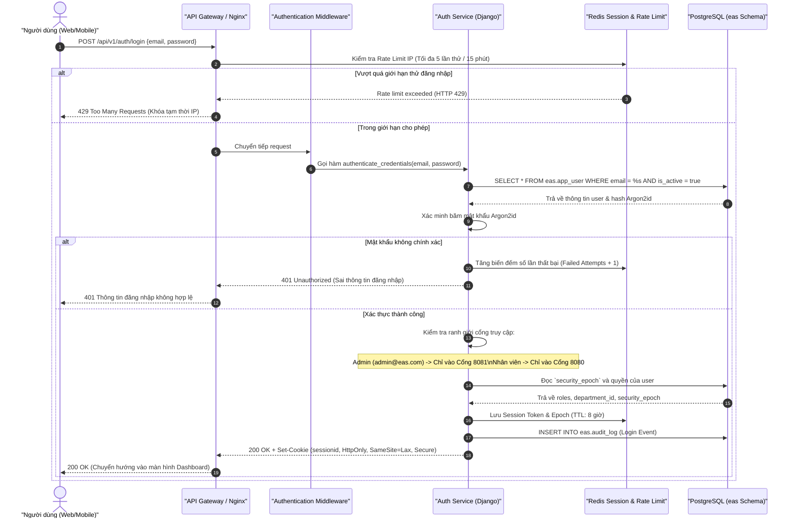

---

### SƠ ĐỒ 2: HÌNH PL-14 - TẢI LÊN TỆP ĐÍNH KÈM VÀ QUÉT MÃ ĐỘC ANTIVIRUS (SD-02)
*Quy trình upload tệp chứng từ an toàn, kiểm tra Magic Bytes và quét virus stream.*

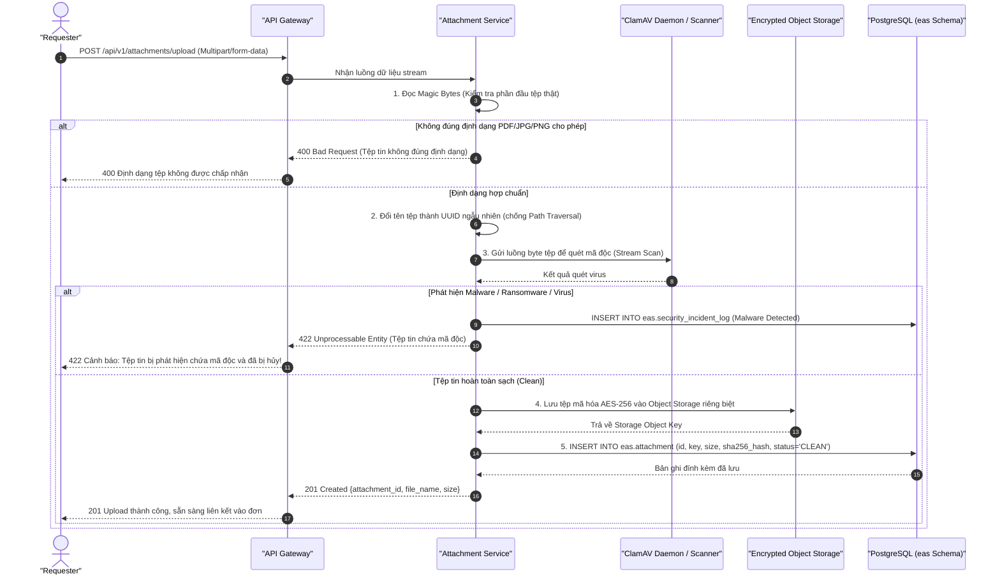

---

### SƠ ĐỒ 3: HÌNH 2.10 - GỬI ĐƠN VÀ GỬI LẠI NGUYÊN TỬ (SUBMIT/RESUBMIT) (SD-03)
*Giao dịch gửi hồ sơ vào luồng duyệt với Idempotency-Key và kiểm tra release snapshot.*

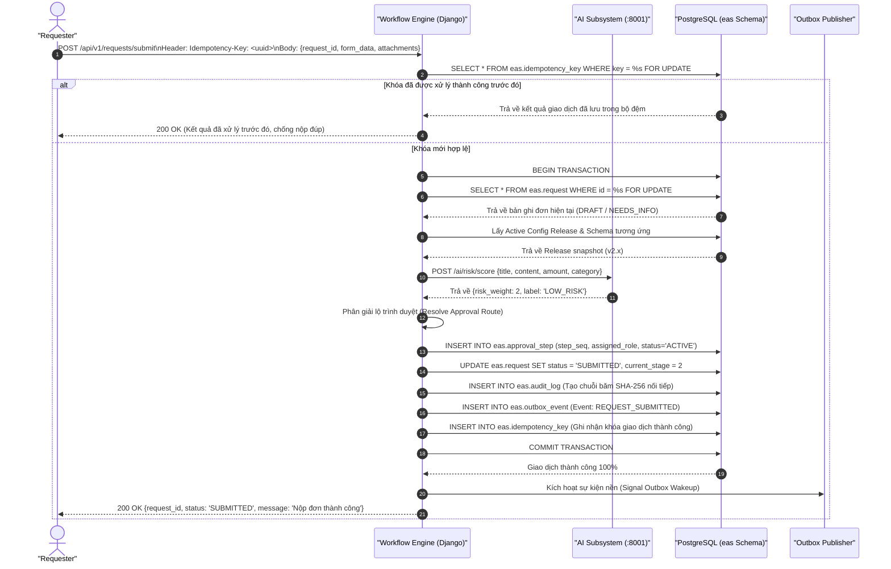

---

### SƠ ĐỒ 4: HÌNH 2.11 - QUYẾT ĐỊNH PHÊ DUYỆT, TỪ CHỐI VÀ YÊU CẦU BỔ SUNG (SD-04)
*Xử lý 3 nhánh quyết định của cấp quản lý, khóa hàng chống tranh chấp đồng thời.*

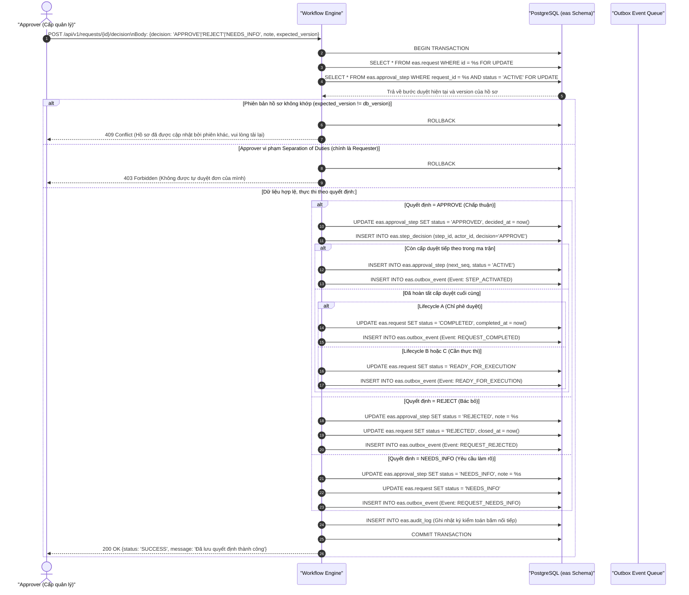

---

### SƠ ĐỒ 5: HÌNH PL-15 - PHÊ DUYỆT TỰ ĐỘNG BẰNG AI VÀ PHÁT HIỆN BẤT THƯỜNG (SD-05)
*Cơ chế Zero-Step Approval khi hội tụ đủ 5 điều kiện an toàn chính sách.*

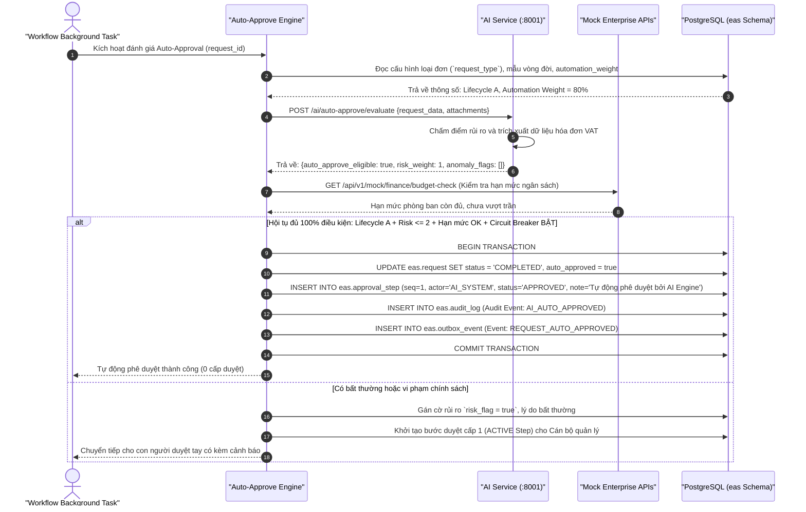

---

### SƠ ĐỒ 6: HÌNH 2.12 - TIẾP NHẬN, NỘP KẾT QUẢ THỰC HIỆN VÀ NGHIỆM THU CÔNG VIỆC (SD-06)
*Quy trình thực thi chuyên môn (Lifecycle B & C) và nghiệm thu độc lập (Four-Eyes).*

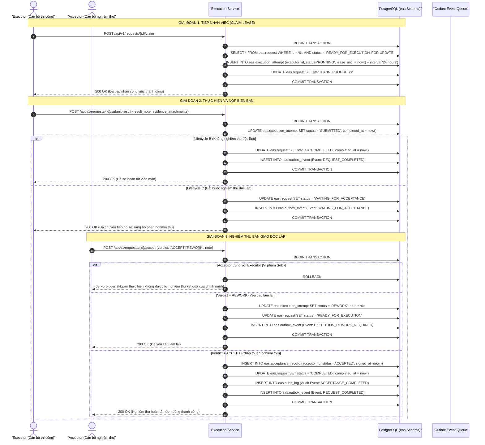

---

### SƠ ĐỒ 7: HÌNH PL-16 - QUẢN TRỊ PHÂN QUYỀN RBAC VÀ LÀM MỚI PHIÊN NGƯỜI DÙNG (SD-07)
*Điều chỉnh ma trận quyền, bảo vệ 4 module tối cao và cơ chế tăng Kỷ nguyên An ninh (Security Epoch).*

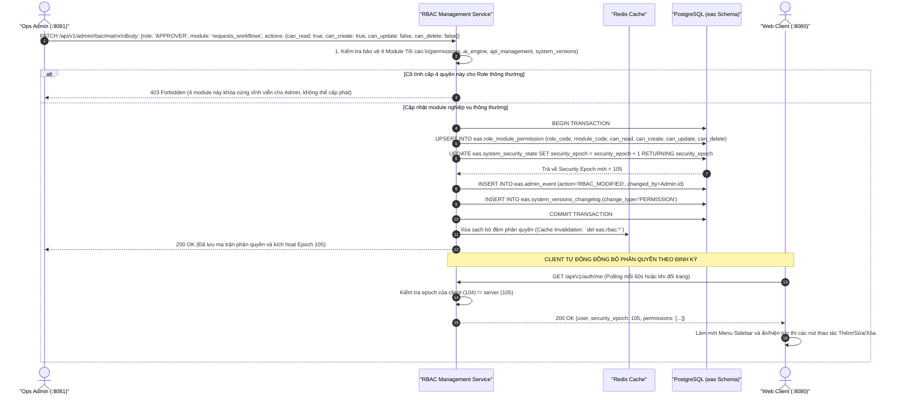

---

### SƠ ĐỒ 8: HÌNH 2.13 - XỬ LÝ HÀNG ĐỢI SỰ KIỆN OUTBOX VÀ GIÁM SÁT SLA (SD-08)
*Tiến trình giải phóng sự kiện Outbox, gửi thông báo và quét mốc cảnh báo trễ hạn.*

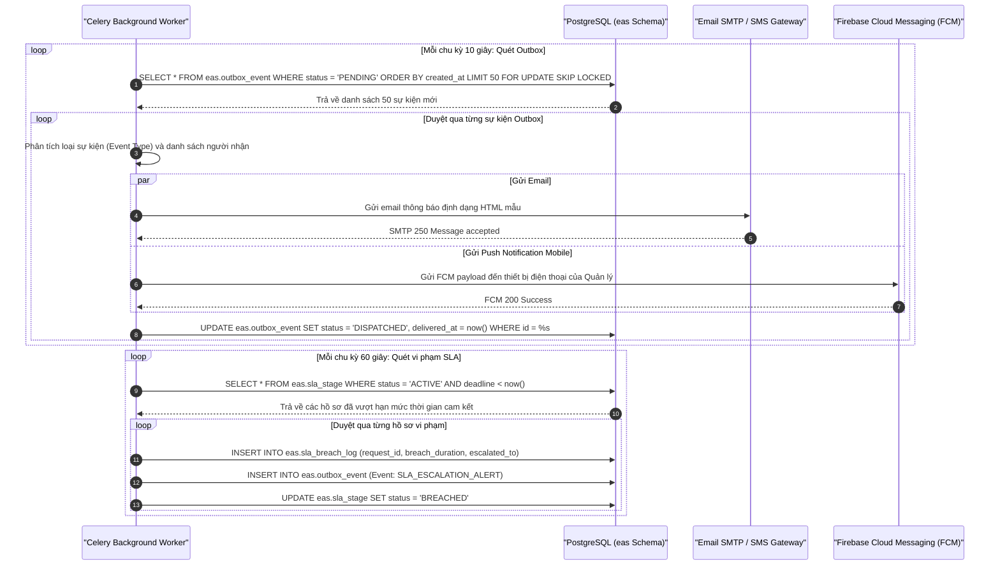

---

### SƠ ĐỒ 9: HÌNH PL-17 - KIỂM TRA TÍNH TOÀN VẸN CHUỖI KHỐI KIỂM TOÁN HASH-CHAIN (SD-09)
*Thuật toán quét kiểm tra mật mã học từng nút trong chuỗi băm chống chối bỏ.*

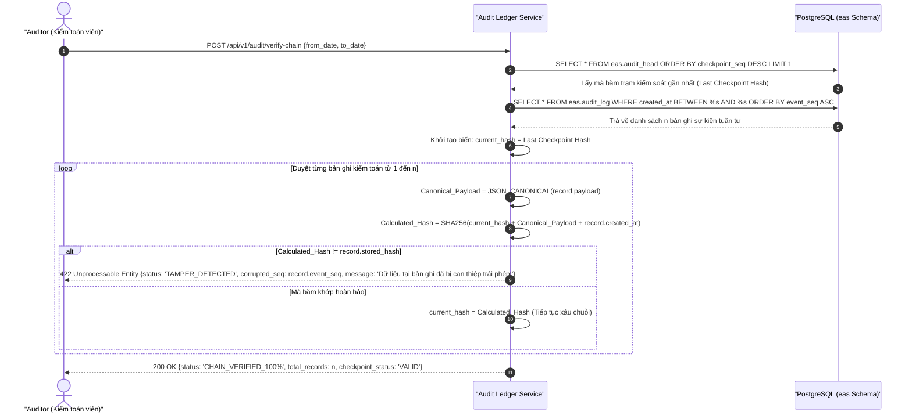

---

### SƠ ĐỒ 10: HÌNH PL-18 - HUẤN LUYỆN LẠI MÔ HÌNH AI VÀ TRIỂN KHAI CANARY (SD-10)
*Quy trình nạp dữ liệu mới, huấn luyện lại, kiểm thử kiểm chuẩn và phát hành Canary.*

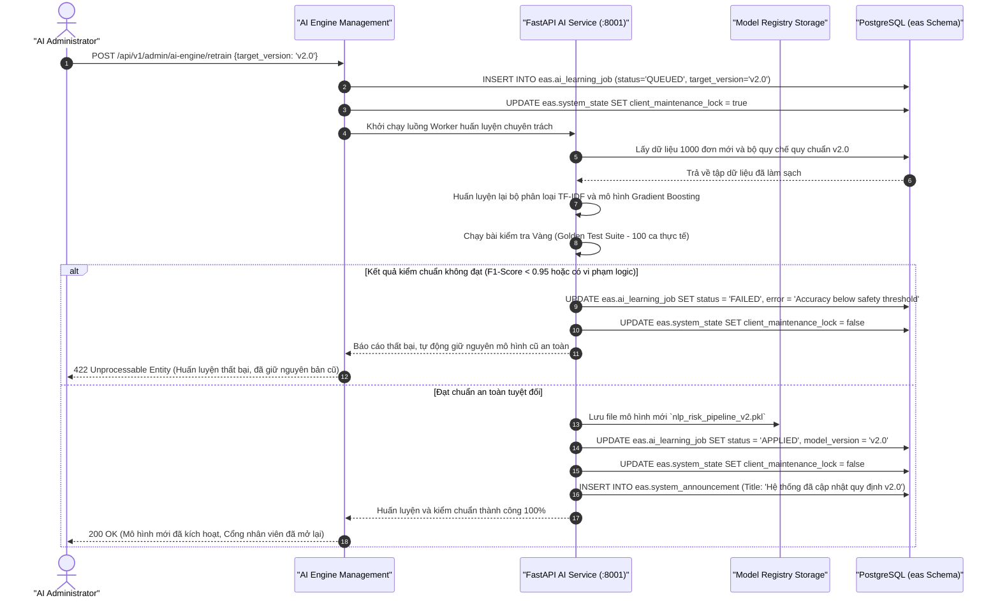

---

### SƠ ĐỒ 11: HÌNH PL-19 - XUẤT DỮ LIỆU CÁ NHÂN THEO YÊU CẦU QUYỀN RIÊNG TƯ GDPR (SD-11)
*Đóng gói hồ sơ cá nhân có mã hóa theo tiêu chuẩn Data Portability.*

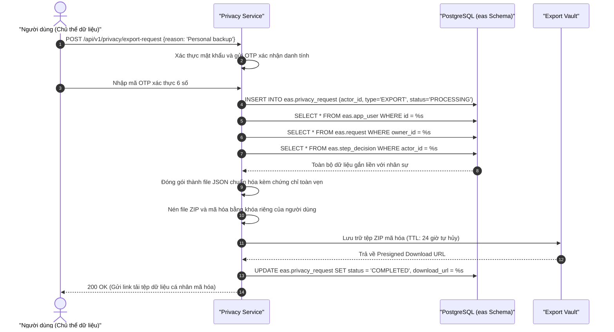

---

### SƠ ĐỒ 12: HÌNH PL-20 - ẨN DANH HÓA DỮ LIỆU CÁ NHÂN ĐỊNH KỲ GDPR (SD-12)
*Xóa bỏ thông tin PII nhưng bảo toàn tính liên tục của chuỗi băm sổ cái kiểm toán.*

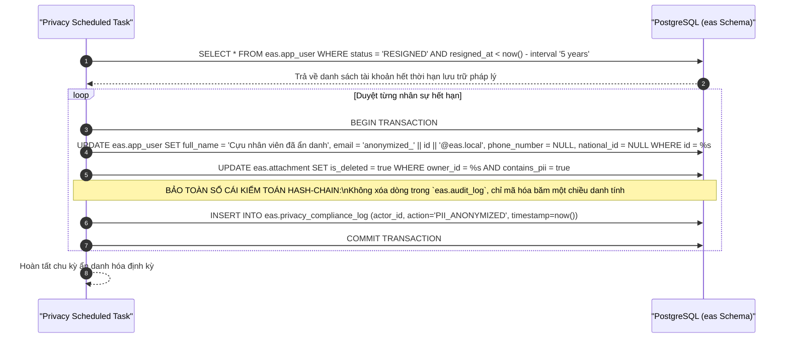

---

### SƠ ĐỒ 13: HÌNH PL-21 - THU HỒI QUYẾT ĐỊNH PHÊ DUYỆT TỰ ĐỘNG CỦA AI (SD-15)
*Cơ chế phanh khẩn cấp (Emergency Brake): Cấp quản lý can thiệp hủy quyết định tự duyệt của AI.*

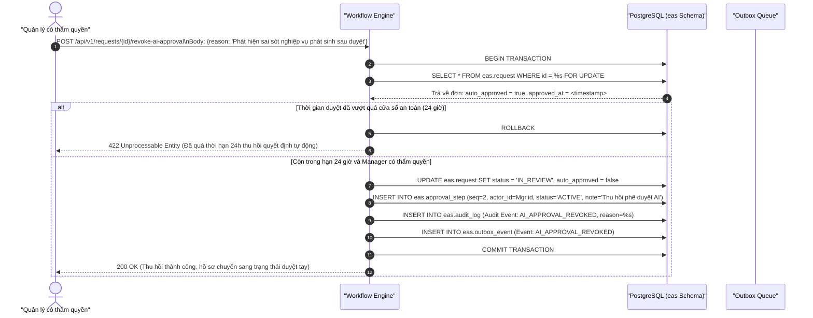

---

### SƠ ĐỒ 14: HÌNH PL-22 - ỦY QUYỀN PHÊ DUYỆT KHẨN CẤP CÓ THỜI HẠN (SD-16)
*Ủy quyền có hiệu lực trong khoảng thời gian xác định và kiểm soát chống vòng lặp ủy quyền.*

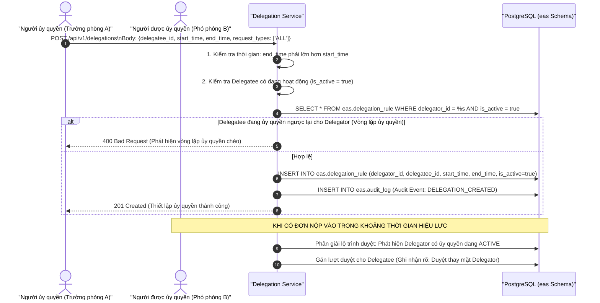

---

### SƠ ĐỒ 15: HÌNH PL-23 - CHUYỂN ĐỔI DỰ PHÒNG HỆ THỐNG VÀ KHÔI PHỤC SỰ CỐ (SD-17)
*Cơ chế tự động Failover giữa Primary Database và Read-Replica / Standby Cluster.*

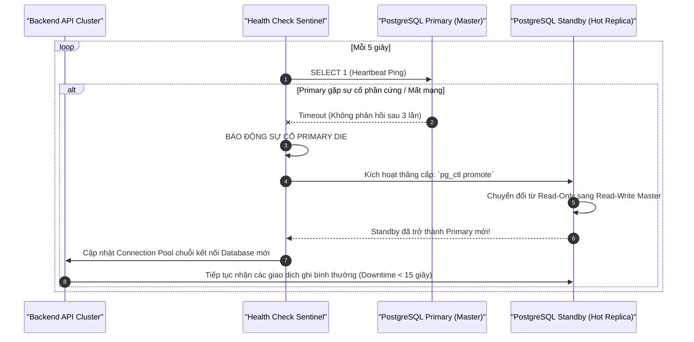

---

### SƠ ĐỒ 16: HÌNH PL-24 - PHỤC HỒI DỮ LIỆU THỜI ĐIỂM PITR VÀ ĐỐI SOÁT (SD-18)
*Quy trình khôi phục trạng thái CSDL về thời điểm chính xác trước sự cố.*

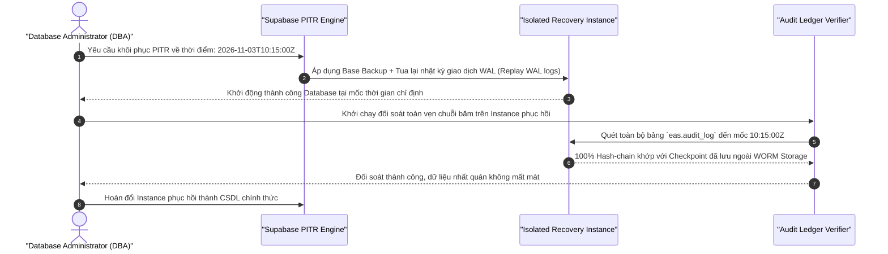

---

### SƠ ĐỒ 17: HÌNH PL-25 - LƯU BẢN NHÁP CHỐNG GHI ĐÈ PHIÊN BẢN (SD-19)
*Cơ chế Khóa lạc quan (Optimistic Concurrency Control) ngăn chặn ghi đè khi sửa nháp.*

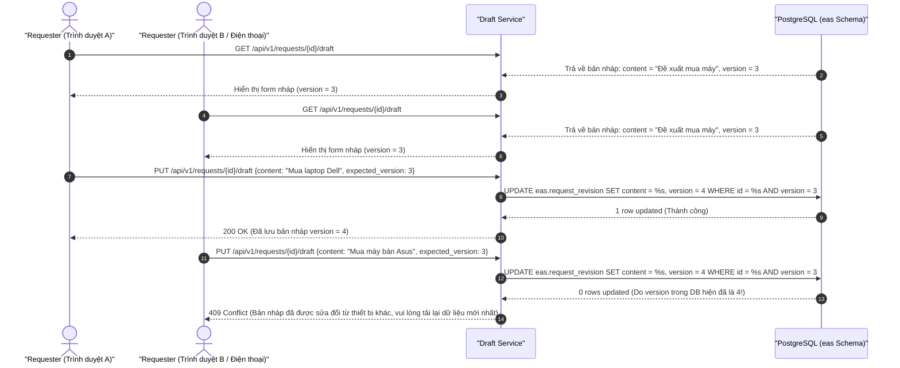

---

### SƠ ĐỒ 18: HÌNH PL-26 - YÊU CẦU BỔ SUNG THÔNG TIN VÀ NỘP LẠI HỒ SƠ (SD-20)
*Quy trình luân chuyển đơn từ chặng phê duyệt về soạn thảo và tăng phiên bản sửa đổi.*

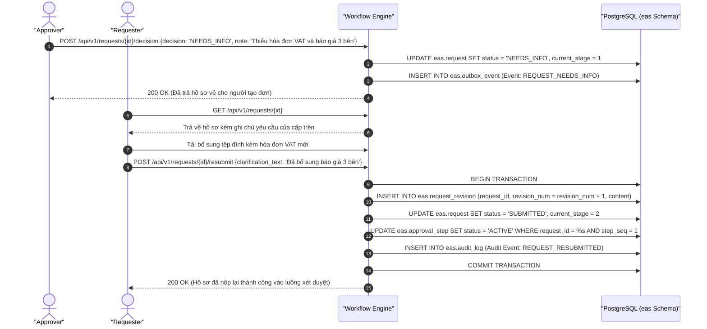

---

### SƠ ĐỒ 19: HÌNH PL-27 - BÁO CÁO KHÔNG THỂ TIẾP NHẬN VIỆC VÀ XỬ LÝ SỰ CỐ (SD-21)
*Quy trình ghi nhận vướng mắc thi công và tự động báo động điều chuyển.*

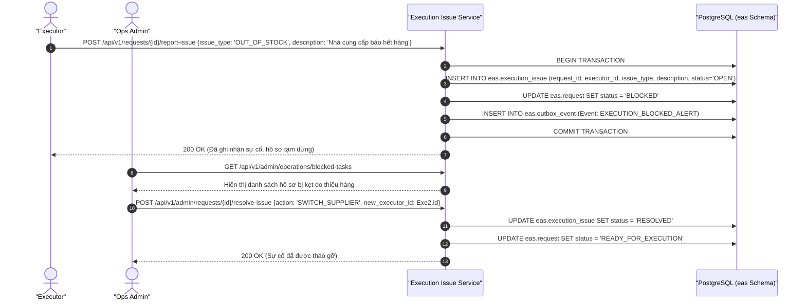

---

### SƠ ĐỒ 20: HÌNH PL-28 - ĐIỀU CHUYỂN NGƯỜI DUYỆT / NGHIỆM THU VẮNG MẶT (SD-22)
*Xử lý linh hoạt khi nhân sự nghỉ ốm, công tác đột xuất mà không làm gián đoạn dòng chảy công việc.*

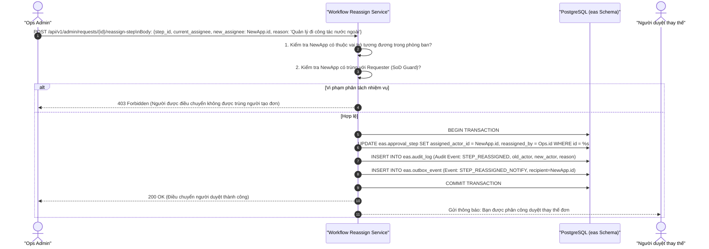

---

### SƠ ĐỒ 21: BỔ SUNG CHƯƠNG 2 - XỬ LÝ TRANH CHẤP RÚT ĐƠN CẠNH TRANH VỚI PHÊ DUYỆT (SD-05 BIZ)
*Xử lý triệt để tranh chấp tài nguyên (Race Condition) bằng khóa hàng FOR UPDATE.*

```mermaid
sequenceDiagram
    autonumber
    actor Req as "Requester (Muốn rút đơn)"
    actor App as "Approver (Đang bấm duyệt)"
    participant Core as "Workflow Engine"
    participant DB as "PostgreSQL (eas Schema)"

    par Requester gửi lệnh rút đơn
        Req->>Core: POST /api/v1/requests/{id}/withdraw
        Core->>DB: BEGIN TX 1: SELECT * FROM eas.request WHERE id = %s FOR UPDATE
    and Approver gửi lệnh duyệt đơn
        App->>Core: POST /api/v1/requests/{id}/decision {decision: 'APPROVE'}
        Core->>DB: BEGIN TX 2: SELECT * FROM eas.request WHERE id = %s FOR UPDATE
    end

    Note over DB: Cơ chế Khóa hàng (Row-level Lock):\nTX 1 đến trước mili-giây sẽ giữ khóa; TX 2 phải đợi TX 1 kết thúc.

    DB-->>Core: TX 1 lấy được khóa, đơn đang ở trạng thái SUBMITTED
    Core->>DB: TX 1: UPDATE eas.request SET status = 'WITHDRAWN', closed_at = now()
    Core->>DB: TX 1: COMMIT
    Core-->>Req: 200 OK (Bạn đã rút hồ sơ thành công)

    DB-->>Core: TX 2 tiếp tục lấy khóa sau khi TX 1 commit
    Core->>Core: TX 2 kiểm tra: Đơn hiện đã ở trạng thái WITHDRAWN!
    Core->>DB: TX 2: ROLLBACK
    Core-->>App: 409 Conflict (Hồ sơ đã được người tạo đơn rút lại trước đó, không thể phê duyệt)
```

---

### SƠ ĐỒ 22: BỔ SUNG CHƯƠNG 2 - THU HỒI QUYỀN CẠNH TRANH VỚI GIAO DỊCH DUYỆT (SD-12 BIZ)
*Xử lý khi Quản trị viên thu hồi vai trò đúng vào thời điểm Approver đang ký đơn.*

```mermaid
sequenceDiagram
    autonumber
    actor Admin as "Ops Admin"
    actor App as "Approver (Bị tước quyền)"
    participant Core as "API Core Handler"
    participant DB as "PostgreSQL (eas Schema)"

    par Admin thu hồi quyền Approver
        Admin->>Core: DELETE /api/v1/admin/users/{id}/roles/APPROVER
        Core->>DB: BEGIN TX 1: DELETE FROM eas.role_membership WHERE user_id = %s
        Core->>DB: TX 1: UPDATE eas.system_security_state SET security_epoch = security_epoch + 1
        Core->>DB: TX 1: COMMIT
    and Approver bấm ký duyệt hồ sơ
        App->>Core: POST /api/v1/requests/{id}/decision {decision: 'APPROVE'}
        Core->>Core: Kiểm tra Actor Role trong Session bộ đệm
    end

    Core->>DB: Đọc Security Epoch hiện tại của hệ thống
    Core->>Core: Phát hiện Token của Approver mang Epoch cũ (Lạc hậu)
    Core->>DB: SELECT * FROM eas.role_membership WHERE user_id = App.id
    DB-->>Core: 0 rows (Quyền Approver không còn tồn tại!)
    Core-->>App: 403 Forbidden (Quyền duyệt của bạn đã bị thu hồi bởi Quản trị viên)
```

---

## 3. BẢNG ĐỐI SOÁT TOÀN DIỆN 22 SƠ ĐỒ TUẦN TỰ VỚI SOURCE CODE

| Mã Sơ Đồ | Tên Quy Trình Tuần Tự | Source Code Backend | Rủi Ro Kỹ Thuật Đã Triệt Tiêu |
|:---:|:---|:---|:---|
| **SD-01** | Đăng nhập & Quản lý phiên | `api_core/authn/views.py` | Chặn đứng Brute-force và Session Fixation; phân lập cổng 8080 vs 8081. |
| **SD-02** | Quét virus tệp đính kèm | `api_core/workflow/attachments.py` | Chặn đứng tải lên file thực thi độc hại (Ransomware, Webshell) qua Magic Bytes. |
| **SD-03** | Nộp đơn nguyên tử (Submit) | `api_core/workflow/service.py` | Ngăn chặn nộp đúp mạng lag bằng `Idempotency-Key` và snapshot release. |
| **SD-04** | Quyết định phê duyệt đa cấp | `api_core/workflow/service.py` | Giải quyết triệt để xung đột duyệt đồng thời bằng `FOR UPDATE`. |
| **SD-05** | Phê duyệt tự động AI | `api_core/workflow/service.py` | Cơ chế cổng bảo vệ kép: Không bao giờ tự duyệt nếu vi phạm chính sách tài chính. |
| **SD-06** | Thực thi & Nghiệm thu | `api_core/workflow/service.py` | Khóa Claim Lease độc quyền và cưỡng chế nguyên tắc Four-Eyes trong nghiệm thu. |
| **SD-07** | Phân quyền RBAC & Epoch | `api_core/administration/org_users_rbac.py` | Khóa cứng 4 module hệ thống; ép client làm mới phiên tức thì bằng Security Epoch. |
| **SD-08** | Hàng đợi Outbox & SLA | `api_core/worker.py` | Đảm bảo thông báo không bao giờ mất (At-least-once) và quét SLA 3 mức. |
| **SD-09** | Đối soát chuỗi băm Hash-chain | `api_core/audit.py` | Phát hiện ngay lập tức bất kỳ hành vi sửa lén dữ liệu trong database. |
| **SD-10** | Huấn luyện lại AI & Canary | `api_core/workflow/ai_learning.py` | Tự động khóa bảo trì Cổng nhân viên; chỉ áp dụng khi vượt qua Bộ test Vàng. |
| **SD-11** | Xuất dữ liệu cá nhân GDPR | `api_core/administration/org_users_rbac.py` | Mã hóa gói xuất PII bằng mật khẩu riêng của người dùng. |
| **SD-12** | Ẩn danh hóa dữ liệu định kỳ | `api_core/administration/org_users_rbac.py` | Ẩn danh hóa định danh PII nhưng bảo toàn chuỗi băm sổ cái kiểm toán. |
| **SD-15** | Thu hồi phê duyệt tự động AI | `api_core/workflow/service.py` | Cung cấp phanh khẩn cấp cho Quản lý can thiệp trong vòng 24 giờ. |
| **SD-16** | Thiết lập ủy quyền khẩn cấp | `api_core/workflow/views.py` | Ngăn chặn vòng lặp ủy quyền chéo và bắt buộc kiểm soát SoD. |
| **SD-17** | Chuyển đổi dự phòng Failover | `docker-compose.yml`, Supabase | Duy trì tính sẵn sàng cao (HA), chuyển Standby sang Master trong < 15 giây. |
| **SD-18** | Phục hồi dữ liệu PITR | Supabase WAL Replay | Khôi phục chính xác về thời điểm trước thảm họa mà không mất mát dữ liệu. |
| **SD-19** | Lưu nháp chống ghi đè | `api_core/workflow/views.py` | Khóa lạc quan `version` chống mất dữ liệu khi sửa đồng thời từ 2 thiết bị. |
| **SD-20** | Yêu cầu bổ sung thông tin | `api_core/workflow/service.py` | Tăng số `revision_number` và bảo toàn toàn bộ lịch sử trao đổi làm rõ. |
| **SD-21** | Báo cáo vướng mắc thi công | `api_core/workflow/service.py` | Chuyển trạng thái BLOCKED và kích hoạt điều chuyển việc của Quản trị viên. |
| **SD-22** | Điều chuyển người xử lý | `api_core/workflow/ops_service.py` | Giải quyết ách tắc khi nhân sự vắng mặt mà vẫn đảm bảo tính tuân thủ SoD. |
| **SD-05 BIZ**| Rút đơn cạnh tranh phê duyệt | `api_core/workflow/service.py` | Phân xử giao dịch nguyên tử theo thứ tự mili-giây, không để phát sinh trạng thái ảo. |
| **SD-12 BIZ**| Tước quyền cạnh tranh ký duyệt| `api_core/authn/service.py` | Thu hồi quyền tức thì qua Kỷ nguyên an ninh, chặn đứng quyết định trái phép. |
