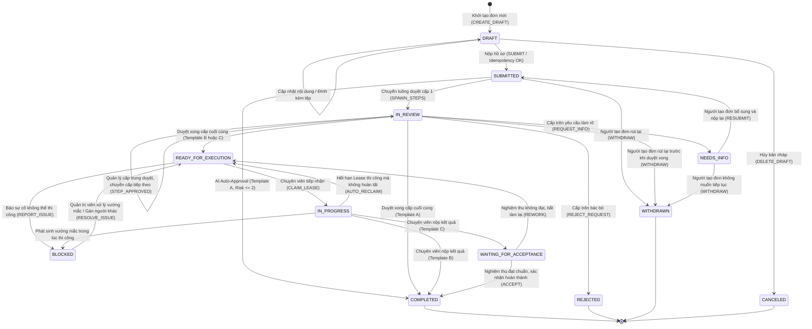
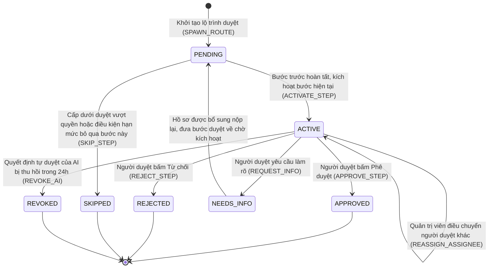
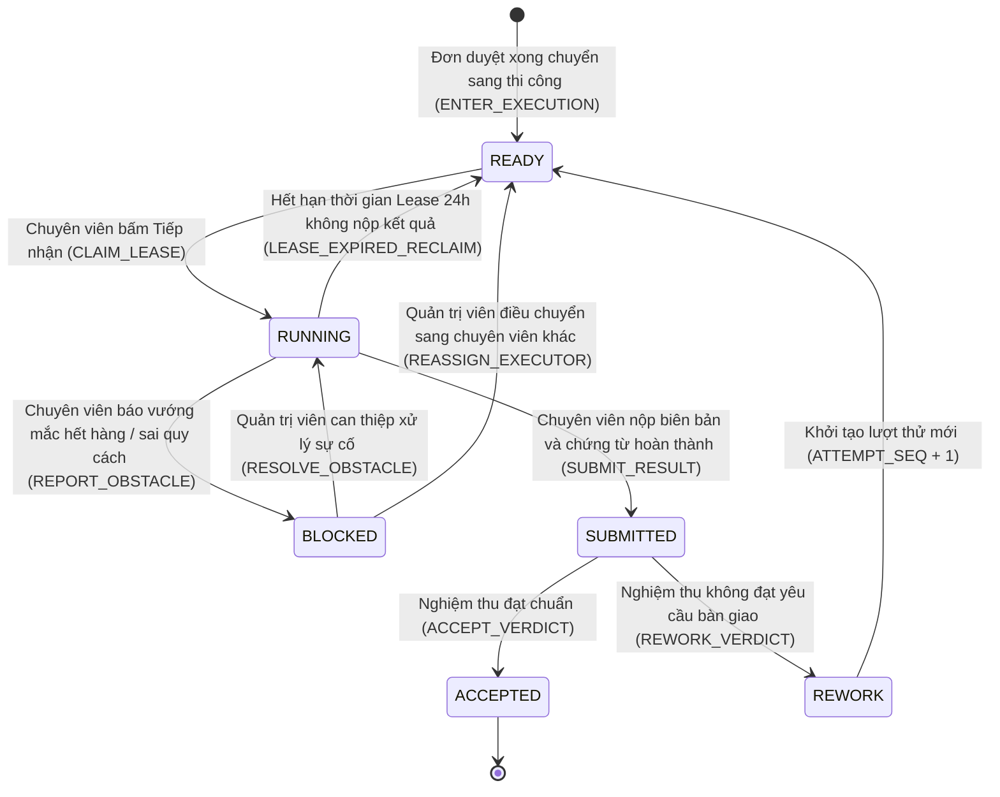
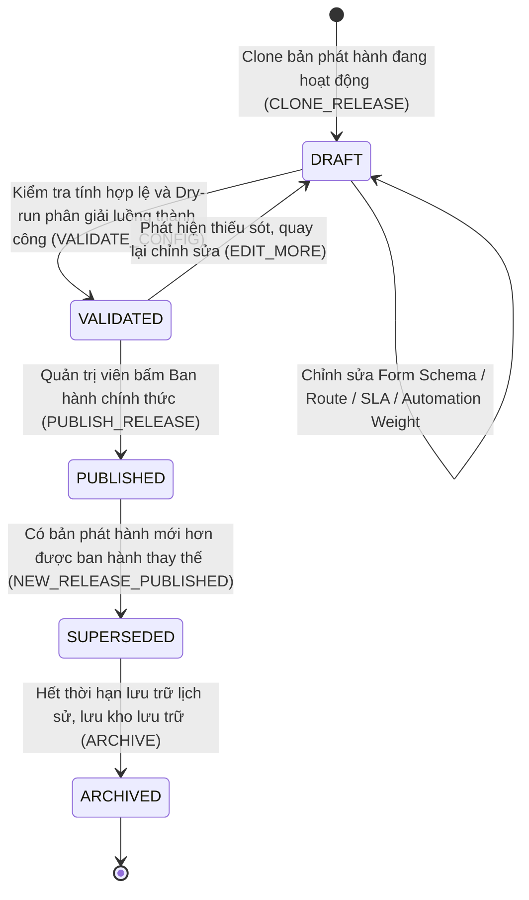
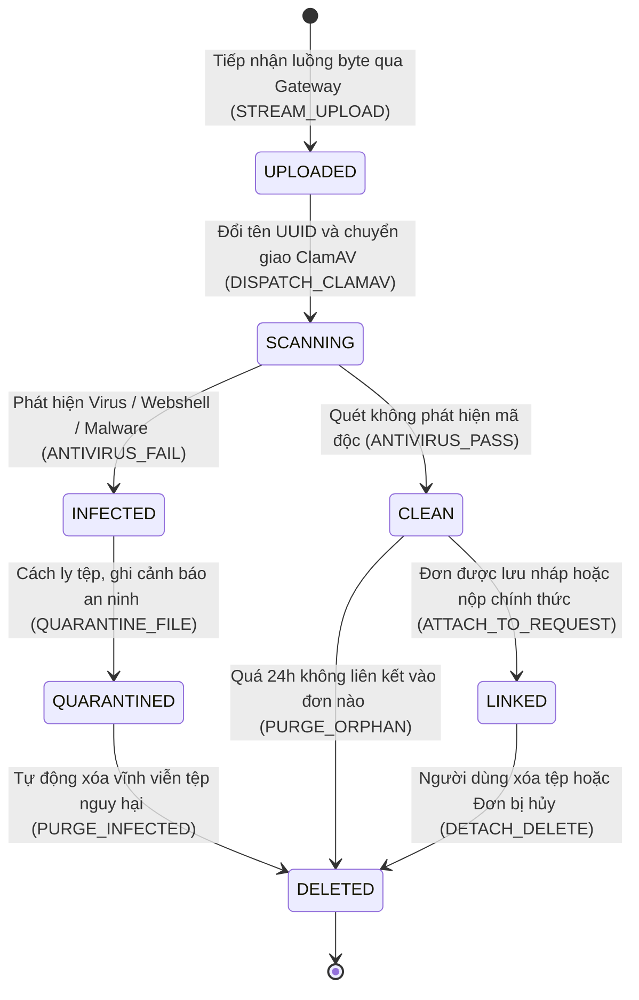
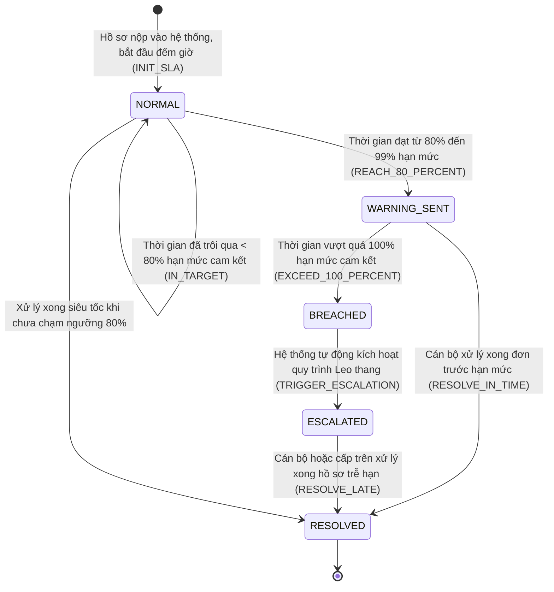
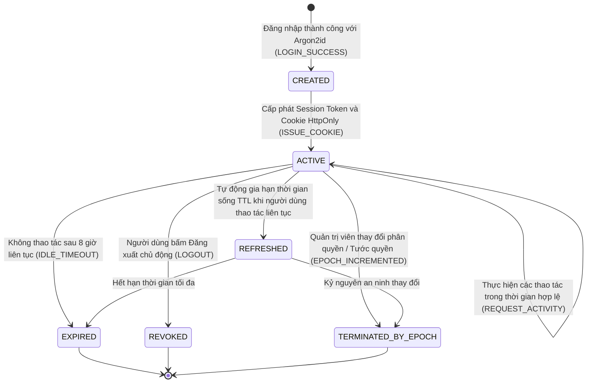
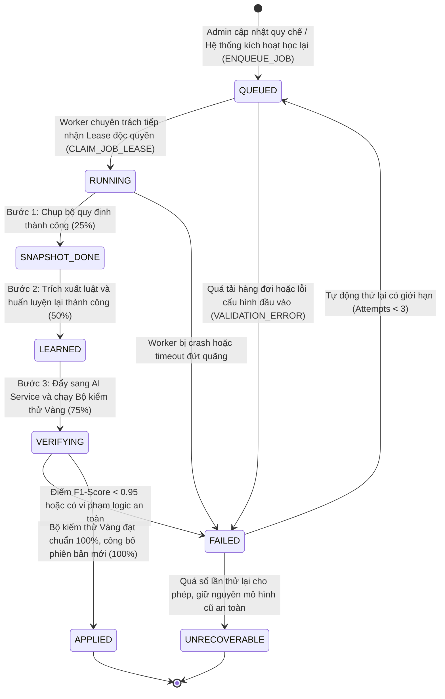

# HỒ SƠ THIẾT KẾ TOÀN DIỆN CÁC SƠ ĐỒ MÁY TRẠNG THÁI (STATE MACHINE DIAGRAMS)
## DỰ ÁN: HỆ THỐNG TỰ ĐỘNG HÓA QUY TRÌNH XỬ LÝ YÊU CẦU NỘI BỘ ĐA CẤP (EAS)
### HỘI ĐỒNG THẨM ĐỊNH IT 15 NĂM KINH NGHIỆM: BA, PM, DEV, UI/UX, AI, QA, PO

---

## 1. NGUYÊN TẮC THIẾT KẾ MÁY TRẠNG THÁI HỮU HẠN (FINITE STATE MACHINE - FSM)

Theo tiêu chuẩn UML 2.5 State Machine Diagrams và đối soát trực tiếp mã nguồn động cơ chuyển trạng thái trong `api_core/workflow/service.py`, `api_core/workflow/ai_learning.py` và các Trigger ràng buộc trong `database/migrations/`, hệ thống EAS áp dụng các nguyên tắc thiết kế toán học khắt khe:
1. **Tính đóng của tập trạng thái (Completeness & Closure):** Mọi thực thể nghiệp vụ chỉ được phép tồn tại ở một trạng thái duy nhất trong tập hợp trạng thái hợp lệ đã định nghĩa.
2. **Chuyển trạng thái có điều kiện bảo vệ (Guarded Transitions):** Không có trạng thái nào chuyển đổi tự do. Mọi chuyển đổi bắt buộc phải có sự kiện kích hoạt (Event Trigger), vai trò tác nhân có thẩm quyền (Actor Guard) và điều kiện dữ liệu thỏa mãn (Data Condition).
3. **Tính đơn điệu của các trạng thái kết thúc (Terminal States Immutability):** Các trạng thái cuối cùng như `COMPLETED`, `REJECTED`, `WITHDRAWN`, `CANCELED` là bất biến tuyệt đối. Khi đã vào trạng thái kết thúc, thực thể không bao giờ được phép chỉnh sửa dữ liệu hoặc hồi sinh lại (No Zombie Transitions).
4. **Cơ chế kiểm soát phiên bản và ghi nhật ký đồng thời (Optimistic Locking & Audit Coupling):** Mọi lần chuyển đổi trạng thái bắt buộc phải tăng trường `version` của thực thể và ghi nhận một dòng sự kiện mới vào sổ cái kiểm toán `eas.audit_log` trong cùng một giao dịch ACID.

---

## 2. DANH MỤC TOÀN BỘ 8 SƠ ĐỒ MÁY TRẠNG THÁI TRONG HỆ THỐNG EAS

---

### SƠ ĐỒ 1: HÌNH 2.16 - MÁY TRẠNG THÁI VÒNG ĐỜI HỒ SƠ YÊU CẦU (REQUEST FSM - ST-01)
*Động cơ vòng đời hồ sơ lõi bao phủ toàn bộ 18 loại đơn và 3 mẫu vòng đời A, B, C.*

---

### SƠ ĐỒ 2: HÌNH 2.17 - MÁY TRẠNG THÁI CỦA MỘT LƯỢT PHÊ DUYỆT (APPROVAL STEP FSM - ST-02)
*Vòng đời của từng chặng duyệt trong ma trận thẩm quyền đa cấp.*

---

### SƠ ĐỒ 3: HÌNH 2.18 - MÁY TRẠNG THÁI LẦN THỰC HIỆN CÔNG VIỆC (EXECUTION ATTEMPT FSM - ST-03)
*Vòng đời kiểm soát chuyên viên thi công và các lần thử nghiệm thu.*

---

### SƠ ĐỒ 4: HÌNH 2.19 - MÁY TRẠNG THÁI BẢN PHÁT HÀNH CẤU HÌNH ĐỘNG (CONFIG RELEASE FSM - ST-07)
*Vòng đời quản lý phiên bản cấu hình quy chế (Semantic Versioning & Immutability).*

---

### SƠ ĐỒ 5: HÌNH PL-29 - MÁY TRẠNG THÁI TỆP ĐÍNH KÈM VÀ QUÉT ANTIVIRUS (ATTACHMENT FSM - ST-04)
*Vòng đời an ninh của tệp tin đính kèm từ khi nạp luồng byte đến lưu trữ an toàn.*

---

### SƠ ĐỒ 6: HÌNH PL-30 - MÁY TRẠNG THÁI CẢNH BÁO VI PHẠM SLA (SLA ALERT FSM - ST-05)
*Tiến trình giám sát cam kết dịch vụ theo ngưỡng thời gian thời gian thực.*

---

### SƠ ĐỒ 7: HÌNH PL-31 - MÁY TRẠNG THÁI PHIÊN XÁC THỰC NGƯỜI DÙNG (AUTH SESSION FSM - ST-08)
*Vòng đời phiên làm việc an toàn, kiểm soát Kỷ nguyên An ninh (Security Epoch).*

---

### SƠ ĐỒ 8: BỔ SUNG MÁY TRẠNG THÁI TÁC VỤ HỌC MÁY AI (AI LEARNING JOB FSM - ST-09)
*Vòng đời kiểm soát tác vụ học quy định với khóa bảo trì tự động và xác minh mô hình.*

---

## 3. MA TRẬN CHUYỂN TRẠNG THÁI YÊU CẦU VÀ ĐỐI SOÁT MÃ NGUỒN (RTM MATRIX)

| Trạng Thái Ban Đầu | Sự Kiện Kích Hoạt | Trạng Thái Đích | Điều Kiện Bảo Vệ (Guard Condition) | Mã Nguồn Triển Khai |
|:---|:---|:---|:---|:---|
| `None` (Mới) | `CREATE_DRAFT` | `DRAFT` | Người dùng đã đăng nhập hợp lệ, chọn loại đơn có Active Release. | `api_core/workflow/views.py` |
| `DRAFT` | `SUBMIT` | `SUBMITTED` | Điền đủ các trường bắt buộc, có Idempotency-Key, tệp đính kèm sạch mã độc. | `api_core/workflow/service.py` |
| `SUBMITTED` | `AI_AUTO_APPROVE` | `COMPLETED` | Template A + Điểm rủi ro AI <= 2 + Hạn mức ngân sách OK + Circuit Breaker BẬT. | `api_core/workflow/service.py` |
| `SUBMITTED` | `SPAWN_STEPS` | `IN_REVIEW` | Không đủ điều kiện tự duyệt, phân giải ít nhất 1 cấp quản lý phê duyệt. | `api_core/workflow/service.py` |
| `SUBMITTED` / `IN_REVIEW` | `WITHDRAW` | `WITHDRAWN` | Người thực hiện phải là chính chủ (`owner_id`), đơn chưa duyệt xong hoàn toàn. | `api_core/workflow/service.py` |
| `IN_REVIEW` | `REJECT` | `REJECTED` | Người duyệt có vai trò hợp lệ, bắt buộc nhập lý do từ chối. | `api_core/workflow/service.py` |
| `IN_REVIEW` | `NEEDS_INFO` | `NEEDS_INFO` | Người duyệt yêu cầu bổ sung, bắt buộc nhập nội dung cần làm rõ. | `api_core/workflow/service.py` |
| `NEEDS_INFO` | `RESUBMIT` | `SUBMITTED` | Người tạo đơn bổ sung thông tin/tệp mới, tăng số `revision_number`. | `api_core/workflow/service.py` |
| `IN_REVIEW` | `APPROVE` (Final A) | `COMPLETED` | Cấp duyệt cuối cùng hoàn tất trên loại đơn Template A (Chỉ phê duyệt). | `api_core/workflow/service.py` |
| `IN_REVIEW` | `APPROVE` (Final B/C) | `READY_FOR_EXECUTION`| Cấp duyệt cuối cùng hoàn tất trên loại đơn Template B hoặc C. | `api_core/workflow/service.py` |
| `READY_FOR_EXECUTION` | `CLAIM` | `IN_PROGRESS` | Chuyên viên thuộc đúng bộ phận chuyên trách, chưa có ai nhận trước. | `api_core/workflow/service.py` |
| `IN_PROGRESS` | `REPORT_ISSUE` | `BLOCKED` | Chuyên viên phát sinh sự cố không thể tiếp tục (hết hàng, sai linh kiện). | `api_core/workflow/service.py` |
| `BLOCKED` | `RESOLVE_ISSUE` | `READY_FOR_EXECUTION`| Quản trị viên xử lý vướng mắc hoặc gán chuyên viên khác thi công. | `api_core/workflow/ops_service.py` |
| `IN_PROGRESS` | `SUBMIT_RESULT` (B) | `COMPLETED` | Chuyên viên nộp kết quả trên loại đơn Template B (Không cần nghiệm thu). | `api_core/workflow/service.py` |
| `IN_PROGRESS` | `SUBMIT_RESULT` (C) | `WAITING_FOR_ACCEPTANCE`| Chuyên viên nộp kết quả trên loại đơn Template C (Bắt buộc nghiệm thu). | `api_core/workflow/service.py` |
| `WAITING_FOR_ACCEPTANCE` | `REWORK` | `READY_FOR_EXECUTION`| Cán bộ nghiệm thu đánh giá không đạt, yêu cầu làm lại kèm lý do. | `api_core/workflow/service.py` |
| `WAITING_FOR_ACCEPTANCE` | `ACCEPT` | `COMPLETED` | Cán bộ nghiệm thu độc lập (khác Executor) ký nhận bàn giao đạt chuẩn. | `api_core/workflow/service.py` |
