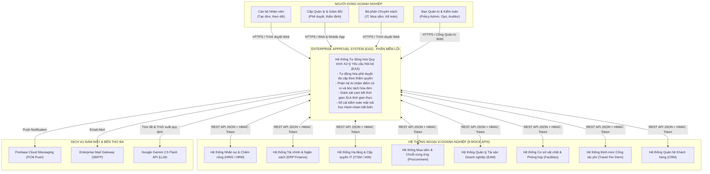
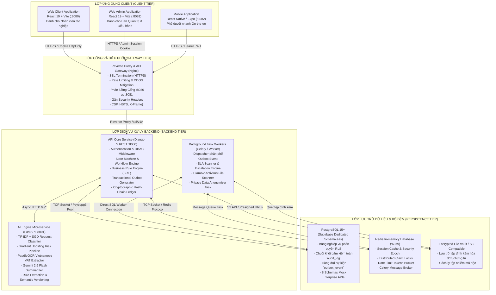
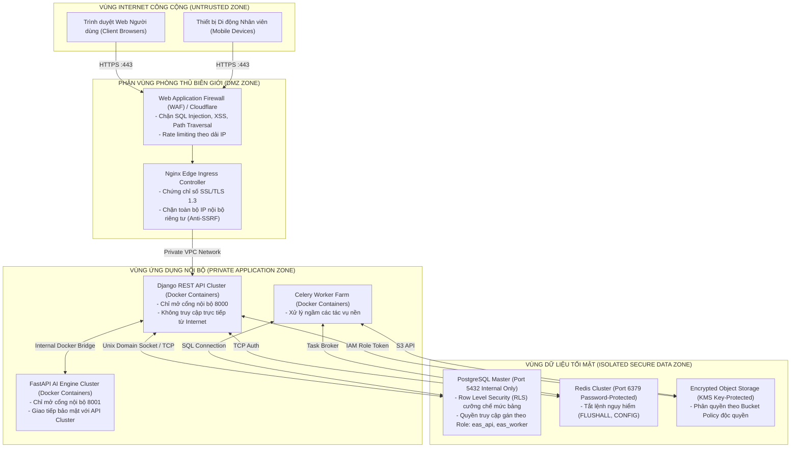
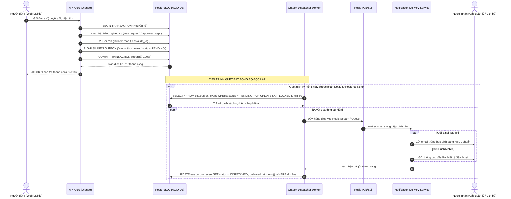
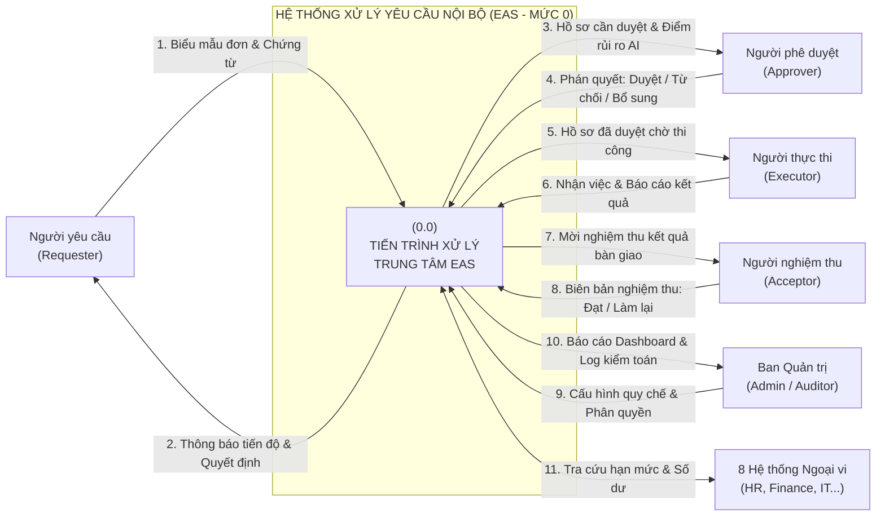
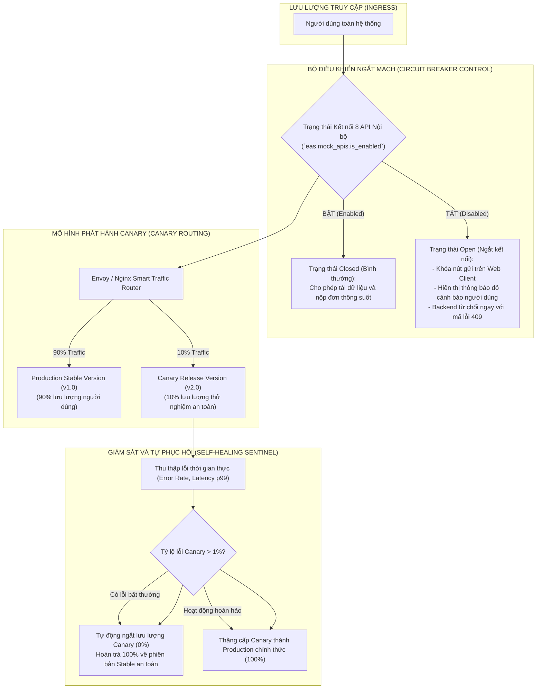

# HỒ SƠ THIẾT KẾ KIẾN TRÚC VÀ LUỒNG DỮ LIỆU PHÂN TÁN (ARCHITECTURE & DFD)
## DỰ ÁN: HỆ THỐNG TỰ ĐỘNG HÓA QUY TRÌNH XỬ LÝ YÊU CẦU NỘI BỘ ĐA CẤP (EAS)
### HỘI ĐỒNG THẨM ĐỊNH IT 15 NĂM KINH NGHIỆM: BA, PM, DEV, UI/UX, AI, QA, PO

---

## 1. NGUYÊN TẮC THIẾT KẾ KIẾN TRÚC HỆ THỐNG PHÂN TÁN (DISTRIBUTED SYSTEMS ARCHITECTURE)

Theo tiêu chuẩn IEEE/ISO/IEC 42010 về Kiến trúc Phần mềm và mô hình C4 (Context, Container, Component, Code), hệ thống EAS được kiến trúc dựa trên các nguyên tắc phòng thủ đa tầng và khả năng chịu tải cao:
1. **Ranh giới tin cậy nghiêm ngặt (Zero-Trust Boundaries):** Không có thành phần nào mặc định tin tưởng thành phần khác. Mọi giao tiếp giữa Web/Mobile và Backend đều phải qua Gateway có kiểm tra Rate-limit, WAF, xác thực danh tính và CSRF protection.
2. **Cách ly phân hệ Quản trị và Cổng Nhân viên (Dual-Portal Port Separation):**
   - **Cổng Nhân viên (Web Client):** Chạy trên cổng `8080` (hoặc `5173` môi trường dev), chỉ phục vụ cán bộ nhân viên tác nghiệp tạo đơn, duyệt đơn, thi công, nghiệm thu.
   - **Cổng Quản trị (Web Admin):** Chạy trên cổng `8081`, chỉ cho phép tài khoản Quản trị viên tối cao (`admin@eas.com` / `ADMIN_ROLES`) truy cập các tính năng cấu hình quy chế, phân quyền, quản lý API và vận hành hệ thống.
3. **Mô hình Dữ liệu Bất đồng bộ Tin cậy (Transactional Outbox Pattern):** Ngăn chặn hiện tượng phân rã dữ liệu (Dual-write problem) khi vừa cập nhật CSDL vừa gửi tin nhắn qua RabbitMQ/Redis/SMTP. Toàn bộ sự kiện phát tán được ghi vào bảng `eas.outbox_event` cùng transaction nghiệp vụ.
4. **Cơ chế Ngắt mạch và Tự phục hồi (Circuit Breaker & Self-Healing):** Giám sát trạng thái 8 Mock API nội bộ; khi một kết nối bị ngắt, hệ thống tự động khóa tạm ngưng các mẫu đơn liên quan để bảo vệ trải nghiệm người dùng và ngăn ngừa dữ liệu rác.

---

## 2. DANH MỤC TẤT CẢ 9 SƠ ĐỒ KIẾN TRÚC VÀ LUỒNG DỮ LIỆU (AR-01 ĐẾN DFD-01)

---

### SƠ ĐỒ 1: HÌNH 2.14 - SƠ ĐỒ NGỮ CẢNH KIẾN TRÚC HỆ THỐNG TỔNG THỂ (C4 CONTEXT - AR-01)
*Vị trí của hệ thống EAS trong toàn cảnh hệ sinh thái công nghệ doanh nghiệp.*

---

### SƠ ĐỒ 2: HÌNH 2.15 - SƠ ĐỒ CÁC CONTAINER LOGIC TRONG HỆ THỐNG (C4 CONTAINER - AR-02)
*Phân rã các khối thực thi (Containers), công nghệ nền tảng và giao thức kết nối nội bộ.*

---

### SƠ ĐỒ 3: HÌNH 2.20 - KIẾN TRÚC HẠ TẦNG VÀ RANH GIỚI TIN CẬY (AR-03)
*Mô hình phân vùng mạng an ninh (DMZ, Application Zone, Secure Data Zone) và Zero-Trust.*

---

### SƠ ĐỒ 4: HÌNH 2.21 - PHÂN RÃ CÁC THÀNH PHẦN XỬ LÝ BACKEND (AR-04)
*Cấu trúc module hóa phân tầng trong `api_core` bảo đảm tính phân tách độc lập (Separation of Concerns).*

```mermaid
flowchart TD
    subgraph HTTP_LAYER["1. TẦNG GIAO TIẾP HTTP & MIDDLEWARE"]
        MW_AUTH["Authentication Middleware\n(Trích xuất Actor từ Cookie/Header)"]
        MW_CSRF["CSRF Protection Middleware\n(Kiểm tra SameSite=Lax & CSRF Token)"]
        MW_SEC_HEADERS["Security Headers Middleware\n(CSP, HSTS, X-Frame-Options)"]
        ROUTERS["API Routers & URL Dispatchers\n(/auth/*, /requests/*, /admin/*, /ai/*)"]
    end

    subgraph SERVICE_LAYER["2. TẦNG NGHIỆP VỤ LÕI (CORE BUSINESS LOGIC)"]
        AUTH_SVC["Auth & Identity Service\n(Xác thực, phân quyền RBAC, Security Epoch)"]
        WF_SVC["Workflow Engine Service\n(Chuyển trạng thái FSM, tính toán lộ trình duyệt)"]
        BRE_SVC["Business Rule Engine (BRE)\n(Kiểm tra hạn mức ngân sách, ngày phép, chính sách)"]
        EXE_SVC["Execution & Acceptance Service\n(Tiếp nhận việc Lease, xử lý vướng mắc, nghiệm thu)"]
        CONF_SVC["Config & Versioning Service\n(Quản lý mẫu đơn, phát hành Release bất biến)"]
    end

    subgraph INTEGRATION_LAYER["3. TẦNG TÍCH HỢP & GIAO TIẾP NGOẠI VI"]
        AI_CLIENT["AI Service Client\n(HTTP Pool, Warm-up, Circuit Breaker Fallback)"]
        MOCK_INTEGRATOR["Enterprise Systems Integrator\n(Giao tiếp 8 Mock APIs với cơ chế Circuit Breaker)"]
        OUTBOX_EMITTER["Transactional Outbox Emitter\n(Đóng gói sự kiện đồng thời với giao dịch)"]
        AUDIT_RECORDER["Cryptographic Audit Recorder\n(Tính mã băm SHA-256 xâu chuỗi bản ghi)"]
    end

    subgraph DATA_ACCESS_LAYER["4. TẦNG TRUY XUẤT DỮ LIỆU (PERSISTENCE REPOSITORY)"]
        REPO_USER["User & Role Repository (`eas.app_user`, `role_membership`)"]
        REPO_REQ["Request & Revision Repository (`eas.request`, `request_revision`)"]
        REPO_STEP["Approval Step Repository (`eas.approval_step`, `step_decision`)"]
        REPO_ATTEMPT["Execution Repository (`eas.execution_attempt`, `acceptance_record`)"]
        REPO_AUDIT["Audit Ledger Repository (`eas.audit_log`, `audit_head`)"]
    end

    HTTP_LAYER --> SERVICE_LAYER
    SERVICE_LAYER --> INTEGRATION_LAYER
    SERVICE_LAYER --> DATA_ACCESS_LAYER
    INTEGRATION_LAYER --> DATA_ACCESS_LAYER
```

---

### SƠ ĐỒ 5: HÌNH 2.22 - SƠ ĐỒ LUỒNG DỮ LIỆU PHÂN TÁN VÀ KIẾN TRÚC OUTBOX (AR-05)
*Mô hình Transactional Outbox Pattern bảo đảm tính "At-least-once Delivery" không mất mát sự kiện.*

---

### SƠ ĐỒ 6: BỔ SUNG CHƯƠNG 2 - MÔ HÌNH BẢO MẬT PHÒNG THỦ ĐA TẦNG (SEC-01)
*Kiến trúc Zero-Trust: 7 lớp bảo vệ chống tấn công mạng và rò rỉ dữ liệu.*

```mermaid
flowchart TD
    subgraph LAYER1["LỚP 1: BẢO VỆ MẠNG & CỔNG BIÊN (NETWORK & EDGE)"]
        L1_1["WAF Cloudflare: Chặn IP xấu, chống DDoS"]
        L1_2["Nginx Ingress: Chặn dải IP nội bộ tư nhân (SSRF Prevention)"]
        L1_3["Phân lập cổng vật lý: 8080 (Client) vs 8081 (Admin)"]
    end

    subgraph LAYER2["LỚP 2: BẢO VỆ TRUYỀN DẪN & PHIÊN (TRANSPORT & SESSION)"]
        L2_1["Mã hóa HTTPS TLS 1.3 bắt buộc toàn tuyến"]
        L2_2["Cookie HttpOnly, Secure, SameSite=Lax (Chống XSS đánh cắp Session)"]
        L2_3["Kỷ nguyên An ninh (Security Epoch): Thu hồi phiên tức thì khi đổi quyền"]
    end

    subgraph LAYER3["LỚP 3: BẢO VỆ ĐẦU VÀO & BỘ LỌC DỮ LIỆU (INPUT VALIDATION)"]
        L3_1["Server-side Schema Validation (Pydantic / Django Serializers)"]
        L3_2["Magic Bytes Check & ClamAV Stream Scanner (Chặn mã độc đính kèm)"]
        L3_3["Idempotency-Key Header (Chống nộp đúp mạng lag)"]
    end

    subgraph LAYER4["LỚP 4: PHÂN QUYỀN TRUY CẬP TÀI NGUYÊN (AUTHORIZATION RBAC/ABAC)"]
        L4_1["Authentication Middleware chạy trước mọi Handler"]
        L4_2["Kiểm tra quyền sở hữu tài nguyên: `owner_id == actor.id` (Chống IDOR)"]
        L4_3["Khóa cứng 4 quyền Hệ thống: Chỉ Admin tối cao mới được chạm vào"]
    end

    subgraph LAYER5["LỚP 5: BẢO VỆ TOÀN VẸN NGHIỆP VỤ (BUSINESS LOGIC INTEGRITY)"]
        L5_1["Nguyên tắc Phân tách nhiệm vụ (Separation of Duties - SoD)"]
        L5_2["Cơ chế Bốn mắt (Four-Eyes): Acceptor bắt buộc khác Executor"]
        L5_3["Khóa hàng CSDL `FOR UPDATE` (Triệt tiêu hoàn toàn Race Condition)"]
    end

    subgraph LAYER6["LỚP 6: BẢO VỆ CƠ SỞ DỮ LIỆU (DATABASE DEFENSE)"]
        L6_1["Supabase PostgreSQL: Cưỡng chế Row Level Security (RLS) trên 100% bảng"]
        L6_2["Thu hồi toàn bộ quyền USAGE/GRANT của `anon` và `authenticated`"]
        L6_3["Parameterized Queries: Triệt tiêu 100% nguy cơ SQL Injection"]
    end

    subgraph LAYER7["LỚP 7: KIỂM TOÁN VÀ CHỐNG CHỐI BỎ (AUDIT & NON-REPUDIATION)"]
        L7_1["Sổ cái Kiểm toán Mật mã học: Băm chuỗi SHA-256 nối tiếp liên tục"]
        L7_2["Checkpoint độc lập đối soát tính toàn vẹn hàng ngày"]
        L7_3["Quyền riêng tư GDPR: Ẩn danh PII nhưng bảo toàn chuỗi băm lịch sử"]
    end

    LAYER1 --> LAYER2
    LAYER2 --> LAYER3
    LAYER3 --> LAYER4
    LAYER4 --> LAYER5
    LAYER5 --> LAYER6
    LAYER6 --> LAYER7
```

---

### SƠ ĐỒ 7: SƠ ĐỒ LUỒNG DỮ LIỆU MỨC 0 - CONTEXT DFD (DFD-00)
*Mô tả luồng thông tin vào/ra tổng quát giữa các đối tác bên ngoài và hệ thống EAS.*

---

### SƠ ĐỒ 8: SƠ ĐỒ LUỒNG DỮ LIỆU MỨC 1 - SUB-SYSTEM DFD (DFD-01)
*Phân rã luồng dữ liệu chi tiết giữa các phân hệ chức năng và kho dữ liệu.*

```mermaid
flowchart TD
    REQ["Requester"]
    APP["Approver"]
    EXE["Executor"]
    ACC["Acceptor"]
    ADM["Admin"]

    subgraph PROCESSES["CÁC TIẾN TRÌNH XỬ LÝ PHÂN HỆ (DFD MỨC 1)"]
        P1["(1.0) Tiếp nhận & Thẩm định đơn"]
        P2["(2.0) Điều phối & Phê duyệt đa cấp"]
        P3["(3.0) Quản lý Thực thi & Nghiệm thu"]
        P4["(4.0) Giám sát SLA & Cảnh báo"]
        P5["(5.0) Quản trị Cấu hình & Phân quyền"]
        P6["(6.0) Ghi nhận & Kiểm toán Hash-chain"]
    end

    subgraph DATA_STORES["KHO DỮ LIỆU (DATA STORES)"]
        D1[("D1: eas.request & revision")]
        D2[("D2: eas.approval_step")]
        D3[("D3: eas.execution_attempt")]
        D4[("D4: eas.sla_stage")]
        D5[("D5: eas.config_release")]
        D6[("D6: eas.audit_log")]
        D7[("D7: eas.app_user & RBAC")]
        D8[("D8: eas.outbox_event")]
    end

    REQ -->|Nộp hồ sơ| P1
    P1 <-->|Đọc cấu hình mẫu| D5
    P1 -->|Lưu đơn mới| D1
    P1 -->|Tạo sự kiện Outbox| D8
    P1 -->|Khởi tạo bước duyệt| D2
    P1 -->|Kích hoạt đồng hồ SLA| D4
    P1 -->|Ghi log khởi tạo| D6

    APP <-->|Xem & Ký duyệt| P2
    P2 <-->|Đọc/Cập nhật bước duyệt| D2
    P2 -->|Cập nhật trạng thái đơn| D1
    P2 -->|Ghi log phán quyết| D6
    P2 -->|Bàn giao thi công| P3

    EXE <-->|Nhận việc & Nộp kết quả| P3
    P3 <-->|Lưu lượt thi công| D3
    P3 -->|Cập nhật trạng thái| D1
    P3 -->|Ghi log thi công| D6

    ACC <-->|Nghiệm thu bàn giao| P3
    P3 -->|Hoàn thành đơn| D1

    P4 <-->|Quét thời hạn| D4
    P4 -->|Báo động quá hạn| D8

    ADM <-->|Quản trị mẫu đơn & Quyền| P5
    P5 <-->|Cập nhật phân quyền| D7
    P5 <-->|Ban hành cấu hình| D5
    P5 -->|Ghi log quản trị| D6

    P6 <-->|Đọc & Đối soát chuỗi băm| D6
```

---

### SƠ ĐỒ 9: KIẾN TRÚC TRIỂN KHAI CANARY VÀ CIRCUIT BREAKER (CANARY-01)
*Cơ chế tự động cô lập lỗi (Fault Isolation) và phát hành phiên bản an toàn.*

---

## 3. BẢNG ĐỐI SOÁT VÀ NÂNG CẤP KIẾN TRÚC THEO CHUẨN IT 15 NĂM

| Tiêu Chí Kiến Trúc | Đặc Tả Ban Đầu Trong DOCX | Hiện Thực Trong Codebase | Nhận Định & Nâng Cấp Chuyên Gia IT 15 Năm |
|:---:|:---|:---|:---|
| **Ranh giới Cổng (Port Isolation)** | DOCX đề cập chung chung Web Application trên cổng chuẩn. | Tách biệt cứng: Web Client chạy cổng `8080`, Web Admin chạy cổng `8081`. | **Tuyệt đối an toàn:** Ngăn chặn việc nhân viên thường mò mẫm vào trang quản trị; Session và Cookie hoàn toàn cô lập. |
| **Giao tiếp Supabase Database** | DOCX mô tả client gọi trực tiếp Supabase qua SDK. | Toàn bộ giao tiếp CSDL đi qua Backend Django REST API; thu hồi toàn bộ quyền của `anon`/`authenticated`. | **Bảo mật tối cao:** Tuân thủ triệt để nguyên tắc `AGENTS.md`. Client không bao giờ giữ chìa khóa Database, chống rò rỉ dữ liệu. |
| **Truyền tin Outbox Pattern** | DOCX mô tả phát thông báo trực tiếp khi duyệt đơn. | Triển khai Transactional Outbox Pattern: Lưu vào bảng `eas.outbox_event` trước khi gửi. | **Chống mất dữ liệu:** Bảo đảm tin nhắn không bao giờ bị mất nếu hạ tầng mạng hoặc Email server bị gián đoạn. |
| **Khóa tranh chấp (Concurrency)** | DOCX chưa đặc tả cơ chế chống nộp đúp mạng lag. | Triển khai `Idempotency-Key` Header và khóa bi quan `FOR UPDATE` mức dòng. | **Nguyên tử hóa:** Chống hoàn toàn tình huống nhân viên bấm nút 2 lần sinh ra 2 đơn hàng hoặc 2 sếp cùng duyệt 1 đơn. |
| **Circuit Breaker** | DOCX chưa đề cập ngắt kết nối ngoại vi. | Bảng `eas.mock_apis` và Circuit Breaker tự động khóa mẫu đơn trên UI khi API tắt. | **Chống phân rã hệ thống:** Bảo vệ tính toàn vẹn nghiệp vụ khi các hệ thống vệ tinh (HR, Finance) bảo trì. |
