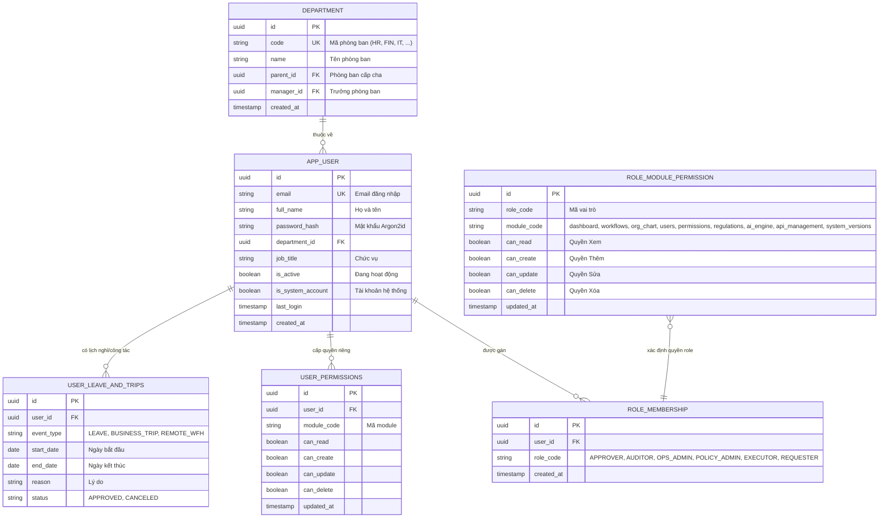
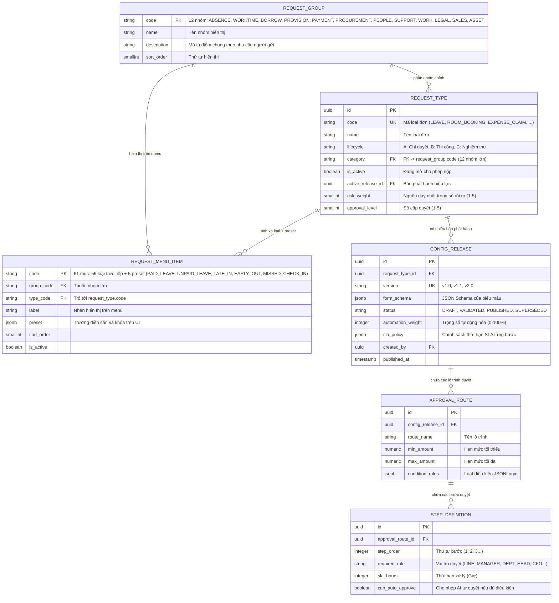
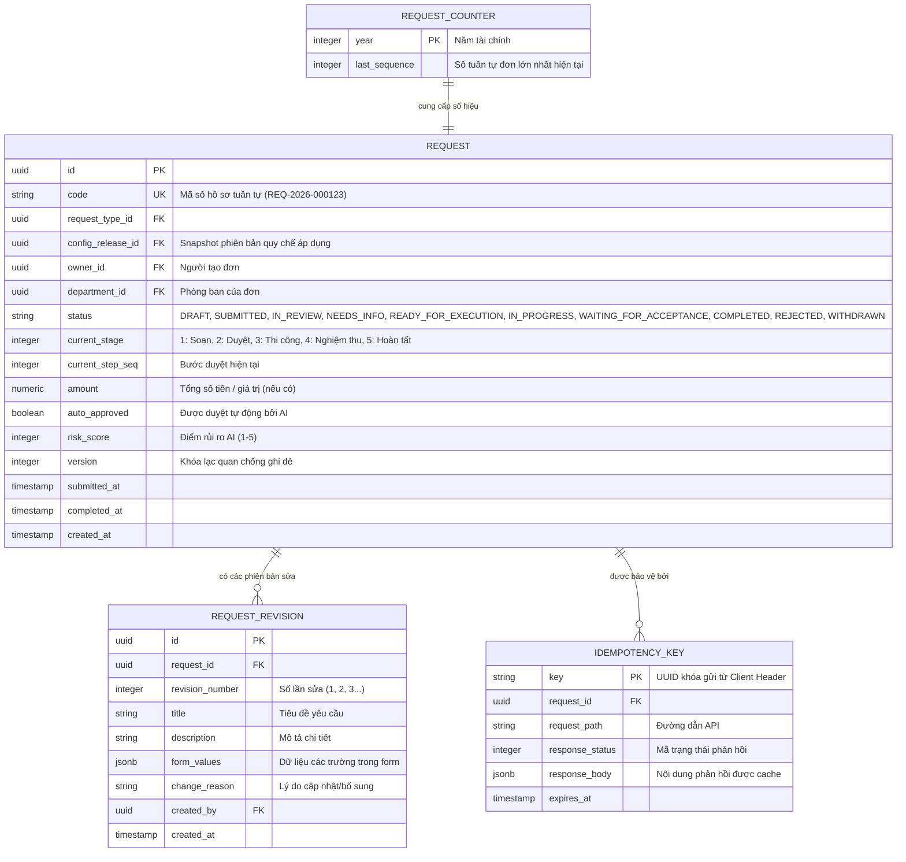
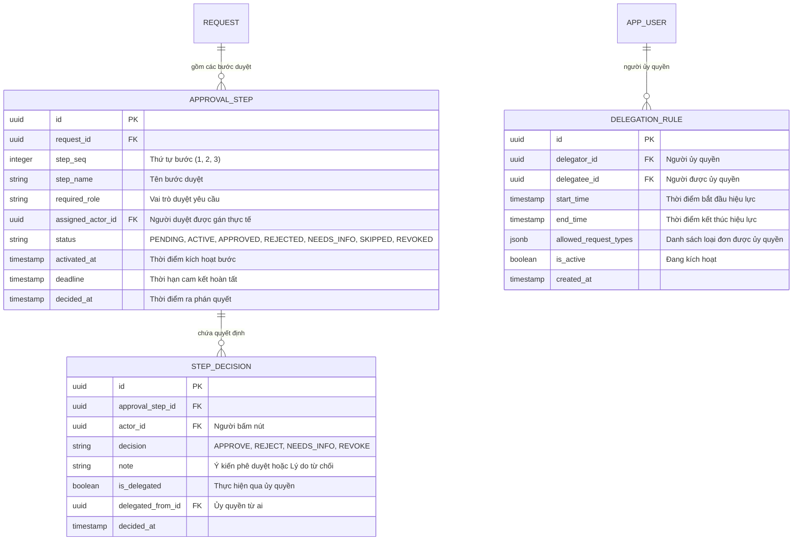
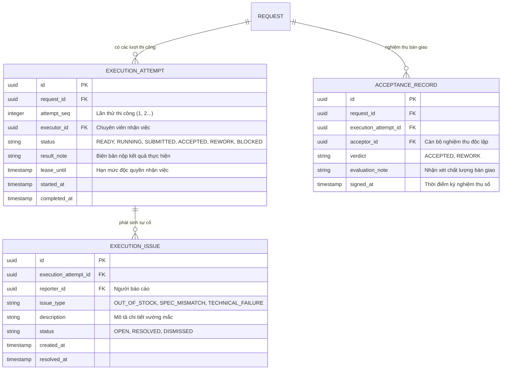
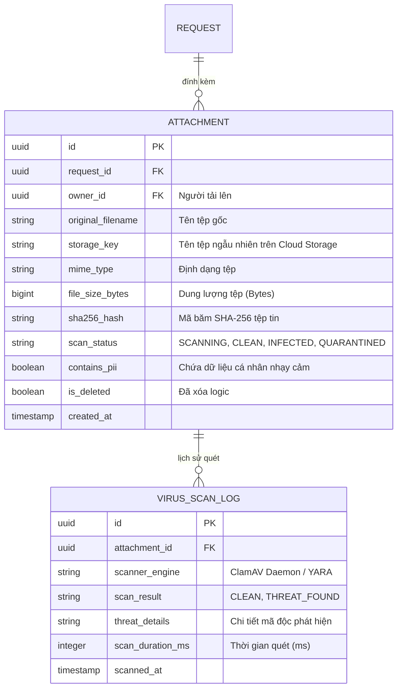
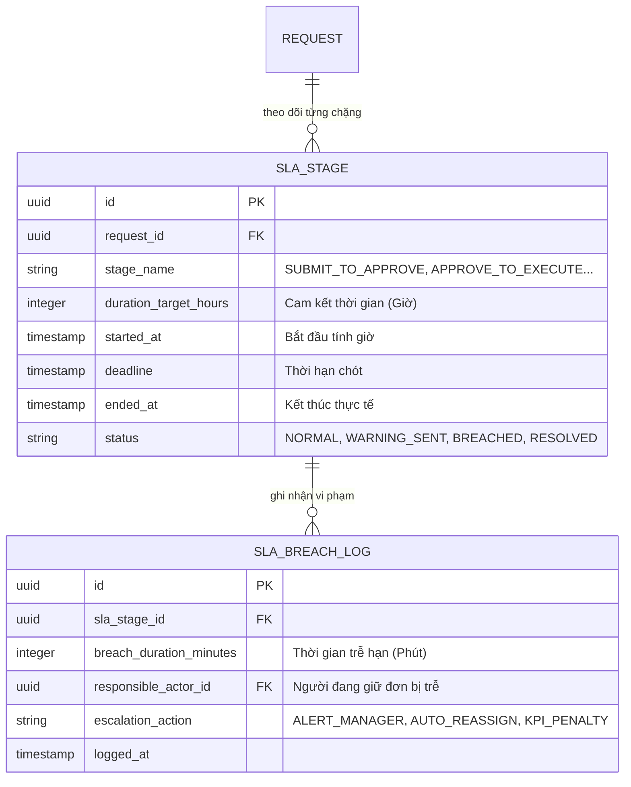
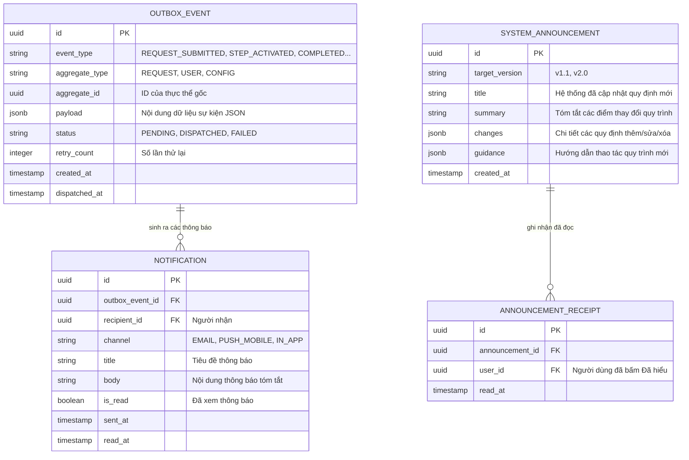
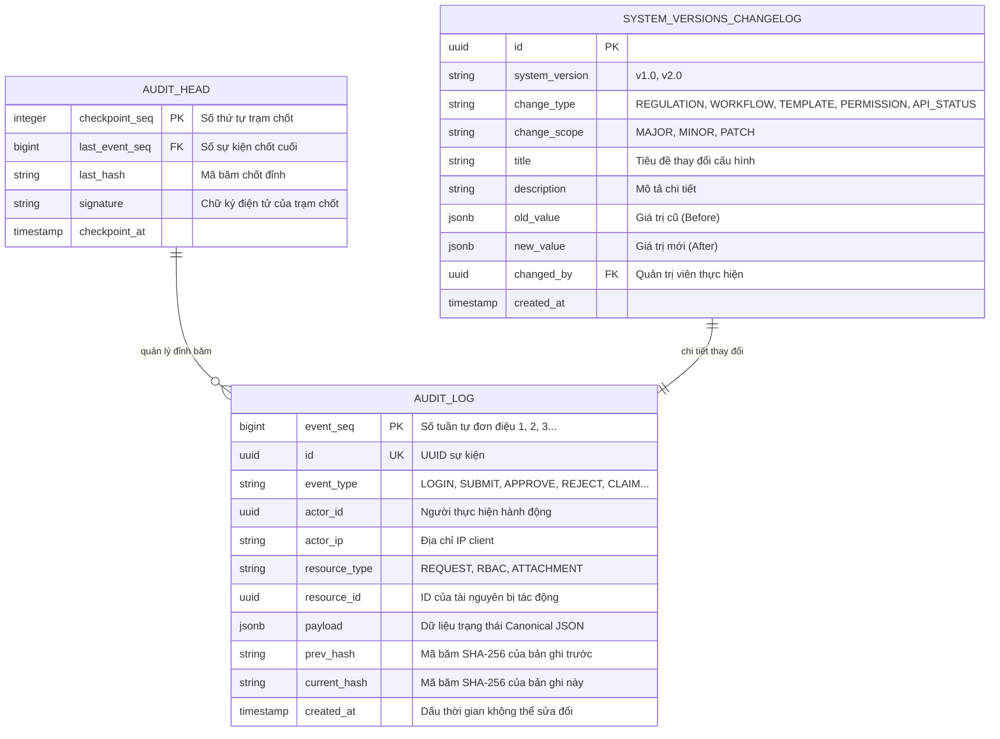
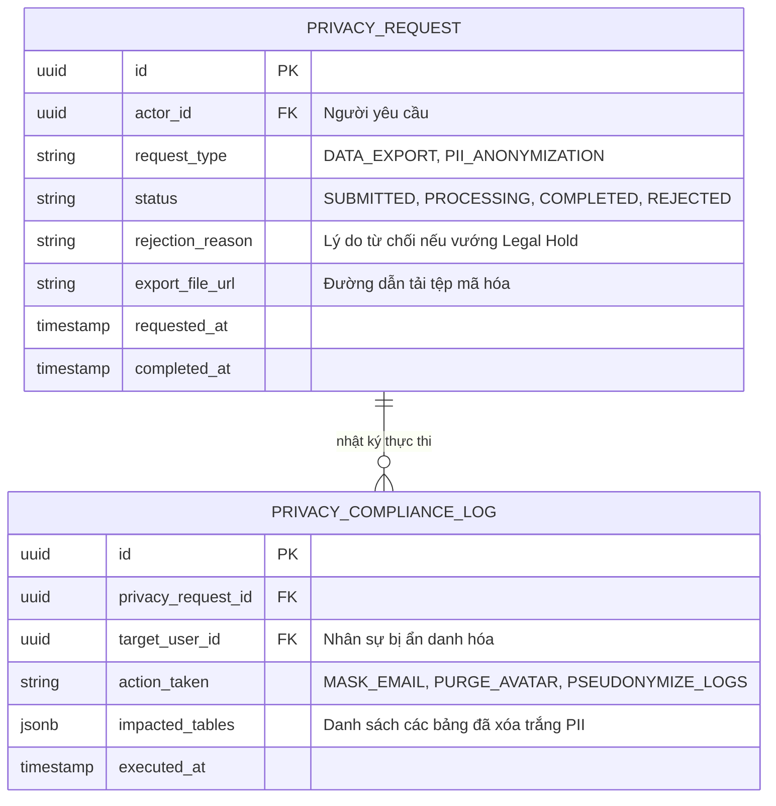

# HỒ SƠ THIẾT KẾ CƠ SỞ DỮ LIỆU TOÀN DIỆN (DATABASE DESIGN & ERD)
## DỰ ÁN: HỆ THỐNG TỰ ĐỘNG HÓA QUY TRÌNH XỬ LÝ YÊU CẦU NỘI BỘ ĐA CẤP (EAS)
### HỘI ĐỒNG THẨM ĐỊNH IT 15 NĂM KINH NGHIỆM: BA, PM, DEV, UI/UX, AI, QA, PO

---

## 1. NGUYÊN TẮC THIẾT KẾ CƠ SỞ DỮ LIỆU DOANH NGHIỆP

Theo chuẩn thiết kế cơ sở dữ liệu quan hệ quốc tế (ANSI/SPARC, Chuẩn hóa 3NF/BCNF) và kiểm chứng trực tiếp trên schema `eas` của PostgreSQL 15+ trong Supabase, cơ sở dữ liệu của hệ thống EAS tuân thủ các nguyên tắc thiết kế tối thượng:
1. **Phân lập Schema chặt chẽ (Strict Schema Isolation):** Toàn bộ thực thể nghiệp vụ nằm độc quyền trong schema `eas.*`. Không dùng schema `public` để tránh xung đột và lỗ hổng bảo mật.
2. **Khóa chính toàn cầu ngẫu nhiên (UUIDv4 Primary Keys):** 100% bảng nghiệp vụ sử dụng `UUID` làm khóa chính, triệt tiêu hoàn toàn nguy cơ quét đoán ID (ID Enumeration / Insecure Direct Object References - IDOR).
3. **Mã hồ sơ thân thiện người dùng tuần tự (Business Human-Readable Sequence):** Sử dụng bảng đếm tuần tự có khóa hàng `eas.request_counter` để sinh mã đơn định dạng chuẩn doanh nghiệp: `REQ-YYYY-NNNNNN` độc lập với UUID.
4. **Bảo mật mức dòng bắt buộc (Enforced Row Level Security - RLS):** 100% bảng nghiệp vụ đều được kích hoạt RLS (`ENABLE ROW LEVEL SECURITY`). Quyền thao tác được cấp phát nghiêm ngặt cho các vai trò backend chuyên trách (`eas_api`, `eas_worker`), thu hồi toàn bộ quyền của các vai trò công cộng (`anon`, `authenticated`).
5. **Sổ cái kiểm toán bất biến chuỗi băm (Tamper-Evident Cryptographic Hash-Chain):** Mọi thay đổi dữ liệu cốt lõi đều được ghi lại vào bảng `eas.audit_log` với mã băm SHA-256 xâu chuỗi liên tục, không bao giờ được phép thực hiện câu lệnh `UPDATE` hay `DELETE` trên bảng kiểm toán.

---

## 2. DANH MỤC TOÀN BỘ 10 SƠ ĐỒ THỰC THỂ LIÊN KẾT MIỀN CHI TIẾT (ER-04 ĐẾN ER-13)

---

### SƠ ĐỒ 1: HÌNH PL-32 - MIỀN TỔ CHỨC NHÂN SỰ & PHÂN QUYỀN RBAC (ER-04)
*Quản lý cây cơ cấu phòng ban, hồ sơ nhân sự, ma trận quyền và trạng thái làm việc.*



---

### SƠ ĐỒ 2: HÌNH PL-33 - MIỀN DANH MỤC, 12 NHÓM YÊU CẦU & BẢN PHÁT HÀNH CẤU HÌNH ĐỘNG (ER-05)
*Quản lý 66 loại yêu cầu (58 loại đang hoạt động), 12 nhóm lớn theo mục đích người dùng (`eas.request_group`), 61 mục chọn trên menu (`eas.request_menu_item`), vòng đời A/B/C và các bản phát hành cấu hình bất biến.*



---

### SƠ ĐỒ 3: HÌNH PL-34 - MIỀN HỒ SƠ YÊU CẦU CỐT LÕI & LỊCH SỬ SỬA ĐỔI (ER-06)
*Bảng lưu trữ hồ sơ trung tâm, số hiệu tuần tự và các phiên bản sửa đổi (Revisions).*



---

### SƠ ĐỒ 4: HÌNH PL-35 - MIỀN QUY TRÌNH & QUYẾT ĐỊNH PHÊ DUYỆT ĐA CẤP (ER-07)
*Quản lý từng bước duyệt thực tế, phán quyết của cấp quản lý và luật ủy quyền.*



---

### SƠ ĐỒ 5: HÌNH PL-36 - MIỀN THỰC THI & NGHIỆM THU BÀN GIAO CÔNG VIỆC (ER-08)
*Quản lý chuyên viên thi công (Lifecycle B/C), sự cố vướng mắc và biên bản nghiệm thu độc lập.*



---

### SƠ ĐỒ 6: HÌNH PL-37 - MIỀN TỆP ĐÍNH KÈM AN TOÀN & QUÉT ANTIVIRUS (ER-09)
*Quản lý chứng từ đính kèm, mã băm SHA-256 và nhật ký quét mã độc.*



---

### SƠ ĐỒ 7: HÌNH PL-38 - MIỀN THEO DÕI CAM KẾT SLA & CẢNH BÁO (ER-10)
*Quản lý đồng hồ đo thời gian, nhật ký vi phạm và hành động leo thang cảnh báo.*



---

### SƠ ĐỒ 8: HÌNH PL-39 - MIỀN HÀNG ĐỢI SỰ KIỆN OUTBOX & THÔNG BÁO (ER-11)
*Mô hình Transactional Outbox Pattern bảo đảm gửi thông báo tin cậy không thất lạc.*



---

### SƠ ĐỒ 9: HÌNH PL-40 - MIỀN SỔ CÁI KIỂM TOÁN HASH-CHAIN & CHECKPOINT (ER-12)
*Sổ cái mật mã học SHA-256 bảo đảm tính toàn vẹn và chống chối bỏ tuyệt đối.*



---

### SƠ ĐỒ 10: HÌNH PL-41 - MIỀN QUYỀN RIÊNG TƯ & BẢO VỆ DỮ LIỆU GDPR (ER-13)
*Quản lý bảo vệ thông tin cá nhân và nhật ký ẩn danh hóa dữ liệu.*



---

## 3. TỔNG HỢP 8 SCHEMAS HỆ THỐNG NGOÀI (`mock_*`) QUA MOCK SYSTEMS API & BẢNG `eas.mock_apis` (CIRCUIT BREAKER)

8 schema `mock_*` giả lập 8 hệ thống thông tin độc lập của doanh nghiệp, được cô lập hoàn toàn phía sau dịch vụ **Mock Systems API** (`mock_systems` chạy ở cổng `:8100`, dùng role CSDL riêng `eas_mock`). Các role của EAS (`eas_api`, `eas_worker`) **đã bị thu hồi toàn bộ quyền SQL trên `mock_*`** (Migration 17); EAS chỉ giao tiếp với hệ thống ngoài qua HTTP `/mock-api/v1/<hệ thống>/...` kèm header `X-Integration-Secret` (qua client duy nhất `api_core/integrations/client.py`, timeout 5s) và kiểm tra công tắc Circuit Breaker trong `eas.mock_apis`:

| Schema Name | Hệ Thống Mô Phỏng | Các Bảng Chính | Mục Đích Tích Hợp Qua `/mock-api/v1/...` | Trạng Thái Circuit Breaker |
|:---|:---|:---|:---|:---:|
| `mock_hr` | Quản trị Nhân sự (HRIS) | `department`, `employee`, `leave_balance`, `leave_usage` | Đồng bộ danh bạ nhân sự (`sync_hr_directory`), kiểm tra quỹ phép còn lại khi gửi và trừ quỹ phép khi duyệt (`POST /mock-api/v1/hr/leave-usages`). | Quản lý qua `API_HR` |
| `mock_finance` | Kế toán & Ngân sách (ERP) | `cost_center_budget`, `expense_category`, `budget_commitment` | Danh mục loại chi phí & hạn mức ngày, kiểm tra ngân sách trung tâm chi phí và ghi cam kết chi khi duyệt (`POST /mock-api/v1/finance/commitments`). | Quản lý qua `API_FINANCE` |
| `mock_it` | Hạ tầng & Cấp quyền (ITSM) | `application`, `access_role`, `user_access`, `it_service` | Danh mục ứng dụng & vai trò truy cập, ghi nhận cấp quyền khi đơn hoàn tất (`POST /mock-api/v1/it/user-access`). | Quản lý qua `API_IT` |
| `mock_procurement`| Mua sắm & Chuỗi cung ứng | `supplier`, `catalog_item`, `purchase_order` | Bảng giá vật tư, danh mục nhà cung cấp phục vụ AI đối soát ngữ cảnh. | Quản lý qua `API_PROCUREMENT`|
| `mock_assets` | Quản lý Tài sản (EAM) | `asset_category`, `asset`, `asset_loan` | Kiểm tra tồn kho thiết bị, giữ chỗ khi duyệt cuối (duyệt trước thắng), ưu tiên BGĐ thu hồi (`RESOURCE_PREEMPTED`), worker tự trả khi hết hạn. | Quản lý qua `API_ASSETS` |
| `mock_facilities` | Cơ sở vật chất (Facilities)| `site`, `resource`, `reservation` | Đặt phòng họp & xe công vụ qua API giữ chỗ/huỷ/trả, kiểm tra sức chứa, ưu tiên BGĐ thu hồi đơn nhân viên trùng giờ. | Quản lý qua `API_FACILITIES` |
| `mock_travel` | Quản lý Công tác phí | `travel_policy`, `travel_option` | Định mức công tác phí khách sạn, vé máy bay theo chức danh phục vụ AI kiểm tra. | Quản lý qua `API_TRAVEL` |
| `mock_crm` | Quan hệ Khách hàng (CRM) | `customer`, `contract`, `support_case` | Hồ sơ khách hàng, giá trị hợp đồng, chiết khấu thương mại phục vụ AI kiểm tra. | Quản lý qua `API_CRM` |

### Cấu trúc Bảng Điều Khiển Circuit Breaker (`eas.mock_apis`)
```sql
CREATE TABLE eas.mock_apis (
    id UUID PRIMARY KEY DEFAULT gen_random_uuid(),
    api_code TEXT UNIQUE NOT NULL,             -- 'API_HR', 'API_FINANCE', 'API_IT'...
    api_name TEXT NOT NULL,                    -- 'HR & Attendance Service API'
    source_system TEXT NOT NULL,               -- 'HRM', 'ERP Finance', 'ITSM'...
    endpoint_path TEXT NOT NULL,               -- '/mock-api/v1/hr/...' (gọi nội bộ kèm X-Integration-Secret)
    http_method TEXT DEFAULT 'GET',
    domain_key TEXT NOT NULL,
    data_provided TEXT NOT NULL,               -- Mô tả dữ liệu cung cấp
    mock_payload JSONB NOT NULL DEFAULT '{}',  -- Dữ liệu mẫu JSON hiển thị trên trang Quản lý API
    is_enabled BOOLEAN DEFAULT true,           -- CÔNG TẮC CIRCUIT BREAKER (Bật/Tắt)
    updated_by TEXT DEFAULT 'System Admin',
    updated_at TIMESTAMPTZ DEFAULT now()
);
```
- **Cơ chế ngắt mạch tự động:** Khi Admin bấm **TẮT** `is_enabled = false` trên một API (ví dụ `API_HR`), ngay lập tức Cổng Web Admin và Web Client tự động phát hiện và khóa các mẫu đơn liên quan với thông báo rõ ràng: `"⚠️ Yêu cầu này hiện không thể sử dụng do kết nối API [HRM] đang bị tắt"`. Phía Backend (`api_core/integrations/client.py`) chặn lời gọi và từ chối giao dịch với mã lỗi `503 INTEGRATION_UNAVAILABLE`.
