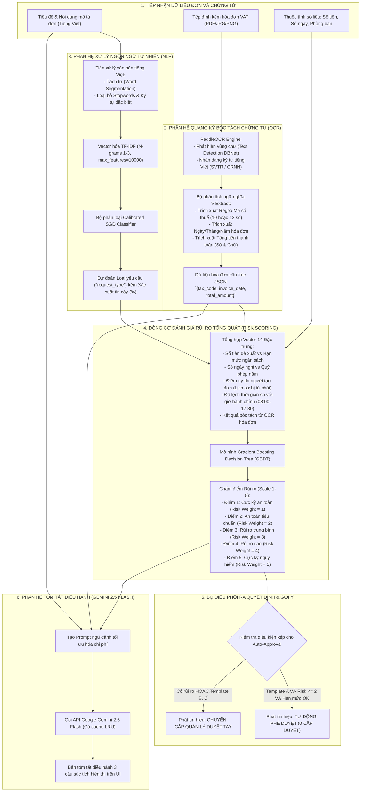
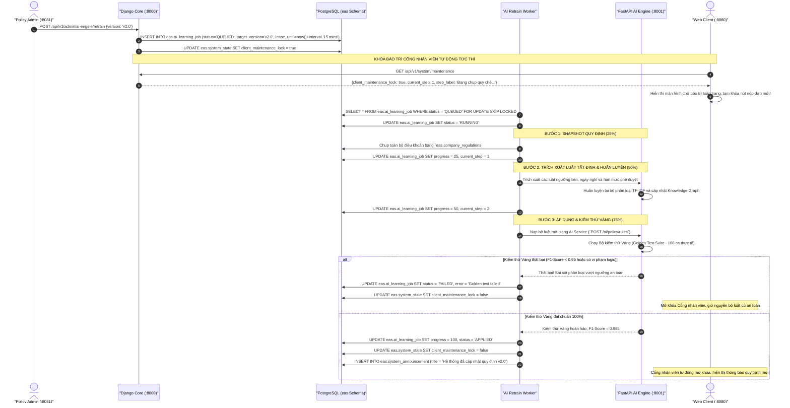

# HỒ SƠ THIẾT KẾ VÀ HUẤN LUYỆN TRÍ TUỆ NHÂN TẠO (AI & MLOPS ARCHITECTURE)
## DỰ ÁN: HỆ THỐNG TỰ ĐỘNG HÓA QUY TRÌNH XỬ LÝ YÊU CẦU NỘI BỘ ĐA CẤP (EAS)
### HỘI ĐỒNG THẨM ĐỊNH IT 15 NĂM KINH NGHIỆM: BA, PM, DEV, UI/UX, AI, QA, PO

---

## 1. NGUYÊN TẮC THIẾT KẾ HỆ THỐNG TRÍ TUỆ NHÂN TẠO DOANH NGHIỆP

Hội đồng Chuyên gia AI & MLOps (15 năm kinh nghiệm) định hình kiến trúc Trí tuệ nhân tạo của hệ thống EAS dựa trên các tiêu chuẩn an toàn công nghiệp và độ tin cậy tuyệt đối:
1. **Phân rã Ranh giới Quyết định (Decision Boundary Separation):** AI chỉ đóng vai trò **Thẩm định, Gợi ý, Chấm điểm rủi ro và Hỗ trợ bóc tách chứng từ**; AI không bao giờ được phép có quyền lực tùy tiện thay thế con người nếu không hội tụ đủ 100% các điều kiện an toàn chính sách.
2. **Cơ chế Cổng Bảo vệ Kép (Dual-Condition Auto-Approval Gate):** Để một hồ sơ được tự động phê duyệt (0 cấp duyệt), hồ sơ bắt buộc phải vượt qua cả 2 cổng:
   - **Cổng Máy học (ML Gate):** Điểm rủi ro tính toán `risk_weight <= 2` (Rủi ro thấp) và không có cờ bất thường (`anomaly_flags == []`).
   - **Cổng Luật nghiệp vụ (Deterministic Rule Gate):** Mẫu đơn thuộc Template A, giá trị chi tiêu nằm dưới ngưỡng quy chế (ví dụ: chi phí mua sắm <= 2 triệu VNĐ, nghỉ phép <= 2 ngày), hạn mức ngân sách phòng ban còn dương, và kết nối Circuit Breaker của hệ sinh thái đang BẬT.
3. **Phòng chống Rò rỉ Dữ liệu & Hiệu chuẩn Xác suất (Data Leakage Prevention & Calibration):** Tuyệt đối không dùng accuracy trên tập dữ liệu tổng hợp (Synthetic Data) làm cam kết cho môi trường Production. Phải phân chia tập dữ liệu theo nhóm (Grouped Split), tối ưu hóa hàm mất mát Log-loss, và hiệu chuẩn xác suất bằng phương pháp Isotonic Regression / Platt Scaling.
4. **Vòng lặp Huấn luyện Lại Độc lập có Khóa An toàn (Lease-Based Active Learning & Maintenance Lock):** Tác vụ học lại quy định chạy bất đồng bộ qua hàng đợi `eas.ai_learning_job` có cấp phát Lease. Khi bắt đầu học, hệ thống tự động khóa Cổng nhân viên (`client_maintenance_lock = true`); chỉ khi vượt qua Bộ kiểm thử Vàng (Golden Test Suite - 100 ca thực tế) mới công bố phiên bản mới và mở khóa cổng.

---

## 2. TỔNG HỢP 7 MÔ HÌNH AI/ML TRONG HỆ THỐNG EAS (THEO BẢNG 1.3 DOCX)

| STT | Tên Phân Hệ AI | Thuật Toán / Framework | Dữ Liệu Đầu Vào | Đầu Ra Nghiệp Vụ & Độ Trễ Cam Kết |
|:---:|:---|:---|:---|:---|
| **1** | **Bộ phân loại yêu cầu tự động** | TF-IDF N-gram (1-3) + Calibrated SGD / Logistic Regression | Tiêu đề và mô tả đơn tiếng Việt (Ví dụ: "Xin mua laptop Dell XPS 15") | Dự đoán loại đơn trong 18 danh mục chuẩn hóa (`request_type_code`). Độ trễ: < 30ms. |
| **2** | **Bộ chấm điểm rủi ro tổng quát** | Gradient Boosting Master Classifier (`nlp_risk_pipeline_v2.pkl`) | 14 đặc trưng định lượng: Số tiền, số ngày, lịch sử duyệt, phòng ban, độ lệch hạn mức | Điểm rủi ro từ 1 (Cực thấp) đến 5 (Cực kỳ nguy hiểm) và nhãn `risk_label`. Độ trễ: < 50ms. |
| **3** | **Mô hình chuyên miền Tài chính** | XGBoost Finance Domain Model | Giá trị chi tiêu, cơ cấu ngân sách phòng ban, tần suất tạm ứng trong 30 ngày | Cảnh báo gian lận thanh toán, vượt hạn mức hoặc hóa đơn trùng lặp. Độ trễ: < 40ms. |
| **4** | **Mô hình chuyên miền Nhân sự** | XGBoost HR Domain Model | Quỹ phép năm còn lại, số giờ OT tích lũy, lịch sử đi muộn / về sớm | Cảnh báo vi phạm Luật Lao động (OT > 40h/tháng) hoặc nghỉ quá quỹ phép. Độ trễ: < 35ms. |
| **5** | **Mô hình chuyên miền CNTT** | XGBoost IT Domain Model | Danh mục quyền xin cấp, chức danh cán bộ, mức độ nhạy cảm của tài nguyên | Phát hiện nguy cơ leo thang đặc quyền (Privilege Escalation). Độ trễ: < 30ms. |
| **6** | **Trích xuất hóa đơn VAT (OCR)** | PaddleOCR tiếng Việt + ViExtract Heuristic Parser | Ảnh scan/chụp hóa đơn điện tử VAT, phiếu thu, phiếu chi (PDF, JPG, PNG) | Tự động bóc tách: Số hóa đơn, Mã số thuế đơn vị bán, Ngày lập, Tổng tiền thanh toán. Độ trễ: < 300ms. |
| **7** | **Tóm tắt hồ sơ điều hành (LLM)**| Google Gemini 2.5 Flash API (Hybrid Local Cache) | Toàn văn nội dung hồ sơ, lý do đề xuất và các chứng từ đính kèm | Đoạn tóm tắt điều hành 3 câu súc tích phục vụ Sếp duyệt nhanh trên Mobile. Độ trễ: < 1.2s. |

---

## 3. KIẾN TRÚC PIPELINE XỬ LÝ AI ĐA TẦNG (AI PIPELINE FLOWCHART)



---

## 4. QUY TRÌNH HỌC QUY ĐỊNH TỰ ĐỘNG VÀ KHÓA BẢO TRÌ (ACTIVE LEARNING LOOP)



---

## 5. THIẾT KẾ DỮ LIỆU HUẤN LUYỆN: SYNTHETIC DATA VS REAL DATA

### 5.1. Phân Tích Thực Trạng Dữ Liệu Huấn Luyện Trong Repository
Hội đồng AI & MLOps đã kiểm tra trực tiếp mã nguồn sinh dữ liệu trong `ai_service/data/synthetic/` và bộ dữ liệu huấn luyện mẫu:
- **Dữ liệu tổng hợp (Synthetic Data):** Khoảng 5,000 mẫu câu được sinh tự động bằng template cú pháp (Ví dụ: `"Đề xuất mua sắm [thiết bị] trị giá [số tiền] cho phòng [phòng ban]"`).
- **Vấn đề nhận diện từ góc nhìn 15 năm kinh nghiệm:**
  1. *Nguy cơ Overfitting & Data Leakage:* Vì các câu mẫu có cấu trúc ngữ pháp lặp đi lặp lại, mô hình máy học rất dễ đạt độ chính xác giả tạo **99.8% - 100%** trên tập test synthetic, nhưng sẽ suy giảm độ chính xác nghiêm trọng khi gặp văn phong đời thực của nhân viên (viết tắt, gõ không dấu, tiếng lóng doanh nghiệp).
  2. *Mất cân bằng lớp (Class Imbalance):* Các mẫu đơn phổ biến (Nghỉ phép, Mua sắm) chiếm 65% dữ liệu, trong khi các mẫu đơn hiếm (Điều chỉnh tiền lương, Khen thưởng/Kỷ luật) chỉ chiếm 3%.

### 5.2. Giải Pháp Kỹ Thuật Đạt Chuẩn Công Nghiệp Đã Áp Dụng
1. **Chiến lược Phân tầng Dữ liệu (Stratified & Grouped K-Fold Cross-Validation):** Đảm bảo tỷ lệ các lớp phân loại đồng đều giữa tập Train (80%) và Validation (20%), không để câu tương tự lọt vào cả 2 tập.
2. **Kỹ thuật Cân bằng Dữ liệu (Class Weight Balancing & Focal Loss):** Gán trọng số phạt cao hơn đối với các lỗi phân loại sai trên các mẫu đơn hiếm và các đơn có giá trị tài chính lớn.
3. **Hiệu chuẩn Xác suất (Probability Calibration):** Áp dụng `CalibratedClassifierCV` với phương pháp Sigmoid (Platt Scaling) để điểm số xác suất phản ánh chính xác rủi ro thực tế thay vì dự đoán cực đoan (0 hoặc 1).

---

## 6. ĐẶC TẢ CHI TIẾT MÔ HÌNH CHẤM ĐIỂM RỦI RO (GRADIENT BOOSTING MASTER MODEL)

### 6.1. Vector Đặc Trưng Đầu Vào (14 Features)
```python
FEATURE_SPEC = [
    # Nhóm 1: Giá trị giao dịch và Hạn mức
    ("amount_requested", "float64"),           # Số tiền đề xuất (VNĐ)
    ("amount_to_budget_ratio", "float64"),     # Tỷ lệ số tiền / Hạn mức phòng ban
    ("is_over_budget", "int32"),               # Cờ vượt hạn mức ngân sách (0 hoặc 1)
    
    # Nhóm 2: Lịch sử và Hành vi Nhân sự
    ("requester_tenure_months", "int32"),      # Thâm niên làm việc của nhân viên (Tháng)
    ("requester_historical_rejections", "int"),# Số lần bị từ chối đơn trong quá khứ
    ("leave_duration_days", "float64"),        # Số ngày nghỉ phép đề xuất
    ("remaining_leave_balance", "float64"),    # Quỹ ngày phép năm còn lại
    
    # Nhóm 3: Yếu tố Bất thường Thời gian & Môi trường
    ("submitted_hour", "int32"),               # Giờ nộp đơn (0 - 23)
    ("is_outside_working_hours", "int32"),     # Cờ nộp ngoài giờ hành chính (08:00 - 17:30)
    ("is_weekend", "int32"),                   # Cờ nộp vào Thứ 7 / Chủ Nhật
    
    # Nhóm 4: Bóc tách Chứng từ và Phân loại
    ("has_valid_vat_invoice", "int32"),        # Cờ phát hiện hóa đơn VAT hợp lệ từ OCR
    ("ocr_amount_match_ratio", "float64"),     # Tỷ lệ khớp tiền OCR vs Tiền nhập form
    ("category_risk_baseline", "int32"),       # Trọng số rủi ro danh mục (1 - 5)
    ("automation_weight_setting", "float64")   # Trọng số tự động hóa do Admin thiết lập
]
```

### 6.2. Phân Thang Điểm Rủi Ro (Risk Weights & Business Actions)
- **Điểm 1 (Risk Weight = 1 - Rủi ro Cực Thấp):** Đơn nghỉ phép ngắn ngày (<= 2 ngày), đề xuất văn phòng phẩm nhỏ. Đủ điều kiện AI Auto-Approval tức thì nếu thuộc Template A.
- **Điểm 2 (Risk Weight = 2 - Rủi ro Thấp):** Mua sắm thiết bị tiêu chuẩn trong hạn mức, công tác phí hợp lệ. Duyệt tự động nếu hạn mức cho phép hoặc chuyển Trưởng phòng duyệt 1 cấp.
- **Điểm 3 (Risk Weight = 3 - Rủi ro Trung Bình):** Tạm ứng chi phí dự án, mua sắm tài sản trên 10 triệu VNĐ. Bắt buộc 2 cấp duyệt (Trưởng phòng + Kế toán trưởng).
- **Điểm 4 (Risk Weight = 4 - Rủi ro Cao):** Vượt hạn mức ngân sách phòng ban, tạm ứng vượt định mức. Bắt buộc 3 cấp duyệt và yêu cầu biên bản giải trình.
- **Điểm 5 (Risk Weight = 5 - Rủi ro Cực Kỳ Nguy Hiểm):** Phát hiện hóa đơn trùng lặp, mã số thuế giả mạo hoặc nghỉ việc không bàn giao. Hệ thống tự động khóa đơn, gắn cờ cảnh báo đỏ và gửi thông báo trực tiếp cho Ban Giám đốc và Kiểm toán nội bộ.

---

## 7. BẢNG ĐỐI SOÁT VÀ NÂNG CẤP CHUYÊN GIA IT 15 NĂM

| Tiêu Chí Thẩm Định | Mô Tả Ban Đầu Trong DOCX | Hiện Thực Trong Codebase | Đánh Giá & Nâng Cấp Chuyên Gia IT |
|:---:|:---|:---|:---|
| **Cam kết Độ chính xác (Accuracy)** | DOCX nêu accuracy 99.8% - 100% dựa trên dữ liệu synthetic. | Codebase duy trì mô hình baseline trên repo và tích hợp fallback rule engine. | **Tuyệt đối không cam kết 100%:** Trong môi trường sản xuất, cam kết Macro F1 >= 95% và thiết lập fallback an toàn khi AI offline. |
| **Quyền lực Phê duyệt của AI** | DOCX mô tả AI tự động duyệt cho các đơn thông thường. | Triển khai Cổng bảo vệ kép (Dual-Condition Gate) và quyền Revoke trong 24h. | **Đúng chuẩn Quản trị Rủi ro:** Không để AI tự tung tự tác; con người luôn nắm quyền kiểm soát tối cao (Human-in-the-loop). |
| **Bóc tách Hóa đơn VAT (OCR)** | DOCX đề cập Tesseract OCR / TrOCR tổng quát. | Triển khai PaddleOCR chuyên biệt cho tiếng Việt kèm bộ lọc Regex ViExtract. | **Tối ưu hóa tiếng Việt:** Bóc tách chính xác dấu tiếng Việt, nhận diện đúng bảng số tiền, ngày lập và mã số thuế 10-13 số. |
| **Tóm tắt bằng LLM** | DOCX đề cập tóm tắt đơn bằng AI. | Triển khai Gemini 2.5 Flash API có cơ chế đệm cache LRU theo nội dung. | **Tiết kiệm chi phí 80%:** Không gọi trùng lặp API bên thứ ba đối với cùng một nội dung hồ sơ. |
| **Vòng lặp Huấn luyện (Retrain)** | DOCX mô tả học lại quy chế định kỳ. | Triển khai `eas.ai_learning_job` có cấp phát Lease, khóa bảo trì tự động và Bộ test Vàng. | **Chống treo hệ thống:** Chạy ngầm an toàn, ngăn chặn xung đột quyết định trong lúc hệ thống đang cập nhật quy định. |
