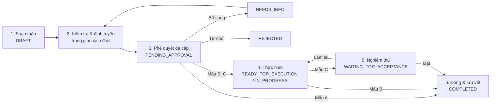
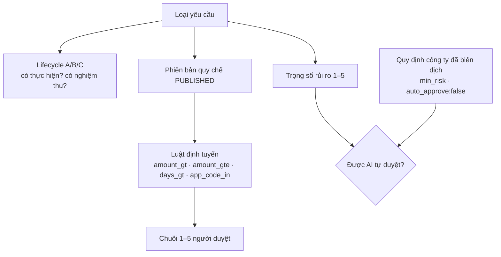
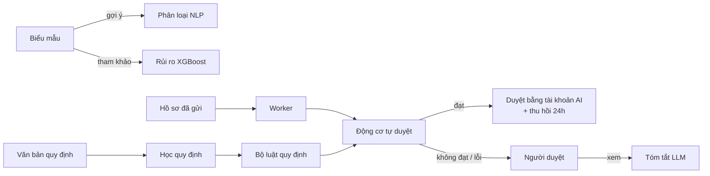

# CHƯƠNG 1 — TỔNG QUAN VỀ BÀI TOÁN VÀ CƠ SỞ CÔNG NGHỆ (các mục thay thế)

> **Giữ nguyên từ bản DOCX:** 1.1.1, 1.1.3, 1.1.4, 1.2.1, 1.2.3, 1.2.4, 1.2.5. Đây là phần lý luận chung, không mâu thuẫn với sản phẩm.
>
> **Thay thế:** 1.1.2, 1.2.2 (gồm Bảng 1.2), 1.3 (gồm Bảng 1.3) và 1.4 (gồm Bảng 1.4, 1.5).

## 1.1.2. Các giai đoạn trong vòng đời yêu cầu nội bộ

Một yêu cầu nội bộ đi qua sáu giai đoạn. Trong EAS, mỗi giai đoạn ứng với một hoặc nhiều trạng thái của hồ sơ. Việc chuyển giữa các trạng thái do cơ sở dữ liệu cưỡng chế, không chỉ do giao diện.

**Bảng 1.1. Sáu giai đoạn vòng đời và trạng thái hệ thống tương ứng**

| Giai đoạn | Nội dung | Trạng thái hồ sơ trong EAS |
|---|---|---|
| 1. Khởi tạo và soạn thảo | Chọn loại yêu cầu, điền biểu mẫu, đính kèm chứng từ, lưu nháp | `DRAFT` |
| 2. Kiểm tra quy định và định tuyến | Kiểm dữ liệu theo biểu mẫu của phiên bản quy chế hiện hành; xác định chuỗi người duyệt; kiểm tách nhiệm. Giai đoạn này diễn ra trong cùng giao dịch với thao tác "Gửi", nên không có trạng thái trung gian | (chuyển ngay sang giai đoạn 3) |
| 3. Thẩm định và phê duyệt đa cấp | Từng cấp duyệt lần lượt Chấp thuận, Từ chối hoặc Yêu cầu bổ sung | `PENDING_APPROVAL`; bị trả về là `NEEDS_INFO`; bị từ chối là `REJECTED` |
| 4. Tiếp nhận và thực hiện | Bộ phận chuyên môn nhận việc và thực hiện (chỉ mẫu B, C) | `READY_FOR_EXECUTION` → `IN_PROGRESS` |
| 5. Nghiệm thu | Người nghiệm thu, khác người thực hiện, xác nhận đạt hoặc yêu cầu làm lại (chỉ mẫu C) | `WAITING_FOR_ACCEPTANCE` |
| 6. Đóng hồ sơ và lưu vết | Hồ sơ kết thúc; mọi phiên bản, quyết định và sự kiện được lưu bất biến | `COMPLETED`, `REJECTED` hoặc `CANCELLED` (rút đơn) |

*Hình 1.1. Vòng đời sáu giai đoạn của yêu cầu nội bộ trong EAS. Nguồn: Nhóm tác giả.*

## 1.2.2. Phân quyền và phê duyệt đa cấp theo điều kiện nghiệp vụ

Phê duyệt đa cấp đòi hỏi một yêu cầu được nhiều cấp quản lý chấp thuận trước khi thi hành. Số cấp và người duyệt không cố định; chúng phụ thuộc thuộc tính của hồ sơ:
- **Giá trị tiền.** Ví dụ, với đề nghị mua sắm:
  - dưới 5 triệu đồng chỉ cần quản lý trực tiếp duyệt;
  - từ 5 đến 50 triệu cần thêm Kế toán;
  - trên 50 triệu cần thêm Giám đốc.
- **Thời lượng.** Nghỉ phép trên 2 ngày cần thêm Giám đốc duyệt.
- **Mức nhạy cảm của đối tượng.** Yêu cầu cấp quyền vào hệ thống sản xuất (cơ sở dữ liệu production, AWS Console, ERP SAP) cần thêm cấp Giám đốc.

Thiết kế của EAS tách cấu hình quy trình thành **ba trục độc lập**. Thực tiễn cho thấy gộp ba trục vào một nhãn sẽ tạo ra mâu thuẫn: một loại đơn đơn giản về quy trình vẫn có thể có giá trị lớn và cần nhiều cấp duyệt.

**Bảng 1.2. Ba mẫu vòng đời và cách cấu hình**

| Trục | Ý nghĩa | Giá trị | Nơi cấu hình |
|---|---|---|---|
| Mẫu vòng đời (lifecycle) | Hình dạng quy trình | **A** – chỉ phê duyệt (vd nghỉ phép, làm việc từ xa, đặt phòng họp); **B** – phê duyệt rồi thực hiện (vd cấp quyền phần mềm, văn phòng phẩm, tạm ứng); **C** – phê duyệt, thực hiện rồi nghiệm thu bởi người khác người thực hiện (vd mua tài sản, cấp laptop, hợp đồng) | Cố định theo loại yêu cầu |
| Ma trận thẩm quyền | Số cấp và vai trò người duyệt | 1–5 cấp, chọn theo luật điều kiện (số tiền, số ngày, ứng dụng) | Phiên bản quy chế do Policy Admin ban hành |
| Trọng số rủi ro | Mức kiểm soát cần áp dụng | 1 (rất thấp) – 5 (rất cao) | Mặc định theo loại; quy định công ty có thể nâng lên hoặc cấm tự duyệt |

*Hình 1.2. Ba trục cấu hình độc lập của một loại yêu cầu. Nguồn: Nhóm tác giả.*

## 1.3. Ứng dụng trí tuệ nhân tạo trong tối ưu hoá quy trình

### 1.3.1. Gợi ý loại yêu cầu từ văn bản tự nhiên
Danh mục có tới 58 loại yêu cầu, nên nhân viên dễ chọn sai biểu mẫu. EAS dùng mô hình phân loại văn bản với các thành phần:
- đặc trưng TF-IDF trên n-gram từ 1–2;
- bộ phân loại hồi quy logistic (Logistic Regression);
- ba đầu ra: nhóm yêu cầu, phòng ban xử lý, mẫu vòng đời.

Kết quả chỉ là **gợi ý**; người dùng luôn là người chọn cuối cùng. Khi chưa có mô hình, dịch vụ chuyển sang phân loại theo từ khoá và báo rõ "kết quả dự phòng", không trả về độ tin cậy giả.

### 1.3.2. Tóm tắt hồ sơ và nhận dạng chứng từ
- **Tóm tắt.** Người duyệt có thể yêu cầu tóm tắt hồ sơ bằng Gemini 1.5 Flash.
  - Nội dung được lọc thông tin nhạy cảm trước khi gửi ra ngoài.
  - Kết quả được lưu đệm theo mã băm nội dung, nên một hồ sơ không bị tính phí hai lần.
  - Khi không cấu hình khoá API, hệ thống dùng thuật toán tóm tắt trích xuất cục bộ.
- **Nhận dạng hoá đơn.** Dịch vụ AI có sẵn PaddleOCR 3.x (chạy offline), với Gemini Vision làm phương án dự phòng, để bóc tách mã số thuế, số hoá đơn, ngày và tổng tiền. Việc đưa chức năng này vào biểu mẫu là hướng phát triển.

### 1.3.3. Nhận diện yêu cầu có rủi ro cao
Bốn mô hình XGBoost chấm điểm rủi ro 1–5:
- mô hình tổng quát;
- ba mô hình chuyên miền: Tài chính, Nhân sự, CNTT.

Mỗi mô hình dùng 19 đặc trưng: loại yêu cầu, phòng ban, vai trò, mức ưu tiên, số tiền, ngân sách còn lại, tỷ lệ số tiền trên ngân sách, dấu hiệu chia nhỏ khoản chi, có chứng từ hay không, thâm niên, lịch sử bị từ chối, gửi ngoài giờ, đúng mẫu hay không.

Đi kèm điểm số là danh sách **lý do dễ hiểu**, ví dụ "+2 Số tiền lớn > 50 triệu" hay "+1 Gửi ngoài giờ làm việc", để người duyệt biết vì sao hồ sơ bị đánh giá cao.

Các mô hình được huấn luyện trên dữ liệu tổng hợp, nên điểm số dùng để **tham khảo**. Điểm này không được dùng để tự động phê duyệt hay từ chối (xem 1.3.4).

### 1.3.4. Vai trò của AI: tự động hoá có kiểm soát
AI trong EAS là trợ lý ra quyết định, vận hành theo nguyên tắc **an toàn theo mặc định**. Một bước phê duyệt chỉ được AI tự duyệt khi đồng thời thoả **cả** các điều kiện:
1. Loại yêu cầu thuộc mẫu A.
2. Trọng số rủi ro của loại yêu cầu ≤ 2, sau khi đã áp các quy định công ty. Quy định có thể nâng trọng số, ví dụ "từ 30 triệu đồng: rủi ro 5, bắt buộc duyệt thủ công".
3. Thoả luật nghiệp vụ của loại đó, ví dụ số ngày xin nghỉ không vượt số phép còn lại.

Khi tự duyệt, AI ký bằng một tài khoản hệ thống không thể đăng nhập. Quyết định đi qua đúng các kiểm tra tách nhiệm và ghi sổ kiểm toán như quyết định của con người. Người duyệt có thể **thu hồi quyết định của AI trong 24 giờ**. Nếu dịch vụ AI lỗi hoặc chậm, hồ sơ tự chuyển cho người duyệt.

Khi doanh nghiệp sửa văn bản quy định, hệ thống tạo một **phiên học quy định**. Phiên này biên dịch văn bản thành bộ luật theo cách tất định (không dùng mô hình ngôn ngữ, không phát sinh chi phí). Trong lúc phiên chạy, cổng nhân viên tạm khoá để không hồ sơ nào được xử lý theo bộ luật nửa cũ nửa mới. Khi xong, hệ thống gửi thông báo về thay đổi cho toàn bộ người dùng.

**Bảng 1.3. Các thành phần AI trong hệ thống EAS**

| STT | Thành phần | Thuật toán / nền tảng | Đầu vào | Đầu ra và cách dùng |
|---|---|---|---|---|
| 1 | Phân loại yêu cầu | TF-IDF (1–2 gram) + Logistic Regression; dự phòng theo từ khoá | Tiêu đề, mô tả | Gợi ý nhóm yêu cầu, phòng ban, mẫu A/B/C |
| 2 | Rủi ro tổng quát | XGBoost, 1.000.000 mẫu tổng hợp | 19 đặc trưng | Điểm 1–5 tham khảo + lý do |
| 3 | Rủi ro Tài chính | XGBoost, 250.000 mẫu | 19 đặc trưng | idem, cho loại tài chính |
| 4 | Rủi ro Nhân sự | XGBoost, 250.000 mẫu | 19 đặc trưng | idem, cho loại nhân sự |
| 5 | Rủi ro CNTT | XGBoost, 250.000 mẫu | 19 đặc trưng | idem, cho loại CNTT |
| 6 | Động cơ tự duyệt | Luật: lifecycle A + trọng số ≤ 2 + quy định công ty + luật theo loại | Hồ sơ đã gửi | Tự duyệt hoặc chuyển người duyệt |
| 7 | Tóm tắt hồ sơ | Gemini 1.5 Flash; dự phòng tóm tắt trích xuất | Nội dung hồ sơ đã lọc | Tóm tắt 3–5 dòng cho người duyệt |
| 8 | Học quy định | Biên dịch tất định | Văn bản quy định công ty | Bộ luật cho động cơ tự duyệt |
| 9 | Nhận dạng hoá đơn | PaddleOCR; dự phòng Gemini Vision | Ảnh hoá đơn | Trường hoá đơn (hướng phát triển: tích hợp biểu mẫu) |

*Hình 1.3. Vị trí các thành phần AI trong quy trình. Nguồn: Nhóm tác giả.*

## 1.4. Công nghệ và nền tảng phát triển hệ thống

### 1.4.1. Ứng dụng web (cổng nhân viên và cổng quản trị)
Giao diện web viết bằng **React 19** và đóng gói bằng **Vite 8**. Có hai cổng:
- cổng nhân viên;
- cổng quản trị, chỉ dành cho tài khoản quản trị.

Hai cổng dùng chung một mã nguồn và khác nhau ở cấu hình `portal`. Giao diện gọi API bằng `fetch` qua một lớp dùng chung: tự gắn mã CSRF, xử lý hết phiên và xung đột dữ liệu, hiển thị lỗi tiếng Việt kèm mã tra cứu.

Trình duyệt **không bao giờ** kết nối trực tiếp tới cơ sở dữ liệu. Mọi truy cập đều qua API.

### 1.4.2. Ứng dụng di động
Ứng dụng **Flutter** (Dart SDK ≥ 3.5) cho phép:
- đăng nhập;
- xem danh sách hồ sơ theo trạng thái;
- xem chi tiết;
- đọc và đánh dấu thông báo;
- đổi mật khẩu.

Ứng dụng dùng cùng API và cùng cơ chế phiên với bản web. Thao tác phê duyệt, thông báo đẩy và đăng nhập sinh trắc là hướng phát triển.

### 1.4.3. PostgreSQL trên nền tảng Supabase
Dữ liệu được lưu trên PostgreSQL do Supabase quản lý, bao gồm sao lưu và khôi phục theo thời điểm (PITR).

**Tổ chức nhiều schema:**
- schema `eas` chứa **52 bảng hoạt động** (**0 view**) cho lõi nghiệp vụ, quản trị, AI và vận hành (sau Schema v2 Migrations 14–17; kho chỉ-đọc `eas_archive` giữ nguyên các bảng/cột di sản bị gộp);
- 8 schema `mock_*` giả lập 8 hệ thống nghiệp vụ độc lập bên ngoài doanh nghiệp (cô lập phía sau dịch vụ **Mock Systems API** `mock_systems :8100`, role CSDL `eas_mock`).

**Bảo vệ toàn vẹn:**
- Khoá ngoại kép `(id, request_id)` trên mọi bảng chi tiết của hồ sơ, nên không thể gắn nhầm dữ liệu giữa hai hồ sơ.
- Trigger chỉ-ghi-thêm (append-only) trên các bảng quyết định và sự kiện, nên quyết định đã ký không thể sửa hay xoá.
- Trigger máy trạng thái trên bảng hồ sơ.
- Khoá lạc quan `lock_version`.

**Phân quyền.** Bật Row Level Security trên cả 52 bảng `eas` và toàn bộ các bảng `mock_*`, với chính sách tách biệt theo role backend: `eas_api`, `eas_worker`, `eas_privacy`, `eas_backup` trên schema `eas` (hoàn toàn không có quyền SQL trên `mock_*` hay `eas_archive`), và `eas_mock` dành riêng cho dịch vụ Mock Systems API trên 8 schema `mock_*`. Các role công khai của Supabase (`anon`, `authenticated`, `public`) bị thu hồi mọi quyền và policy.

**Hiệu năng.** 163 chỉ mục B-Tree (92 chỉ mục duy nhất). Ứng dụng dùng pool kết nối psycopg kết hợp bộ gộp kết nối của Supabase.

**Bảng 1.4. Tám hệ thống nghiệp vụ mô phỏng**

| Schema | Hệ thống mô phỏng | Dữ liệu chính | Cách EAS sử dụng |
|---|---|---|---|
| `mock_hr` | Nhân sự | phòng ban, danh bạ nhân viên, quỹ phép | Tra số phép còn lại; hỗ trợ luật tự duyệt nghỉ phép |
| `mock_assets` | Tài sản | danh mục tài sản, lịch sử mượn | Tra tình trạng thiết bị khi tạo yêu cầu cấp / mượn |
| `mock_facilities` | Cơ sở vật chất | địa điểm, phòng họp, xe | Tra tài nguyên khi đặt phòng / xe |
| `mock_crm` | Khách hàng | danh bạ khách hàng, hợp đồng | Ngữ cảnh cho đề xuất chiết khấu, hợp đồng |
| `mock_procurement` | Mua sắm | nhà cung cấp, danh mục hàng | Tra giá tham khảo khi đề nghị mua sắm |
| `mock_it` | Quản trị CNTT | ứng dụng, nhóm quyền, danh mục dịch vụ | Tra ứng dụng và quyền khi cấp quyền |
| `mock_finance` | Tài chính | ngân sách theo trung tâm chi phí, danh mục chi phí | Ngữ cảnh ngân sách cho người duyệt |
| `mock_travel` | Công tác | chính sách và phương án công tác | Tra định mức khi lập đề nghị công tác |

Các role CSDL của EAS (`eas_api`, `eas_worker`) **không có quyền SQL trực tiếp** trên các schema `mock_*` (đã thu hồi ở Migration 17). Mọi thao tác đọc danh mục, kiểm tra khả dụng và ghi nhận giữ chỗ/trừ phép/cam kết ngân sách đều đi qua dịch vụ độc lập **Mock Systems API** (`mock_systems :8100`, dùng role CSDL riêng `eas_mock`, xác thực bằng header `X-Integration-Secret`, khoá chống trùng `source_request_id`) thông qua client duy nhất `api_core/integrations/client.py`.

Quản trị viên có thể tắt từng tích hợp. Khi một tích hợp bị tắt, các loại yêu cầu phụ thuộc vào nó tạm ngừng nhận đơn mới.

### 1.4.4. Workflow, luật nghiệp vụ và tác vụ nền
Máy trạng thái hồ sơ và các ràng buộc tách nhiệm được cài **hai lớp**:
- lớp dịch vụ Python (`api_core/workflow/service.py`);
- lớp trigger PostgreSQL (`eas.guard_request` và các trigger cho bước duyệt, lần thực hiện).

Nhờ vậy, kể cả khi có lỗi ở tầng ứng dụng, dữ liệu vẫn không thể rơi vào trạng thái sai.

Luật định tuyến lưu ở dạng JSON có cấu trúc, gồm bốn toán tử (`amount_gt`, `amount_gte`, `days_gt`, `app_code_in`), độ ưu tiên và một luật mặc định. Luật được kiểm tra hợp lệ cả ở ứng dụng lẫn ở CSDL trước khi ban hành.

Tác vụ nền dùng mẫu **transactional outbox**:
- Mỗi giao dịch nghiệp vụ ghi kèm sự kiện vào bảng `outbox_event`.
- Một tiến trình worker (`manage.py run_outbox_worker`) nhận sự kiện theo cơ chế thuê (lease) 60 giây, tạo thông báo, thử lại khi lỗi, và chuyển sang trạng thái `DEAD` sau 4 lần thất bại để quản trị viên gửi lại.
- Cùng tiến trình này quét hạn xử lý (SLA) và chạy phiên học quy định.

Không cần message broker riêng.

### 1.4.5. Dịch vụ trí tuệ nhân tạo
Dịch vụ `ai_service` viết bằng **FastAPI 0.162**, gồm 7 nhóm API:
- `classify`;
- `risk`;
- `auto-approve`;
- `summarize`;
- `ocr`;
- `policy`;
- `mock` (ngữ cảnh).

Các mô hình được nạp từ 16 tệp trong thư mục `ai_service/models` (8 tệp mô hình `.pkl` và 8 tệp mô tả đặc trưng / nhãn / chỉ số). Thư viện: XGBoost 2.1.1, scikit-learn 1.5.2.

Dịch vụ chỉ nhận lời gọi kèm khoá nội bộ (`X-Internal-Secret`) và giới hạn kích thước yêu cầu 20 MB. Tài liệu Swagger:
- bị tắt hoàn toàn khi chạy production (`ai_service/main.py:45-47`);
- ở môi trường khác, chỉ mở trên máy chạy dịch vụ (`127.0.0.1:8001`); cổng Nginx không định tuyến tới dịch vụ AI. Trình duyệt và ứng dụng di động gọi AI gián tiếp qua lõi nghiệp vụ (`/api/v1/ai/*`).

### 1.4.6. Bảo mật, cổng API, xác thực và phân quyền

**Cổng Nginx:**
- giới hạn tần suất: đăng nhập 5 lần/phút, tải tệp 10 lần/phút, AI 20 lần/phút, API chung 60 lần/phút;
- giới hạn thân yêu cầu 10 MB;
- header bảo mật (CSP, HSTS, X-Frame-Options: DENY, X-Content-Type-Options, Referrer-Policy);
- gắn mã tương quan `X-Correlation-ID`;
- chặn đường dẫn nội bộ `/api/v1/internal/*` từ bên ngoài.

**Xác thực:**
- mật khẩu băm **Argon2**;
- cookie phiên ký số, `HttpOnly`, `SameSite=Lax`, `Secure` khi chạy production;
- thời hạn tuyệt đối 8 giờ; tự hết hạn sau 30 phút không hoạt động (`EAS_SESSION_IDLE_SECONDS` = 1800);
- chống dò mật khẩu theo hai chiều: 5 lần/tài khoản và 30 lần/IP trong 15 phút;
- khoá đếm lưu dưới dạng băm, không lưu email hay IP thô.

**Thu hồi quyền.** Khi đổi mật khẩu, khoá tài khoản hay thu hồi vai trò, số phiên bản xác thực của người dùng tăng lên. Mọi phiên cũ mất hiệu lực ngay ở yêu cầu kế tiếp.

**Phân quyền hai lớp:**
- **quyền màn hình** theo module (xem / thêm / sửa / xoá) cho từng vai trò và từng người;
- **quyền dữ liệu** theo vai trò có phạm vi phòng ban và loại yêu cầu (Scoped RBAC), kèm nguyên tắc tách nhiệm.

Hệ thống có 7 vai trò. Vai trò quản trị và vai trò nghiệp vụ không được giao cho cùng một tài khoản.

**Bảng 1.5. Công nghệ sử dụng**

| Tầng | Công nghệ | Phiên bản |
|---|---|---|
| Giao diện web | React, Vite, Playwright (kiểm thử) | 19.3.0; 8.3.4; 1.64.0 |
| Di động | Flutter / Dart, gói `http` | Dart ≥ 3.5 |
| Cổng | Nginx (image ghim theo digest) | 1.31.6-alpine |
| Lõi nghiệp vụ | Python, Django, psycopg (pool), argon2-cffi, rfc8785, gunicorn | 3.12; 5.2.18; 3.3.6; 25.1.0; 0.1.4; 26.2.0 |
| AI | Python, FastAPI, XGBoost, scikit-learn, pandas, PaddleOCR (PaddlePaddle), Gemini 1.5 Flash | 3.11; 0.162.0; 2.1.1; 1.5.2; 2.2.3; 3.7.0 (3.3.1) |
| Build giao diện | Node.js | 22 (alpine) |
| Dữ liệu | Supabase PostgreSQL, Supabase Storage (bucket riêng tư) | Dịch vụ quản lý |
| Bộ đệm | Redis | 8.0.3 |
| Quét mã độc | ClamAV | 1.4.3 |
| Đóng gói | Docker, Docker Compose | — |
