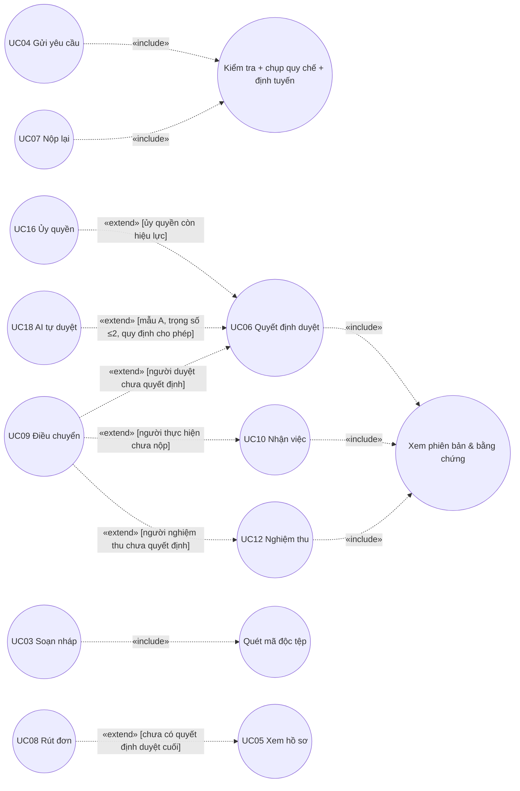
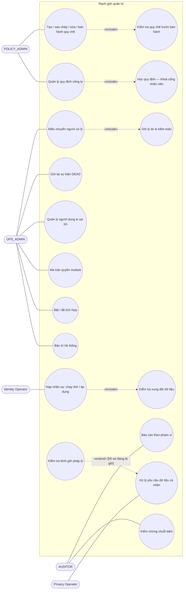
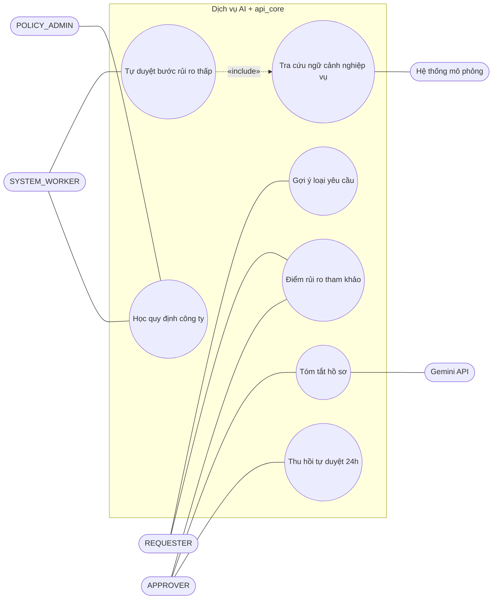

# 2.2.8. BIỂU ĐỒ CA SỬ DỤNG (USE CASE DIAGRAM)

Hệ thống được mô tả bằng **bốn sơ đồ chính** đặt trong chương và **sáu sơ đồ bổ trợ** đặt ở phụ lục:
- sơ đồ ngữ cảnh;
- sơ đồ quan hệ include/extend;
- sơ đồ nghiệp vụ lõi;
- sơ đồ quản trị.

Ký pháp theo UML 2.5.1:
- quan hệ «include» trỏ **tới** ca bắt buộc được gộp;
- quan hệ «extend» trỏ **về** ca cơ sở và ghi điều kiện mở rộng trong ngoặc vuông.

> **Hướng dẫn chèn hình.** Bốn hình chính có ảnh vẽ sẵn trong DOCX nhưng đang mang chú thích sai. Dùng ảnh theo cột "Ảnh" dưới đây. Riêng Hình 2.1 cần vẽ lại theo khối Mermaid vì phải bổ sung UC16, UC18–UC22 và tác nhân AI.

| Hình | Sơ đồ | Ảnh dùng được |
|---|---|---|
| 2.1 | UC-CTX-01 Ngữ cảnh | img_035; cần bổ sung theo Mermaid |
| 2.2 | UC-REL-01 Quan hệ | img_033 (chỉ dùng phần B và C) hoặc Mermaid |
| 2.3 | UC-BIZ-01 Nghiệp vụ lõi | img_036 |
| 2.4 | UC-ADM-01 Quản trị | img_037; bổ sung các ca quản trị web theo Mermaid |

## 1. Sơ đồ ngữ cảnh ca sử dụng (UC-CTX-01)

Sơ đồ tổng quát thể hiện tác nhân nào dùng chức năng nào. Có hai nhóm tác nhân:
- tác nhân nghiệp vụ ở bên trái;
- tác nhân quản trị và tác nhân hệ thống ở bên phải.

```mermaid
flowchart LR
  R([REQUESTER]); A([APPROVER]); E([EXECUTOR]); C([ACCEPTOR])
  P([POLICY_ADMIN]); O([OPS_ADMIN]); AU([AUDITOR]); W([SYSTEM_WORKER]); AI([AI_SYSTEM])
  subgraph EAS["Enterprise Approval System"]
    UC01((UC01 Đăng nhập & phiên)); UC02((UC02 Ban hành quy chế)); UC03((UC03 Soạn nháp & đính kèm))
    UC04((UC04 Gửi yêu cầu)); UC05((UC05 Xem hồ sơ)); UC06((UC06 Quyết định duyệt))
    UC07((UC07 Bổ sung & nộp lại)); UC08((UC08 Rút đơn)); UC09((UC09 Điều chuyển))
    UC10((UC10 Nhận việc)); UC11((UC11 Báo vướng & nộp kết quả)); UC12((UC12 Nghiệm thu))
    UC13((UC13 Thông báo)); UC14((UC14 Giám sát SLA)); UC15((UC15 Kiểm toán & báo cáo))
    UC16((UC16 Ủy quyền duyệt)); UC17((UC17 Danh tính & phân quyền)); UC18((UC18 AI tự duyệt & thu hồi))
    UC19((UC19 Quy định & học quy định)); UC21((UC21 Bảo trì)); UC22((UC22 Quyền module))
  end
  R --- UC03 & UC04 & UC05 & UC07 & UC08 & UC13
  A --- UC05 & UC06 & UC13 & UC16 & UC18
  E --- UC05 & UC10 & UC11 & UC13
  C --- UC05 & UC12 & UC13
  P --- UC02 & UC19
  O --- UC09 & UC17 & UC21 & UC22 & UC15
  AU --- UC05 & UC15
  W --- UC14 & UC19
  AI --- UC18
  R & A & E & C & P & O & AU --- UC01
```

*Hình 2.1. Sơ đồ ngữ cảnh ca sử dụng của hệ thống EAS (UC-CTX-01). Nguồn: Nhóm tác giả.*

Ba ca sử dụng không thể hiện trên hình vì dùng chung cho mọi người dùng: UC20 (thông báo hệ thống), UC23 (quên mật khẩu) và UC24 (tra cứu dữ liệu nghiệp vụ). Chúng được liệt kê ở Bảng 2.2.

## 2. Quan hệ include / extend giữa các ca sử dụng (UC-REL-01)

*Hình 2.2. Quan hệ include/extend giữa các ca sử dụng (UC-REL-01). Nguồn: Nhóm tác giả.*

Hai ca dùng chung một phần bắt buộc:
- **UC04 và UC07** cùng gộp ca "Kiểm tra + chụp quy chế + định tuyến", vì cả hai đều gọi một hàm `submit_request`.
- **UC06, UC10 và UC12** cùng gộp ca xem phiên bản hồ sơ và bằng chứng trước khi quyết định.

Các ca mở rộng chỉ xảy ra khi thoả điều kiện ghi trên mũi tên:
- **Rút đơn:** chỉ khi chưa duyệt xong.
- **Điều chuyển:** chỉ khi người đang giữ việc chưa hoàn tất.
- **Ủy quyền và AI tự duyệt:** đều là cách thay người ra quyết định ở UC06.

## 3. Ca sử dụng nghiệp vụ lõi theo tác nhân (UC-BIZ-01)

Dùng ảnh img_036 (tiêu đề in trên ảnh: "UC-BIZ-01 — Use case nghiệp vụ lõi theo actor"). Nội dung ảnh khớp hệ thống.

| Tác nhân | Ca sử dụng trên ảnh | Đối chiếu Bảng 2.2 |
|---|---|---|
| REQUESTER | Soạn nháp và tệp; Gửi / Gửi lại; Rút đơn; Xem hồ sơ; Đọc thông báo | UC03, UC04, UC07, UC08, UC05, UC13 |
| APPROVER | Duyệt / Từ chối / Bổ sung («include» Xem hồ sơ) | UC06 |
| EXECUTOR | Nhận việc / Báo không thể nhận («include» Xem hồ sơ); Báo vướng / Nộp kết quả | UC10, UC11 |
| ACCEPTOR | Chấp nhận / Làm lại («include» Xem hồ sơ) | UC12 |

*Hình 2.3. Ca sử dụng nghiệp vụ lõi theo tác nhân (UC-BIZ-01). Nguồn: Nhóm tác giả.*

## 4. Ca sử dụng quản trị và quản trị dữ liệu (UC-ADM-01)

*Hình 2.4. Ca sử dụng quản trị và quản trị dữ liệu (UC-ADM-01). Nguồn: Nhóm tác giả.*

---

## 5. Đặc tả các ca sử dụng chính

Mỗi đặc tả gồm: tác nhân, mục đích, tiền điều kiện, hậu điều kiện, luồng chính, luồng thay thế / ngoại lệ, quy tắc nghiệp vụ và nơi hiện thực. Mã lỗi là mã thật do API trả về.

### UC01 — Đăng nhập và quản lý phiên

| Mục | Nội dung |
|---|---|
| Tác nhân | Mọi người dùng |
| Mục đích | Xác thực danh tính và cấp phiên làm việc an toàn |
| Tiền điều kiện | Tài khoản tồn tại và đang hoạt động |
| Hậu điều kiện | Có phiên hợp lệ gắn `user_id` và `auth_version`. Phiên hết hạn sau 30 phút không hoạt động hoặc 8 giờ kể từ khi đăng nhập |
| Luồng chính | 1. Giao diện lấy mã CSRF (`GET /api/v1/auth/csrf`). 2. Người dùng nhập email và mật khẩu. 3. Hệ thống kiểm giới hạn số lần sai theo tài khoản và theo IP. 4. Hệ thống xác minh mật khẩu Argon2. 5. Hệ thống tạo phiên mới (đổi mã phiên) và trả hồ sơ người dùng cùng quyền module |
| Luồng thay thế | 4a. Cờ `must_change_password` bật (tài khoản mới hoặc vừa cấp lại mật khẩu) → chuyển sang màn hình đổi mật khẩu bắt buộc; đổi xong thì phiên cũ hết hiệu lực. 5a. Phân hệ AI đang học quy định → nhân viên thấy màn hình chờ, quản trị viên vẫn vào được |
| Ngoại lệ | 3a. Vượt ngưỡng (5 lần / tài khoản hoặc 30 lần / IP trong 15 phút; Nginx: 5 yêu cầu / phút) → `429 LOGIN_RATE_LIMITED` kèm `Retry-After`. 4b. Sai thông tin → `401 INVALID_CREDENTIALS` với thông báo chung, không tiết lộ tài khoản có tồn tại hay không |
| Quy tắc | Khoá đếm lưu dưới dạng băm. Đăng nhập thành công chỉ xoá bộ đếm của tài khoản, không xoá bộ đếm của IP |
| Hiện thực | `api_core/authn/views.py`, `service.py`, `login_throttle.py` |

### UC02 — Ban hành quy chế

| Mục | Nội dung |
|---|---|
| Tác nhân | POLICY_ADMIN |
| Tiền điều kiện | Loại yêu cầu tồn tại |
| Hậu điều kiện | Phiên bản mới ở trạng thái `PUBLISHED`, bất biến, có `content_sha256`; loại yêu cầu trỏ sang phiên bản mới. Hồ sơ cũ vẫn giữ phiên bản cũ |
| Luồng chính | 1. Tạo bản nháp mới hoặc sao chép bản đang hiệu lực (số phiên bản tự tăng). 2. Sửa các trường cho phép: biểu mẫu, luật định tuyến, bảng gán người, SLA. 3. Chạy kiểm tra: cấu trúc, toán tử, ưu tiên, luật mặc định, số vị trí duyệt, giờ SLA. 4. Ban hành: hệ thống khoá bảo mật, kiểm lại, chuyển `PUBLISHED`, đổi phiên bản hiệu lực nguyên tử, ghi nhật ký quản trị |
| Ngoại lệ | 3a. Cấu hình sai → `422 CONFIG_INVALID` kèm danh sách lỗi. 4a. Có người sửa / ban hành trước → `409 VERSION_CONFLICT`. 4b. Nội dung đã đổi sau lần kiểm tra (mã băm khác) → `409 VALIDATION_STALE`, phải kiểm tra lại. 4c. Sửa bản đã ban hành → `409 RELEASE_IMMUTABLE` |
| Quy tắc | Đúng một luật mặc định, đặt ở cuối. Độ ưu tiên là số nguyên duy nhất. 1–5 người duyệt. Giờ SLA trong (0, 720]. Mốc nhắc cố định 50% |
| Hiện thực | `api_core/workflow/config_service.py`; trigger kiểm tra trong `00_eas_supabase_schema.sql` |

### UC03 — Soạn nháp và đính kèm tệp

| Mục | Nội dung |
|---|---|
| Tác nhân | REQUESTER |
| Tiền điều kiện | Người dùng có vai trò REQUESTER cho loại và phòng ban; loại đang có quy chế ban hành; tích hợp liên quan đang bật |
| Hậu điều kiện | Hồ sơ `DRAFT` có mã `REQ-…`; tệp đã quét sạch được gắn vào nháp |
| Luồng chính | 1. Chọn loại → tạo nháp. 2. Nhập dữ liệu; lưu với `expected_version`. 3. Chọn tệp → hệ thống kiểm kích thước, tên, chữ ký đầu tệp, quét ClamAV → lưu kho riêng tư với tên UUID và mã băm → gắn vào nháp |
| Ngoại lệ | 1a. Tích hợp tắt → `409 INTEGRATION_UNAVAILABLE`. 2a. Lệch phiên bản → `409 VERSION_CONFLICT`. 3a. Sai định dạng → `422 FILE_TYPE_NOT_ALLOWED`. 3b. Có mã độc → `422 MALWARE_DETECTED`. 3c. Máy quét không phản hồi → `503 MALWARE_SCANNER_UNAVAILABLE`, tệp **không** được lưu |
| Hiện thực | `service.create_draft`, `update_draft`; `attachments.register_attachment`; `storage.py` |

### UC04 — Gửi yêu cầu

| Mục | Nội dung |
|---|---|
| Tác nhân | REQUESTER |
| Tiền điều kiện | Hồ sơ của chính người dùng, ở `DRAFT` hoặc `NEEDS_INFO` |
| Hậu điều kiện | Hồ sơ `PENDING_APPROVAL`; có phiên bản `revision_no` mới bất biến; có phiên quy trình và các bước duyệt; bước 1 `ACTIVE` có chặng SLA; sự kiện `APPROVAL_REQUESTED` được xếp hàng |
| Luồng chính | 1. Người dùng xem lại nội dung và tuyến duyệt dự kiến, rồi xác nhận gửi (kèm khoá chống gửi trùng). 2. Hệ thống khoá hồ sơ và kiểm phiên bản. 3. Kiểm dữ liệu theo biểu mẫu và ràng buộc riêng của loại. 4. Định tuyến theo luật. 5. Kiểm tách nhiệm. 6. Ghi phiên bản, phiên quy trình, bước, SLA, người tham gia, kiểm toán, sự kiện trong một giao dịch. 7. Sau khi lưu, tiến trình nền xét AI tự duyệt (UC18) |
| Ngoại lệ | 2a. Lệch phiên bản / sai trạng thái → `409`. 3a. Dữ liệu sai → `422 VALIDATION_FAILED` kèm lỗi từng trường. 3b. Phòng ban trong dữ liệu khác phòng ban của phiên → `403 DEPARTMENT_SCOPE_VIOLATION`. 4a/5a. Không phân giải được người duyệt hoặc vi phạm tách nhiệm → `409 ROUTE_CONFIGURATION_INVALID`; người duyệt đã nghỉ việc → `409 ROUTE_ACTOR_INACTIVE`. 1a. Gửi lặp cùng khoá → trả lại kết quả lần đầu, không tạo hồ sơ thứ hai |
| Quy tắc | Phòng ban luôn lấy từ phiên đăng nhập, không tin dữ liệu gửi lên. Mẫu C bắt buộc có số tiền |
| Hiện thực | `service.submit_request` (`api_core/workflow/service.py:1311`) |

### UC06 — Quyết định phê duyệt

| Mục | Nội dung |
|---|---|
| Tác nhân | APPROVER (hoặc người được ủy quyền; hoặc AI_SYSTEM qua UC18) |
| Tiền điều kiện | Hồ sơ `PENDING_APPROVAL`; người dùng là người được giao bước `ACTIVE` |
| Hậu điều kiện | Có bản ghi quyết định bất biến; hồ sơ sang bước kế, sang `COMPLETED`, `READY_FOR_EXECUTION`, `NEEDS_INFO` hoặc `REJECTED` |
| Luồng chính | 1. Mở hồ sơ, xem nội dung, tệp, lịch sử, SLA, tóm tắt AI. 2. Chọn Duyệt. 3. Hệ thống khoá, kiểm vai trò, phiên bản và bước. 4. Ghi quyết định; đóng SLA bước. 5. Kích hoạt bước kế (có thay người nếu người kế vắng hoặc đã ủy quyền), hoặc kết thúc theo mẫu A / B / C |
| Luồng thay thế | 2a. Từ chối hoặc yêu cầu bổ sung, kèm lý do 10–2000 ký tự. 5a. Bước cuối của mẫu B/C: người duyệt có thể chọn người thực hiện trong danh sách được phép |
| Ngoại lệ | 3a. Không phải người được giao / sai vai trò → `403`. 3b. Đã có người quyết định hoặc phiên bản đổi → `409`. 2b. Thiếu lý do → `422 DECISION_REASON_REQUIRED`. 5b. Người kế tiếp / người thực hiện / người nghiệm thu không còn hợp lệ → `409 ASSIGNEE_UNAVAILABLE` (giao dịch huỷ toàn bộ) |
| Hiện thực | `service.decide_approval`, `_handle_approval_approved`, `_substitute_approver` |

### UC07 — Bổ sung và nộp lại

| Mục | Nội dung |
|---|---|
| Tác nhân | REQUESTER |
| Tiền điều kiện | Hồ sơ `NEEDS_INFO` |
| Hậu điều kiện | Phiên bản mới; quy trình mới chạy **từ bước 1** |
| Luồng chính | 1. Xem lý do bổ sung. 2. Sửa dữ liệu, thêm / bỏ tệp (tệp cũ đã có sẵn trong nháp). 3. Gửi lại (như UC04 từ bước 2) |
| Luồng thay thế | 1a. Không muốn tiếp tục → rút đơn (UC08) |
| Quy tắc | Duyệt lại từ đầu vì nội dung đã đổi; các cấp trước phải xem lại bản mới (nguyên tắc bốn mắt trên nội dung mới) |

### UC08 — Rút đơn

| Mục | Nội dung |
|---|---|
| Tác nhân | REQUESTER |
| Tiền điều kiện | Hồ sơ của chính người dùng ở `DRAFT`, `NEEDS_INFO` hoặc `PENDING_APPROVAL` |
| Hậu điều kiện | Hồ sơ `CANCELLED` (trạng thái cuối); phiên quy trình `CANCELLED`; bước còn lại `SKIPPED` |
| Luồng chính | 1. Chọn Huỷ, nhập lý do. 2. Hệ thống khoá hồ sơ, kiểm trạng thái và phiên bản. 3. Ghi huỷ, kiểm toán, sự kiện |
| Ngoại lệ | 2a. Người duyệt cuối vừa ký trước → `409 REQUEST_STATE_CONFLICT`. 1a. Thiếu lý do → `422 CANCELLATION_REASON_REQUIRED` |

### UC09 — Điều chuyển người xử lý

| Mục | Nội dung |
|---|---|
| Tác nhân | OPS_ADMIN |
| Tiền điều kiện | Mục tiêu đang mở: bước duyệt `ACTIVE`/`WAITING`, lượt thực hiện `READY`/`RUNNING`, người nghiệm thu chưa quyết định, hoặc người thực hiện dự kiến cho lần làm lại |
| Hậu điều kiện | Người mới được giao, có quyền xem hồ sơ; hạn SLA giữ nguyên; nhật ký ghi người cũ, người mới, lý do |
| Luồng chính | 1. Chọn hồ sơ, loại mục tiêu, người mới, nhập lý do. 2. Hệ thống khoá, kiểm phạm vi OPS, kiểm người mới (đang hoạt động, đúng vai trò, đúng loại và phòng, không vi phạm tách nhiệm trên toàn tuyến). 3. Cập nhật theo loại mục tiêu: lượt đang chạy thì đóng `REASSIGNED` và mở lượt mới `READY`. 4. Ghi kiểm toán, sự kiện, thông báo người mới |
| Ngoại lệ | 2a. Mục tiêu đã quyết định / đã nộp → `409`. 2b. Người mới không hợp lệ → `409` / `422` |
| Hiện thực | `api_core/workflow/ops_service.py:522` (`reassign_actor`) |

### UC10, UC11 — Nhận việc, báo vướng, nộp kết quả

| Mục | Nội dung |
|---|---|
| Tác nhân | EXECUTOR |
| Tiền điều kiện | Hồ sơ `READY_FOR_EXECUTION` (nhận) hoặc `IN_PROGRESS` (báo vướng, nộp); đúng người được giao |
| Hậu điều kiện | Nhận: lượt `RUNNING`, hồ sơ `IN_PROGRESS`. Nộp mẫu B: `COMPLETED`. Nộp mẫu C: `WAITING_FOR_ACCEPTANCE` với chặng SLA nghiệm thu |
| Luồng chính | 1. Nhận việc. 2. (Tuỳ chọn) tải tệp bằng chứng. 3. Nộp ghi chú (10–4000 ký tự) và mã tham chiếu (1–200 ký tự) |
| Luồng thay thế | 1a. Không thể nhận → gửi báo cáo `UNABLE_TO_CLAIM`, lượt giữ `READY`. 2a. Vướng → báo cáo `BLOCKED`, hồ sơ giữ `IN_PROGRESS`; thông báo quản trị vận hành |
| Ngoại lệ | Hai người cùng nhận / sai người → `403` / `409`. Ghi chú không hợp lệ → `422 RESULT_NOTE_INVALID` |
| Quy tắc | Báo vướng không dừng SLA và không tự đổi người |

### UC12 — Nghiệm thu

| Mục | Nội dung |
|---|---|
| Tác nhân | ACCEPTOR |
| Tiền điều kiện | Hồ sơ mẫu C ở `WAITING_FOR_ACCEPTANCE`; người dùng là người nghiệm thu và khác người thực hiện |
| Hậu điều kiện | Chấp nhận → `COMPLETED`. Làm lại → lượt cũ đóng `REWORK`, lượt mới `READY`, hồ sơ `READY_FOR_EXECUTION` |
| Ngoại lệ | Người thực hiện dự kiến cho lần làm lại không còn hợp lệ → `409 ASSIGNEE_UNAVAILABLE` (cần điều chuyển trước) |

### UC16 — Ủy quyền phê duyệt

| Mục | Nội dung |
|---|---|
| Tác nhân | APPROVER |
| Hậu điều kiện | Trong khoảng thời gian ủy quyền, mọi bước được kích hoạt cho người ủy quyền sẽ chuyển cho người nhận ủy quyền |
| Luồng chính | 1. Chọn người nhận trong danh sách hợp lệ. 2. Chọn thời gian bắt đầu – kết thúc, nhập lý do. 3. Lưu. 4. (Tuỳ chọn) thu hồi sớm |
| Ngoại lệ | Ủy quyền cho chính mình → `422 CANNOT_DELEGATE_TO_SELF`. Khoảng thời gian sai → `422 INVALID_DELEGATION_WINDOW`. Thiếu lý do → `422 DELEGATION_REASON_REQUIRED` |
| Quy tắc | Người nhận phải là APPROVER hợp lệ cho đúng loại và phòng, và không phải người yêu cầu của hồ sơ |
| Hiện thực | `api_core/workflow/delegation.py` |

### UC18 — AI tự duyệt và thu hồi

| Mục | Nội dung |
|---|---|
| Tác nhân | SYSTEM_WORKER, AI_SYSTEM; APPROVER (thu hồi) |
| Tiền điều kiện | Có bước duyệt vừa được kích hoạt; hồ sơ chưa từng bị thu hồi tự duyệt |
| Luồng chính | 1. Tiến trình nền nhận sự kiện `APPROVAL_REQUESTED`. 2. Đọc trọng số rủi ro của hồ sơ; nếu > 2 thì dừng. 3. Gọi dịch vụ AI (ngoài giao dịch CSDL): áp quy định công ty, kiểm mẫu A, kiểm trọng số sau quy định, kiểm luật theo loại (ví dụ số ngày nghỉ ≤ số phép còn lại). 4. Nếu đạt, gọi chính UC06 với tài khoản AI hệ thống |
| Luồng thay thế | 3a. Không đạt hoặc AI lỗi / quá thời gian → bước giữ nguyên, người duyệt nhận thông báo. 5. Trong 24 giờ, một APPROVER (khác người yêu cầu) có thể thu hồi, kèm lý do → hồ sơ quay về duyệt thủ công |
| Quy tắc | AI không bao giờ được từ chối hồ sơ. Mọi kiểm tra tách nhiệm và kiểm toán áp dụng như với người |
| Hiện thực | `api_core/workflow/auto_approval.py`, `ai_service/routers/auto_approve.py`, `policy.py` |

### UC19 — Quy định công ty và học quy định

| Mục | Nội dung |
|---|---|
| Tác nhân | POLICY_ADMIN, SYSTEM_WORKER |
| Luồng chính | 1. Thêm / sửa / xoá văn bản quy định (tự tăng phiên bản). 2. Hệ thống xếp một phiên học (`QUEUED`); cổng nhân viên tạm khoá. 3. Tiến trình nhận phiên theo cơ chế thuê, qua bốn bước: chụp quy định → biên dịch thành luật → đẩy sang dịch vụ AI và kiểm tra dịch vụ đã dùng luật mới → ghi bộ luật, nhật ký phiên bản, thông báo người dùng. 4. Mở khoá |
| Ngoại lệ | Lỗi quá số lần cho phép → phiên `FAILED`; giữ bộ luật cũ; mở khoá; báo quản trị viên |
| Hiện thực | `api_core/workflow/ai_learning.py`, `api_core/administration/regulations_ai.py` |

---

## 6. Sơ đồ bổ trợ (đặt ở Phụ lục A)

| Số | Mã | Nội dung | Ảnh dùng được |
|---|---|---|---|
| PL-01 | UC-BIZ-02 | Khởi tạo, gửi và quyết định | img_006 |
| PL-02 | UC-BIZ-03 | Thực hiện và nghiệm thu | img_009 |
| PL-03 | UC-APR-01 | Góc nhìn người phê duyệt | img_007 |
| PL-04 | UC-CTL-01 | Góc nhìn kiểm soát nội bộ | img_034 |
| PL-05 | UC-SYS-01 | Tác vụ nền và hệ thống ngoài | img_008 (thay "Quarantine/Scan" bằng "Quét đồng bộ trước khi lưu"; bỏ "xuất checkpoint" hoặc ghi là hướng phát triển) |
| PL-06 | UC-AI-01 | AI hỗ trợ quy trình | Mermaid dưới đây |

*Hình PL-06. Ca sử dụng của phân hệ AI (UC-AI-01). Nguồn: Nhóm tác giả.*
