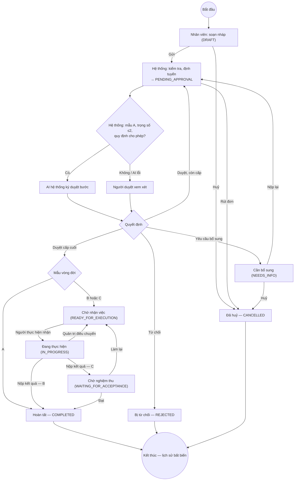
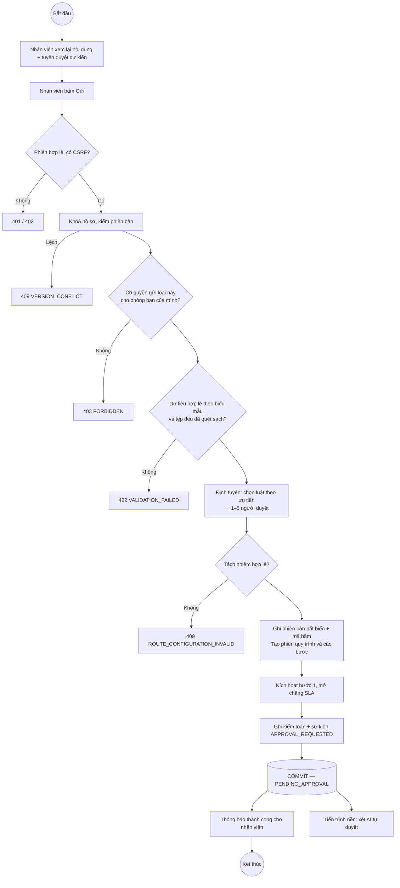
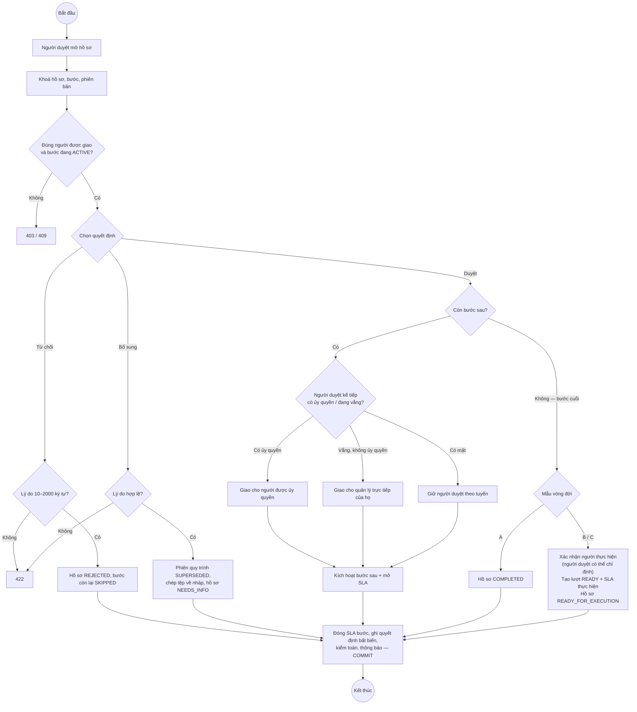
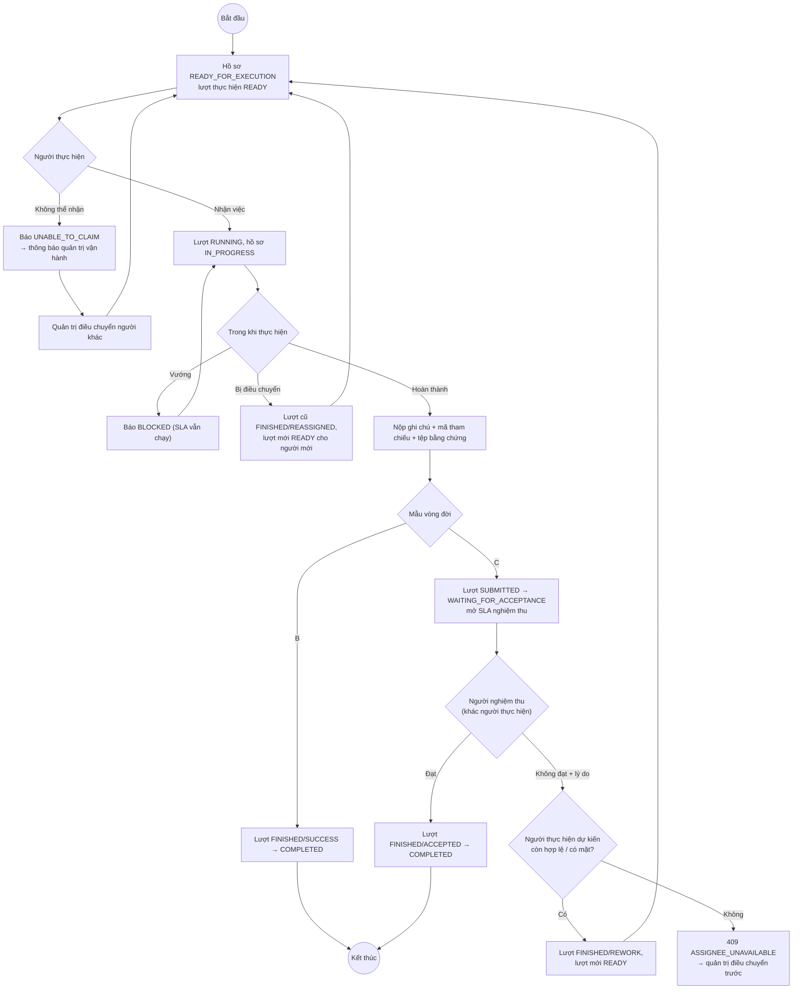

# 2.2.9. BIỂU ĐỒ HOẠT ĐỘNG CHO CÁC LUỒNG XỬ LÝ CHÍNH (ACTIVITY DIAGRAM)

Bốn luồng chính đặt trong chương (Hình 2.5–2.8); sáu luồng bổ trợ đặt ở Phụ lục B (PL-07…PL-12). Mỗi sơ đồ chia làn (swimlane) theo người hoặc thành phần chịu trách nhiệm.

> **Hướng dẫn chèn hình.** DOCX đã có ảnh vẽ sẵn cho cả 10 sơ đồ nhưng chú thích bị đặt sai. Bảng dưới chỉ đúng ảnh cho từng hình. Sơ đồ nào cần sửa nội dung thì dùng khối Mermaid trong mục tương ứng.

| Hình | Mã | Ảnh vẽ sẵn | Cần sửa trên ảnh |
|---|---|---|---|
| 2.5 | AD-01 | img_011 | Có. Dùng Mermaid: thêm nhánh AI tự duyệt; nhánh theo mẫu A/B/C thay cho ví dụ cụ thể |
| 2.6 | AD-02 | img_040 | Có. "1 đến 3 cấp" → "1 đến 5 cấp"; thêm bước xét AI tự duyệt sau khi lưu |
| 2.7 | AD-03 | img_038 | Có. Người duyệt kế tiếp vắng: chuyển người thay, không báo lỗi |
| 2.8 | AD-04 | img_012 | Có. Làn cuối đổi tên thành "Người nghiệm thu"; khi người làm cũ vắng thì hệ thống tự chọn người có mặt |
| PL-07 | AD-05 | img_013 | Thêm nhánh ủy quyền |
| PL-08 | AD-06 | img_041 | Không |
| PL-09 | AD-07 | img_010 | Không |
| PL-10 | AD-08 | img_042 | Không |
| PL-11 | AD-09 | img_043 | Ghi chú: duyệt kép là hướng phát triển |
| PL-12 | AD-10 | img_039 | Không (chuyển sang Chương 3) |

## 1. Vòng đời tổng thể xử lý một yêu cầu (AD-01)

*Hình 2.5. Sơ đồ hoạt động vòng đời tổng thể xử lý một yêu cầu (AD-01). Nguồn: Nhóm tác giả.*

**Diễn giải.**
- Từ trạng thái nháp, nhân viên có thể huỷ hoặc gửi.
- Sau khi gửi, hệ thống xét tự duyệt; chỉ hồ sơ mẫu A rủi ro thấp mới được AI ký thay.
- Người duyệt có ba lựa chọn. "Bổ sung" đưa hồ sơ về cho nhân viên sửa và nộp lại; "Từ chối" kết thúc hồ sơ.
- Khi cấp cuối đồng ý:
  - mẫu A hoàn tất;
  - mẫu B, C chuyển sang bộ phận thực hiện.
- Với mẫu C, kết quả phải được người nghiệm thu chấp nhận. Nếu không đạt, hồ sơ quay về hàng chờ nhận việc với một lượt thực hiện mới.
- Ở mọi trạng thái kết thúc, toàn bộ lịch sử được giữ bất biến.

## 2. Gửi đơn và kiểm tra tự động (AD-02)

*Hình 2.6. Sơ đồ hoạt động gửi đơn và kiểm tra tự động (AD-02). Nguồn: Nhóm tác giả.*

Mọi bước từ "Khoá hồ sơ" đến "COMMIT" nằm trong **một giao dịch**. Bất kỳ lỗi nào cũng làm huỷ toàn bộ, nên không có hồ sơ "đã gửi một nửa".

## 3. Cấp trên xử lý phê duyệt (AD-03)

*Hình 2.7. Sơ đồ hoạt động cấp trên xử lý phê duyệt (AD-03). Nguồn: Nhóm tác giả.*

Ghi chú về trạng thái vắng mặt: khi một bước duyệt được kích hoạt, hệ thống xét theo thứ tự sau (`api_core/workflow/service.py`, hàm `_absence_status`):

1. Nếu người duyệt có **ủy quyền còn hiệu lực** (`eas.approval_delegation`) và người được ủy quyền đủ điều kiện, bước được giao cho người được ủy quyền.
2. Nếu không có ủy quyền và người duyệt đang **nghỉ phép đã được duyệt** (`eas.user_leave_and_trips`, `approval_status = 'APPROVED'`), bước được chuyển cho **quản lý trực tiếp** của người đó.
3. **Đi công tác không tính là vắng mặt** (quyết định D2): người duyệt vẫn xử lý được qua cổng web hoặc ứng dụng di động.

Dữ liệu chấm công của hệ thống nhân sự mô phỏng không được dùng.

## 4. Thực hiện và nghiệm thu (AD-04)

*Hình 2.8. Sơ đồ hoạt động thực hiện và nghiệm thu (AD-04). Nguồn: Nhóm tác giả.*

## 5. Sơ đồ hoạt động bổ trợ (Phụ lục B)

**PL-07. Chuyển giao người xử lý khi vắng mặt (AD-05), ảnh img_013.**
1. Bộ phận điều phối chọn hồ sơ, người thay và lý do.
2. Hệ thống kiểm tra theo thứ tự:
   - đúng thẩm quyền;
   - khoá hồ sơ;
   - hồ sơ còn mở;
   - người mới đang làm việc, đúng vai trò, không trùng người tạo.
3. Hệ thống xác định vị trí cần thay và xử lý tương ứng:

   | Vị trí | Xử lý |
   |---|---|
   | Người duyệt | Đổi người, giữ hạn |
   | Người thực hiện chưa nhận | Đổi người |
   | Người thực hiện đang làm | Đóng lượt cũ, giao lượt mới |
   | Người nghiệm thu | Đổi người |
   | Người thực hiện dự kiến cho lần làm lại | Đổi người |

4. Hệ thống ghi nhật ký và thông báo; người cũ mất quyền thao tác.

**Bổ sung vào ảnh:** nhánh song song "Người duyệt tự ủy quyền trước" (UC16). Khi đó hệ thống tự giao bước cho người được ủy quyền, không cần quản trị can thiệp.

**PL-08. Tự động nhắc tiến độ và cảnh báo trễ hạn (AD-06), ảnh img_041.**
- Bộ quét chạy liên tục (chu kỳ 2 giây trong tiến trình nền) trên các chặng SLA đang mở:
  - qua 50% thời hạn → ghi cảnh báo `REMINDER`;
  - quá hạn → ghi `BREACH` và mốc vi phạm.
- Mỗi chặng chỉ nhận tối đa một cảnh báo mỗi loại.
- Thông báo gửi qua hàng đợi outbox tới người đang giữ việc. Lỗi gửi được thử lại với khoảng chờ tăng dần; sau 4 lần thất bại, sự kiện chuyển `DEAD` để quản trị gửi lại thủ công.

**PL-09. Ban hành và cập nhật quy chế (AD-07), ảnh img_010.** Sao chép quy chế đang dùng → sửa → hệ thống kiểm tra cấu trúc → xem trước tuyến duyệt → ban hành (khoá bảo mật, kiểm lại, đóng băng, đổi phiên bản hiệu lực nguyên tử). Hồ sơ mới dùng quy chế mới; hồ sơ cũ giữ quy chế cũ.

**PL-10. Cập nhật danh sách nhân sự và phân quyền (AD-08), ảnh img_042.**
1. Nạp tệp CSV ở chế độ chạy thử. Hệ thống kiểm tra mã nhân viên, email, phòng ban, quan hệ quản lý không tạo vòng lặp, vai trò, phạm vi, ngày hiệu lực; rồi trả kế hoạch thêm / sửa / khoá cùng mã băm tệp.
2. Áp dụng với **cùng mã băm** trong một giao dịch:
   - tăng `security_epoch`;
   - ghi nhật ký quản trị cho từng thay đổi;
   - người bị đổi quyền mất phiên ở yêu cầu kế tiếp.
3. Lỗi bất kỳ thì khôi phục toàn bộ.

**PL-11. Xử lý quyền riêng tư và tiêu huỷ hồ sơ (AD-09), ảnh img_043.**
- Cán bộ pháp chế tiếp nhận và phân loại yêu cầu.
- Hệ thống từ chối xoá nếu hồ sơ của chủ thể đang có **lệnh giữ pháp lý** (`retention_hold` chưa giải toả).
- Nếu đủ điều kiện: chạy thử, phê duyệt (ghi số quyết định), thực hiện xoá, ghi biên bản tối thiểu không chứa nội dung đã xoá.
- *Hướng phát triển:* bắt buộc người duyệt thứ hai khác người thao tác, ràng buộc theo mã băm danh sách xoá (duyệt kép đúng như ảnh).

**PL-12. Kiểm tra nghiệm thu và đưa phần mềm vào sử dụng (AD-10), ảnh img_039.** Quy trình vận hành: cổng chất lượng → UAT và diễn tập khôi phục → bật chế độ bảo trì (chặn thao tác ghi) → sao lưu → triển khai và nâng cấp CSDL → kiểm thử nhanh và đối soát → mở lại → giám sát 60 phút; lỗi thì quay về bản trước. Nội dung chi tiết trình bày ở Chương 3.
