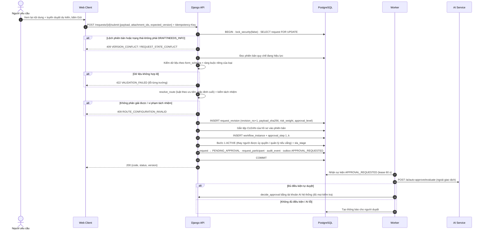
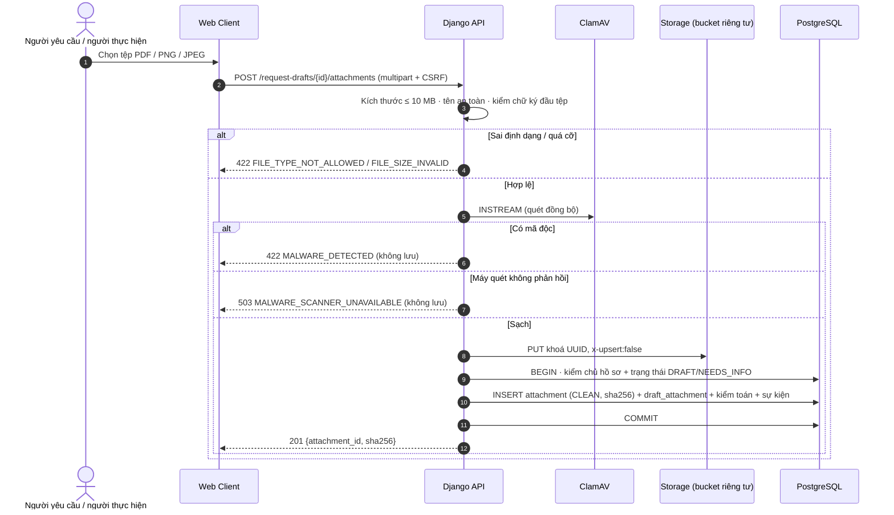
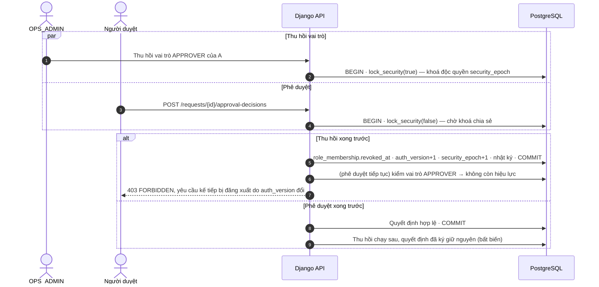
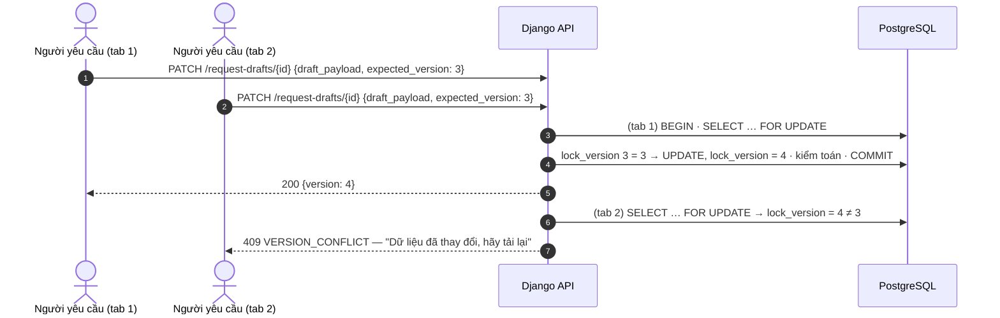
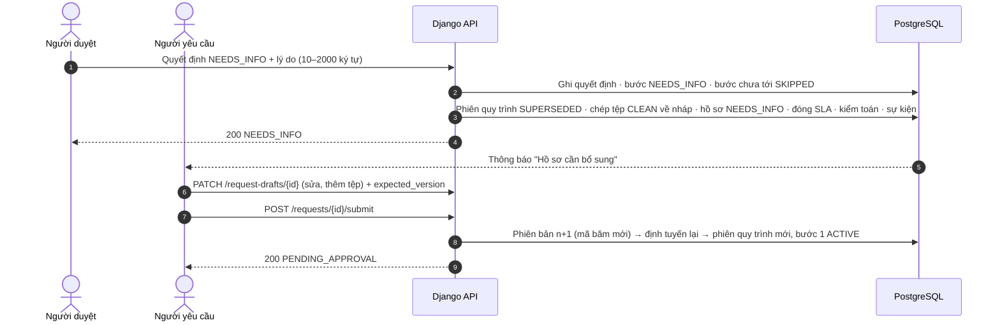

# 2.2.10. BIỂU ĐỒ TUẦN TỰ CHO CÁC CA SỬ DỤNG CỐT LÕI (SEQUENCE DIAGRAM)

## Quy ước chung của mọi lệnh ghi dữ liệu

Mọi thao tác làm thay đổi dữ liệu nghiệp vụ trong EAS đi theo **cùng một khuôn giao dịch**. Nhờ vậy, các sơ đồ dưới đây không phải lặp lại các bước này:

1. `BEGIN` giao dịch.
2. `SELECT eas.lock_security(false)`: khoá **chia sẻ** trên bảng `security_epoch`. Thao tác đổi quyền lấy khoá **độc quyền**, nên hai loại thao tác không chạy chen nhau.
3. Khoá các dòng liên quan bằng `FOR UPDATE` theo thứ tự cố định: hồ sơ → phiên quy trình → bước / lượt thực hiện. Thứ tự cố định này tránh khoá chết.
4. So `expected_version` với `lock_version`; lệch thì trả `409 VERSION_CONFLICT`.
5. Kiểm khoá chống lặp (`Idempotency-Key`). Lần gửi lặp nhận lại đúng kết quả lần đầu.
6. Ghi dữ liệu nghiệp vụ, rồi sự kiện kiểm toán (chuỗi băm), rồi sự kiện outbox.
7. `COMMIT`. Bất kỳ lỗi nào ở các bước trên đều dẫn tới `ROLLBACK` toàn bộ.

> **Hướng dẫn chèn hình.** 18 sơ đồ đã có ảnh vẽ sẵn trong DOCX (đặt nhầm chú thích). 4 sơ đồ chưa có ảnh (SD-03, SD-12, SD-19, SD-20) được vẽ bằng Mermaid dưới đây. SD-02 dùng bản Mermaid thay cho ảnh vì ảnh mô tả cơ chế quét bất đồng bộ, khác với hệ thống.

| Hình | Mã | Nội dung | Ảnh |
|---|---|---|---|
| 2.9 | SD-01 | Đăng nhập, phiên, đăng xuất | img_046 |
| 2.10 | SD-03 | Gửi / gửi lại nguyên tử | Mermaid |
| 2.11 | SD-04 | Duyệt / từ chối / bổ sung | img_047 |
| 2.12 | SD-06 | Nhận việc, nộp kết quả, nghiệm thu | img_048 |
| 2.13 | SD-08 | SLA và hàng đợi outbox | img_056 |
| PL-13…PL-29 | SD-02, 05, 07, 09–22 | Bổ trợ | Xem §6 |

## 1. Đăng nhập, phiên và đăng xuất (SD-01)

*Hình 2.9 — dùng ảnh img_046. Truy vết: UC01; kiểm thử TC001–006, TC071–072.*

**Đăng nhập.**
1. Trình duyệt gọi `GET /api/v1/auth/csrf` để nhận mã CSRF.
2. Trình duyệt gửi `POST /api/v1/auth/login` (email, mật khẩu, mã CSRF).
3. Django kiểm hai bộ đếm sai: theo tài khoản và theo IP. Khoá đếm được băm SHA-256 trước khi lưu Redis.
4. Kết quả có ba nhánh:
   - **vượt ngưỡng:** trả `429 LOGIN_RATE_LIMITED` kèm header `Retry-After`;
   - **sai thông tin:** ghi tăng bộ đếm, trả `401 INVALID_CREDENTIALS` với thông báo chung (chống dò tài khoản);
   - **đúng:** xác minh Argon2, kiểm tài khoản đang hoạt động, đổi mã phiên (chống cố định phiên), ghi `user_id` và `auth_version` vào cookie ký `eas_session`, trả hồ sơ người dùng và quyền module.

**Ở mỗi yêu cầu sau đó**, máy chủ kiểm ba điều:
- dấu rỗi trong Redis còn hạn (30 phút);
- tuổi phiên ≤ 8 giờ;
- `auth_version` trong phiên còn bằng giá trị trong CSDL.

Sai một điều thì trả `401 AUTHENTICATION_REQUIRED` và giao diện đưa người dùng về màn hình đăng nhập.

**Đăng xuất:** `POST /api/v1/auth/logout` (có CSRF) huỷ phiên và xoá cookie.

## 2. Gửi và gửi lại hồ sơ nguyên tử (SD-03)

*Hình 2.10. Sơ đồ tuần tự gửi và gửi lại hồ sơ nguyên tử (SD-03). Nguồn: Nhóm tác giả.*

**Gửi lại sau khi bị trả về** dùng đúng luồng trên:
- phiên bản mới có `revision_no` tăng lên;
- hệ thống định tuyến lại theo dữ liệu mới, nên có thể ra tuyến khác nếu số tiền thay đổi;
- quy trình bắt đầu lại từ bước 1.

## 3. Duyệt, từ chối và yêu cầu bổ sung (SD-04)

*Hình 2.11 — dùng ảnh img_047. Truy vết: UC06, UC07; kiểm thử TC031–042, TC057–060.*

1. Người duyệt gửi quyết định gồm: bước, kết quả, lý do, `expected_version`, khoá chống lặp.
2. Trong một giao dịch, hệ thống khoá theo thứ tự: bảo mật → hồ sơ → phiên quy trình → bước `ACTIVE`. Sau đó kiểm người, vai trò, phạm vi, trạng thái, phiên bản, khoá chống lặp. Sai thì `403` / `409`.
3. Xử lý theo kết quả:

| Kết quả | Điều kiện | Xử lý | Trạng thái hồ sơ sau đó |
|---|---|---|---|
| Từ chối | Lý do hợp lệ (thiếu → `422`) | Ghi quyết định; phiên quy trình `REJECTED`; các bước chưa tới `SKIPPED`; đóng SLA | `REJECTED` |
| Bổ sung | Lý do hợp lệ (thiếu → `422`) | Phiên quy trình `SUPERSEDED`; chép tệp về nháp | `NEEDS_INFO` |
| Duyệt, còn bước | Người kế tiếp hợp lệ (hoặc đã được thay bằng người ủy quyền / quản lý) | Kích hoạt bước kế tiếp + SLA mới | `PENDING_APPROVAL` |
| Duyệt cuối, mẫu A | — | Đóng phiên quy trình | `COMPLETED` |
| Duyệt cuối, mẫu B/C | Người thực hiện (và người nghiệm thu với C) hợp lệ | Tạo lượt thực hiện `READY` + SLA thực hiện | `READY_FOR_EXECUTION` |

Nếu người kế tiếp không còn hợp lệ, hệ thống huỷ toàn bộ giao dịch và trả `409 ASSIGNEE_UNAVAILABLE`.

Mọi nhánh đều ghi kiểm toán, sự kiện outbox và khoá chống lặp trước `COMMIT`.

## 4. Nhận việc, nộp kết quả, nghiệm thu / làm lại (SD-06)

*Hình 2.12 — dùng ảnh img_048. Truy vết: UC10–UC12; kiểm thử TC043–055.*

1. **Nhận việc.** `POST /requests/{id}/claim` khoá hồ sơ và lượt thực hiện, kiểm đúng người và trạng thái `READY`.
   - Đúng: lượt `RUNNING`, hồ sơ `IN_PROGRESS`.
   - Hai người cùng nhận, sai người hoặc dữ liệu cũ: `403` / `409`.
2. **Báo vướng (tuỳ chọn).** Ghi `execution_issue` loại `BLOCKED`, giữ nguyên trạng thái và hạn SLA.
3. **Nộp kết quả** (ghi chú, mã tham chiếu, tệp đã quét sạch do chính người thực hiện tải lên):
   - mẫu B: lượt `FINISHED/SUCCESS`, hồ sơ `COMPLETED`;
   - mẫu C: lượt `SUBMITTED`, hồ sơ `WAITING_FOR_ACCEPTANCE`, mở SLA nghiệm thu.
4. **Nghiệm thu** (mẫu C). Hệ thống kiểm người nghiệm thu khác người thực hiện.
   - Chấp nhận: lượt `FINISHED/ACCEPTED`, hồ sơ `COMPLETED`.
   - Làm lại: lượt `FINISHED/REWORK`, tạo lượt mới `READY` + SLA, hồ sơ `READY_FOR_EXECUTION`.
   - Người thực hiện dự kiến không hợp lệ: `ROLLBACK`, `409`.

## 5. Giám sát SLA và hàng đợi outbox (SD-08)

*Hình 2.13 — dùng ảnh img_056. Truy vết: UC14; kiểm thử TC061–070, TC087.*

**Quét SLA.** Tiến trình `run_outbox_worker` lặp (chu kỳ mặc định 2 giây), với mỗi chặng SLA đang mở:
- quá hạn → ghi `sla_alert` loại `BREACH` (duy nhất cho mỗi chặng), cập nhật `breached_at`, kèm kiểm toán và sự kiện;
- qua 50% thời hạn → ghi `REMINDER` (duy nhất cho mỗi chặng) và sự kiện;
- còn lại → bỏ qua.

**Phát sự kiện.** Worker nhận tối đa một lô sự kiện `PENDING` (hoặc `PROCESSING` đã hết hạn thuê) bằng `lease_token`, thời hạn thuê 60 giây. Trong một giao dịch, worker kiểm còn giữ quyền thuê, xác định người nhận rồi tạo thông báo (có khoá chống trùng) và đánh dấu `SENT`.
- **Lỗi:** tăng số lần thử, lùi thời điểm thử lại theo cấp số nhân (15 s, 30 s, 60 s…, tối đa 300 s).
- **Lần lỗi thứ 4:** chuyển `DEAD`.

**Gửi lại.** Quản trị vận hành gửi lại sự kiện `DEAD` kèm lý do. Sự kiện giữ nguyên mã và khoá chống trùng, quay về `PENDING`, và có nhật ký quản trị.

> Hằng số trên ảnh (quét 60 s, poll 5 s, thử lại 1/5/15 phút) là giá trị thiết kế ban đầu. Khi chèn ảnh, cập nhật ghi chú theo hằng số thực tế ở trên.

## 6. Sơ đồ tuần tự bổ trợ (Phụ lục C)

### PL-13. Tải lên và quét tệp (SD-02) — vẽ lại theo hệ thống

*Hình PL-13. Tải lên, quét mã độc và đính kèm tệp an toàn (SD-02). Nguồn: Nhóm tác giả.*

Chọn quét **đồng bộ** vì tệp nhỏ (≤ 10 MB) quét dưới một giây, và tệp chưa quét sạch không bao giờ được lưu vào kho. Tải tệp xuống cũng kiểm lại quyền và trạng thái quét, rồi ghi kiểm toán.

### PL-14. Rút đơn tranh chấp với duyệt cuối (SD-05) — ảnh img_050
Hai yêu cầu đến gần như đồng thời đều khoá **cùng một dòng** hồ sơ (`FOR UPDATE`). Giao dịch nào lấy được khoá trước sẽ thắng:
- **Rút đơn thắng:** hồ sơ `CANCELLED`, bước còn lại `SKIPPED`; quyết định duyệt đến sau thấy phiên bản đã đổi và nhận `409 REQUEST_STATE_CONFLICT`.
- **Duyệt cuối thắng:** hồ sơ `COMPLETED` (A) hoặc `READY_FOR_EXECUTION` (B/C); lệnh rút đến sau nhận `409 REQUEST_STATE_CONFLICT`.

### PL-15. Điều chuyển người thực hiện đang làm (SD-07) — ảnh img_059
1. Quản trị gửi yêu cầu điều chuyển: đích, người mới, lý do, phiên bản, khoá chống lặp.
2. Hệ thống khoá theo thứ tự: bảo mật → hồ sơ → lượt hiện tại.
3. Hệ thống kiểm phạm vi quản trị, kiểm người mới (đang hoạt động, đúng vai trò và phạm vi, không vi phạm tách nhiệm trên toàn tuyến).
4. Xử lý theo trạng thái lượt:
   - lượt `READY`: đổi người tại chỗ, giữ SLA;
   - lượt `RUNNING`: đóng lượt cũ `FINISHED/REASSIGNED`, tạo lượt mới `READY`, hồ sơ về `READY_FOR_EXECUTION`, giữ nguyên chặng SLA.
5. Ghi nhật ký `ACTOR_REASSIGNED` (cũ, mới, lý do) và sự kiện.

CSDL chặn đổi trực tiếp người thực hiện của lượt đang chạy, nên buộc phải tạo lượt mới.

### PL-16. Ban hành quy chế (SD-09) — ảnh img_057
1. Policy Admin sao chép bản đang hiệu lực thành bản nháp.
2. Sửa các trường cho phép kèm `expected_version`.
3. Kiểm tra (cấu trúc, toán tử, ưu tiên, luật mặc định, 1–5 vị trí duyệt, SLA) và xem kết quả định tuyến mẫu.
4. Ban hành. Trong một giao dịch, hệ thống:
   - lấy khoá bảo mật độc quyền và khoá loại yêu cầu;
   - kiểm phiên bản và mã băm nội dung;
   - chuyển `DRAFT → PUBLISHED`;
   - đổi `active_release_id`;
   - ghi nhật ký quản trị.
5. Hồ sơ đã gửi vẫn giữ quy chế cũ.

Cập nhật ghi chú trên ảnh: "1–3 slots" → "1–5 vị trí".

### PL-17. Truy xuất hồ sơ và tệp chống IDOR (SD-10) — ảnh img_045
Với mỗi yêu cầu đọc, hệ thống chỉ trả dữ liệu khi người gọi thuộc một trong các trường hợp:
- là chủ hồ sơ;
- là người tham gia chưa bị thu hồi quyền đọc;
- là AUDITOR có phạm vi phù hợp (toàn công ty hoặc đúng phòng ban, đúng loại).

Ngoài các trường hợp trên, hệ thống trả **404** (không tiết lộ hồ sơ có tồn tại). Quản trị vận hành chỉ thấy siêu dữ liệu điều phối, không thấy nội dung. Tải tệp: kiểm lại quyền và trạng thái quét, ghi kiểm toán rồi mới trả nội dung.

### PL-18. Nạp danh tính và thu hồi phiên (SD-11) — ảnh img_014
1. **Chạy thử:** phân tích và kiểm tệp CSV (mã, khoá ngoại, vai trò, phạm vi, ngày, vòng lặp quản lý). Có lỗi thì báo theo dòng kèm mã băm tệp, không thay đổi gì.
2. **Áp dụng** với cùng mã băm: khoá `security_epoch`, kiểm lại, áp dụng, tăng epoch, ghi nhật ký từng thay đổi. Lỗi CSDL thì `ROLLBACK` toàn bộ.
3. **Thu hồi phiên** được thực hiện bằng cách tăng `auth_version` của người bị đổi mật khẩu, khoá tài khoản hoặc đổi quyền. Phiên cũ bị từ chối ở yêu cầu kế tiếp. Không cần xoá phiên trong Redis.

### PL-19. Thu hồi quyền tranh chấp với phê duyệt (SD-12) — vẽ mới

*Hình PL-19. Thu hồi quyền tranh chấp với phê duyệt (SD-12). Nguồn: Nhóm tác giả.*

### PL-20. Ghi kiểm toán và kiểm chứng (SD-13) — ảnh img_049
1. Khoá đầu chuỗi `REQ:{id}` hoặc `ADMIN` để lấy số thứ tự và mã băm cuối.
2. Chuẩn hoá sự kiện theo RFC 8785, tính `hash = SHA-256(prev_hash ‖ sự kiện)`.
3. Ghi sự kiện, đẩy đầu chuỗi. Lỗi thì `ROLLBACK` cả giao dịch nghiệp vụ, để không có thay đổi nào thiếu kiểm toán.
4. Kiểm toán viên gọi `POST /requests/{id}/audit/verify`: hệ thống tính lại toàn chuỗi và trả `PASS` hoặc `FAIL` kèm vị trí sai.

Phần xuất điểm kiểm soát (checkpoint) ra kho ngoài trên ảnh là **hướng phát triển**.

### PL-21. Đọc và đánh dấu thông báo (SD-15) — ảnh img_052
- `GET /notifications` chỉ trả thông báo của chính người dùng.
- Mở liên kết hồ sơ thì hệ thống kiểm lại quyền; nếu đã mất quyền thì trả `404`, không lộ nội dung.
- Đánh dấu đã đọc là thao tác lặp lại an toàn: chỉ ghi `read_at` lần đầu.
- Giao diện làm mới định kỳ khi tab đang hiển thị.

### PL-22. Xoá dữ liệu cá nhân có kiểm soát giữ pháp lý (SD-14) — ảnh img_053
1. Privacy Operator chạy thử để xem số lệnh giữ pháp lý đang hiệu lực.
2. Phê duyệt kèm số quyết định.
3. Thực hiện xoá. Nếu còn lệnh giữ thì dừng với `BLOCKED_BY_HOLD`. Nếu không, xoá theo phụ thuộc và ghi biên bản tối thiểu.

Bước "người duyệt thứ hai xác nhận đúng mã băm danh sách xoá" và "danh sách loại trừ khi khôi phục sao lưu" trên ảnh là **hướng phát triển**.

### PL-23. Báo cáo theo phạm vi (SD-16) — ảnh img_060
`GET /reports/requests` (và `/reports/team`) hoạt động như sau:
- dựng điều kiện phân quyền **trước** khi tổng hợp;
- đếm theo hồ sơ, không đếm theo phiên bản;
- mẫu số bằng 0 thì trả tỷ lệ rỗng và giao diện hiển thị N/A;
- kênh quản trị không được dùng để mở rộng quyền đọc nội dung nghiệp vụ.

### PL-24. Chuyển đổi phiên bản và quay lui có kiểm soát (SD-17) — ảnh img_058
Release Owner xác nhận các cổng chất lượng, rồi thực hiện:
1. Bật bảo trì: chặn lệnh ghi.
2. Chờ các giao dịch đang chạy hoàn tất; dừng worker.
3. Ghi mốc sao lưu.
4. Triển khai bản mới; chạy migration tương thích ngược.
5. QA kiểm thử nhanh và đối soát (số dòng, khoá ngoại, đầu chuỗi kiểm toán, mã băm tệp).
6. Đạt thì tắt bảo trì và giám sát 60 phút. Không đạt thì quay về bản trước; khôi phục dữ liệu nếu được phê duyệt.

Hệ thống hỗ trợ bước 1 qua `POST /system/maintenance/start|complete`; migration có kịch bản rollback.

### PL-25. Khôi phục theo thời điểm và đối soát (SD-18) — ảnh img_054
DBA chọn thời điểm khôi phục trên Supabase PITR vào môi trường cách ly. Sau đó đối soát bằng:
- `02_verify_installation_READ_ONLY.sql`;
- `check_schema_contract.py`;
- lệnh `audit_verify`.

QA/PO quyết định GO hoặc NO-GO.

### PL-26. Lưu nháp chống ghi đè (SD-19) — vẽ mới

*Hình PL-26. Lưu nháp chống ghi đè bằng khoá lạc quan (SD-19). Nguồn: Nhóm tác giả.*

Trigger CSDL bắt buộc mọi cập nhật hồ sơ tăng `lock_version` **đúng 1**. Vì vậy, ngay cả mã ứng dụng sai cũng không thể bỏ qua cơ chế này.

### PL-27. Yêu cầu bổ sung và nộp lại (SD-20) — vẽ mới

*Hình PL-27. Yêu cầu bổ sung và nộp lại (SD-20). Nguồn: Nhóm tác giả.*

### PL-28. Không thể nhận việc và báo vướng (SD-21) — ảnh img_044
- **Lượt `READY` → báo `UNABLE_TO_CLAIM`:** hồ sơ giữ `READY_FOR_EXECUTION` và hạn SLA.
- **Lượt `RUNNING` → báo `BLOCKED`:** hồ sơ giữ `IN_PROGRESS` và hạn SLA.

Cả hai trường hợp đều ghi kiểm toán và gửi thông báo cho quản trị vận hành. Báo cáo **không** tự đổi người và **không** dừng hay đặt lại SLA.

### PL-29. Điều chuyển người duyệt / người nghiệm thu (SD-22) — ảnh img_051
1. Khoá theo thứ tự: bảo mật → hồ sơ → đích.
2. Kiểm phạm vi quản trị và đích còn đổi được.
3. Kiểm người mới (đang hoạt động, vai trò, loại, phòng ban, tách nhiệm toàn tuyến).
4. Xử lý theo đích:

| Đích | Xử lý |
|---|---|
| Bước `ACTIVE` / `WAITING` | Đổi người, **giữ** hạn SLA |
| Người nghiệm thu, chưa quyết định | Đổi người nghiệm thu và người tham gia |
| Người thực hiện dự kiến, khi đang chờ nghiệm thu | Chỉ áp dụng cho lần làm lại sau |
| Đã có quyết định / đã nộp | `409 TARGET_IMMUTABLE`; người mới không hợp lệ → `ASSIGNEE_INVALID` |

5. Ghi nhật ký `ACTOR_REASSIGNED` (cũ, mới, lý do).

API: `POST /api/v1/requests/{id}/reassign` với `target_kind ∈ {APPROVAL_STEP, EXECUTOR, ACCEPTOR, PLANNED_EXECUTOR}`.
