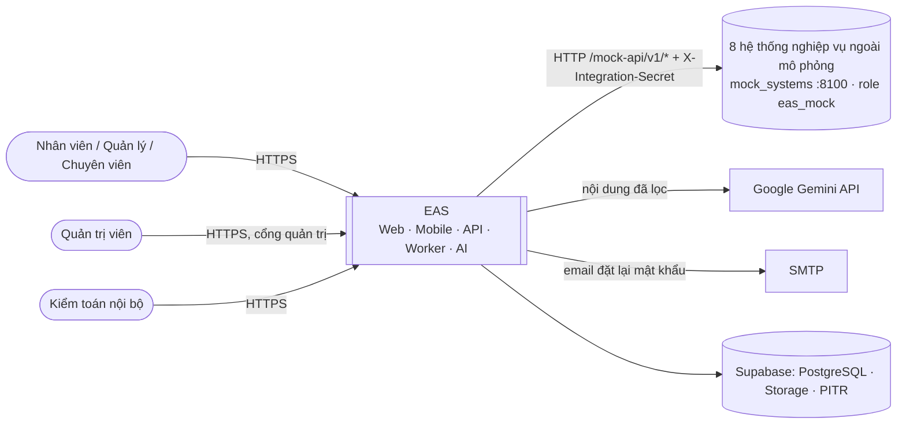
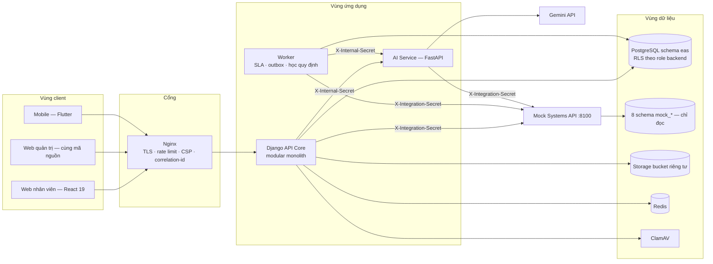
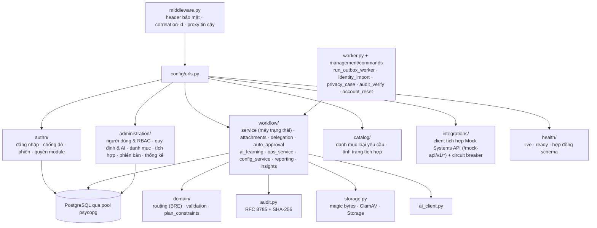
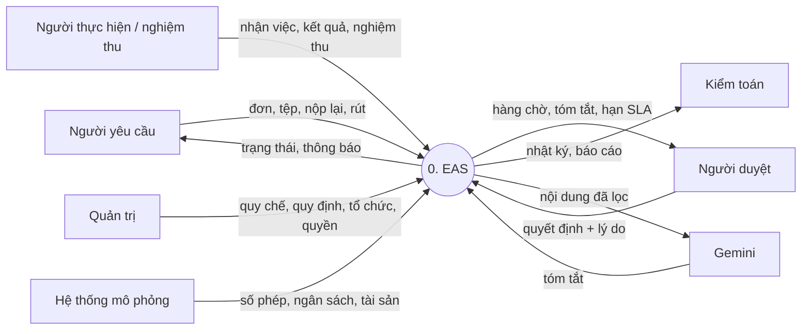
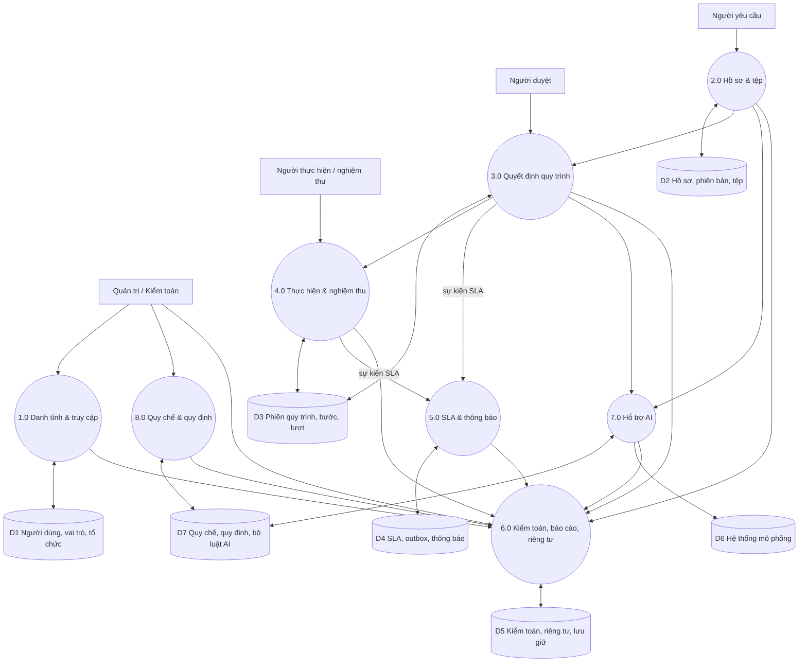
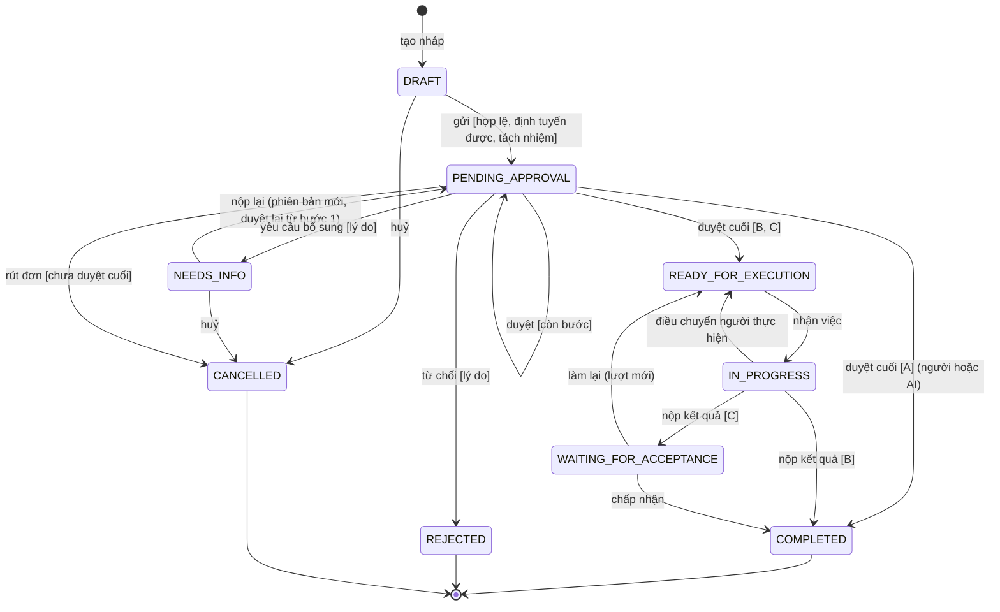
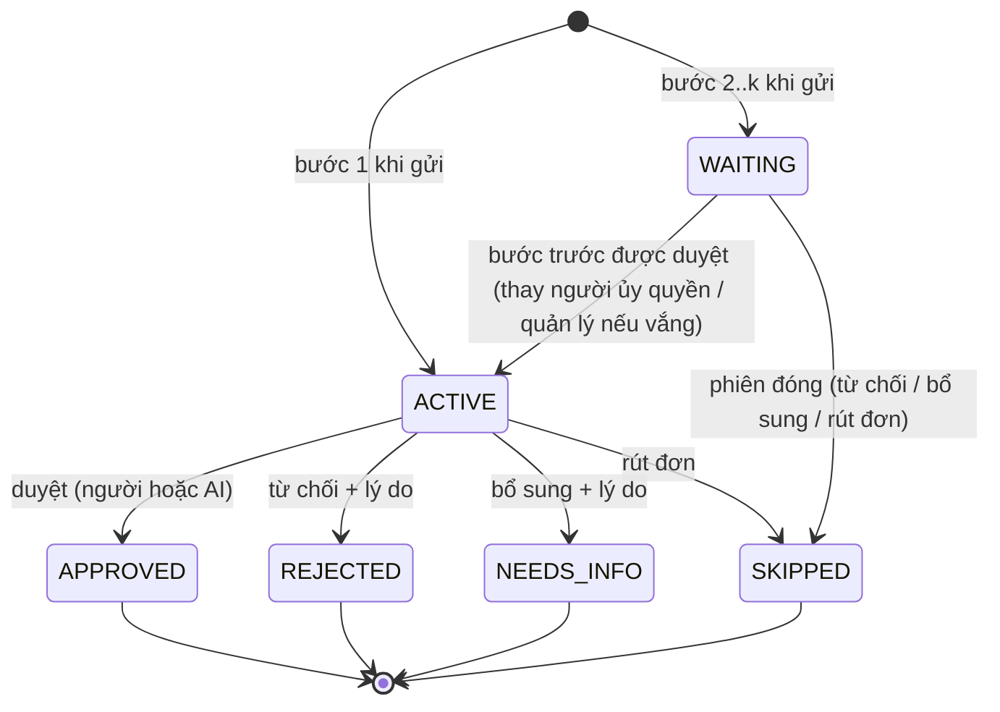
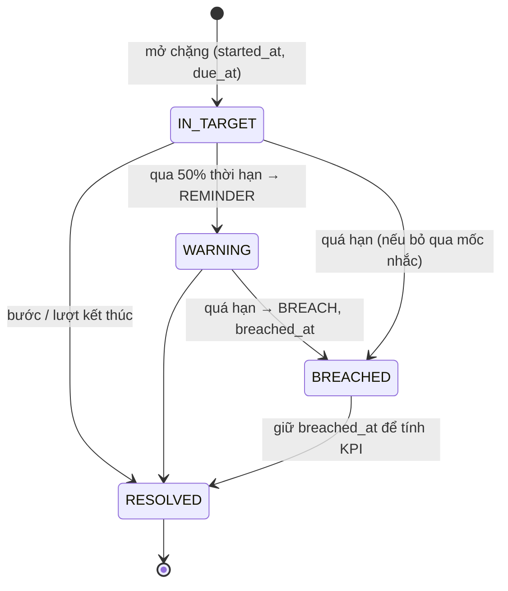

# 2.3. THIẾT KẾ KIẾN TRÚC VÀ HỆ THỐNG

## 2.3.1. Thiết kế kiến trúc tổng thể hệ thống

EAS theo kiến trúc **phân tầng**. Lõi nghiệp vụ là một **khối ứng dụng mô-đun** (modular monolith); trí tuệ nhân tạo được tách thành **một dịch vụ độc lập**.

Lý do chọn mô hình này:
1. Các thao tác nghiệp vụ cần tính nguyên tử trên nhiều bảng (hồ sơ, phiên bản, bước, SLA, kiểm toán, sự kiện). Đặt chúng trong một tiến trình và một giao dịch CSDL đơn giản và an toàn hơn giao dịch phân tán.
2. Phân hệ AI có thư viện nặng (XGBoost, PaddleOCR), vòng đời phát hành riêng và có thể lỗi. Tách nó ra giúp lõi vẫn chạy khi AI gặp sự cố.

Các tầng:
- **Tầng giao diện.** Web nhân viên, web quản trị (cùng mã nguồn React 19) và ứng dụng Flutter. Chỉ gọi REST API qua cổng; không truy cập CSDL trực tiếp.
- **Tầng cổng (Nginx).**
  - TLS và header bảo mật (CSP, HSTS, X-Frame-Options, X-Content-Type-Options, Referrer-Policy);
  - giới hạn tần suất theo nhóm đường dẫn;
  - giới hạn thân yêu cầu 10 MB;
  - gắn mã tương quan `X-Correlation-ID`;
  - chặn đường dẫn nội bộ.
- **Tầng lõi nghiệp vụ (`api_core`, Django 5.2).** Xác thực, phân quyền, máy trạng thái, định tuyến, đính kèm, báo cáo, quản trị. Truy cập CSDL bằng SQL tham số hoá qua pool psycopg.
- **Tầng tác vụ nền (`run_outbox_worker`).** Quét SLA, phát thông báo, phiên học quy định, gọi động cơ tự duyệt.
- **Tầng AI (`ai_service`, FastAPI).** Phân loại, rủi ro, tự duyệt, tóm tắt, nhận dạng hoá đơn, bộ luật quy định. Chỉ nhận lời gọi có khoá nội bộ.
- **Tầng dữ liệu.**
  - Supabase PostgreSQL: schema `eas` cùng 8 schema mô phỏng;
  - Supabase Storage: bucket riêng tư;
  - Redis: giới hạn tần suất, phiên rỗi, bộ đệm;
  - ClamAV: quét mã độc.


*Hình 2.14. Sơ đồ ngữ cảnh kiến trúc hệ thống EAS (AR-01). Nguồn: Nhóm tác giả.*


*Hình 2.15. Sơ đồ container logic (AR-02). Có thể dùng ảnh img_073 sau khi bổ sung AI Service, Mobile, cổng Nginx và schema mô phỏng. Nguồn: Nhóm tác giả.*


*Hình 2.16. Sơ đồ thành phần của API Core (AR-03). Nguồn: Nhóm tác giả.*


*Hình 2.17. Sơ đồ luồng dữ liệu mức ngữ cảnh (DFD-00). Nguồn: Nhóm tác giả.*


*Hình 2.18. Sơ đồ luồng dữ liệu mức 1 (DFD-01). Có thể dùng ảnh img_070 sau khi bổ sung tiến trình 7.0, 8.0 và kho D6, D7. Nguồn: Nhóm tác giả.*

## 2.3.2. Thiết kế phân hệ quản lý yêu cầu và workflow

Workflow được thiết kế như **ba máy trạng thái lồng nhau**:
- **hồ sơ** (`request`);
- **phiên quy trình** (`workflow_instance`), tương ứng một lần gửi;
- **bước duyệt** (`approval_step`) và **lượt thực hiện** (`execution_attempt`).

Mọi chuyển trạng thái hợp lệ được kiểm **hai lần**: trong dịch vụ Python và trong trigger CSDL. Trigger `eas.guard_request` còn cưỡng chế các ràng buộc sau:
- trạng thái cuối không thể sửa;
- mỗi cập nhật tăng `lock_version` đúng 1;
- mẫu A không thể vào trạng thái thực hiện; mẫu B không thể vào trạng thái nghiệm thu;
- mọi trạng thái sau `DRAFT` (trừ `CANCELLED`) phải trỏ tới một phiên bản đã gửi;
- từ `READY_FOR_EXECUTION` trở đi phải có thời điểm duyệt `approved_at`.


*Hình 2.19. Máy trạng thái vòng đời hồ sơ yêu cầu (ST-01). Nguồn: Nhóm tác giả.*

*Hình 2.20. Máy trạng thái phiên quy trình (ST-02) — dùng ảnh img_063.* Một phiên được tạo ở trạng thái `ACTIVE` khi gửi hoặc gửi lại, và kết thúc ở một trong bốn trạng thái:

| Trạng thái kết thúc | Khi nào |
|---|---|
| `COMPLETED` | Duyệt cuối |
| `REJECTED` | Bị từ chối |
| `SUPERSEDED` | Bị yêu cầu bổ sung (bị thay bằng phiên sau) |
| `CANCELLED` | Rút đơn |

Mỗi hồ sơ có tối đa một phiên `ACTIVE`.


*Hình 2.21. Máy trạng thái bước phê duyệt (ST-03). Nguồn: Nhóm tác giả.*

Ràng buộc thời điểm của bước:
- `WAITING` chưa có `activated_at`;
- `ACTIVE` có `activated_at`, chưa có `closed_at`;
- các trạng thái kết thúc có `closed_at`.

Khi quản trị điều chuyển, bước `ACTIVE` chỉ đổi người được giao; trạng thái và hạn SLA giữ nguyên.

Lượt thực hiện có máy trạng thái riêng (ảnh img_061, đặt ở Phụ lục D):

| Chuyển trạng thái | Điều kiện | Kiểu đóng (`closure_kind`) |
|---|---|---|
| `READY → RUNNING` | Nhận việc | — |
| `RUNNING → FINISHED` | Mẫu B nộp kết quả | `SUCCESS` |
| `RUNNING → SUBMITTED` | Mẫu C nộp kết quả | — |
| `SUBMITTED → FINISHED` | Nghiệm thu | `ACCEPTED` hoặc `REWORK` |
| `RUNNING → FINISHED` | Điều chuyển | `REASSIGNED` |

Mỗi phiên quy trình chỉ có một lượt chưa kết thúc tại một thời điểm.

**Bảng 2.5. Bảng chuyển trạng thái của hồ sơ**

| Trạng thái nguồn | Sự kiện | Tác nhân | Điều kiện tiên quyết | Trạng thái đích |
|---|---|---|---|---|
| — | Tạo nháp | REQUESTER | Có vai trò cho loại / phòng; loại có quy chế ban hành; tích hợp bật | `DRAFT` |
| `DRAFT`, `NEEDS_INFO` | Gửi / gửi lại | REQUESTER | Đúng phiên bản; dữ liệu hợp lệ; tệp sạch; định tuyến được 1–5 cấp; tách nhiệm hợp lệ | `PENDING_APPROVAL` |
| `PENDING_APPROVAL` | Duyệt (chưa phải cấp cuối) | APPROVER / AI | Đúng người của bước `ACTIVE`; người kế tiếp hợp lệ | `PENDING_APPROVAL` |
| `PENDING_APPROVAL` | Duyệt cấp cuối, mẫu A | APPROVER / AI | — | `COMPLETED` |
| `PENDING_APPROVAL` | Duyệt cấp cuối, mẫu B/C | APPROVER | Người thực hiện (và nghiệm thu với C) hợp lệ | `READY_FOR_EXECUTION` |
| `PENDING_APPROVAL` | Yêu cầu bổ sung | APPROVER | Lý do 10–2000 ký tự | `NEEDS_INFO` |
| `PENDING_APPROVAL` | Từ chối | APPROVER | Lý do 10–2000 ký tự | `REJECTED` |
| `DRAFT`, `NEEDS_INFO`, `PENDING_APPROVAL` | Rút đơn | REQUESTER | Có lý do; chưa có quyết định duyệt cuối | `CANCELLED` |
| `READY_FOR_EXECUTION` | Nhận việc | EXECUTOR | Đúng người của lượt `READY` | `IN_PROGRESS` |
| `IN_PROGRESS` | Điều chuyển người thực hiện | OPS_ADMIN | Người mới hợp lệ; có lý do | `READY_FOR_EXECUTION` |
| `IN_PROGRESS` | Nộp kết quả, mẫu B | EXECUTOR | Ghi chú và mã tham chiếu hợp lệ | `COMPLETED` |
| `IN_PROGRESS` | Nộp kết quả, mẫu C | EXECUTOR | idem | `WAITING_FOR_ACCEPTANCE` |
| `WAITING_FOR_ACCEPTANCE` | Chấp nhận | ACCEPTOR | Khác người thực hiện | `COMPLETED` |
| `WAITING_FOR_ACCEPTANCE` | Làm lại | ACCEPTOR | Có lý do; người thực hiện dự kiến hợp lệ | `READY_FOR_EXECUTION` |

## 2.3.3. Thiết kế cơ chế luật nghiệp vụ và kiểm soát tuân thủ nội bộ

**Tách luật khỏi mã nguồn.** Luật định tuyến được lưu trong phiên bản quy chế (`config_release.route_rules`) dưới dạng JSON có cấu trúc. Ví dụ luật của loại "Đề nghị mua sắm":

```json
{
  "schema_version": 1,
  "rules": [
    {"id": "PURCHASE_HIGH",   "priority": 10, "when": {"amount_gt": 50000000},  "approvers": ["DIRECT_MANAGER", "FINANCE", "DIRECTOR"]},
    {"id": "PURCHASE_MEDIUM", "priority": 20, "when": {"amount_gte": 5000000},  "approvers": ["DIRECT_MANAGER", "FINANCE"]},
    {"id": "PURCHASE_LOW",    "default": true,                                  "approvers": ["DIRECT_MANAGER"]}
  ],
  "executor": "EXECUTOR_PROCUREMENT"
}
```

Luật được kiểm tra **ở cả ứng dụng và CSDL** trước khi ban hành:
- đúng một luật mặc định, đặt ở cuối;
- độ ưu tiên là số nguyên không trùng;
- chỉ dùng bốn toán tử cho phép;
- 1–5 vị trí người duyệt thuộc danh sách 14 vị trí cho phép;
- vị trí người thực hiện và người nghiệm thu thuộc danh sách cho phép.

Thiết kế dạng dữ liệu, không dùng biểu thức tự do, bảo đảm ba tính chất:
- **tất định:** cùng dữ liệu luôn cho cùng tuyến;
- **kiểm chứng được:** xem trước tuyến trước khi gửi;
- **an toàn:** không có đường chèn mã.

**Tách nhiệm và bốn mắt** được cưỡng chế khi định tuyến và khi điều chuyển:
- người yêu cầu không duyệt hồ sơ của mình;
- các người duyệt trong một tuyến khác nhau;
- người thực hiện không phải người yêu cầu hoặc người duyệt;
- người nghiệm thu khác người thực hiện.

**Thay người khi vắng.** Khi kích hoạt một bước, hệ thống:
1. ưu tiên người được ủy quyền còn hiệu lực;
2. nếu người duyệt vắng (theo dữ liệu chấm công) và không ủy quyền, chuyển cho quản lý trực tiếp của họ;
3. ghi lại lý do thay người.

**Dự phòng khi AI lỗi.** AI chỉ tham gia ở khâu tự duyệt. Khi AI không phản hồi, bước duyệt giữ nguyên chờ người, nên không có hồ sơ nào bị duyệt sai vì lỗi AI.

**Bảng 2.6. Bảng quyết định định tuyến (trích các loại tiêu biểu, cấu hình đang hiệu lực)**

| Mã luật | Loại yêu cầu | Điều kiện | Tuyến duyệt | Ghi chú |
|---|---|---|---|---|
| LV-DEFAULT | Nghỉ phép (A) | ≤ 2 ngày | Quản lý trực tiếp | Trọng số 1: được xét AI tự duyệt nếu đủ số phép còn lại |
| LV-LONG | Nghỉ phép (A) | > 2 ngày | Quản lý trực tiếp → Giám đốc | |
| PURCHASE_LOW | Đề nghị mua sắm (B) | < 5.000.000 đ | Quản lý trực tiếp | Thực hiện: Mua sắm |
| PURCHASE_MEDIUM | Đề nghị mua sắm (B) | ≥ 5.000.000 đ | Quản lý trực tiếp → Kế toán | |
| PURCHASE_HIGH | Đề nghị mua sắm (B) | > 50.000.000 đ | Quản lý trực tiếp → Kế toán → Giám đốc | |
| EXPENSE_DEFAULT | Thanh toán chi phí (A) | ≤ 20.000.000 đ | Quản lý trực tiếp → Kế toán | Trọng số 3: không tự duyệt |
| EXPENSE_GT_20M | Thanh toán chi phí (A) | > 20.000.000 đ | Quản lý trực tiếp → Kế toán → Giám đốc | |
| EQ-DEFAULT / EQ-MID / EQ-HIGH | Mua sắm thiết bị (C) | < 10 tr / ≥ 10 tr / > 50 tr | 1 / 2 / 3 cấp (thêm Kế toán, Giám đốc) | Nghiệm thu: người yêu cầu |
| AC-DEFAULT | Cấp quyền truy cập (B) | Ứng dụng thường | Quản lý trực tiếp | Thực hiện: CNTT |
| AC-PROD | Cấp quyền truy cập (B) | Ứng dụng ∈ {PRODUCTION_DB, AWS_CONSOLE, ERP_SAP} | Quản lý trực tiếp → Giám đốc | |
| PROD_DATA_ACCESS-DEFAULT | Quyền dữ liệu nhạy cảm (C) | Mọi trường hợp | Quản lý trực tiếp → An ninh → CTO | Nghiệm thu: CTO |
| REG-002-3 (quy định công ty) | Mọi loại | Số tiền ≥ 30.000.000 đ | (không đổi tuyến) | Trọng số nâng lên 5; cấm tự duyệt |
| REG-002-4 (quy định công ty) | Mọi loại | Số tiền > 10.000.000 đ | (không đổi tuyến) | Trọng số tối thiểu 4; cấm tự duyệt |
| SoD-01 | Mọi loại | Người yêu cầu trùng một vị trí duyệt | Không cho gửi (`409`) | Hướng phát triển: tự thay bằng quản lý trực tiếp của người yêu cầu và ghi kiểm toán |

## 2.3.4. Thiết kế cơ chế phê duyệt đa cấp và phân quyền

**Phê duyệt đa cấp tuần tự.** Một tuyến có 1–5 bước, mỗi thời điểm chỉ một bước `ACTIVE`. Phê duyệt song song (nhiều người cùng duyệt một bước, gộp theo tất cả / bất kỳ / đa số) nằm ngoài phạm vi P0.

**Phân quyền hai lớp:**
1. **Quyền màn hình (module).** Ma trận vai trò × module với bốn thao tác xem / thêm / sửa / xoá (`role_module_permission`), có thể ghi đè cho từng người (`user_permissions`). Hàm `eas.get_effective_user_permissions` tính quyền hiệu lực. Giao diện dùng kết quả này để ẩn hoặc hiện mục; máy chủ vẫn kiểm lại.
2. **Quyền dữ liệu (Scoped RBAC).** `role_membership` gán vai trò với phạm vi `GLOBAL` / `DEPARTMENT`, `ALL` / một loại, thời gian hiệu lực và thời điểm thu hồi. Mọi lệnh nghiệp vụ gọi `_authorize` với vai trò, phòng ban và loại yêu cầu tương ứng.

Ranh giới tin cậy được thể hiện ở Hình 2.22 (ảnh img_066, cần bổ sung luồng dữ liệu tới Gemini). Các vùng:
- trình duyệt (không tin cậy);
- cổng HTTPS;
- vùng ứng dụng (API, worker, bộ quét);
- vùng dữ liệu đặc quyền (CSDL, kho tệp, bí mật);
- vùng kiểm soát tách biệt (sao lưu, mốc kiểm toán).

Tệp tải lên và văn bản tự do được coi là dữ liệu không tin cậy cho tới khi qua kiểm tra.

*Hình 2.22. Ranh giới tin cậy và bề mặt kiểm soát an toàn thông tin (SEC-01). Nguồn: Nhóm tác giả.*

**Bảng 2.7. Ma trận phân quyền theo chức năng**

| Chức năng | Requester | Approver | Executor | Acceptor | Policy Admin | Ops Admin | Auditor |
|---|---|---|---|---|---|---|---|
| Tạo nháp, gửi, nộp lại, rút đơn (UC03, 04, 07, 08) | ✔ (hồ sơ của mình) | — | — | — | — | — | — |
| Xem chi tiết hồ sơ (UC05) | Hồ sơ của mình | Hồ sơ mình tham gia | Hồ sơ mình tham gia | Hồ sơ mình tham gia | — | Chỉ siêu dữ liệu điều phối | Theo phạm vi được gán |
| Duyệt / từ chối / bổ sung (UC06) | — | Bước được giao (gồm ủy quyền) | — | — | — | — | — |
| Ủy quyền; thu hồi AI tự duyệt (UC16, 18) | — | ✔ | — | — | — | — | — |
| Nhận việc, báo vướng, nộp kết quả (UC10, 11) | — | — | Lượt được giao | — | — | — | — |
| Nghiệm thu (UC12) | — | — | — | Hồ sơ được giao (≠ người thực hiện) | — | — | — |
| Ban hành quy chế, quy định công ty (UC02, 19) | — | — | — | — | ✔ | — | — |
| Điều chuyển, gửi lại sự kiện, người dùng, quyền, tích hợp, bảo trì (UC09, 17, 21, 22) | — | — | — | — | — | ✔ | — |
| Nhật ký quản trị (`/admin-events`) | — | — | — | — | Xem | Xem | Xem |
| Kiểm chứng chuỗi băm, báo cáo kiểm toán (UC15) | — | — | — | — | — | — | ✔ |

Tài khoản quản trị không xem được nội dung nghiệp vụ của hồ sơ (nguyên tắc đặc quyền tối thiểu). Một tài khoản không được đồng thời giữ vai trò quản trị và vai trò nghiệp vụ.

## 2.3.5. Thiết kế cơ chế nhật ký kiểm toán và truy vết

- **Chuỗi theo phạm vi.** Mỗi hồ sơ có một chuỗi băm riêng (`REQ:{id}`); thao tác quản trị dùng chuỗi `ADMIN`. Nhiều hồ sơ ghi kiểm toán song song không phải chờ nhau.
- **Chuẩn hoá trước khi băm.** Dùng RFC 8785 (thứ tự khoá, định dạng số và chuỗi chuẩn) và chuẩn hoá Unicode NFC, để cùng nội dung luôn cho cùng mã băm bất kể thứ tự khoá hay cách mã hoá dấu tiếng Việt.
- **Liên kết.** `hash = SHA-256(prev_hash ‖ canonical(event))`. Sửa, chèn hoặc xoá bất kỳ bản ghi nào đều làm sai mọi mã băm phía sau.
- **Bất biến.** Bảng `audit_event`, `admin_event` và các bảng quyết định có trigger cấm cập nhật và xoá.
- **Kiểm chứng.** API `POST /requests/{id}/audit/verify` và lệnh `manage.py audit_verify` tính lại chuỗi.
- **Mốc kiểm soát ngoài** (`audit_checkpoint`): ghi định kỳ đầu chuỗi ra kho chỉ-ghi bên ngoài CSDL. Bảng đã có; chức năng xuất là hướng phát triển.
- **Quyền riêng tư.** Xoá dữ liệu cá nhân bị chặn khi hồ sơ có lệnh giữ pháp lý chưa giải toả. Khi xoá, chuỗi kiểm toán vẫn giữ nguyên, chỉ lưu biên bản tối thiểu.

**Bảng 2.8. Cấu trúc bản ghi kiểm toán (`eas.audit_event`)**

| Trường | Kiểu | Ý nghĩa |
|---|---|---|
| `id` | uuid | Khoá chính |
| `request_id` | uuid | Hồ sơ (chuỗi `REQ:{id}`) |
| `seq` | bigint | Số thứ tự trong chuỗi, tăng đơn điệu |
| `actor_id`, `actor_kind` | uuid, `HUMAN`/`SYSTEM` | Ai thực hiện; phân biệt người với hệ thống / AI |
| `action` | varchar | Mã hành động, ví dụ `DRAFT_CREATED`, `REQUEST_SUBMITTED`, `EXECUTION_STARTED`, `REQUEST_CANCELLED`, `APPROVER_SUBSTITUTED`, `ACTOR_REASSIGNED`, `ATTACHMENT_DOWNLOADED`, `AI_AUTO_APPROVE_REVOKED` |
| `target_type`, `target_id` | varchar | Đối tượng bị tác động |
| `details` | jsonb | Nội dung sự kiện, chuẩn hoá RFC 8785 |
| `correlation_id` | varchar | Liên kết với log của cổng và ứng dụng |
| `occurred_at` | timestamptz | Thời điểm (UTC) |
| `hash_version` | smallint (= 1) | Phiên bản thuật toán băm, cho phép đổi thuật toán sau này mà không phá chuỗi cũ |
| `prev_hash`, `hash` | char(64) | Mã băm SHA-256 của bản ghi trước và của chính bản ghi |

## 2.3.6. Thiết kế cơ chế thông báo, SLA và leo thang

**Chặng SLA.** Mỗi bước duyệt, mỗi lượt thực hiện và mỗi lần nghiệm thu mở một chặng SLA (`sla_stage`). Thời hạn được tính theo giờ cấu hình trong quy chế của loại:
- duyệt: thường 24 giờ; 8 giờ với đặt phòng họp; tới 168 giờ với thôi việc;
- thực hiện;
- nghiệm thu.

Đồng hồ tính theo lịch UTC. Giờ làm việc và ngày nghỉ lễ là hướng phát triển.

Trạng thái SLA **không lưu thành cột** mà **suy ra** từ các mốc thời gian và cảnh báo đã ghi. Cách này tránh phải cập nhật hàng loạt theo thời gian.


*Hình 2.23. Máy trạng thái chặng theo dõi SLA (ST-06). Nguồn: Nhóm tác giả.*

*Hình 2.24. Máy trạng thái sự kiện hàng đợi outbox (ST-07) — dùng ảnh img_062.*
- Sự kiện sinh ra khi giao dịch nghiệp vụ được ghi → `PENDING`.
- Worker thuê sự kiện → `PROCESSING` (60 s).
- Tạo thông báo và xác nhận → `SENT`.
- Lỗi tạm thời (lần 1–3) hoặc hết hạn thuê → quay lại `PENDING`.
- Lỗi lần 4 → `DEAD`.
- Quản trị gửi lại kèm lý do → `PENDING`.

Thông báo có khoá chống trùng theo (sự kiện, người nhận).

**Bảng 2.9. Ma trận cảnh báo SLA**

| Mốc thời gian | Trạng thái suy ra | Hành động của hệ thống | Người nhận |
|---|---|---|---|
| 0% – dưới 50% | `IN_TARGET` | Không gửi | — |
| Từ 50% | `WARNING` | Ghi `REMINDER` (một lần cho mỗi chặng) | Người đang giữ việc |
| Từ 100% | `BREACHED` | Ghi `BREACH` + `breached_at` (một lần) | Người đang giữ việc |
| Từ 150% | `ESCALATED_L2` | *Hướng phát triển:* cảnh báo mức 2 | Quản trị vận hành |
| Khi kết thúc bước / lượt | `RESOLVED` | Đóng chặng; giữ mốc vi phạm để tính tỷ lệ đúng hạn | Báo cáo KPI |

*Hướng phát triển:* khi vi phạm, gửi thêm quản lý trực tiếp của người giữ việc. Quản trị chọn chế độ "chỉ nhắc" hoặc "tự chuyển cho người được ủy quyền / quản lý".
