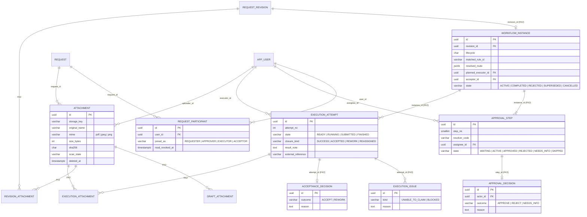
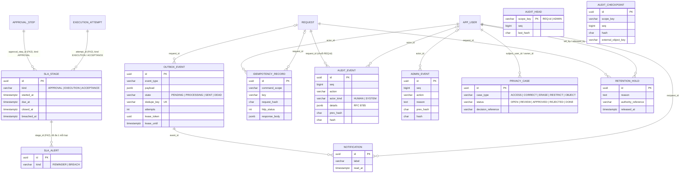
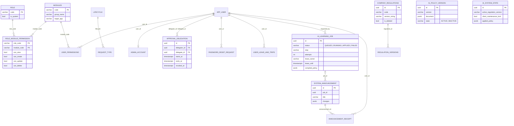

# 2.3.7. SƠ ĐỒ THỰC THỂ LIÊN KẾT

CSDL của EAS dùng PostgreSQL trên Supabase. Schema nghiệp vụ `eas` có **52 bảng hoạt động** (**0 view** — đã gỡ 9 view bí danh cũ ở Migration 15): 49 bảng gốc − 2 bảng di sản (`workflow_categories`, `system_versions_changelog`) chuyển sang kho `eas_archive` ở Migration 15 + 3 bảng mới từ Migration 14 (`privacy_case_approval`, `sla_escalation_policy`, `business_holiday`) + 2 bảng danh mục 12 nhóm yêu cầu từ Migration 17 (`request_group`, `request_menu_item`), chia thành 30 bảng lõi và 22 bảng mở rộng. Các bảng được chia thành **bốn miền**, mỗi miền một sơ đồ:

- **Miền 1 — Danh tính, cấu hình và hồ sơ lõi:** ai được làm gì, theo quy chế nào, trên hồ sơ nào.
- **Miền 2 — Quy trình, thực hiện và tệp:** diễn biến xử lý một lần gửi.
- **Miền 3 — SLA, sự kiện, kiểm toán và quyền riêng tư:** theo dõi thời hạn, giao tiếp bất đồng bộ, bằng chứng bất biến.
- **Miền 4 — Quản trị, AI và vận hành:** các bảng mở rộng.

Ký pháp: crow's foot (IE). Thực thể chỉ ghi các thuộc tính chính; danh sách đầy đủ xem mục 2.3.8.

Ba quyết định thiết kế quan trọng thể hiện trên sơ đồ:
1. **Khoá ngoại kép** `(x_id, request_id)` (ghi `FK2`) trên mọi bảng con của hồ sơ. Một bản ghi con không thể trỏ tới bản ghi cha thuộc hồ sơ khác.
2. **Bản chụp:** mỗi lần gửi (`request_revision`) lưu phiên bản quy chế (`release_id`) và phòng ban (`department_id`) tại thời điểm gửi. Đổi quy chế hay đổi tổ chức sau này không làm sai lịch sử.
3. **Bảng chỉ-ghi-thêm** cho mọi quyết định và sự kiện. Trigger cấm cập nhật và xoá.

## 1. Miền 1 — Danh tính, cấu hình và hồ sơ lõi (ER-01)

```mermaid
erDiagram
  DEPARTMENT ||--o{ DEPARTMENT : "parent_id"
  DEPARTMENT ||--o{ APP_USER : "department_id"
  APP_USER |o--o{ APP_USER : "manager_id"
  APP_USER ||--o{ ROLE_MEMBERSHIP : "user_id"
  DEPARTMENT |o--o{ ROLE_MEMBERSHIP : "department_id (phạm vi)"
  REQUEST_GROUP ||--o{ REQUEST_TYPE : "category"
  REQUEST_GROUP ||--o{ REQUEST_MENU_ITEM : "group_code"
  REQUEST_TYPE ||--o{ REQUEST_MENU_ITEM : "type_code"
  REQUEST_TYPE |o--o{ ROLE_MEMBERSHIP : "type_id (phạm vi)"
  REQUEST_TYPE ||--o{ CONFIG_RELEASE : "type_id"
  REQUEST_TYPE |o--o| CONFIG_RELEASE : "active_release_id"
  REQUEST_TYPE ||--o{ REQUEST : "type_id"
  APP_USER ||--o{ REQUEST : "requester_id"
  REQUEST |o--o{ REQUEST : "origin_request_id"
  CONFIG_RELEASE ||--o{ REQUEST : "draft_release_id"
  REQUEST ||--o{ REQUEST_REVISION : "request_id"
  REQUEST |o--o| REQUEST_REVISION : "current_revision_id (FK2)"
  CONFIG_RELEASE ||--o{ REQUEST_REVISION : "release_id (bản chụp)"
  DEPARTMENT ||--o{ REQUEST_REVISION : "department_id (bản chụp)"
  SECURITY_EPOCH {
    smallint id PK "luôn = 1"
    bigint version
  }
  DEPARTMENT {
    uuid id PK
    varchar code UK
    varchar name
    uuid parent_id FK
  }
  APP_USER {
    uuid id PK
    varchar email UK
    uuid department_id FK
    uuid manager_id FK
    int auth_version
    text password_hash "Argon2"
    varchar account_type
    bool is_system_account
  }
  ROLE_MEMBERSHIP {
    uuid id PK
    uuid user_id FK
    varchar role "7 vai trò"
    varchar scope_kind "GLOBAL | DEPARTMENT"
    varchar type_scope "ALL | ONE"
    timestamptz valid_from
    timestamptz valid_to
    timestamptz revoked_at
  }
  REQUEST_TYPE {
    uuid id PK
    varchar code UK
    char lifecycle "A | B | C"
    smallint risk_weight "1..5"
    uuid active_release_id FK
  }
  CONFIG_RELEASE {
    uuid id PK
    uuid type_id FK
    int version
    varchar state "DRAFT | PUBLISHED"
    jsonb form_schema
    jsonb route_rules
    jsonb actor_bindings
    jsonb sla_profile
    char content_sha256
  }
  REQUEST {
    uuid id PK
    varchar code UK "REQ-…"
    uuid requester_id FK
    varchar status "9 trạng thái"
    jsonb draft_payload
    bigint lock_version
    uuid current_revision_id FK
  }
  REQUEST_REVISION {
    uuid id PK
    uuid request_id FK
    int revision_no
    jsonb payload
    bigint amount_vnd
    char payload_sha256
    uuid release_id FK
  }
```

*Hình 2.25. Sơ đồ thực thể liên kết miền 1 — Danh tính, cấu hình và hồ sơ lõi (ER-01). Nguồn: Nhóm tác giả.*

Có thể dùng ảnh img_065 nếu sửa tên cột trên ảnh:
- `owner_id` → `requester_id`;
- `username` → `email`;
- `role_code` → `role`;
- `department_scope_id` → `department_id`;
- `content_hash` → `content_sha256`;
- `version` (của REQUEST) → `lock_version`.

Đồng thời bỏ quan hệ `department.manager_id` vì quản lý trực tiếp nằm ở `app_user.manager_id`, và bỏ khoá ngoại `security_epoch`–`app_user` vì đây là bảng một dòng toàn cục.

## 2. Miền 2 — Quy trình, thực hiện và tệp (ER-02)

*Hình 2.26. Sơ đồ thực thể liên kết miền 2 — Quy trình, thực hiện và tệp (ER-02). Nguồn: Nhóm tác giả.*

Ba bảng liên kết tệp (`draft_attachment`, `revision_attachment`, `execution_attachment`) biểu diễn quan hệ nhiều–nhiều giữa tệp và bản nháp / lần gửi / lượt thực hiện. Hai bảng sau là chỉ-ghi-thêm, nên chứng từ của một lần gửi không thể bị thay sau khi gửi.

## 3. Miền 3 — SLA, sự kiện, kiểm toán và quyền riêng tư (ER-03)

*Hình 2.27. Sơ đồ thực thể liên kết miền 3 — SLA, sự kiện, kiểm toán và quyền riêng tư (ER-03). Nguồn: Nhóm tác giả.*

Ba điểm cần lưu ý ở miền 3:
- `AUDIT_HEAD` **không** có khoá ngoại tới `AUDIT_EVENT`. Đây là bảng khoá logic giữ đầu mỗi chuỗi (`scope_key` dạng `REQ:{id}` hoặc `ADMIN`).
- `AUDIT_CHECKPOINT` lưu mốc của một chuỗi để đối chiếu với bản sao ở kho ngoài.
- Quan hệ "lưu giữ pháp lý" đi qua `RETENTION_HOLD` gắn với hồ sơ, không gắn trực tiếp vào `PRIVACY_CASE`.

## 4. Miền 4 — Quản trị, AI và vận hành (ER-04)

*Hình 2.28. Sơ đồ thực thể liên kết miền 4 — Quản trị, AI và vận hành (ER-04). Nguồn: Nhóm tác giả.*

Khoá ngoại thật trong miền này:
- `system_announcement.job_id` → `ai_learning_job`: thông báo sinh ra từ phiên học;
- `ai_learning_job.requested_by` → `app_user`;
- `admin_account.employee_user_id` → `app_user`: liên kết tài khoản quản trị với tài khoản nghiệp vụ, nếu có.

Các quan hệ sau là quan hệ logic qua mã phiên bản và mã phiên, **không** phải khoá ngoại:
- `COMPANY_REGULATIONS` → `AI_LEARNING_JOB` → `AI_POLICY_VERSION`;
- `AI_SYSTEM_STATE` → `AI_LEARNING_JOB`.

Ngoài ra còn hai bảng không thể hiện trên hình:
- `mock_apis`: danh mục tích hợp, có cờ bật/tắt;
- `system_versions_changelog`: nhật ký phiên bản hệ thống.

## 5. Sơ đồ chi tiết ở Phụ lục E

| Số | Mã | Nội dung | Ảnh vẽ sẵn | Cần sửa |
|---|---|---|---|---|
| PL-34 | ER-05 | Danh tính & tổ chức chi tiết | img_067 | Tên cột như ER-01; thêm `scope_kind`, `type_scope`, `revoked_at` |
| PL-35 | ER-06 | Loại yêu cầu, quy chế, phiên bản hồ sơ | img_071 | `owner_id` → `requester_id`; `version` → `lock_version`; thêm `actor_bindings`, `amount_vnd`, `payload_sha256` |
| PL-36 | ER-07 | Thực hiện & nghiệm thu | img_064 | `closure` → `closure_kind`; `issue_kind` → `kind` |
| PL-37 | ER-08 | Tệp & liên kết bất biến | img_072 | `uploaded_by` → `uploader_id`; thêm `mime`, `original_name` |
| PL-38 | ER-09 | Kiểm toán, chống lặp, quyền riêng tư | img_068 | `previous_hash` / `event_hash` → `prev_hash` / `hash`; thêm `RETENTION_HOLD` (nối với REQUEST); bỏ quan hệ trực tiếp PRIVACY_CASE–REQUEST |

Các mã ER-05…ER-09 ở trên là **đánh số mới**. Phần text của bản DOCX cũ dùng mã ER-04…ER-13 với nội dung khác, nên cần cập nhật theo bảng này.
