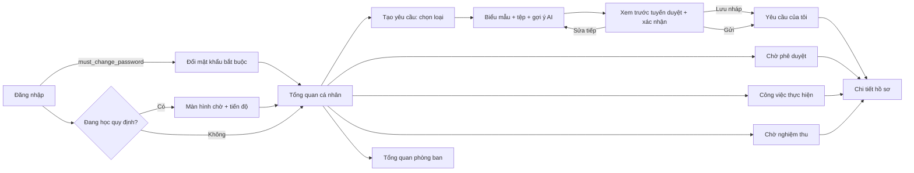

# 2.4. THIẾT KẾ GIAO DIỆN NGƯỜI DÙNG

Giao diện tuân theo năm nguyên tắc:

1. **Theo vai trò.** Mỗi người chỉ thấy các mục mình vừa có vai trò vừa có quyền xem module. Máy chủ luôn kiểm lại quyền, giao diện chỉ là lớp hiển thị.
2. **Hiển thị trạng thái rõ ràng.** Mọi hồ sơ cho biết đang ở giai đoạn nào, ai đang giữ, hạn còn bao lâu.
3. **Ngăn lỗi trước khi xảy ra.** Loại yêu cầu không dùng được thì bị khoá kèm lý do. Người dùng xem trước tuyến duyệt trước khi gửi. Hai người sửa cùng lúc thì nhận thông báo xung đột thay vì ghi đè.
4. **Ngôn ngữ tiếng Việt nhất quán.** Mã trạng thái kỹ thuật được hiển thị bằng nhãn tiếng Việt. Lỗi kèm mã tra cứu và không lộ chi tiết kỹ thuật.
5. **Một hệ thiết kế.** Dùng chung token màu, khoảng cách, cỡ chữ và các thành phần (`design-system.css`, `ui.jsx`, `ux.jsx`). Bố cục co giãn tới màn hình điện thoại, menu trái thu gọn thành ngăn kéo.

## 2.4.1. Thiết kế Web Portal cho nhân viên và quản trị viên

Có hai cổng dùng chung mã nguồn React:
- **cổng nhân viên**, dành cho các vai trò nghiệp vụ;
- **cổng quản trị**, chỉ dành cho tài khoản quản trị.

Một tài khoản quản trị không xuất hiện ở cổng nhân viên với vai trò nghiệp vụ.

**Bố cục chung:**
- thanh trên: tên hệ thống, chuông thông báo, tài khoản;
- menu trái: nhóm theo module;
- vùng nội dung.

**Các trạng thái toàn cục:**
- **Đổi mật khẩu bắt buộc.** Tài khoản mới hoặc vừa được cấp mật khẩu tạm phải đổi trước khi dùng.
- **Cập nhật quy định.** Khi phân hệ AI đang học quy định mới, cổng nhân viên hiển thị màn hình chờ kèm tiến độ bốn bước. Xong thì mở lại và hiện thông báo tóm tắt thay đổi cùng hướng dẫn thao tác.
- **Bảo trì.** Thao tác ghi bị chặn khi quản trị bật chế độ bảo trì.

*Hình 2.29. Sơ đồ điều hướng màn hình cổng nhân viên (UI-01). Nguồn: Nhóm tác giả.*

**Bảng 2.17. Ánh xạ màn hình – vai trò (cổng nhân viên)**

| Nhóm | Màn hình | REQUESTER | APPROVER | EXECUTOR | ACCEPTOR | Thành phần mã nguồn |
|---|---|---|---|---|---|---|
| Không gian cá nhân | Tổng quan | ✔ | ✔ | ✔ | ✔ | `ClientDashboard.jsx`, `DashboardOverview.jsx` |
| | Yêu cầu của tôi / Tạo yêu cầu | ✔ | | | | `ClientRequestsHub.jsx`, `RequestTypeMenu.jsx`, `RequestEditor.jsx` |
| Công việc được giao | Chờ phê duyệt | | ✔ | | | `AssignedWorkDashboard.jsx`, `RoleTasks.jsx` |
| | Công việc thực hiện | | | ✔ | | idem |
| | Chờ nghiệm thu | | | | ✔ | idem |
| Quản lý phòng ban | Tổng quan / nhân viên phòng ban | | ✔ | | | `TeamDashboard.jsx` |
| Tổ chức & công cụ | Sơ đồ tổ chức, sơ đồ luồng, quy trình AI | ✔ | ✔ | ✔ | ✔ | `ClientOrgChart.jsx`, `WorkflowDiagrams.jsx`, `AiProcessGuide.jsx` |
| Tài khoản & Thông báo | Hồ sơ cá nhân, đổi mật khẩu, trung tâm thông báo, ủy quyền & bàn giao (`APPROVER`) | ✔ | ✔ | ✔ | ✔ | `ProfilePage.jsx`, `NotificationsPage.jsx`, `DelegationSettings.jsx` |

## 2.4.2. Thiết kế giao diện quản lý và theo dõi yêu cầu

**Tạo yêu cầu.**
- Danh mục **12 thẻ nhóm lớn theo mục đích người gửi** (`eas.request_group`) dẫn tới **61 mục chọn loại nhỏ** (`eas.request_menu_item`), có ô tìm kiếm nhanh trên toàn bộ danh mục. Với 5 mục đặt sẵn (`preset`: Đi muộn, Về sớm, Quên chấm công, Nghỉ phép có lương, Nghỉ không lương), trường đặt sẵn được tự động điền và khoá trên biểu mẫu; danh sách chọn động (phòng họp, xe, thiết bị, ứng dụng, loại chi phí) nạp qua `/api/v1/integrations/options`, trường số tiền dùng `CurrencyInput` (`formatters.js`) đọc số tiền thành chữ tiếng Việt trực tiếp và có màn hình Xem lại trước khi gửi (Pre-submit Review).
- Loại bị khoá hiển thị nhãn "Tạm ngưng" và lý do: chưa có quy chế, đang tắt, không có quyền, hoặc tích hợp phụ thuộc đang tắt.
- Biểu mẫu sinh từ `form_schema`: kiểu trường, bắt buộc, giới hạn và gợi ý được kiểm ngay trên giao diện; máy chủ kiểm lại.
- Khu vực tệp: chỉ nhận PDF, PNG, JPEG ≤ 10 MB; mỗi tệp hiển thị trạng thái "đã quét an toàn".
- Nút **Gợi ý AI** điền sẵn loại yêu cầu phù hợp (người dùng xác nhận). Kèm theo là điểm rủi ro tham khảo và lý do.
- Thẻ **Tuyến duyệt dự kiến** hiển thị số bước và người duyệt từng bước theo dữ liệu đang nhập.
- Hai nút **Lưu nháp** và **Gửi**. "Gửi" mở hộp xác nhận.

**Yêu cầu của tôi.**
- Các tab theo giai đoạn: Tất cả, Nháp, Chờ duyệt, Cần bổ sung, Đang thực hiện, Chờ nghiệm thu, Hoàn thành, Từ chối, Đã huỷ.
- Lọc, tìm, phân trang.
- Mỗi dòng có mã hồ sơ, loại, ngày gửi, trạng thái (nhãn màu) và người đang giữ.

**Chi tiết hồ sơ** có tám tab:

| Tab | Nội dung |
|---|---|
| Thông tin | Dữ liệu biểu mẫu của phiên bản hiện hành |
| Tiến độ | Sơ đồ bước: ai đã duyệt, ai đang giữ, bước kế, hạn SLA, cờ quá hạn |
| Phê duyệt | Các quyết định và lý do |
| Thực hiện | Các lượt thực hiện, báo vướng, kết quả |
| Đính kèm | Tệp theo phiên bản; tải xuống có ghi nhật ký |
| Lịch sử phiên bản | So sánh các lần gửi |
| Hoạt động | Dòng thời gian sự kiện kiểm toán |
| Đánh giá AI | Kết quả gợi ý / tự duyệt đã lưu |

Nút thao tác chỉ hiện khi người dùng có quyền ở trạng thái hiện tại:

| Nút | Người thấy | Trạng thái |
|---|---|---|
| Sửa, Gửi lại, Huỷ | Người tạo | `DRAFT`, `NEEDS_INFO` (Huỷ còn ở `PENDING_APPROVAL`) |
| Duyệt, Từ chối, Yêu cầu bổ sung | Người duyệt đang được giao (kể cả người nhận ủy quyền) | `PENDING_APPROVAL` |
| Thu hồi AI tự duyệt | Người duyệt khác người tạo | Trong 24 giờ sau khi AI duyệt |
| Nhận việc, Báo vướng, Nộp kết quả | Người thực hiện được giao | `READY_FOR_EXECUTION`, `IN_PROGRESS` |
| Chấp nhận, Làm lại | Người nghiệm thu | `WAITING_FOR_ACCEPTANCE` |

Hồ sơ ở trạng thái kết thúc không có nút thao tác.

## 2.4.3. Thiết kế giao diện phê duyệt đa cấp

**Hộp việc "Chờ phê duyệt"** liệt kê các hồ sơ có bước đang giao cho người dùng, hoặc cho người đã ủy quyền cho họ. Hồ sơ quá 50% hạn được đánh dấu "sắp đến hạn"; hồ sơ quá hạn đánh dấu "quá hạn".

**Màn hình quyết định:**
- Nội dung hồ sơ, tệp, lịch sử, tuyến duyệt (bước đã qua và bước còn lại).
- Nút **Tóm tắt AI** tạo bản tóm tắt 3–5 dòng.
- Ba nút quyết định. "Từ chối" và "Yêu cầu bổ sung" mở ô lý do bắt buộc (10–2000 ký tự), có đếm ký tự.
- Ở bước cuối của mẫu B/C có thêm ô chọn **người thực hiện** trong danh sách được phép. Danh sách đã loại người tạo và người duyệt.

**Ủy quyền** (trang Tài khoản): chọn người nhận trong danh sách hợp lệ, chọn khoảng thời gian, nhập lý do; có thể thu hồi sớm. Trong thời gian ủy quyền, người nhận thấy các hồ sơ đó trong hộp việc của mình.

## 2.4.4. Thiết kế giao diện thực hiện và nghiệm thu

**Công việc thực hiện.** Danh sách lượt được giao, có hạn SLA.
- **Nhận việc**: một chạm.
- **Báo vướng / Không thể nhận**: chọn loại, nhập lý do.
- **Nộp kết quả**: ghi chú (10–4000 ký tự), mã tham chiếu (vd số phiếu nhập, mã tài khoản đã cấp), tệp bằng chứng.

**Chờ nghiệm thu.** Hiển thị kết quả, tệp bằng chứng và lịch sử các lượt trước (số lần làm lại). Hai nút:
- **Chấp nhận**;
- **Yêu cầu làm lại** (bắt buộc lý do).

## 2.4.5. Thiết kế giao diện Dashboard và báo cáo

- **Tổng quan cá nhân.**
  - Bộ lọc thời gian: hôm nay, 7 ngày, 30 ngày, 12 tháng, tuỳ chọn.
  - Thẻ số liệu của chính người dùng: đã gửi, đang xử lý, chờ duyệt, bị từ chối, hoàn thành, tỷ lệ hoàn thành, thời gian xử lý trung bình. Không tính bản nháp.
  - Biểu đồ phân bố trạng thái và loại yêu cầu thường dùng.
- **Tổng quan phòng ban** (APPROVER): số liệu theo phạm vi phòng của vai trò; danh sách nhân viên với số hồ sơ theo 5 giai đoạn.
- **Cổng quản trị — Tổng quan:**
  - KPI toàn công ty: tổng, hoàn thành, từ chối, đang xử lý;
  - hiệu suất SLA theo mẫu A/B/C;
  - xu hướng theo thời gian;
  - top loại, phòng ban, người gửi.
- **Nguyên tắc số liệu:**
  - đếm theo hồ sơ, không đếm theo phiên bản;
  - điều kiện phân quyền được áp **trước** khi tổng hợp;
  - tỷ lệ có mẫu số bằng 0 hiển thị **N/A**.

## 2.4.6. Thiết kế ứng dụng di động phục vụ theo dõi yêu cầu

Ứng dụng Flutter gồm năm màn hình:
1. **Đăng nhập**: dùng cùng cơ chế phiên và CSRF với web.
2. **Danh sách hồ sơ** theo tab trạng thái.
3. **Chi tiết hồ sơ**: thông tin và tiến độ.
4. **Thông báo**: danh sách, đánh dấu đã đọc.
5. **Đổi mật khẩu.**

Ứng dụng phục vụ nhu cầu **theo dõi nhanh** khi không có máy tính. Ba tính năng thuộc hướng phát triển:
- thao tác duyệt / từ chối trên di động (dùng lại API sẵn có);
- thông báo đẩy;
- đăng nhập sinh trắc học.

## 2.4.7. Thiết kế cổng quản trị

Menu gồm 9 mục, nhóm theo chức năng:

| Nhóm | Mục | Chức năng chính |
|---|---|---|
| Giám sát | Tổng quan | KPI, hiệu suất SLA, xu hướng; trang vận hành: lọc hồ sơ toàn công ty theo siêu dữ liệu, điều chuyển người xử lý, gửi lại sự kiện lỗi |
| Luồng công việc | Yêu cầu & Quy trình | Mẫu A/B/C; danh sách loại yêu cầu (nhóm, mẫu, SLA, mức tự động hoá, phiên bản quy chế); bật / tắt loại |
| Tổ chức & nhân sự | Sơ đồ công ty | Cây phòng ban, người phụ trách, trạng thái làm việc |
| | Người dùng | Danh sách, tạo, sửa, khoá / mở; gán vai trò nghiệp vụ; ghi nhận nghỉ / công tác; xét duyệt yêu cầu đặt lại mật khẩu |
| | Phân quyền | Ma trận vai trò × module; quyền riêng từng người; khôi phục mặc định |
| Tri thức & AI | Quy định | Thêm / sửa / xoá văn bản quy định (tự tăng phiên bản); mỗi thay đổi khởi động phiên học quy định |
| | Quản trị AI | Trạng thái và lịch sử các phiên học; chạy lại; thử động cơ tự duyệt với dữ liệu giả định |
| Hệ thống | Quản lý API | 8 tích hợp, các loại yêu cầu phụ thuộc; bật / tắt (tắt thì khoá ngay loại phụ thuộc) |
| | Phiên bản hệ thống | Nhật ký thay đổi; so sánh trước / sau |

Ngoài 9 mục trên menu (`ADMIN_NAV`, `web_client/src/App.jsx:469`), cổng quản trị còn bốn trang chuyên sâu mở bằng đường dẫn trực tiếp:
- Phiên bản cấu hình quy trình (`release-workspace`): soạn, kiểm tra, ban hành quy chế;
- SLA & thông báo (`sla`);
- Nhật ký kiểm toán (`audit`);
- Danh tính & phạm vi quyền (`identity`).

*Hướng phát triển:* đưa bốn trang này thành tab con của "Yêu cầu & Quy trình" và "Phân quyền", để quản trị viên không phải nhớ đường dẫn.

Mọi thao tác ghi ở cổng quản trị đều:
- yêu cầu lý do;
- được kiểm ở máy chủ;
- có khoá chống ghi đè;
- được ghi vào nhật ký quản trị dạng chuỗi băm.

Tài khoản quản trị **không** xem được nội dung nghiệp vụ của hồ sơ.
