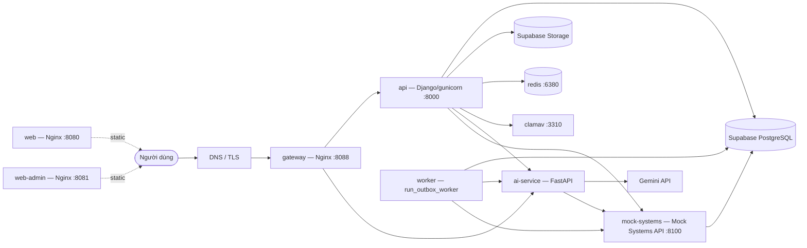
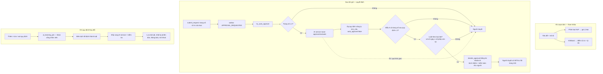

# CHƯƠNG 3 — XÂY DỰNG, TRIỂN KHAI VÀ ĐÁNH GIÁ HỆ THỐNG (mục 3.1 và 3.2)

## 3.1. Môi trường phát triển và cài đặt hệ thống

### 3.1.1. Công cụ, ngôn ngữ và framework phát triển

**Bảng 3.1. Công cụ và phiên bản sử dụng**

| Nhóm | Công cụ | Phiên bản | Vai trò |
|---|---|---|---|
| Ngôn ngữ | Python | 3.12 (lõi), 3.11 (AI) | Lõi nghiệp vụ, worker, dịch vụ AI, công cụ huấn luyện |
| | JavaScript (ES2022), JSX | Node.js 22 | Giao diện web |
| | Dart | SDK ≥ 3.5 | Ứng dụng di động |
| | SQL / PL/pgSQL | PostgreSQL (Supabase) | Lược đồ, trigger, hàm kiểm tra |
| Framework | Django | 5.2.18 | Lõi nghiệp vụ (`api_core`) |
| | FastAPI / Starlette / Pydantic | 0.162.0 / 1.10.0 / 2.9.2 | Dịch vụ AI |
| | React / Vite | 19.3.0 / 8.3.4 | Giao diện web |
| | Flutter | — | Ứng dụng di động |
| Thư viện chính | psycopg (pool) | 3.3.6 | Kết nối PostgreSQL, SQL tham số hoá |
| | argon2-cffi | 25.1.0 | Băm mật khẩu |
| | rfc8785 | 0.1.4 | Chuẩn hoá JSON cho chuỗi băm |
| | redis | 8.1.0 | Chống dò mật khẩu, phiên rỗi, bộ đệm |
| | XGBoost / scikit-learn / pandas | 2.1.1 / 1.5.2 / 2.2.3 | Huấn luyện và suy luận AI |
| | PaddleOCR / PaddlePaddle, Google Gemini SDK | 3.7.0 / 3.3.1 (`requirements-paddle.txt`) | Nhận dạng, tóm tắt |
| Kiểm thử | Django test runner, unittest | — | Kiểm thử backend |
| | Node test runner, Playwright | — / 1.64.0 | Kiểm thử giao diện, e2e |
| Chất lượng | ruff, coverage, pip-audit, npm audit, SonarQube | — | Kiểm tra mã, độ phủ, lỗ hổng phụ thuộc |
| Hạ tầng | Docker, Docker Compose, Nginx 1.31.6, Redis 8.0.3, ClamAV 1.4.3 | — | Đóng gói và chạy dịch vụ |
| Quản lý mã | Git, GitHub Actions | — | Phiên bản và cổng chất lượng tự động |

Mọi phụ thuộc đều **ghim phiên bản chính xác** (`requirements*.txt`, `package.json`, `package-lock.json`). Image Nginx còn được ghim theo digest. Mục đích là bảo đảm bản build tái lập được và tránh bị tấn công chuỗi cung ứng.

### 3.1.2. Môi trường cơ sở dữ liệu và lưu trữ tài liệu

- **CSDL.** Supabase PostgreSQL. Lược đồ được dựng theo thứ tự sau:
  1. `database/EAS_Supabase_SQL/00_eas_supabase_schema.sql` — 30 bảng lõi, hàm, trigger, chính sách RLS;
  2. `database/mock_enterprise_sql/00_mock_enterprise_schemas.sql` — 8 schema mô phỏng;
  3. các migration `database/migrations/04…17` (kèm `database/mock_enterprise_sql/migrations/005_align_with_eas.sql`), mỗi migration có kịch bản quay lui trong `rollback/`;
  4. kiểm tra cài đặt bằng `02_verify_installation_READ_ONLY.sql`;
  5. kiểm tra hồi quy CSDL trên môi trường phát triển bằng `03_database_regression_DEV_ONLY.sql`.
- **Nguyên tắc vận hành.**
  - Ứng dụng EAS kết nối bằng role backend (`eas_api`, `eas_worker`), **không có quyền DDL** và **không có quyền trên `mock_*`**. Dịch vụ hệ thống ngoài `mock_systems` (`:8100`) kết nối bằng role riêng `eas_mock` (chỉ đọc/ghi 8 schema `mock_*`).
  - Thay đổi lược đồ do quản trị viên chạy qua SQL Editor bằng role `eas_migration`.
  - Kiểm thử ghi dữ liệu chạy trên một bản sao PostgreSQL cục bộ (Docker), không chạy trên CSDL thật.
- **Lưu trữ tệp.** Supabase Storage, bucket riêng tư. Khoá đối tượng là UUID. Tệp chỉ được tải xuống qua API sau khi kiểm quyền, không có đường dẫn công khai.
- **Sao lưu.** Sao lưu tự động và khôi phục theo thời điểm (PITR) của Supabase. Quy trình khôi phục và đối soát ở Phụ lục C (SD-18).

### 3.1.3. Cấu hình môi trường triển khai Web và Mobile

- **Web.** Hai ứng dụng được build bằng Vite (Node 22) và phục vụ bởi Nginx:
  - `web` — cổng nhân viên, cổng 8080;
  - `web-admin` — cổng quản trị, cổng 8081.

  Kiểm tra `scripts/check_client_bundle.py` bảo đảm **gói giao diện nhân viên không chứa màn hình quản trị**.
- **Cổng API.** `gateway` (Nginx, cổng 8088) chỉ định tuyến `/api/*` tới lõi nghiệp vụ, và áp dụng giới hạn tần suất, header bảo mật và mã tương quan. Dịch vụ AI và dịch vụ hệ thống ngoài mô phỏng (`mock_systems`, Mock Systems API `/mock-api/v1/*`) **không** được mở qua cổng này; chúng chỉ nhận lời gọi nội bộ trong mạng Docker, kèm khoá `X-Internal-Secret` hoặc `X-Integration-Secret`.
- **Cấu hình theo môi trường** qua tệp `.env` (không đưa vào Git). Tệp mẫu `.env.example` chỉ chứa giá trị giả; kịch bản `scripts/validate_env.py` kiểm đủ biến cho từng hồ sơ: compose, api, worker, web. Khi `EAS_ENV=production`:
  - cookie bật `Secure`;
  - bật HSTS;
  - chuyển hướng HTTPS;
  - tắt tài liệu API;
  - bắt buộc có Redis và khoá nội bộ đủ 32 ký tự.
- **Mobile.** Ứng dụng Flutter cấu hình địa chỉ API qua biến build. Dùng cùng cơ chế phiên và CSRF với web.

### 3.1.4. Cài đặt các dịch vụ nền tảng của hệ thống

*Hình 3.1. Topology triển khai bằng Docker Compose. Bản đề xuất cho production có hai bản sao API và bản sao CSDL dự phòng ở ảnh img_069 (DP-01). Nguồn: Nhóm tác giả.*

Các dịch vụ trong `docker-compose.yml`:
- `web`, `web-admin`, `gateway`, `api`, `worker`, `mock-systems` (`EAS_SERVICE=mock`, cổng `:8100`, role CSDL `eas_mock`);
- `redis` (8.0.3-alpine), `clamav` (1.4.3);
- `ai-service`, với volume lưu mô hình OCR.

Cổng của mọi dịch vụ chỉ mở trên `127.0.0.1`; truy cập từ ngoài phải đi qua gateway. Môi trường phát triển trên Windows có sẵn các kịch bản: `setup_local.cmd`, `start_backend_local.cmd`, `start_worker_local.cmd`, `start_ai_local.cmd`, `start_frontend_local.cmd`, `start_admin_local.cmd`.

**Cổng chất lượng tự động** (`.github/workflows/ci.yml`) gồm 7 job:

| Job | Nội dung |
|---|---|
| `secret-gate` | Quét bí mật trong repo |
| `backend` | ruff, kiểm định dạng, pip-audit, kiểm thử Django có đo độ phủ, bộ kiểm thử tích hợp, biên dịch |
| `database` | Kiểm tra lược đồ |
| `frontend` | Kiểm thử, npm audit, lint, build cả hai cổng, kiểm gói nhân viên không chứa màn hình quản trị |
| `ocr-smoke` | Kiểm thử nhanh nhận dạng hoá đơn |
| `container-config` | Kiểm tệp môi trường mẫu và `docker compose config` |
| `documentation` | Kiểm tính hợp lệ của tài liệu (`scripts/validate_docs.py`) |

## 3.2. Xây dựng và tích hợp các phân hệ chức năng

Mỗi mục nêu: chức năng đã xây dựng, các điểm kỹ thuật chính và vị trí mã nguồn.

### 3.2.1. Phân hệ quản lý người dùng, tổ chức và phân quyền
- **Đăng nhập** bằng email công ty, mật khẩu Argon2. Chống dò mật khẩu theo hai chiều. Đổi mật khẩu bắt buộc lần đầu. Đặt lại mật khẩu do OPS_ADMIN xét duyệt, gửi mật khẩu tạm qua email (`api_core/authn/`).
- **Phiên.** Cookie ký 8 giờ cộng dấu rỗi 30 phút trong Redis. Mỗi yêu cầu kiểm `auth_version`, nên đổi quyền hay khoá tài khoản có hiệu lực ngay.
- **Tổ chức và người dùng.** Cây phòng ban, quản lý trực tiếp, mã nhân viên. Tạo / sửa / khoá tài khoản; gán vai trò nghiệp vụ có phạm vi; ghi nhận nghỉ / công tác (`api_core/administration/org_users_rbac.py`). Nạp hàng loạt qua lệnh `identity_import`: chạy thử rồi mới áp dụng, cùng mã băm tệp.
- **Phân quyền module.** Ma trận vai trò × module với 4 thao tác, cộng quyền riêng từng người. Hàm CSDL `get_effective_user_permissions` tính quyền hiệu lực; API `GET /api/v1/auth/permissions/me` trả quyền cho giao diện (`api_core/authn/module_access.py`).
- **Tách tài khoản quản trị** (migration 11). Chỉ `admin@eas.com` giữ vai trò quản trị. Trigger cấm gán đồng thời vai trò quản trị và vai trò nghiệp vụ cho một tài khoản.

### 3.2.2. Phân hệ quản lý loại yêu cầu và tạo yêu cầu
- **Danh mục 66 loại** (58 đang hoạt động) chia vào **12 nhóm lớn theo mục đích người gửi** (`eas.request_group`) với **61 mục chọn trên menu** (`eas.request_menu_item`, gồm 56 loại trực tiếp và 5 mục đặt sẵn `preset`), khai báo ở `api_core/catalog/catalog_v2.json` và bảng `request_type` (Migration 09 & 17). Mỗi loại có: mẫu vòng đời, trọng số rủi ro (nguồn duy nhất trên `request_type`, chụp vào `request_revision` khi gửi), số cấp mặc định, biểu mẫu và tuyến duyệt trong phiên bản quy chế.
- **Tình trạng sẵn sàng.** Một loại bị khoá kèm lý do khi tích hợp phụ thuộc đang tắt (`api_core/catalog/availability.py`, `integrations.py`).
- **Tạo nháp và lưu nháp** có khoá lạc quan.
- **Kiểm dữ liệu** theo biểu mẫu (`api_core/domain/validation.py`) và ràng buộc riêng của loại (`plan_constraints.py`). Ví dụ: điều chuyển ngân sách không được trùng nguồn và đích.
- **Đính kèm an toàn:** kiểm kích thước, kiểm chữ ký đầu tệp, quét ClamAV, lưu kho riêng tư (`api_core/workflow/attachments.py`, `api_core/storage.py`).

### 3.2.3. Phân hệ workflow và xử lý vòng đời yêu cầu
- Hàm `submit_request` thực hiện gửi nguyên tử: phiên bản, phiên quy trình, bước, SLA, người tham gia, kiểm toán và sự kiện trong một giao dịch (`api_core/workflow/service.py:1311`).
- **Máy trạng thái hai lớp.** Lớp dịch vụ Python; lớp trigger CSDL `guard_request`, `guard_step` và trigger lượt thực hiện.
- **Chống lặp.** Mọi lệnh ghi nhận `Idempotency-Key`; kết quả lần đầu được lưu và trả lại cho các lần lặp (`_execute_idempotent`).
- **Khuôn giao dịch chung.** Khoá bảo mật → khoá dòng → kiểm phiên bản → ghi → kiểm toán → sự kiện (§2.2.10).

### 3.2.4. Cơ chế luật nghiệp vụ và kiểm soát tuân thủ nội bộ
- **Động cơ định tuyến** `resolve_route` (`api_core/domain/routing.py`): chọn luật theo ưu tiên, phân giải 1–5 vị trí người duyệt (14 vị trí cho phép), người thực hiện (11 vị trí) và người nghiệm thu (5 vị trí), rồi kiểm tách nhiệm.
- **Quản lý phiên bản quy chế** (`config_service.py`): tạo / sao chép, sửa, kiểm tra, ban hành nguyên tử. Bản đã ban hành không sửa được; thay đổi phải sau khi kiểm tra (chống `VALIDATION_STALE`).
- **Quy định công ty** được biên dịch thành luật (`min_risk`, `auto_approve: false`, ngưỡng tiền / ngày) và áp dụng cho động cơ tự duyệt (UC19).

### 3.2.5. Phân hệ phê duyệt đa cấp, bổ sung và từ chối
- `decide_approval` xử lý ba kết quả; lý do bắt buộc 10–2000 ký tự cho từ chối và bổ sung.
- **Thay người khi vắng** (`_substitute_approver`): ưu tiên người được ủy quyền; nếu vắng mà không ủy quyền thì chuyển quản lý trực tiếp; mọi lần thay đều được ghi `APPROVER_SUBSTITUTED`.
- **Ủy quyền** (`delegation.py`): khoảng thời gian, lý do, thu hồi.
- **Người duyệt cuối của mẫu B/C** chọn người thực hiện trong danh sách hợp lệ (`list_assignable_executors`).
- **Rút đơn** (`cancel_request`) và **điều chuyển** (`ops_service.reassign_actor`).

### 3.2.6. Phân hệ thực hiện và nghiệm thu yêu cầu
- `start_execution` (nhận việc), `report_execution_issue` (không thể nhận / vướng), `submit_execution` (nộp kết quả), `decide_acceptance` (chấp nhận / làm lại).
- **Chọn người thực hiện đang có mặt** khi mở lượt (`_pick_present_executor`).
- **Mỗi lần làm lại là một lượt mới.** CSDL bảo đảm mỗi phiên quy trình chỉ có một lượt chưa kết thúc.

### 3.2.7. Phân hệ thông báo, SLA và leo thang
- **Chặng SLA** được tạo cùng giao dịch với bước / lượt. Giờ lấy từ `sla_profile` của quy chế.
- **Worker** `run_outbox_worker`: tham số `--poll-seconds` (mặc định 2) và `--batch-size`; dừng an toàn khi nhận SIGTERM. Mỗi vòng lặp chạy `process_sla_batch` → `run_outbox_batch` → `run_learning_jobs`.
- **Phát sự kiện.** Thuê theo lô, lease 60 giây; thử lại lùi dần (15 s × 2ⁿ, tối đa 300 s); `DEAD` sau 4 lần; quản trị gửi lại (`ops/outbox/{id}/replay`).
- **Thông báo trong ứng dụng.** Khoá chống trùng (sự kiện, người nhận); đánh dấu đã đọc lặp lại an toàn.

### 3.2.8. Phân hệ nhật ký kiểm toán và truy vết lịch sử
- `api_core/audit.py`: chuẩn hoá NFC + RFC 8785, SHA-256.
- `_append_request_audit` / `_append_admin_audit` ghi sự kiện cùng giao dịch nghiệp vụ, khoá đầu chuỗi.
- **Xem và kiểm chứng:** `GET /requests/{id}/audit`, `POST /requests/{id}/audit/verify`, lệnh `audit_verify`.
- **Lịch sử đầy đủ:** `/requests/{id}/history`, `/revisions`.
- **Quyền riêng tư:** lệnh `privacy_case` (chạy thử, duyệt, từ chối, xoá); chặn xoá khi còn lệnh giữ pháp lý.

### 3.2.9. Dashboard và báo cáo
- **Báo cáo theo phạm vi:** `reports/requests`, `reports/team` (`api_core/workflow/reporting.py`).
- **Chỉ số cá nhân và phòng ban:** `workflow/insights.py`.
- **Thống kê quản trị:** `administration/analytics.py`, `overview.py`.

Mọi truy vấn tổng hợp áp điều kiện phân quyền trước khi tính, và đếm theo hồ sơ.

### 3.2.10. Ứng dụng di động phục vụ theo dõi yêu cầu
Ứng dụng Flutter (`mobile_app/lib/main.dart`, `eas_api.dart`) gọi các API:
- `auth/csrf`, `auth/login`, `auth/me`, `auth/logout`, `auth/password`;
- `requests?tab=…`, `requests/{id}`;
- `notifications`, `notifications/{id}/read`.

Phiên dùng cookie như web. Thao tác duyệt, thông báo đẩy và đăng nhập sinh trắc là hướng phát triển (3.3.8).

### 3.2.11. Tích hợp module AI hỗ trợ phân loại, tóm tắt và phát hiện bất thường

**a) Kiến trúc tích hợp.**
- Lõi nghiệp vụ gọi dịch vụ AI qua `api_core/ai_client.py`: có thời gian chờ, kèm `X-Internal-Secret`, lỗi thì trả kết quả dự phòng.
- Giao diện gọi AI **qua lõi nghiệp vụ** (`/api/v1/ai/classify`, `/ai/risk-score`, `/ai/summarize`), không gọi thẳng dịch vụ AI.

*Hình 3.2. Luồng vận hành AI trong hệ thống (AI-01). Nguồn: Nhóm tác giả.*

**b) Dữ liệu huấn luyện.**
- **Nguồn:** dữ liệu tổng hợp sinh bởi `ai_service/training/generate_enterprise_requests.py` và `enterprise_bigdata_generator.py`, với hạt giống ngẫu nhiên cố định (tái lập được).
- **Văn bản:** 50.000 mẫu, **16 nhãn phân loại của mô hình NLP** (lưu ý: đây là 16 nhãn huấn luyện của bộ phân loại văn bản, không phải 12 nhóm yêu cầu trên menu `eas.request_group`), 7 phòng ban, 3 mẫu vòng đời.
- **Rủi ro:** 1.000.000 mẫu cho mô hình tổng quát và 250.000 mẫu cho mỗi mô hình Tài chính, Nhân sự, CNTT.
- **Nhãn rủi ro:** gán theo bộ luật nghiệp vụ (vượt ngân sách, nghi chia nhỏ khoản chi, thiếu chứng từ, tỷ lệ bị từ chối cao, gửi ngoài giờ, sai mẫu…) có thêm 5% nhiễu để mô phỏng sai lệch thực tế.
- **Chia tập:** train / validation / test ≈ 58% / 21% / 21% bằng `GroupShuffleSplit` **theo tiêu đề chuẩn hoá**. Cách chia này không để cùng một tiêu đề xuất hiện ở hai tập, tránh đánh giá lạc quan do lọt mẫu.

**c) Mô hình và tham số.**
- **Phân loại văn bản:** TF-IDF (n-gram 1–2) + Logistic Regression, ba bộ phân loại độc lập cho loại / phòng ban / mẫu vòng đời.
- **Rủi ro:** XGBoost đa lớp, dừng sớm sau 30 vòng không cải thiện trên tập validation, 4 luồng, `random_state = 42`.
- Mỗi lần huấn luyện ghi `model_metadata.json` gồm: thời điểm, thời gian, kích thước tập, chỉ số, ma trận nhầm lẫn và đặc trưng quan trọng nhất.

**d) Kết quả đánh giá** (lần huấn luyện 31/10/2026, `pipeline_version = grouped-holdout-v1`):

| Mô hình | Số mẫu test | Accuracy | F1 macro | F1 weighted |
|---|---|---|---|---|
| Phân loại loại yêu cầu (16 lớp) | 9.874 | 1,000 | 1,000 | 1,000 |
| Phân loại phòng ban (7 lớp) | 9.874 | 0,999 | 0,999 | 0,999 |
| Phân loại mẫu vòng đời (3 lớp) | 9.874 | 0,987 | 0,981 | 0,987 |
| Rủi ro tổng quát (5 lớp) | 209.126 | 0,930 | 0,941 | 0,929 |
| Rủi ro Tài chính (4 lớp) | 62.161 | 0,934 | 0,936 | 0,933 |
| Rủi ro Nhân sự (5 lớp) | 44.610 | 0,915 | 0,939 | 0,912 |
| Rủi ro CNTT (4 lớp) | 49.450 | 0,952 | 0,954 | 0,950 |

**Diễn giải trung thực.**
- Kết quả đo trên **dữ liệu tổng hợp**. Các mô hình rủi ro đạt khoảng 93–95%, xấp xỉ giới hạn trên do 5% nhiễu nhãn. Nghĩa là mô hình đã học được bộ luật sinh nhãn.
- Đặc trưng quan trọng nhất của mô hình tổng quát là `is_over_budget` (0,335) và `is_split_amount_suspect` (0,119), trùng với các luật rủi ro nặng nhất.
- Độ chính xác gần tuyệt đối của bộ phân loại văn bản phản ánh việc văn bản được sinh từ mẫu câu; **không** ước lượng được độ chính xác trên văn bản do người dùng thật viết.
- Vì những lý do này, điểm rủi ro chỉ được dùng để **tham khảo**. Quyết định tự duyệt dựa trên trọng số của loại yêu cầu và quy định công ty: các yếu tố tất định, kiểm toán được.

**e) Tóm tắt bằng mô hình ngôn ngữ lớn.**
- Gemini 1.5 Flash, có prompt cố định.
- Nội dung được lọc qua `ai_service/sanitizer.py` trước khi gửi.
- Lưu đệm theo mã băm SHA-256 của nội dung, nên không tính phí hai lần cho cùng hồ sơ.
- Khi không có khoá API, hệ thống dùng tóm tắt trích xuất cục bộ.

**f) An toàn vận hành.**
- Dịch vụ AI chỉ nhận lời gọi có khoá nội bộ; giới hạn yêu cầu 20 MB; tắt tài liệu API ở production.
- Mỗi lần tự duyệt để lại hai sự kiện kiểm toán liên tiếp:
  1. `AI_AUTO_APPROVE_TAKEOVER` với `actor_kind = SYSTEM`, ghi người duyệt gốc, trọng số rủi ro và lý do của AI;
  2. `APPROVAL_APPROVE` do tài khoản AI hệ thống (`ai.system@eas.com`, không đăng nhập được) ký.
- Nhờ vậy, quyết định của AI luôn phân biệt được với quyết định của người. Nếu người duyệt đã quyết định hoặc hồ sơ vừa bị điều chuyển, việc tiếp quản không xảy ra (`api_core/workflow/auto_approval.py:124-160`).
