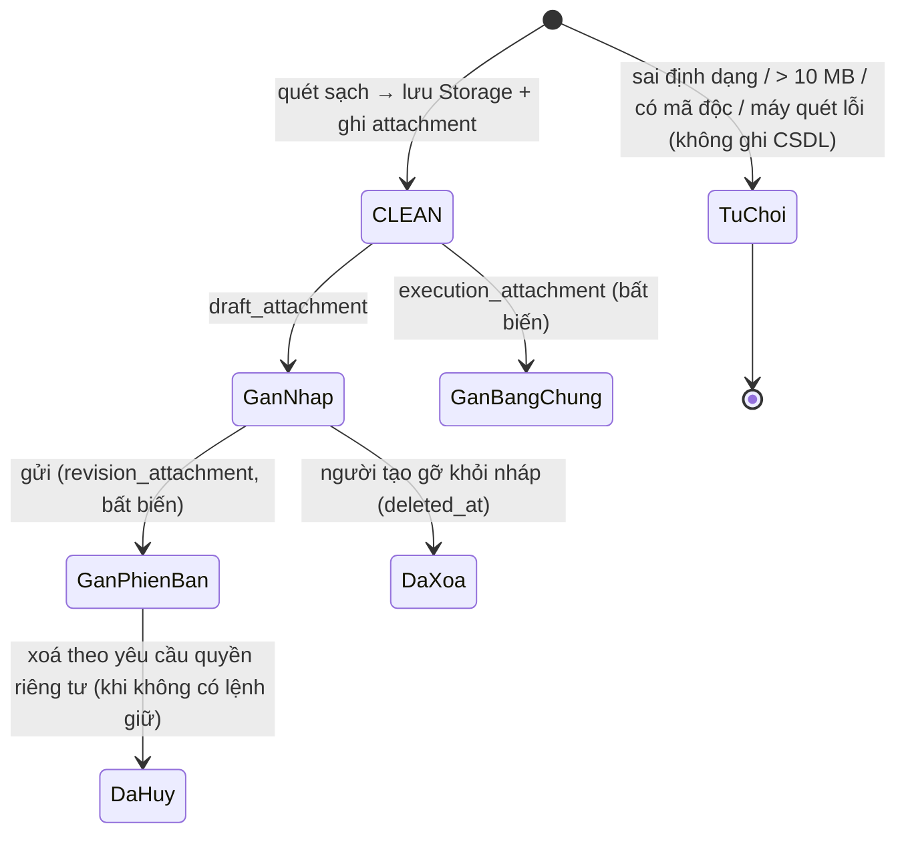
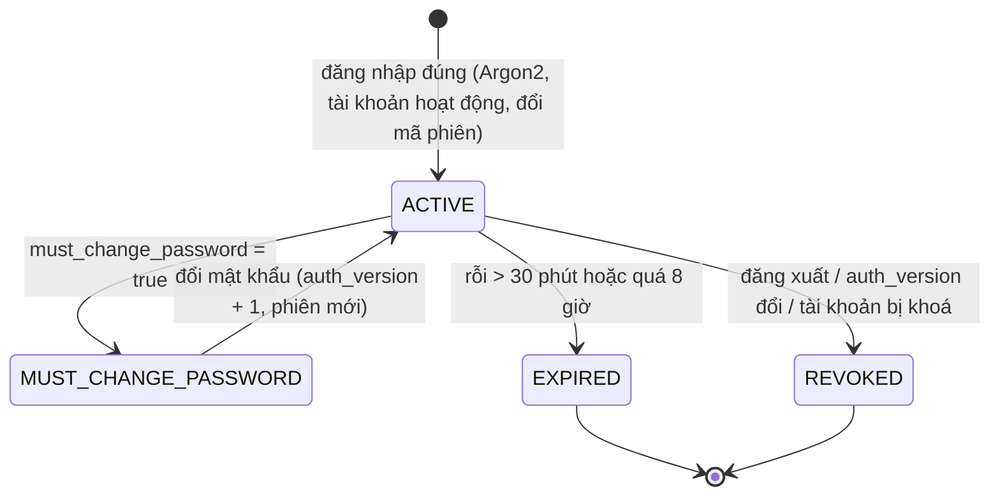
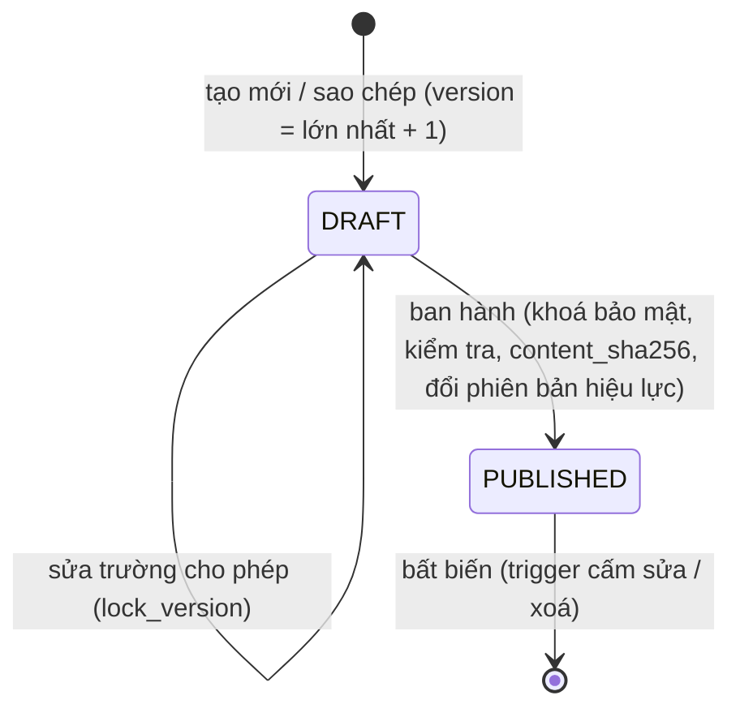

# PHỤ LỤC

## Phụ lục A–E. Danh mục sơ đồ bổ trợ

Mỗi sơ đồ ghi rõ nguồn hình (ảnh đã có trong DOCX, hoặc khối Mermaid trong bộ tài liệu này) và mục chứa phần diễn giải.

| Số | Mã | Tên | Nguồn hình | Diễn giải |
|---|---|---|---|---|
| PL-01 | UC-BIZ-02 | Khởi tạo, gửi và quyết định yêu cầu | img_006 | 05 §6 |
| PL-02 | UC-BIZ-03 | Thực hiện và nghiệm thu | img_009 | 05 §6 |
| PL-03 | UC-APR-01 | Góc nhìn người phê duyệt | img_007 | 05 §6 |
| PL-04 | UC-CTL-01 | Góc nhìn kiểm soát nội bộ | img_034 | 05 §6 |
| PL-05 | UC-SYS-01 | Tác vụ nền và hệ thống ngoài | img_008 (sửa nhãn quét) | 05 §6 |
| PL-06 | UC-AI-01 | Ca sử dụng phân hệ AI | Mermaid (05 §6) | 05 §6 |
| PL-07 | AD-05 | Chuyển giao người xử lý khi vắng | img_013 | 06 §5 |
| PL-08 | AD-06 | Nhắc tiến độ và cảnh báo trễ hạn | img_041 | 06 §5 |
| PL-09 | AD-07 | Ban hành quy chế | img_010 | 06 §5 |
| PL-10 | AD-08 | Cập nhật nhân sự và phân quyền | img_042 | 06 §5 |
| PL-11 | AD-09 | Quyền riêng tư và tiêu huỷ hồ sơ | img_043 | 06 §5 |
| PL-12 | AD-10 | Nghiệm thu và đưa phần mềm vào sử dụng | img_039 | 06 §5 |
| PL-13 | SD-02 | Tải lên, quét và đính kèm tệp | Mermaid (07 §6) | 07 §6 |
| PL-14 | SD-05 | Rút đơn tranh chấp duyệt cuối | img_050 | 07 §6 |
| PL-15 | SD-07 | Điều chuyển người thực hiện đang làm | img_059 | 07 §6 |
| PL-16 | SD-09 | Ban hành quy chế | img_057 | 07 §6 |
| PL-17 | SD-10 | Truy xuất hồ sơ chống IDOR | img_045 | 07 §6 |
| PL-18 | SD-11 | Nạp danh tính và thu hồi phiên | img_014 | 07 §6 |
| PL-19 | SD-12 | Thu hồi quyền tranh chấp phê duyệt | Mermaid (07 §6) | 07 §6 |
| PL-20 | SD-13 | Ghi kiểm toán và kiểm chứng | img_049 | 07 §6 |
| PL-21 | SD-15 | Đọc và đánh dấu thông báo | img_052 | 07 §6 |
| PL-22 | SD-14 | Xoá dữ liệu cá nhân có giữ pháp lý | img_053 | 07 §6 |
| PL-23 | SD-16 | Báo cáo theo phạm vi | img_060 | 07 §6 |
| PL-24 | SD-17 | Chuyển đổi phiên bản và quay lui | img_058 | 07 §6 |
| PL-25 | SD-18 | Khôi phục theo thời điểm và đối soát | img_054 | 07 §6 |
| PL-26 | SD-19 | Lưu nháp chống ghi đè | Mermaid (07 §6) | 07 §6 |
| PL-27 | SD-20 | Yêu cầu bổ sung và nộp lại | Mermaid (07 §6) | 07 §6 |
| PL-28 | SD-21 | Không thể nhận việc và báo vướng | img_044 | 07 §6 |
| PL-29 | SD-22 | Điều chuyển người duyệt / nghiệm thu | img_051 | 07 §6 |
| PL-30 | ST-04 | Máy trạng thái lượt thực hiện | img_061 | 08 §2.3.2 |
| PL-31 | ST-05 | Vòng đời tệp đính kèm | Mermaid dưới đây | Phụ lục D |
| PL-32 | ST-08 | Phiên xác thực | Mermaid dưới đây | Phụ lục D |
| PL-33 | ST-09 | Phiên bản quy chế | Mermaid dưới đây | Phụ lục D |
| PL-34 | ER-05 | Danh tính & tổ chức chi tiết | img_067 (sửa tên cột) | 09 §5 |
| PL-35 | ER-06 | Loại yêu cầu, quy chế, phiên bản | img_071 (sửa tên cột) | 09 §5 |
| PL-36 | ER-07 | Thực hiện & nghiệm thu | img_064 (sửa tên cột) | 09 §5 |
| PL-37 | ER-08 | Tệp & liên kết bất biến | img_072 (sửa tên cột) | 09 §5 |
| PL-38 | ER-09 | Kiểm toán, chống lặp, quyền riêng tư | img_068 (thêm RETENTION_HOLD) | 09 §5 |
| PL-39 | SEC-01 | Ranh giới tin cậy (nếu không đặt trong chương) | img_066 | 08 §2.3.4 |
| PL-40 | DP-01 | Topology triển khai đề xuất | img_069 | 12 §3.1.4 |

Tổng số hình sơ đồ của báo cáo là **74**: Chương 1 có 3 hình, Chương 2 có 29 hình, Chương 3 có 2 hình, Phụ lục có 40 hình. Con số này thay cho "68 sơ đồ" ở bản cũ.

### Phụ lục D — các máy trạng thái bổ sung

*Hình PL-31. Vòng đời tệp đính kèm (ST-05). Giá trị `QUEUED` và `ERROR` của `scan_state` được dành cho phương án quét bất đồng bộ sau này. Nguồn: Nhóm tác giả.*

*Hình PL-32. Vòng đời phiên xác thực (ST-08). Nguồn: Nhóm tác giả.*

*Hình PL-33. Vòng đời phiên bản quy chế (ST-09). Nguồn: Nhóm tác giả.*

## Phụ lục B. Ma trận truy vết ca sử dụng – sơ đồ – kiểm thử

| UC | Sơ đồ | Kiểm thử tự động |
|---|---|---|
| UC01 | SD-01, ST-08 | `api_core/tests/test_authn.py`, `test_security_middleware.py`, `tests/test_login_throttle.py` |
| UC02 | SD-09, AD-07, ST-09 | `test_ops_and_config.py`, `tests/test_policy_publication.py` |
| UC03 | SD-02, SD-19, ST-05 | `test_storage.py`, `test_request_workflow_scenarios.py` |
| UC04, UC07 | SD-03, SD-20, AD-02 | `test_workflow_service.py`, `test_workflow_api.py`, `test_request_workflow_scenarios.py` |
| UC05 | SD-10 | `test_history_views.py`, `test_role_scope_alignment.py`, `test_actor_permissions.py` |
| UC06 | SD-04, AD-03, ST-03 | `test_request_workflow_scenarios.py` |
| UC08 | SD-05 | `test_request_workflow_scenarios.py` |
| UC09 | SD-07, SD-22, AD-05 | `test_ops_and_config.py` |
| UC10–UC12 | SD-06, SD-21, AD-04, ST-04 | `test_request_workflow_scenarios.py` |
| UC13 | SD-15 | `test_workflow_api.py` |
| UC14 | SD-08, AD-06, ST-06, ST-07 | `test_worker.py`, `test_maintenance.py` |
| UC15 | SD-13, SD-16 | `test_audit.py`, `test_reporting_and_cli.py`, `test_insights.py` |
| UC16 | AD-05 | `test_approval_delegation.py` |
| UC17 | SD-11, AD-08 | `test_reporting_and_cli.py`, `test_administration.py` |
| UC18 | AI-01, UC-AI-01 | `test_ai_auto_approve_revoke.py`, `tests/test_ai_payload_contract.py` |
| UC19 | AI-01 | `test_ai_learning.py` |
| UC21 | AD-10, SD-17 | `test_maintenance.py` |
| UC22 | — | `test_admin_core_modules.py`, `web_client/e2e/access-matrix.test.mjs`, `role-policy.test.mjs` |
| UC24 | — | `test_mock_sources.py`, `tests/test_request_catalog_availability.py` |
| Quyền riêng tư | SD-14, AD-09 | `test_reporting_and_cli.py` |

## Phụ lục F. Thẻ mô hình (Model Card)

| Mục | Mô hình rủi ro tổng quát (XGBoost) | Bộ phân loại văn bản |
|---|---|---|
| Mục đích | Điểm rủi ro 1–5 **tham khảo** cho người duyệt | Gợi ý loại yêu cầu, phòng ban, mẫu vòng đời |
| Không dùng cho | Tự động phê duyệt hay từ chối; xếp hạng nhân viên | Tự chọn loại khi người dùng chưa xác nhận |
| Dữ liệu | 1.000.000 bản ghi tổng hợp; nhãn theo luật + 5% nhiễu | 50.000 văn bản tổng hợp; **16 nhãn phân loại của mô hình NLP** (khác với 12 nhóm menu `eas.request_group`) |
| Đặc trưng | 19 đặc trưng (`ai_service/models/feature_columns.json`) | TF-IDF n-gram 1–2 |
| Chia tập | Theo tiêu đề chuẩn hoá (không lọt mẫu) | idem |
| Chỉ số (test) | Accuracy 0,930; F1 macro 0,941 | Accuracy 1,000 (loại); 0,987 (mẫu vòng đời) |
| Hạn chế | Học lại luật của bộ sinh dữ liệu; chưa hiệu chỉnh xác suất; khi gọi từ giao diện, phần lớn đặc trưng nhận giá trị mặc định | 16 nhãn NLP chưa khớp đủ 58 loại; chưa thử trên văn bản thật |
| Công bằng | Thâm niên và vai trò có thể làm điểm nhân viên mới cao hơn. Đây là lý do mô hình không được dùng để ra quyết định | — |
| Phiên bản | `grouped-holdout-v1`, 31/10/2026, seed 42 | idem |

## Phụ lục G. Tài liệu tham khảo (bổ sung các chuẩn đã áp dụng)

1. Object Management Group. *Unified Modeling Language (UML), Version 2.5.1*, 2017.
2. Object Management Group. *Business Process Model and Notation (BPMN), Version 2.0.2*, 2014.
3. Committee of Sponsoring Organizations of the Treadway Commission (COSO). *Internal Control — Integrated Framework*, 2013.
4. OWASP Foundation. *Application Security Verification Standard 4.0.3*, 2021.
5. ISO/IEC 25010:2011. *Systems and software engineering — System and software quality models*.
6. A. Rundgren, B. Jordan, S. Erdtman. *RFC 8785 — JSON Canonicalization Scheme (JCS)*, IETF, 2020.
7. NIST. *FIPS 180-4 — Secure Hash Standard (SHS)*, 2015.
8. A. Biryukov, D. Dinu, D. Khovratovich. *RFC 9106 — Argon2 Memory-Hard Function for Password Hashing*, IETF, 2021.
9. C. Richardson. *Microservices Patterns* — mẫu Transactional Outbox, Manning, 2018.
10. M. Mitchell et al. "Model Cards for Model Reporting", *Proc. FAT\* 2019*, ACM.
11. T. Chen, C. Guestrin. "XGBoost: A Scalable Tree Boosting System", *Proc. KDD 2016*, ACM.
12. F. Pedregosa et al. "Scikit-learn: Machine Learning in Python", *JMLR* 12, 2011.
13. Chính phủ nước CHXHCN Việt Nam. *Nghị định 13/2023/NĐ-CP về bảo vệ dữ liệu cá nhân*, 2023.
14. Quốc hội nước CHXHCN Việt Nam. *Luật Giao dịch điện tử số 20/2023/QH15*, 2023.
15. Tài liệu chính thức: Django 5.2, FastAPI, PostgreSQL (Row Level Security, trigger), Supabase, React 19, Flutter.
