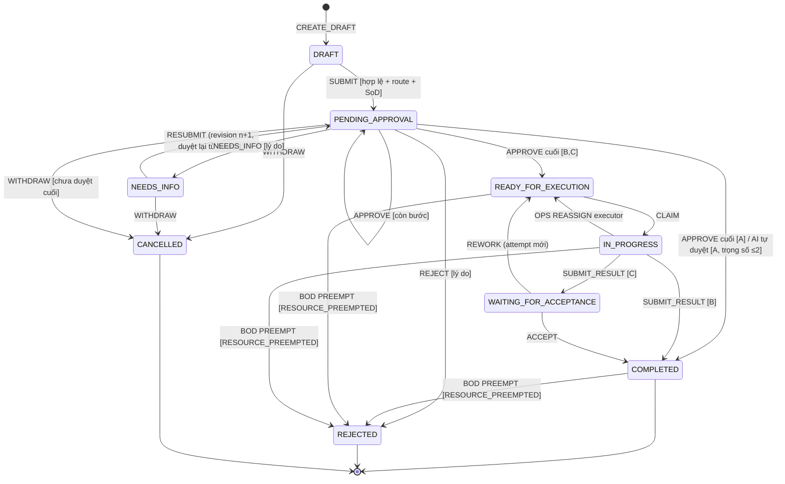

# 02 — Quy trình nghiệp vụ, vòng đời A/B/C, BRE, SLA, RBAC

> Phạm vi DOCX: 1.1.2 (6 giai đoạn), 1.2.2 (Bảng 1.2), 2.2.1–2.2.7, 2.3.2 (Bảng 2.5), 2.3.3 (Bảng 2.6), 2.3.4 (Bảng 2.7), 2.3.5 (Bảng 2.8), 2.3.6 (Bảng 2.9).
> Nguồn sự thật của hệ thống:
> - trigger `eas.guard_request` (`database/EAS_Supabase_SQL/00_eas_supabase_schema.sql:795-826`);
> - `api_core/workflow/service.py`;
> - `api_core/domain/routing.py`;
> - dữ liệu `config_release` live.

## 1. Sáu giai đoạn vòng đời (1.1.2)

| Giai đoạn DOCX | Trạng thái hệ thống | Đánh giá |
|---|---|---|
| 1 Khởi tạo & soạn thảo | `DRAFT` (`create_draft`, `update_draft` có `expected_version`) | KHỚP |
| 2 Kiểm tra quy định & định tuyến | Diễn ra trong cùng giao dịch `submit_request`: validate theo `form_schema`, `resolve_route`, kiểm SoD, tạo `request_revision`, `workflow_instance`, `approval_step` | KHỚP. Đây là bước **đồng bộ** trong một giao dịch, không có trạng thái riêng |
| 3 Thẩm định & phê duyệt | `PENDING_APPROVAL` (bước `ACTIVE`/`WAITING`), quyết định `APPROVE`/`REJECT`/`NEEDS_INFO` | KHỚP |
| 4 Tiếp nhận & thực thi | `READY_FOR_EXECUTION` → `IN_PROGRESS` | KHỚP |
| 5 Nghiệm thu | `WAITING_FOR_ACCEPTANCE` (chỉ C) | KHỚP |
| 6 Đóng & lưu vết | `COMPLETED`/`REJECTED`/`CANCELLED`, đều là trạng thái cuối. Trigger cấm sửa sau khi đóng (`schema.sql:799`) | KHỚP |

## 2. Ba mẫu vòng đời A/B/C (Bảng 1.2, 2.2.1, Bảng 2.4)

### 2.1 DOCX định nghĩa A/B/C bằng ba tiêu chí cùng lúc
1. **Số cấp duyệt**: A = 0–1; B = 1–2; C ≥ 3.
2. **Có bước thực thi / nghiệm thu hay không.**
3. **Ngưỡng tiền**: A < 2 triệu; B 2–20 triệu; C > 20 triệu hoặc có rủi ro IT.

### 2.2 Thực tế live (58 loại đơn đang hoạt động, đọc ngày 04/11/2026)

| Lifecycle | Số loại | Số cấp duyệt nhỏ nhất–lớn nhất (trên mọi rule) | Số loại có `risk_weight ≤ 2` | Người nghiệm thu |
|---|---|---|---|---|
| A | 9 | 1–3 (vd `EXPENSE_CLAIM` > 20 triệu: QL → Kế toán → GĐ) | 7 | không có |
| B | 27 | 1–4 | 13 | không có |
| C | 22 | 1–5 | 7 | `REQUESTER`, `DIRECT_MANAGER`, `CTO`, `LEGAL`, `PROJECT_MANAGER` |

Trong DB, lifecycle **chỉ quyết định hình dạng quy trình**:
- A: không có executor;
- B: có executor, không có nghiệm thu;
- C: có executor và nghiệm thu.

Ràng buộc này nằm ở trigger (`schema.sql:819`, `:838-839`). C còn bắt buộc có `amount_vnd`. Số cấp duyệt thì do `route_rules` quyết định (1–5 cấp), không phụ thuộc lifecycle.

### 2.3 Phán quyết

**DOCX SAI** khi gộp ba tiêu chí độc lập vào một nhãn. Cách gộp này sinh mâu thuẫn ngay trong DOCX:
- Bảng 2.4 dùng ngưỡng 2 / 20 triệu;
- BRE R03–R05 dùng 5 / 50 triệu;
- ví dụ tự duyệt ở 1.3 là văn phòng phẩm < 500 nghìn;
- quy chế đang chạy `REG-002-3` xếp C từ 30 triệu (`ai_service/data/active_enterprise_policy.json`).

Theo BPMN và thực hành ITSM, *hình dạng quy trình*, *ma trận thẩm quyền* và *mức rủi ro* là ba trục riêng. **Giữ mô hình của code**; sửa DOCX như sau:

| Trục | Định nghĩa chuẩn hoá | Nơi cấu hình |
|---|---|---|
| Lifecycle A/B/C | A = chỉ phê duyệt; B = phê duyệt → thực thi; C = phê duyệt → thực thi → nghiệm thu độc lập (acceptor ≠ executor) | `request_type.lifecycle` (cố định theo loại đơn) |
| Số cấp duyệt 1–5 | Do rule theo số tiền, số ngày hoặc ứng dụng (`amount_gt`, `amount_gte`, `days_gt`, `app_code_in`) | `config_release.route_rules` (Policy Admin ban hành) |
| Trọng số rủi ro 1–5 | Mặc định theo loại đơn. Quy định công ty có thể nâng (`min_risk`) hoặc cấm tự duyệt (`auto_approve:false`) | `request_type.risk_weight` + bộ luật AI đã học |

Ngưỡng tiền **không** dùng để chọn A/B/C. Ngưỡng tiền chỉ quyết định số cấp duyệt trong từng loại đơn. Mỗi loại đơn công bố ngưỡng của mình trong quy chế, và DOCX trích bảng ngưỡng của 5 loại tiêu biểu (§4).

## 3. Trạng thái và chuyển trạng thái (Bảng 2.5)

### 3.1 Đối chiếu tên trạng thái

| DOCX (Bảng 2.5, 2.2.x) | Hệ thống (`request.status`) | Ghi chú |
|---|---|---|
| — (mới) | `DRAFT` | |
| SUBMITTED | *(không có)* | Submit và định tuyến xảy ra trong một giao dịch nguyên tử, nên không cần trạng thái trung gian. Trạng thái trung gian sẽ tạo ra cửa sổ "đã gửi nhưng chưa có người duyệt" |
| IN_REVIEW | `PENDING_APPROVAL` | |
| APPROVED (kết thúc A) | `COMPLETED` (A hoàn tất khi được duyệt cuối) | Mốc duyệt lưu ở `approved_at` |
| READY | `READY_FOR_EXECUTION` | |
| IN_PROGRESS | `IN_PROGRESS` | |
| SUBMITTED_ACCEPT | `WAITING_FOR_ACCEPTANCE` | |
| DRAFT (Needs Info) | `NEEDS_INFO` | Trạng thái riêng giúp phân biệt "chưa gửi" với "bị trả về"; báo cáo và SLA cần sự phân biệt này |
| REJECTED / CANCELLED / COMPLETED | như nhau | |

Ảnh SD-04, SD-05, SD-06 và ST-02 trong DOCX đã dùng đúng tên của hệ thống. Chỉ **phần text** dùng tên cũ.

### 3.2 Bảng chuyển trạng thái chuẩn hoá (thay Bảng 2.5)

| Nguồn | Sự kiện | Tác nhân | Điều kiện (được kiểm ở DB hoặc service) | Đích |
|---|---|---|---|---|
| — | CREATE_DRAFT | Requester | Có quyền REQUESTER cho loại đơn. Loại đơn có release PUBLISHED. Tích hợp ERP của loại đơn sẵn sàng | DRAFT |
| DRAFT / NEEDS_INFO | SUBMIT | Requester | `expected_version` khớp. Payload hợp lệ theo `form_schema`. Tệp đều `CLEAN`. Resolve được tuyến 1–5 cấp. SoD: requester ∉ approvers, executor ∉ approvers, acceptor ≠ executor | PENDING_APPROVAL |
| PENDING_APPROVAL | APPROVE (chưa phải cấp cuối) | Approver hoặc AI (trọng số ≤ 2, chỉ A) | Đúng assignee của bước ACTIVE. Người duyệt kế tiếp hợp lệ, nếu vắng thì thay bằng delegate hoặc QL trực tiếp | PENDING_APPROVAL (bước sau) |
| PENDING_APPROVAL | APPROVE cuối, lifecycle A | Approver / AI | — | COMPLETED |
| PENDING_APPROVAL | APPROVE cuối, lifecycle B/C | Approver | Executor (và acceptor nếu là C) hợp lệ. Approver cuối có thể chỉ định executor | READY_FOR_EXECUTION |
| PENDING_APPROVAL | NEEDS_INFO | Approver | Lý do 10–2000 ký tự | NEEDS_INFO (instance → SUPERSEDED, tệp cũ chép về nháp) |
| PENDING_APPROVAL | REJECT | Approver | Lý do 10–2000 ký tự | REJECTED |
| DRAFT / NEEDS_INFO / PENDING_APPROVAL | WITHDRAW / CANCEL | Requester | Chưa có quyết định duyệt cuối (khoá dòng `FOR UPDATE`) | CANCELLED |
| READY_FOR_EXECUTION | CLAIM | Executor | Đúng executor của attempt READY | IN_PROGRESS |
| IN_PROGRESS | SUBMIT_RESULT, lifecycle B | Executor | `result_note` 10–4000 ký tự + `external_reference`; tệp bằng chứng do chính executor tải | COMPLETED |
| IN_PROGRESS | SUBMIT_RESULT, lifecycle C | Executor | idem | WAITING_FOR_ACCEPTANCE |
| IN_PROGRESS | REASSIGN executor | Ops Admin | Attempt cũ FINISHED/REASSIGNED, tạo attempt READY mới | READY_FOR_EXECUTION |
| WAITING_FOR_ACCEPTANCE | ACCEPT | Acceptor | acceptor ≠ executor | COMPLETED |
| WAITING_FOR_ACCEPTANCE | REWORK | Acceptor | Có lý do. Executor dự kiến còn hợp lệ | READY_FOR_EXECUTION (attempt mới) |

Các điểm lệch so với DOCX:

| # | DOCX | Hệ thống | Phán quyết |
|---|---|---|---|
| T1 | REWORK → IN_PROGRESS | REWORK → READY_FOR_EXECUTION, tạo **attempt mới** | **Giữ code.** Mỗi lần làm lại là một attempt có SLA riêng và lịch sử bất biến. Executor phải claim lại, nên biết được ai đang thực sự làm. Ảnh SD-06 và ST-04 trong DOCX cũng vẽ như code |
| T2 | NEEDS_INFO → DRAFT | NEEDS_INFO là trạng thái riêng | **Giữ code** (lý do ở §3.1) |
| T3 | Resubmit "kích hoạt lại từ bước đã yêu cầu bổ sung" (text SD-20) | Resubmit tạo instance mới, **duyệt lại từ bước 1** | **Giữ code.** Nội dung đã thay đổi nên các cấp đã duyệt trước phải xem lại bản mới (four-eyes trên nội dung mới). Nếu muốn bỏ qua bước đã duyệt thì phải ghi thành quy định riêng; không nên làm mặc định |
| T4 | WITHDRAW từ DRAFT | DRAFT → CANCELLED (trigger cho phép) | KHỚP |
| T5 | Không có NEEDS_INFO → CANCELLED | Có (người tạo bỏ đơn bị trả về). Ảnh AD-01 cũng vẽ "Không nộp lại và hủy" | Bổ sung vào bảng DOCX |
| T6 | Không nhắc REASSIGN làm đổi trạng thái | IN_PROGRESS → READY_FOR_EXECUTION khi reassign executor đang chạy | Bổ sung |

### 3.3 Máy trạng thái chuẩn hoá (thay ST-01)

## 4. Động cơ luật BRE (2.3.3, Bảng 2.6)

### 4.1 So khớp từng luật với cấu hình live

| Luật | DOCX | Live (`config_release.route_rules` của bản PUBLISHED) | Phán quyết |
|---|---|---|---|
| R01 | Nghỉ ≤ 2 ngày và rủi ro ≤ 2 → AI tự duyệt, 0 cấp | `LEAVE` (A, `risk_weight` 1): rule mặc định `[DIRECT_MANAGER]`. Bước này được AI tự ký duyệt khi trọng số ≤ 2, quy định không cấm và đủ ngày phép (`auto_approval.try_auto_approve`, `routers/auto_approve.check_leave_short`) | KHỚP về kết quả. **Cơ chế khác:** vẫn tạo 1 bước rồi AI ký thay. Cách này tốt hơn "0 cấp" vì vẫn có bước, audit và quyền thu hồi trong 24 giờ (`requests/{id}/ai-approval/revoke`) |
| R02 | Nghỉ > 2 ngày → 1 cấp Trưởng phòng | `LV-LONG: days_gt 2 → [DIRECT_MANAGER, DIRECTOR]` | LỆCH NGHIỆP VỤ. Live là 2 cấp. **Chốt theo quy chế công ty**; DOCX phải trích đúng bản đang ban hành |
| R03 | Mua sắm < 5 triệu → 1 cấp | `PURCHASE_REQUEST: PURCHASE_LOW (mặc định) → [DIRECT_MANAGER]` | KHỚP |
| R04 | 5–50 triệu → Trưởng BP → Kế toán trưởng | `PURCHASE_MEDIUM: amount_gte 5.000.000 → [DIRECT_MANAGER, FINANCE]` | KHỚP |
| R05 | > 50 triệu → + CEO | `PURCHASE_HIGH: amount_gt 50.000.000 → [DIRECT_MANAGER, FINANCE, DIRECTOR]` | KHỚP |
| R06 | Quyền Admin/Root → Trưởng IT → CISO | `ACCESS: AC-PROD app_code_in [PRODUCTION_DB, AWS_CONSOLE, ERP_SAP] → [DIRECT_MANAGER, DIRECTOR]`. `PROD_DATA_ACCESS → [DIRECT_MANAGER, SECURITY, CTO]` | LỆCH NGHIỆP VỤ. Hệ thống điều kiện theo **ứng dụng nhạy cảm**, không theo "mức quyền". Đề xuất: thêm resolver `IT_MANAGER` + `SECURITY` (slot đã có ở `routing.py:12-27`) vào rule AC-PROD. DOCX nên mô tả theo ứng dụng nhạy cảm vì payload không có trường "mức quyền" |
| R07 | Requester trùng approver → chuyển lên cấp trên trực tiếp | **Đã hiện thực ngày 04/11/2026** trong `api_core/domain/routing.py`: khi người gửi trùng người duyệt của một bước, tự động chuyển bước đó lên `manager_id` của người gửi (mã audit `SOD_ESCALATED`), hoặc bỏ qua nếu không có quản lý (`SOD_SKIPPED`); với bước `DIRECT_MANAGER` của lãnh đạo cao nhất (`manager_id IS NULL`), dùng `TOP_LEVEL_APPROVER` (`TOP_LEVEL_FALLBACK`) hoặc bỏ qua (`TOP_LEVEL_SKIPPED`); gộp bước liền trùng người (`DUPLICATE_SKIPPED`). Chỉ trả `409 ROUTE_CONFIGURATION_INVALID` khi sau điều chỉnh tuyến rỗng | KHỚP (đã nâng cấp 04/11, xem `docs/THIET_KE_SCHEMA_EAS_V2.md` §5) |
| "Rủi ro ≥ 4 → lên Giám đốc" | BRE dùng điểm AI | Định tuyến **không** dùng điểm AI. Điểm rủi ro chỉ chặn tự duyệt | THIẾU HIỆN THỰC, và **không nên làm như DOCX mô tả**. Để mô hình học máy đổi chuỗi phê duyệt khiến kết quả không tái lập được khi kiểm toán. Phương án an toàn: rule tất định trên `risk_weight` đã lưu trong revision (vd `risk_gte: 4 → thêm DIRECTOR`); chỉ cho phép **thêm** cấp, không bớt |
| "Budget Quota Guard" | Vượt ngân sách phòng → thêm Kế toán trưởng/TGĐ | Không có trong routing. Ngân sách chỉ có ở `mock_finance.cost_center_budget` và feature `is_over_budget` của AI | THIẾU HIỆN THỰC. Mức P1: thêm toán tử `over_budget: true` và resolver đọc ngân sách qua `mock_sources` |
| "Tuần tự và song song" (2.3.4) | Có duyệt song song | Chỉ có tuần tự (`approval_step.step_no`, một bước ACTIVE tại một thời điểm) | THIẾU HIỆN THỰC. **Đề xuất bỏ khỏi DOCX** cho P0: duyệt song song cần quy tắc gộp (all/any/quorum) mà chưa có trong đặc tả |
| Safe fallback khi AI lỗi | Gán rủi ro mặc định an toàn | AI lỗi → `escalate_to_human` (`auto_approval.py`). Bước vẫn chờ người duyệt | KHỚP |

### 4.2 Tập toán tử luật hiện có
- `amount_gt`, `amount_gte`, `days_gt`, `app_code_in` (`routing.py:48`).
- Đúng một rule `default` ở cuối.
- `priority` là số nguyên duy nhất.
- 1–5 approver slot thuộc allowlist gồm 14 slot.

Phần này tốt hơn mô tả chung chung "Rule Expressions" của DOCX: tất định, kiểm được và không thể chèn mã. DOCX nên ghi đúng danh sách toán tử này.

## 5. SLA và leo thang (2.3.6, Bảng 2.9)

| Hạng mục | DOCX text / Bảng 2.9 | Ảnh AD-06, SD-08 trong DOCX | Code | Đề xuất |
|---|---|---|---|---|
| Ngưỡng nhắc | 80% | 50% | 50% (`worker.classify_sla_alert`). `reminder_fraction` bị khoá `0.5` ở trigger (`schema.sql:752`) | Chọn **một** con số. Khuyến nghị **giữ 50%** vì SLA duyệt thường chỉ 24 giờ: nhắc ở 80% chỉ còn khoảng 5 giờ, quá muộn để người duyệt sắp xếp |
| Quá hạn | 100% → ESCALATED_L1, gửi cả trưởng bộ phận | 100% → BREACH | 100% → BREACH, chỉ gửi **người đang giữ việc** (`worker._recipients`) | THIẾU HIỆN THỰC một phần: thêm người nhận là quản lý trực tiếp của assignee khi BREACH. Đây là quyết định D3 trong kế hoạch auto-assignment: admin chọn "nhắc" hay "tự chuyển" |
| > 150% → L2 (BOD + Ops) | Có | Không có | Không có | P1: thêm mốc `ESCALATED_L2` khi ≥ 150%, gửi Ops Admin. **Không** gửi BOD tự động (gây nhiễu, không có quyền xử lý) |
| Chu kỳ quét | 5 phút (text AD-06) | 1 phút / 60 giây | 2 giây (cùng vòng outbox) | Giữ code; ghi đúng vào DOCX |
| Kênh | Email + push | Chuông trong ứng dụng | Chỉ trong ứng dụng (`notification`). Email chỉ dùng cho đặt lại mật khẩu | Ghi đúng phạm vi P0 là "thông báo trong ứng dụng" |
| Trạng thái SLA | IN_TARGET / WARNING / ESCALATED_L1 / L2 / RESOLVED | — | Suy ra từ `sla_stage.{started_at, due_at, closed_at, breached_at}` và `sla_alert.kind ∈ {REMINDER, BREACH}` | Giữ dữ liệu thô; trạng thái hiển thị là **trường suy diễn** (xem tệp 07 ST-06) |
| SLA khi báo vướng | Tạm dừng (text PL-27) | Không dừng (ảnh SD-21) | Không dừng | Giữ code. Tạm dừng SLA cần phê duyệt của quản lý; nếu không, executor có thể tự kéo dài hạn |

## 6. Ma trận phân quyền (Bảng 2.7)

| Chức năng | Requester | Approver | Executor | Acceptor | Policy Admin | Ops Admin | Auditor |
|---|---|---|---|---|---|---|---|
| Tạo nháp & gửi | ✔ | — | — | — | — | — | — |
| Xem chi tiết hồ sơ | Đơn của mình | Đơn mình tham gia (participant) | idem | idem | **Không xem nội dung** | **Chỉ metadata điều phối** (`ops/requests`) | Theo scope GLOBAL/DEPARTMENT + type |
| Duyệt / Từ chối / Bổ sung | — | Bước được giao | — | — | — | — | — |
| Rút đơn / nộp lại | ✔ | — | — | — | — | — | — |
| Nhận & thực thi | — | — | ✔ | — | — | — | — |
| Nghiệm thu | — | — | — | ✔ (≠ executor) | — | — | — |
| Ban hành quy chế | — | — | — | — | ✔ | — | — |
| Reassign, replay outbox | — | — | — | — | — | ✔ | — |
| Kiểm chứng chuỗi băm, báo cáo | — | — | — | — | — | Xem `admin-events` | ✔ |

Điểm DOCX sai: dòng "Xem chi tiết hồ sơ" cho Policy Admin và Ops Admin quyền "Tất cả". Code và ảnh SD-10/SD-16 **không cho** admin đọc nội dung nghiệp vụ, đúng nguyên tắc least privilege. **Sửa DOCX.**

Thêm nữa:
- Một người có thể giữ nhiều vai trò nghiệp vụ, nhưng không được giữ đồng thời vai trò nghiệp vụ và vai trò quản trị (trigger migration 11).
- Quyền **màn hình** do bảng module quyết định: `role_module_permission`, `user_permissions`, hàm `eas.get_effective_user_permissions`.
- Hệ thống có hai lớp quyền, và DOCX chưa mô tả: **quyền màn hình (module)** và **quyền dữ liệu (role_membership + scope)**.

## 7. Sổ cái kiểm toán (2.3.5, Bảng 2.8)

| Trường DOCX | Hệ thống (`eas.audit_event`) | Ghi chú |
|---|---|---|
| event_seq BIGINT | `seq` theo từng chuỗi (`audit_head` khoá theo `REQ:{id}` hoặc `ADMIN`) | Có nhiều chuỗi (mỗi hồ sơ một chuỗi + chuỗi admin), không phải một chuỗi toàn cục. Cách này tốt hơn vì không tạo nút cổ chai khoá |
| event_type | `action` (+ `target_type`, `target_id`) | |
| actor_id / ip | `actor_id`, `actor_kind HUMAN/SYSTEM`, `correlation_id` | IP không lưu trong audit (log có correlation-id). Chấp nhận được và giảm dữ liệu cá nhân |
| payload_json | `details` JSONB (RFC 8785 + NFC) | |
| prev_event_hash / event_hash | `prev_hash` / `hash` = SHA-256(prev_hash ‖ canonical(event)), có `hash_version` | KHỚP (`api_core/audit.py`) |
| Checkpoint | `audit_checkpoint` có bảng, **0 dòng**; không có exporter | THIẾU HIỆN THỰC. P1: lệnh `audit_checkpoint` chạy hằng ngày, ghi đầu chuỗi + hash tổng ra kho WORM ngoài DB |

## 8. Các quyết định nghiệp vụ đã chốt với chủ đầu tư (03/11/2026) cần đưa vào DOCX

Nguồn: `plans/active/2026-11-03_auto_assignment_lifecycle.md`. Các quyết định này **chưa hiện thực**.

| # | Quyết định | Tác động tới DOCX |
|---|---|---|
| D1 | Ghim mềm người duyệt/thực thi; không cố định cứng | Bổ sung 2.3.4 |
| D2 | Vắng mặt tính theo đơn nghỉ **đã duyệt** | Bổ sung AD-05 |
| D3 | Admin cấu hình "nhắc" hay "tự chuyển" khi quá hạn | Bổ sung Bảng 2.9 |
| D4 | Bàn giao công việc theo hai cách: tự động từ đơn nghỉ và đơn bàn giao tự tạo | Thêm UC "Bàn giao công việc" |
| D5 | Trọng số 1–2: AI chọn và tự duyệt các bước của A/B/C; người yêu cầu được đổi người duyệt | Sửa R01. Mở rộng tự duyệt ra B/C (hiện chỉ A) |
| D6 | Trọng số 3–5: AI gợi ý, người yêu cầu chọn | Bổ sung 2.2.3 |
| D7 | Màn hình xem lại toàn bộ trước khi gửi; chưa gửi thì lưu nháp | Bổ sung 2.2.2 và 2.4 |
