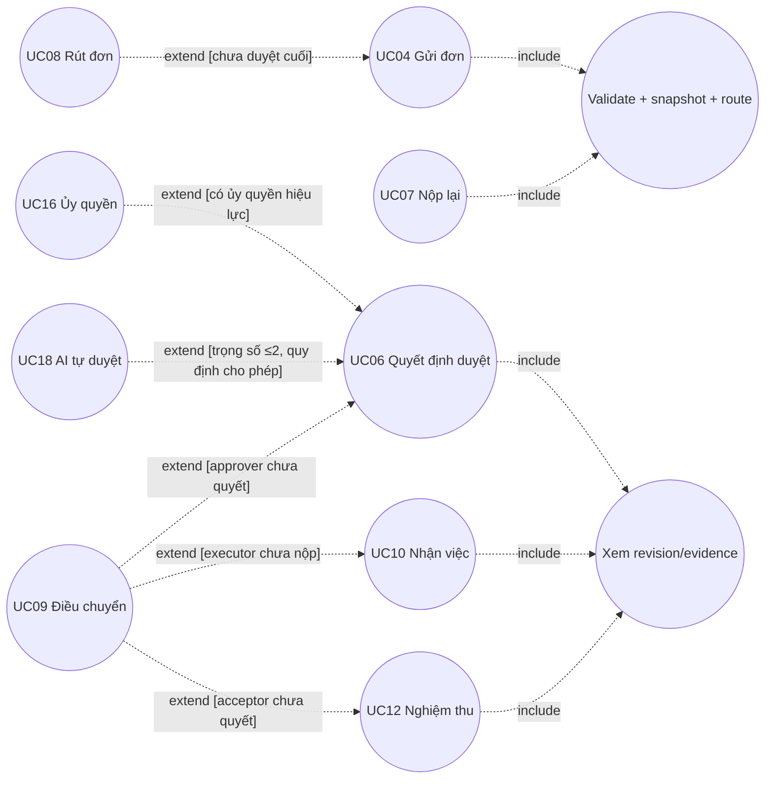
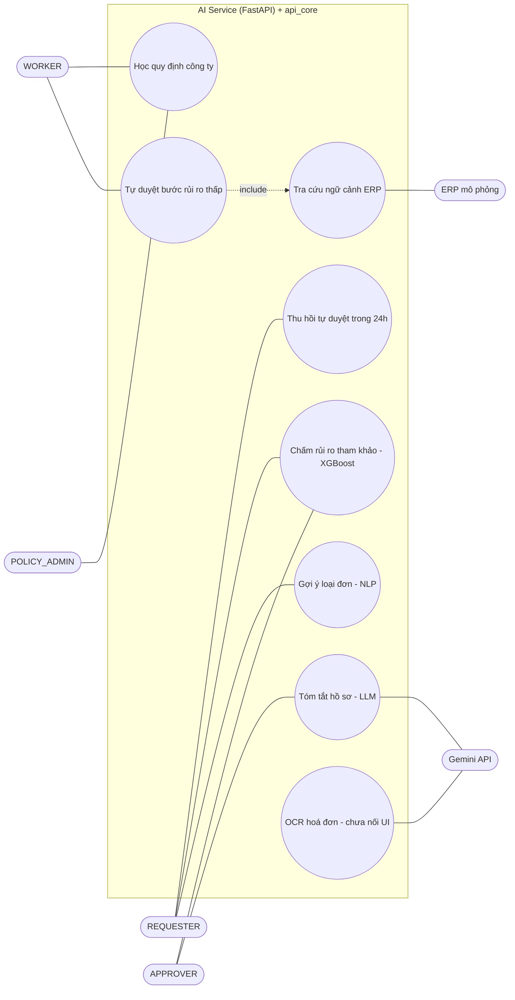

# 03 — Sơ đồ Use Case (DOCX 2.2.8 + Phụ lục A)

> Có 9 sơ đồ: 4 ở thân báo cáo và 5 ở phụ lục.
> **Cả 9 ảnh đều có chú thích sai sơ đồ**; bảng đối chiếu ở `00` §3.2. Tệp này sắp xếp theo **mã sơ đồ thật** (đọc từ tiêu đề in trong ảnh).
> Mermaid không có kiểu use-case chuẩn UML, nên mỗi sơ đồ dùng `flowchart`:
> - tác nhân là nút `([...])`;
> - ca sử dụng là nút `((...))`;
> - `-.->|include|` và `-.->|extend|` theo UML 2.5: mũi tên extend trỏ **về** ca cơ sở, mũi tên include trỏ **tới** ca được gộp.

## Nhận xét chung (áp dụng cho cả 9 sơ đồ)

| # | Vấn đề | Mức | Đề xuất |
|---|---|---|---|
| G1 | Chú thích và đoạn mô tả không khớp ảnh (9/9) | DOCX SAI | Đặt lại theo bảng `00` §3.2. Mô tả phải đi kèm đúng ảnh |
| G2 | Không có UC16. Thiếu các UC đã hiện thực: ủy quyền, AI tự duyệt / thu hồi, học quy định AI, thông báo hệ thống, bảo trì, quyền module, quên mật khẩu, tra cứu ERP | THIẾU trong DOCX | Thêm UC16 và UC18–UC24 (`01` §3). Vẽ thêm sơ đồ UC-AI-01 (bên dưới) |
| G3 | Một số ảnh dùng nhãn tiếng Anh (Approve, Submit, Withdraw…) lẫn tiếng Việt | LỆCH NHẸ | Thống nhất tiếng Việt, kèm mã UC |
| G4 | Ảnh UC-REL-01 dùng hình elip use case để vẽ *luồng trạng thái* (mũi tên tuần tự) | Trái UML 2.5 | Use case diagram không biểu diễn thứ tự. Phần A của UC-REL-01 nên chuyển sang activity diagram; chỉ giữ phần B (include) và C (extend) |

---

## UC-CTX-01 — Ngữ cảnh hệ thống
*Ảnh: img_035 (đang mang chú thích PL-03 "UC-BIZ-03"). Chú thích đúng là Hình 2.1.*

**Nội dung ảnh.**
- Tác nhân trái: REQUESTER, APPROVER, EXECUTOR, ACCEPTOR.
- Tác nhân phải: POLICY_ADMIN, OPS_ADMIN, AUDITOR, Identity operator, Scheduler/Worker.
- Ca sử dụng: UC01–UC15 và UC17.

**Đối soát.** Toàn bộ UC trong ảnh đều có endpoint tương ứng (`01` §3). Thiếu:
- tác nhân **AI hệ thống**;
- UC ủy quyền và các UC quản trị mới.

**Phán quyết:** KHỚP phần đã vẽ; THIẾU phần mở rộng.

```mermaid
flowchart LR
  R([REQUESTER]); A([APPROVER]); E([EXECUTOR]); C([ACCEPTOR]); D([NGƯỜI ĐƯỢC ỦY QUYỀN])
  P([POLICY_ADMIN]); O([OPS_ADMIN]); AU([AUDITOR]); W([SYSTEM WORKER]); AI([AI HỆ THỐNG])
  subgraph EAS["Enterprise Approval System — P0"]
    UC01((UC01 Đăng nhập/đăng xuất)); UC02((UC02 Ban hành quy chế)); UC03((UC03 Nháp & tệp))
    UC04((UC04 Gửi đơn)); UC05((UC05 Xem hồ sơ)); UC06((UC06 Quyết định duyệt))
    UC07((UC07 Bổ sung & nộp lại)); UC08((UC08 Rút đơn)); UC09((UC09 Điều chuyển))
    UC10((UC10 Nhận việc)); UC11((UC11 Báo vướng/nộp kết quả)); UC12((UC12 Nghiệm thu))
    UC13((UC13 Thông báo)); UC14((UC14 SLA & giao thông báo)); UC15((UC15 Kiểm toán & báo cáo))
    UC16((UC16 Ủy quyền phê duyệt)); UC17((UC17 Danh tính & phân quyền)); UC18((UC18 AI tự duyệt / thu hồi))
    UC19((UC19 Quy định & học AI)); UC21((UC21 Bảo trì hệ thống)); UC22((UC22 Quyền module))
  end
  R --- UC03 & UC04 & UC05 & UC07 & UC08 & UC13 & UC18
  A --- UC05 & UC06 & UC13 & UC16
  D --- UC06
  E --- UC05 & UC10 & UC11 & UC13
  C --- UC05 & UC12 & UC13
  P --- UC02 & UC19
  O --- UC09 & UC17 & UC21 & UC22 & UC15
  AU --- UC15
  W --- UC14
  AI --- UC18
  R & A & E & C & P & O & AU --- UC01
```

## UC-REL-01 — Quan hệ nghiệp vụ giữa các use case
*Ảnh: img_033 (chú thích sai: PL-01 "UC-SYS-01"). Chú thích đúng là Hình 2.2.*

**Nội dung ảnh.**
- (A) Luồng UC03 → UC04 → UC06 → UC10 → UC11 → UC12, với REWORK quay về UC10 và NEEDS_INFO đi qua UC07 về UC04.
- (B) UC04 và UC07 «include» Validate + snapshot + route. UC06, UC10 và UC12 «include» Xem revision / evidence.
- (C) UC08 «extend» UC04 với điều kiện [chưa hoàn tất duyệt]. UC09 «extend» UC06/UC10/UC12 với điều kiện [người xử lý chưa hoàn tất]. UC14 đứng độc lập.

**Đối soát với code.**
- `submit_request` dùng chung cho gửi lần đầu và gửi lại (validate + snapshot + route): KHỚP.
- REWORK tạo attempt mới, đúng như ảnh ghi "REWORK → attempt mới": KHỚP.
- Reassign trên 3 giai đoạn ứng với `target_kind` APPROVAL_STEP / EXECUTOR / ACCEPTOR: KHỚP.

**Phán quyết:** KHỚP nghiệp vụ. Phần (A) vi phạm G4.

## UC-BIZ-01 — Use case nghiệp vụ lõi theo tác nhân
*Ảnh: img_036 (chú thích sai: PL-04 "UC-APR-01"). Chú thích đúng là Hình 2.3.*

**Nội dung ảnh.** Boundary "Request Lifecycle".
- REQUESTER: Soạn nháp & tệp, Submit/Resubmit, Withdraw («extend» Submit [còn được rút]), Xem hồ sơ, Đọc thông báo.
- APPROVER: Approve/Reject/Needs Info («include» Xem hồ sơ).
- EXECUTOR: Claim/Báo không thể nhận («include» Xem hồ sơ), Báo vướng/Nộp kết quả.
- ACCEPTOR: Accept/Rework («include» Xem hồ sơ).

**Đối soát.** KHỚP các endpoint `01` §3.

**Lỗi ký pháp.** "Withdraw «extend» Submit" sai hướng ngữ nghĩa: Withdraw không mở rộng hành vi *gửi*; nó là ca độc lập với tiền điều kiện "đơn chưa duyệt cuối".

**Phán quyết:** LỆCH NHẸ (ký pháp). Đổi quan hệ thành liên kết tác nhân + ràng buộc tiền điều kiện.

## UC-BIZ-02 — Khởi tạo, gửi và quyết định yêu cầu
*Ảnh: img_006 (chú thích sai: Hình 2.1 "UC-CTX-01"). Chú thích đúng là PL-02.*

**Nội dung ảnh.**
- REQUESTER: Tạo request, Lưu nháp, Upload/chọn tệp CLEAN, Submit, Sửa và resubmit, Withdraw, Xem revision và route.
- APPROVER: Approve, Reject có lý do, Yêu cầu bổ sung.
- OPS_ADMIN: Reassign step.
- Quan hệ: Submit / Resubmit «include» Validate + snapshot + route.

**Đối soát.**

| Ca trong ảnh | Bằng chứng | Kết quả |
|---|---|---|
| Upload / chọn tệp CLEAN | `register_attachment` chỉ ghi khi quét sạch (`attachments.py:50-60`) | KHỚP |
| Xem revision và route | `requests/{id}/revisions`, `requests/route-preview` | KHỚP |
| "Duyệt bằng chữ ký số" (mô tả PL-02 trong DOCX) | Không có chữ ký số. Quyết định là bản ghi `approval_decision` bất biến + audit hash | **DOCX SAI.** Đổi thành "xác nhận điện tử có lưu vết bất biến". Chữ ký số (PKI, Luật GDĐT 2023) là phạm vi P2 |
| "OCR điền sẵn" (mô tả PL-02) | `ai_service/routers/ocr.py` có; **api_core không mở endpoint OCR**, UI không gọi | THIẾU HIỆN THỰC (xem `11`) |

**Phán quyết:** KHỚP lõi; mô tả DOCX thừa hai tính năng chưa có.

## UC-BIZ-03 — Thực hiện và nghiệm thu
*Ảnh: img_009 (chú thích sai: Hình 2.4 "UC-ADM-01"). Chú thích đúng là PL-03.*

**Nội dung ảnh.**
- EXECUTOR: Xem hồ sơ đã duyệt, Claim việc, Báo không thể nhận («extend» Claim), Báo vướng, Upload bằng chứng, Nộp kết quả («include» Upload bằng chứng).
- ACCEPTOR: Nghiệm thu («include» Xem hồ sơ), Yêu cầu làm lại («extend» Nghiệm thu [kết quả chưa đạt]).
- OPS_ADMIN: Reassign executor/acceptor.

**Đối soát.**
- `execution_issue.kind ∈ {UNABLE_TO_CLAIM, BLOCKED}`: KHỚP.
- Nộp kết quả bắt buộc có `result_note` (10–4000 ký tự) và `external_reference` (1–200 ký tự) (`service.py:2405-2422`), nhưng **không bắt buộc có tệp**. Ảnh vẽ «include» Upload bằng chứng (bắt buộc).

**Phán quyết:** LỆCH NHẸ. Theo ISO 9001 về bằng chứng bàn giao, **nên bắt buộc ít nhất 1 tệp với loại C**. Với loại B thì để tùy chọn, và đổi thành «extend».

## UC-APR-01 — Góc nhìn người phê duyệt
*Ảnh: img_007 (chú thích sai: Hình 2.2 "UC-REL-01"). Chú thích đúng là PL-04.*

**Nội dung ảnh.** APPROVER: Xem hàng chờ được gán, Xem revision/evidence/route/SLA, Approve, Reject có lý do, Needs Info có lý do, Đọc thông báo. Reject và Needs Info «include» Ghi lý do quyết định.

**Đối soát.**

| Ca | Bằng chứng | Kết quả |
|---|---|---|
| Lý do bắt buộc khi Reject / Needs Info | `_validate_approval_decision_input` (`service.py:1548`) | KHỚP |
| "Lý do ≥ 10 ký tự" (ảnh AD-03, text ER-07) | `10 ≤ len(reason) ≤ 2000` (`service.py:1573`) | KHỚP |
| "Tóm tắt LLM" (mô tả PL-04) | `ai/summarize` dùng Gemini 1.5 Flash, có cache (`summarize.py:213-232`) | KHỚP |
| "Ủy quyền" (mô tả PL-04) | `delegations` | Có; nhưng ảnh không vẽ → bổ sung UC16 |

**Phán quyết:** KHỚP.

## UC-CTL-01 — Góc nhìn kiểm soát nội bộ (Control plane)
*Ảnh: img_034 (chú thích sai: PL-02 "UC-BIZ-02"). Chú thích đúng là PL-05.*

**Nội dung ảnh.**
- OPS_ADMIN: Reassign có lý do («include» Ghi lý do & audit event), Replay DEAD event.
- POLICY_ADMIN: Publish immutable config («include» Validate release).
- AUDITOR: Scoped report, Audit verification.
- Identity Operator: Atomic identity import ← «extend» Session/security epoch invalidation [import làm đổi quyền].

**Đối soát.**
- `reassign_actor` + `ACTOR_REASSIGNED` audit; `ops/outbox/{id}/replay`; `config-releases/{id}/publish`; `audit/verify`; lệnh `identity_import`.
- Tăng `auth_version` / `security_epoch` khi đổi quyền (`authn/service.py:118-124`): KHỚP.
- Text PL-05 nói "legal hold" ở góc nhìn này nhưng ảnh không vẽ. Legal hold thuộc UC-ADM-01.

**Phán quyết:** KHỚP.

## UC-ADM-01 — Quản trị và quản trị dữ liệu
*Ảnh: img_037 (chú thích sai: PL-05 "UC-CTL-01"). Chú thích đúng là Hình 2.4.*

**Nội dung ảnh.**
- POLICY_ADMIN: Clone/Validate/Publish release.
- OPS_ADMIN: Reassign actor, Replay outbox DEAD.
- AUDITOR: Báo cáo theo scope, Verify audit/checkpoint.
- Identity operator: Dry-run/Apply org-role import («include» Kiểm tra dữ liệu import/conflict).
- Privacy operator: Xử lý privacy case ← «extend» Legal hold/Purge có kiểm soát.

**Đối soát.**

| Ca | Bằng chứng | Kết quả |
|---|---|---|
| Privacy case | Lệnh `privacy_case` (dry-run / approve / reject / execute-erase). Chặn khi có `retention_hold` chưa giải toả | KHỚP một phần |
| Verify checkpoint | Không có checkpoint | THIẾU HIỆN THỰC |
| Tạo / giải toả legal hold | Không có lệnh hay API; `retention_hold` chỉ được ghi qua SQL | THIẾU HIỆN THỰC (P1) |
| Quản trị tổ chức / người dùng / quyền module trên web admin | `administration/org_users_rbac.py`, `RolePermissionMatrixPage.jsx`, `UserManagementPage.jsx` | Có trong code, **thiếu trong ảnh** |

**Phán quyết:** LỆCH. Bổ sung các ca quản trị web vào ảnh.

## UC-SYS-01 — Tác vụ nền và hệ thống ngoài
*Ảnh: img_008 (chú thích sai: Hình 2.3 "UC-BIZ-01"). Chú thích đúng là PL-01.*

**Nội dung ảnh.**
- File Scanner: Quarantine/Scan («include» Lưu scan status).
- SLA Scheduler: Scan SLA stage ← «extend» Tạo reminder/breach.
- Outbox Worker: Claim lease/Deliver («include» Đọc outbox PENDING) ← «extend» Dead-letter/Replay [giao thất bại và DEAD].
- External Checkpoint Store: Xuất/Verify checkpoint.

**Đối soát.**

| Ca | Thực tế | Kết quả |
|---|---|---|
| Quarantine / Scan | Quét ClamAV **đồng bộ** khi upload, không có vùng cách ly (`storage.scan_with_clamav`) | LỆCH NGHIỆP VỤ. Code an toàn hơn về tính đơn giản vì tệp bẩn không bao giờ vào kho. Đổi lại upload chậm hơn khi tệp lớn. **Giữ code ở P0**; sửa ảnh thành "Scan đồng bộ trước khi lưu" |
| SLA / Outbox / DEAD / Replay | `worker.py` | KHỚP |
| Xuất checkpoint | Không có | THIẾU HIỆN THỰC |
| Mô tả PL-01: "dọn tệp mồ côi 30 ngày", "đồng bộ LDAP/AD", "xuất audit kho lạnh" | Không có dọn tệp mồ côi; không có LDAP (dùng `identity_import` CSV); không có kho lạnh | **DOCX mô tả vượt hiện thực.** Bỏ khỏi P0 hoặc ghi rõ là P2 |
| Tác vụ nền thiếu trong ảnh | **AI learning job** (học quy định, khoá cổng nhân viên), **AI auto-approve** sau sự kiện `APPROVAL_REQUESTED` | Bổ sung |

## UC-AI-01 — Trí tuệ nhân tạo hỗ trợ quy trình *(sơ đồ đề xuất bổ sung)*

DOCX có cả phân hệ AI (1.3, 2.1.2-7) nhưng **không có sơ đồ use case nào cho AI**. Sơ đồ dưới đây vẽ đúng phần đã hiện thực.

