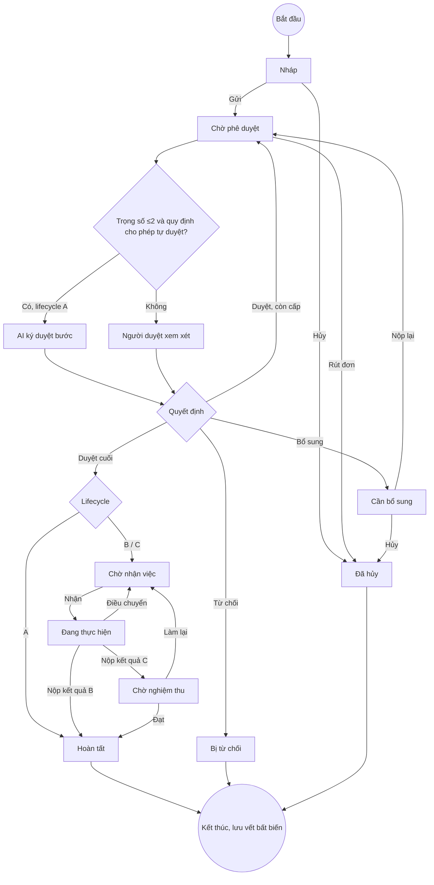

# 04 — Sơ đồ hoạt động (DOCX 2.2.9 + Phụ lục B)

> Có 10 sơ đồ AD-01…AD-10. **Cả 10 ảnh đều mang chú thích sai** (bảng `00` §3.2). Tệp này sắp theo mã thật in trong ảnh.
> Các ảnh đều vẽ theo kiểu swimlane BPMN-like và dùng ngôn ngữ nghiệp vụ dễ hiểu. Đây là điểm mạnh và nên giữ.
> Sơ đồ chuẩn hoá dùng `flowchart TD` của Mermaid; nhãn trong `|...|` là điều kiện nhánh.

## Bảng tổng hợp

| Mã | Ảnh thật | Chú thích DOCX hiện tại | Chủ đề | Đánh giá |
|---|---|---|---|---|
| AD-01 | img_011 | Hình 2.6 | Vòng đời tổng thể | KHỚP (4 điểm cần sửa) |
| AD-02 | img_040 | PL-08 | Gửi đơn & kiểm tra tự động | LỆCH NHẸ (1–3 cấp; thiếu AI) |
| AD-03 | img_038 | PL-06 | Cấp trên xử lý phê duyệt | LỆCH NGHIỆP VỤ (người duyệt kế tiếp vắng) |
| AD-04 | img_012 | Hình 2.7 | Thực hiện & nghiệm thu | LỆCH NGHIỆP VỤ (2 điểm) |
| AD-05 | img_013 | Hình 2.8 | Chuyển giao khi vắng | KHỚP (thiếu ủy quyền) |
| AD-06 | img_041 | PL-09 | SLA nhắc & cảnh báo | KHỚP ảnh; text DOCX sai |
| AD-07 | img_010 | Hình 2.5 | Ban hành quy chế | KHỚP một phần (thiếu chạy thử) |
| AD-08 | img_042 | PL-10 | Cập nhật nhân sự & quyền | KHỚP |
| AD-09 | img_043 | PL-11 | Quyền riêng tư & tiêu hủy | THIẾU HIỆN THỰC (duyệt kép) |
| AD-10 | img_039 | PL-07 | Nghiệm thu & go-live | KHỚP quy trình; là quy trình vận hành |

---

## AD-01 — Vòng đời tổng thể xử lý một yêu cầu
**Swimlane:** Nhân viên | Cấp trên | Nhân viên chuyên trách | Hệ thống.

**Nội dung ảnh.**
1. Nháp → [tự hủy] Đã hủy; hoặc [nộp] Đang chờ phê duyệt.
2. Khi đang chờ: [rút trước khi duyệt] Đã hủy; hoặc Cấp trên xem xét.
3. Quyết định của cấp trên:
   - [duyệt, còn cấp] chờ duyệt tiếp;
   - [từ chối] kết thúc;
   - [bổ sung] → [nộp lại] quay lại chờ duyệt, hoặc [không nộp, hủy] Đã hủy;
   - [cấp cao nhất đồng ý] → hệ thống phân loại.
4. Phân loại sau duyệt:
   - [nghỉ phép] Hoàn tất;
   - [cấp quyền / mua sắm] Chờ nhận việc → Đang làm (có thể phân công lại) → hình thức bàn giao.
5. Hình thức bàn giao: [cấp quyền] Hoàn tất; [mua tài sản] Chờ nghiệm thu → [không đạt] làm lại hoặc [đạt] Hoàn tất → Lưu trữ.

**Đối soát với FSM** (`02` §3): mọi nhánh trong ảnh đều có transition hợp lệ trong `guard_request`.

| # | Điểm cần sửa | Đề xuất |
|---|---|---|
| 1 | Phân loại theo **ví dụ** (nghỉ phép / cấp quyền / mua tài sản) thay vì theo lifecycle | Đổi nhãn nhánh thành `[A]`, `[B]`, `[C]` |
| 2 | Không có nhánh AI tự duyệt | Thêm "AI tự duyệt [trọng số ≤ 2]" ở lane Hệ thống |
| 3 | "Không đạt, làm lại" quay về "Chờ nhận việc". Đúng với code: REWORK → READY_FOR_EXECUTION | KHỚP; giữ |
| 4 | Lane "Nhân viên chuyên trách" chứa cả "Chờ nghiệm thu" và "Kết quả nghiệm thu", trong khi người nghiệm thu là Nhân viên (người tạo) | Chuyển hai nút này sang lane Người nghiệm thu |

## AD-02 — Gửi đơn và kiểm tra tự động
**Swimlane:** Nhân viên | Hệ thống (kiểm tra) | Hệ thống (định tuyến & lưu).

**Nội dung ảnh.** Bấm Nộp → kiểm đăng nhập & an toàn mạng → tạm khoá đơn → kiểm quyền gửi loại đơn → kiểm mẫu đơn có phải bản mới nhất → kiểm đủ mục và tệp không virus → đóng băng nội dung → tìm danh sách người duyệt **(1 đến 3 cấp)** → kiểm không để sếp tự duyệt đơn của mình → khởi tạo đợt duyệt & SLA → bật chờ duyệt cấp 1 → ghi nhật ký → lưu → ĐANG CHỜ PHÊ DUYỆT → thông báo thành công.

**Đối soát với `submit_request`** (`service.py:1311-1546`):

| Bước ảnh | Code | Kết quả |
|---|---|---|
| Tạm khoá đơn | `SELECT … FOR UPDATE` + `expected_version` (`ERR_VERSION_CONFLICT` 409) | KHỚP |
| Quyền gửi | `_authorize(role="REQUESTER", type_id)` | KHỚP |
| Mẫu đơn mới nhất | Lấy `active_release_id` tại thời điểm gửi. Nháp tạo từ release cũ vẫn gửi được nếu payload hợp lệ theo schema mới | LỆCH NHẸ. Code tốt hơn: không bắt người dùng nhập lại khi quy chế đổi |
| Tệp không virus | Tệp đã CLEAN từ lúc upload; khi submit chỉ kiểm `scan_state='CLEAN'` | KHỚP |
| 1–3 cấp | **1–5 cấp** (`routing.py:298`, `request.approval_level` 1..5) | **Sửa DOCX** |
| SoD | `_validate_resolved_actors` | KHỚP (nhưng xem R07 tại `02` §4) |
| Thiếu bước | Sau khi commit, outbox `APPROVAL_REQUESTED` → worker gọi `try_auto_approve` | Bổ sung nút "AI đánh giá tự duyệt (bất đồng bộ)" |
| Thiếu bước (quyết định D7) | Màn hình xem lại trước khi gửi | Bổ sung (đã chốt, chưa làm) |

## AD-03 — Cấp trên xử lý phê duyệt
**Swimlane:** Cấp trên | Hệ thống (kiểm tra) | Hệ thống (phân luồng & lưu).

**Nội dung ảnh.** Mở hồ sơ → tạm khoá → kiểm đúng thẩm quyền và đơn chưa hủy → chọn quyết định:
- **Duyệt:** người cấp tiếp có sẵn sàng? [vắng] → **BÁO LỖI** "người duyệt tiếp đang nghỉ / chưa phân công"; [sẵn sàng] → còn cấp thì chuyển lên; cấp cuối thì phân loại.
- **Từ chối:** lý do ≥ 10 chữ?
- **Bổ sung:** đã ghi rõ giấy tờ cần nộp?

Sau đó: đóng đồng hồ hạn chót → ghi nhật ký & chuông → lưu vĩnh viễn.

**Đối soát.**

| Điểm | Code | Phán quyết |
|---|---|---|
| Người duyệt kế tiếp vắng → báo lỗi | `_substitute_approver` (`service.py:1652`): **chuyển cho người được ủy quyền**, nếu không có thì **chuyển quản lý trực tiếp** khi attendance là ABSENT/LEAVE. Chỉ báo `ASSIGNEE_UNAVAILABLE` khi không còn ai hợp lệ | **Giữ code.** Báo lỗi làm người duyệt hiện tại bị kẹt vì lý do không thuộc trách nhiệm của họ. Sửa ảnh |
| Lý do ≥ 10 ký tự | 10–2000 | KHỚP |
| Nhánh "Bổ sung" → trả về nhân viên | NEEDS_INFO; tệp cũ được chép về nháp | KHỚP |
| Thiếu | Approver cuối của B/C có thể **chỉ định executor** (`assigned_executor_id`, `_validate_assigned_executor`) | Bổ sung |

## AD-04 — Thực hiện công việc và nghiệm thu bàn giao
**Swimlane:** Hệ thống | NV chuyên trách | Quản trị viên | Người xin đơn (nghiệm thu).

**Nội dung ảnh.**
1. Chờ nhận việc → [báo bận] nhờ điều phối; hoặc [nhận] → thi công.
2. Trong khi thi công: [vướng] báo vướng rồi tiếp tục; [bị thay người] quản trị viên đổi người.
3. Hoàn thành → nộp biên bản + ảnh hoá đơn → hệ thống kiểm đủ bằng chứng → phân loại:
   - [cấp quyền] xong;
   - [mua tài sản] → người xin đơn kiểm tra → [đạt] thành công; [không đạt] → "người mua ban đầu còn đi làm?" → [có] mở đợt mới; [vắng] báo lỗi, quản lý chỉ định người mới.

**Đối soát.**

| Điểm | Code | Phán quyết |
|---|---|---|
| "Hệ thống kiểm đủ bằng chứng" | Không bắt buộc tệp; chỉ bắt buộc `result_note` và `external_reference` | LỆCH NGHIỆP VỤ. Khuyến nghị: lifecycle C phải có ≥ 1 tệp `execution_attachment` (xem `03` UC-BIZ-03) |
| Rework khi người làm cũ vắng → báo lỗi | `_pick_present_executor` (`service.py:1738`) chọn executor **đang có mặt**; nếu không có thì `ASSIGNEE_UNAVAILABLE` 409 | Code tự xử lý, tốt hơn. Sửa ảnh |
| Người nghiệm thu = người xin đơn | Tuỳ loại đơn (5 slot acceptor) | LỆCH NHẸ. Đổi lane thành "Người nghiệm thu (theo quy chế)" |
| Báo bận / báo vướng | `execution_issue` UNABLE_TO_CLAIM / BLOCKED. **Không** tự điều chuyển, **không** dừng SLA | KHỚP ảnh SD-21 |

## AD-05 — Chuyển giao người xử lý khi vắng mặt
**Swimlane:** Bộ phận điều phối | Hệ thống kiểm tra | Hệ thống cập nhật.

**Nội dung ảnh.**
1. Chọn hồ sơ + người thay + lý do → kiểm thẩm quyền → khoá → đơn còn mở? → người mới đi làm và đúng chức vụ?
2. Xác định vị trí cần thay:
   - người duyệt (giữ hạn);
   - người làm (khi chưa ai nhận);
   - người đang làm (hủy đợt cũ, giao lượt mới);
   - người nghiệm thu;
   - người làm lại dự kiến.
3. Ghi nhật ký + chuông → người cũ mất quyền.

**Đối soát.** `ops_service.reassign_actor` với `target_kind ∈ {APPROVAL_STEP, EXECUTOR, ACCEPTOR, PLANNED_EXECUTOR}`. Năm vị trí trong ảnh ánh xạ đúng. "Hủy đợt cũ, giao lượt mới" ứng với `closure_kind='REASSIGNED'` + attempt mới. **KHỚP.**

**Thiếu so với text PL-06.**
- Nhánh **tự ủy quyền** (delegate) do chính người duyệt đặt trước. Hiện thực: `approval_delegation`, `delegations/candidates`.
- Điều kiện "delegate phải cùng hoặc cao cấp hơn" **không có trong code**: code chỉ kiểm delegate là APPROVER hợp lệ cho loại đơn và phòng ban, và không phải requester.

**Phán quyết.**
- Bổ sung nhánh ủy quyền vào ảnh.
- Điều kiện "cùng hoặc cao cấp hơn" không đo được vì không có bảng cấp bậc. **Bỏ khỏi DOCX**; thay bằng "delegate phải có vai trò APPROVER cho đúng loại đơn và phòng ban".

## AD-06 — Tự động nhắc tiến độ và cảnh báo trễ hạn
**Swimlane:** Hệ thống quét SLA | Bưu điện nội bộ | Bộ phận kỹ thuật.

**Nội dung ảnh.**
1. Quét **mỗi phút** → rà đơn chờ duyệt/làm → khoá tạm → còn mở?
2. Mức thời gian: [< 50%] bỏ qua; [qua **50%**] cảnh báo sắp hạn; [trễ 100%] ghi vi phạm.
3. Ghi sổ, tạo thông báo → hộp thư người nhận hoạt động? → gửi chuông.
4. Lỗi gửi → thử lại lần 1, 2, 3 → quá 4 lần thì báo động kỹ thuật → gửi lại thủ công.

**Đối soát.** `worker.process_sla_batch`, `classify_sla_alert` (nhắc ở 1/2), `fail_outbox` (DEAD khi `attempts ≥ 4`), `ops/outbox/{id}/replay`. **Ảnh KHỚP code.**

**DOCX text sai.** Đoạn mô tả PL-09 (ứng với ảnh này) ghi "quét **5 phút**, nhắc **80%**, email trưởng phòng và BOD". Bảng 2.9 ghi 80/100/150%. Xem quyết định ở `02` §5.

**Bổ sung đề xuất.** Ở nhánh "trễ 100%" thêm cấu hình D3: [nhắc] gửi assignee + quản lý trực tiếp; [tự chuyển] gọi reassign sang delegate hoặc quản lý.

## AD-07 — Ban hành và cập nhật quy chế mẫu đơn
**Swimlane:** Người quản lý quy chế | Hệ thống.

**Nội dung ảnh.** Sao chép quy chế đang dùng thành nháp → sửa (mẫu đơn, hạn mức, số cấp duyệt, hẹn giờ) → hệ thống kiểm chuẩn mẫu và không có công thức độc hại → **chạy thử trên bộ hồ sơ mẫu giả định** → kết quả ưng ý? → gửi lệnh ban hành → kiểm thẩm quyền và phiên bản → đóng băng BAN HÀNH → giao diện dùng mẫu mới → đơn mới theo quy chế này.

**Đối soát.**

| Bước | Code | Kết quả |
|---|---|---|
| Clone → nháp | `config_service` tạo release DRAFT từ bản đang hiệu lực | KHỚP |
| Kiểm chuẩn mẫu | Trigger kiểm `route_rules`/`sla_profile` (`schema.sql:720-760`) + `routing._validate_route_rules_structure` | KHỚP |
| Chạy thử bộ hồ sơ mẫu | `config-releases/{id}/validate` và `requests/route-preview` cho **một** payload | THIẾU một phần. Chưa có bộ ca kiểm thử biên lưu cùng release. Mức P1: lưu `test_vectors` trong release và chạy toàn bộ khi validate |
| Đóng băng | Trigger cấm UPDATE/DELETE release PUBLISHED (`schema.sql:703`). `content_sha256`, swap `active_release_id` nguyên tử | KHỚP |
| Đơn cũ giữ quy chế cũ | `request_revision.release_id` | KHỚP |
| Thiếu | Khi đổi **quy định công ty** (văn bản), hệ thống tạo **AI learning job** và khoá cổng nhân viên tới khi học xong (migration 12) | Bổ sung một nhánh song song |

## AD-08 — Cập nhật danh sách nhân sự và phân quyền
**Swimlane:** Cán bộ nhân sự | Hệ thống kiểm tra | Hệ thống cập nhật & bảo mật.

**Nội dung ảnh.** Nhận Excel/CSV đã được GĐ ký → đọc tệp, tạo mã niêm phong → kiểm mã NV, email, chức vụ, ngày vào làm → kiểm sơ đồ tổ chức (không tự làm cấp trên của mình) → có dòng lỗi? → [có] báo lỗi từng dòng, không nạp dở; [không] báo cáo kế hoạch X/Y/Z → cán bộ đối chiếu mã niêm phong và xác nhận → áp dụng → cập nhật mã bảo mật, buộc đăng xuất tài khoản bị thu hồi → nhật ký → thành công, hoặc khôi phục toàn bộ.

**Đối soát.** Lệnh `identity_import` (dry-run/apply, cùng file hash), tăng `security_epoch`, `auth_version`, ghi `admin_event`, toàn bộ trong một giao dịch. **KHỚP.**

**Lưu ý.** Web admin còn có đường **sửa từng người** (`org_users_rbac.py`). Đường này cũng tăng `auth_version`. Nên bổ sung một nhánh nhỏ vào ảnh.

## AD-09 — Xử lý quyền riêng tư và tiêu hủy hồ sơ
**Swimlane:** Cán bộ pháp chế | Lãnh đạo thứ hai | Hệ thống.

**Nội dung ảnh.** Tiếp nhận đề nghị xoá → xác minh danh tính → phân loại căn cứ → đang phong toả pháp lý / thuế? → [có] từ chối, nêu căn cứ → [đủ điều kiện] lập danh sách, chạy thử phạm vi → **lãnh đạo thứ hai duyệt kép** → đóng quyền truy cập → xoá / bôi đen → biên bản tiêu hủy → kiểm lại → cập nhật kho, bản sao không khôi phục → trả lời.

**Đối soát.**

| Bước | Code (`management/commands/privacy_case.py`) | Kết quả |
|---|---|---|
| Kiểm legal hold | Đếm `retention_hold` chưa giải toả theo requester; `BLOCKED_BY_HOLD` | KHỚP |
| Chạy thử | `--action dry-run` | KHỚP (chỉ in số hold, chưa liệt kê đối tượng sẽ xoá) |
| **Duyệt kép** | `--action approve --approval <tham chiếu>`. **Một người** chạy với một chuỗi tham chiếu tự do; không kiểm người duyệt thứ hai, không ràng buộc manifest hash | **THIẾU HIỆN THỰC.** Vi phạm four-eyes mà chính DOCX đặt ra. P1: bảng `privacy_case_approval(case_id, approver_id, manifest_sha256)`; `execute-erase` yêu cầu hai approver khác nhau và khác operator |
| Biên bản không chứa nội dung đã xoá | `admin_event` tối thiểu | KHỚP |
| Bản sao không khôi phục (suppression) | Không có | THIẾU (P2; phụ thuộc chính sách backup của Supabase) |

## AD-10 — Kiểm tra nghiệm thu và đưa phần mềm vào sử dụng
**Swimlane:** QA/UAT | Hệ thống triển khai | Bộ phận kỹ thuật.

**Nội dung ảnh.**
1. Bản ứng viên → kiểm tra đợt 3 đạt? → UAT + diễn tập khôi phục → đợt 4 đủ biên bản?
2. Bật bảo trì (tạm dừng nộp đơn ≤ 60 giây) → dừng chạy ngầm, chụp backup → cài bản mới + nâng cấp CSDL → smoke test & đối soát.
3. [lỗi] khôi phục bản cũ; [ok] tắt bảo trì → giám sát 60 phút → thành công.

**Đối soát.**
- `api_core/maintenance.py` + `system/maintenance/{start,complete}`: chặn ghi khi bảo trì → KHỚP.
- Migration có kèm rollback (`database/migrations/rollback/08–13`) → KHỚP.
- Quy trình QA gate ở `.github`/`report_conformance.py`/`tests_readiness`.

**Phán quyết.** KHỚP. Sơ đồ này là **quy trình vận hành**, không phải nghiệp vụ người dùng; nên chuyển sang Chương 3 (triển khai).
