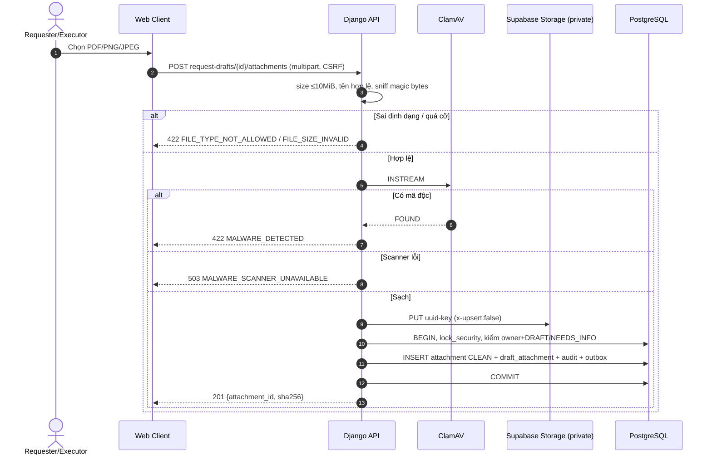
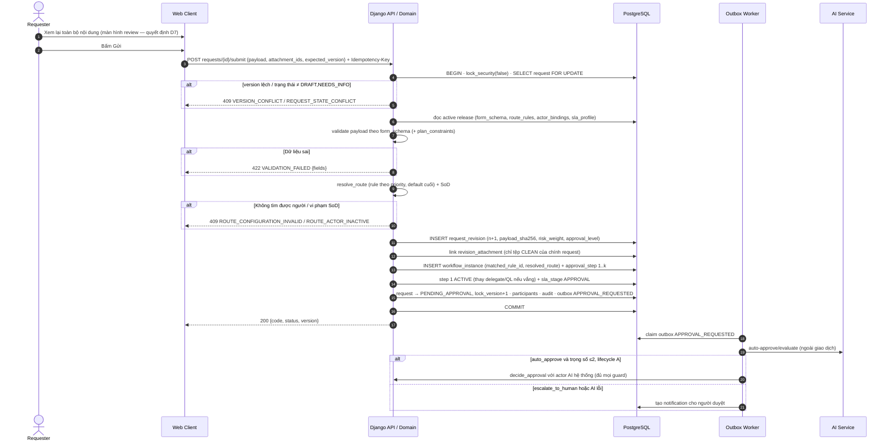
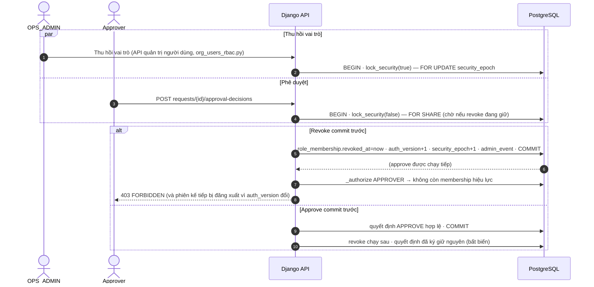
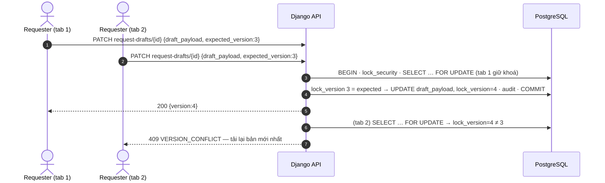
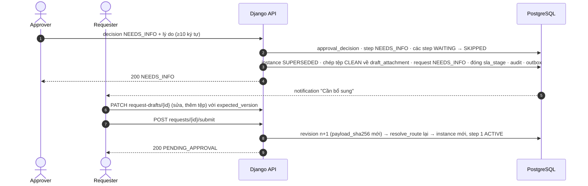

# 05 — Sơ đồ tuần tự (DOCX 2.2.10 + Phụ lục C, Bảng PL-2)

> Có 22 sơ đồ SD-01…SD-22. DOCX có **18 ảnh thật**, nhưng chú thích sai toàn bộ (`00` §3.2). **4 sơ đồ không có ảnh**: SD-03, SD-12, SD-19, SD-20. Tệp này vẽ đủ 4 sơ đồ đó bằng Mermaid theo đúng code.
> Ảnh SD do nhóm vẽ có chất lượng cao: dùng khung TRANSACTION, ALT, OPT, PAR và ghi Trace / Test. Phần **đoạn văn mô tả** ở Phụ lục C lệch ảnh và lệch code nhiều chỗ, nên phải sửa theo ảnh.
> Quy ước chung của mọi lệnh ghi trong code, nên ghi một lần vào 2.2.10:
> 1. `BEGIN`;
> 2. `SELECT eas.lock_security(false)` (khoá chia sẻ trên `security_epoch`);
> 3. khoá dòng `FOR UPDATE` theo thứ tự request → instance → step/attempt;
> 4. kiểm `expected_version` (khác thì trả 409);
> 5. kiểm `Idempotency-Key` (`_execute_idempotent`);
> 6. ghi nghiệp vụ → `audit_event` (hash-chain) → `outbox_event` → `COMMIT`.

## Bảng tổng hợp

| Mã | Ảnh thật | Chủ đề | Đối soát ảnh ↔ code | Đối soát text ↔ code |
|---|---|---|---|---|
| SD-01 | img_046 | Đăng nhập, phiên, đăng xuất | KHỚP | LỆCH (Redis session) |
| SD-02 | img_055 | Upload, quét, chọn tệp | LỆCH NGHIỆP VỤ | LỆCH |
| SD-03 | *không có* | Submit / Resubmit nguyên tử | — (vẽ mới) | mô tả chép nhầm |
| SD-04 | img_047 | Approve / Reject / Needs-info | KHỚP | mô tả chép nhầm |
| SD-05 | img_050 | Rút đơn tranh chấp duyệt cuối | KHỚP | LỆCH NHẸ (tên trạng thái) |
| SD-06 | img_048 | Claim, nộp kết quả, nghiệm thu | KHỚP | mô tả chép nhầm |
| SD-07 | img_059 | Reassign executor đang chạy | KHỚP | LỆCH NHẸ (tên event) |
| SD-08 | img_056 | SLA / outbox lease, retry, replay | KHỚP logic, khác hằng số | mô tả chép nhầm |
| SD-09 | img_057 | Publish config release | KHỚP (1–3 → 1–5 cấp) | KHỚP |
| SD-10 | img_045 | Chống IDOR | KHỚP | LỆCH (quản lý cùng phòng) |
| SD-11 | img_014 | Import danh tính, thu hồi phiên | KHỚP | LỆCH (Redis xoá key) |
| SD-12 | *không có* | Thu hồi quyền tranh chấp duyệt | — (vẽ mới) | KHỚP |
| SD-13 | img_049 | Audit append & checkpoint | append KHỚP; checkpoint THIẾU | idem |
| SD-14 | img_053 | Privacy purge có legal hold | THIẾU (duyệt kép) | idem |
| SD-15 | img_052 | Đọc thông báo | KHỚP | LỆCH (Redis / WebSocket) |
| SD-16 | img_060 | Báo cáo theo scope | KHỚP | LỆCH (URL) |
| SD-17 | img_058 | Cutover & rollback | KHỚP (vận hành) | **text mô tả sơ đồ khác hẳn** |
| SD-18 | img_054 | PITR & đối soát | vận hành | KHỚP |
| SD-19 | *không có* | Lưu nháp khoá lạc quan | — (vẽ mới) | LỆCH NHẸ (tên cột) |
| SD-20 | *không có* | Needs-info & nộp lại | — (vẽ mới) | LỆCH NGHIỆP VỤ |
| SD-21 | img_044 | Không thể nhận / báo vướng | KHỚP | LỆCH (dừng SLA, BLOCKED) |
| SD-22 | img_051 | Reassign approver / acceptor | KHỚP | LỆCH NHẸ (URL, event) |

---

## SD-01 — Đăng nhập, phiên và đăng xuất (img_046 · UC01, FR01, NFR01)

**Ảnh.**
1. `GET /auth/csrf` trả token và cookie.
2. `POST /auth/login`, sau đó kiểm rate-limit theo user và IP:
   - vượt ngưỡng → 429 + Retry-After;
   - sai thông tin → ghi security event, trả 401 `AUTH_FAILED` chung chung;
   - đúng → verify Argon2, kiểm active và cờ bắt đổi mật khẩu, rotate session ID gắn `security_epoch`, trả 200 kèm quyền.
3. Phiên hết hạn khi rỗi 30 phút hoặc đủ 8 giờ tuyệt đối → 401 `SESSION_EXPIRED`.
4. `POST /auth/logout` → 204, xoá cookie.

**Code.**
- `authn/urls.py`.
- `login_throttle.py`: khoá đếm theo **hash** email và IP, cửa sổ cố định 15 phút, 5 lần/tài khoản và 30 lần/IP; Nginx 5 request/phút.
- Session `signed_cookies` 8 giờ (`settings.py:120,128`).
- Rỗi: khoá Redis `eas:idle:{session_id}` (`authn/service.py:222`).
- Kiểm `auth_version` của user ở **mỗi request** (`service.py:240`).

**Text PL / 2.2.10.** Ghi "Redis session TTL 8 giờ". Thực tế phiên nằm trong cookie ký; Redis chỉ giữ dấu rỗi và bộ đếm throttle.

**Phán quyết:** ảnh KHỚP. Sửa text.

## SD-02 — Upload, quét và chọn tệp (img_055 · UC03, FR05, NFR09)

**Ảnh (bất đồng bộ 2 pha).**
1. Gửi metadata; kiểm owner, state, 10 MiB, **tối đa 5 tệp**, **quota 200 MiB**.
2. Tạo attachment `QUEUED` + ticket, client upload thẳng lên storage, gọi complete.
3. Enqueue scan, trả 202. Scanner đọc object cách ly và ghi `CLEAN`/`INFECTED`/`ERROR`.
4. Bước link riêng.

**Code (đồng bộ 1 pha)** (`attachments.register_attachment`):
1. Kiểm kích thước ≤ 10 MiB và tên tệp.
2. Sniff magic bytes: chỉ PDF, PNG, JPEG.
3. Quét ClamAV `INSTREAM`.
4. Đặt tên `uuid4`, tính SHA-256, ghi Supabase Storage bucket riêng tư, ghi `attachment` với `scan_state='CLEAN'`, audit + outbox.

Code **không** có giới hạn 5 tệp và **không** có quota 200 MiB.

**Phán quyết.**

| Điểm | Chọn |
|---|---|
| Đồng bộ hay bất đồng bộ | **Giữ đồng bộ cho P0.** Tệp ≤ 10 MiB quét dưới 1 giây; tệp bẩn không bao giờ vào kho. Cách này bỏ được trạng thái QUEUED/ERROR và job dọn dẹp. Sửa ảnh. Giá trị `QUEUED`/`ERROR` trong CHECK để dành cho P2 |
| Giới hạn 5 tệp / 200 MiB | THIẾU HIỆN THỰC. Rủi ro lạm dụng dung lượng (OWASP API4: unrestricted resource consumption). **Thêm vào code**: đếm tệp chưa xoá theo request; mỗi request ≤ 5 tệp và tổng ≤ 50 MiB (200 MiB là quá lớn cho đơn nội bộ) |
| Upload thẳng lên storage | **Không làm.** Hiện tại browser không nói chuyện trực tiếp với Supabase (AGENTS.md); proxy qua API giữ được kiểm tra magic bytes trước khi lưu |

## SD-03 — Submit / Resubmit nguyên tử *(không có ảnh, vẽ mới theo `service.submit_request`)*

Đoạn mô tả Hình 2.10 của DOCX chép nhầm từ Hình 2.1. Sơ đồ đúng:

## SD-04 — Approve, Reject, Needs-info (img_047 · UC06–07, FR07–09)
Ảnh vẽ khung TRANSACTION với các nhánh:
- sai actor/state/version → 403/409;
- thiếu lý do → 422;
- REJECT → instance/request REJECTED, bước còn lại SKIPPED;
- NEEDS_INFO → instance SUPERSEDED, clone nháp;
- APPROVE → người kế tiếp không hợp lệ thì 409 `ASSIGNEE_UNAVAILABLE`; còn bước thì PENDING_APPROVAL; cuối A thì COMPLETED; cuối B/C thì tạo attempt READY + SLA và chuyển READY_FOR_EXECUTION.

**Code:** `decide_approval`, `_handle_approval_approved`, `_handle_approval_rejected_or_needs_info` (`service.py:1848-2226`). **KHỚP 1:1.**

Hai chi tiết ảnh chưa vẽ:
1. Trước khi kích hoạt bước kế tiếp, hệ thống thay người bằng delegate hoặc quản lý trực tiếp nếu người đó vắng.
2. Approver cuối của B/C có thể chỉ định executor.

## SD-05 — Rút đơn tranh chấp với duyệt cuối (img_050 · UC08, FR10, NFR10)
Ảnh dùng khối PAR cho hai giao dịch cùng khoá một dòng; giao dịch đến sau nhận 409 `REQUEST_STATE_CONFLICT`. **KHỚP** `cancel_request` và `decide_approval` (`FOR UPDATE` + `lock_version`).

Text PL-13 dùng `APPROVED`/`ACTIVE`/`IN_REVIEW`. Phải sửa thành `COMPLETED`/`READY_FOR_EXECUTION`/`PENDING_APPROVAL`.

## SD-06 — Claim, nộp kết quả, nghiệm thu / làm lại (img_048 · UC10–12, FR12–13)
**KHỚP** `start_execution`, `submit_execution`, `decide_acceptance`:
- B: FINISHED/SUCCESS → COMPLETED.
- C: SUBMITTED → WAITING_FOR_ACCEPTANCE.
- ACCEPT → COMPLETED.
- REWORK → attempt mới READY.
- Executor dự kiến không hợp lệ → 409.

## SD-07 — Reassign khi executor đang chạy (img_059 · UC09, BR09–10)
**KHỚP** `ops_service._reassign_executor`:
- attempt READY: đổi người tại chỗ, giữ SLA;
- attempt RUNNING: đóng attempt cũ `FINISHED/REASSIGNED`, tạo attempt mới READY, request → READY_FOR_EXECUTION, giữ `sla_stage`.

Trigger chặn đổi executor của attempt đang chạy (`schema.sql:925`).

Text PL-14 ghi event `ADMIN_REASSIGN_EXECUTOR`; code ghi `ACTOR_REASSIGNED` kèm `target_kind`. Sửa text.

## SD-08 — SLA / outbox lease, retry, replay (img_056 · UC14, FR14–15, NFR04)

| Thông số | Ảnh | Code |
|---|---|---|
| Chu kỳ quét SLA | 60 giây | 2 giây (cùng vòng lặp, `run_outbox_worker --poll-seconds 2`) |
| Ngưỡng nhắc | 50% | 50% |
| Poll outbox | 5 giây | 2 giây |
| Lease | 60 giây | 60 giây (`claim_outbox lease_seconds=60`) |
| Retry | 1 / 5 / 15 phút | 15 / 30 / 60 giây … tối đa 300 giây (`retry_delay`) |
| DEAD | lần thứ 4 | `attempts ≥ 4` |
| Replay | có lý do + đúng scope, giữ dedupe | `ops/outbox/{id}/replay` |

**Phán quyết:** KHỚP logic. Ghi các hằng số của code vào DOCX, hoặc chỉnh code theo ảnh. Chỉ cần thống nhất một bộ số; khuyến nghị giữ code vì backoff ngắn hợp với thông báo trong ứng dụng.

## SD-09 — Publish config release (img_057 · UC02, FR03/17/18)
**KHỚP** `config_service.create_or_clone_release` → `update_draft_release` → `validate_release_candidate` → `publish_config_release`:
- khoá `lock_security(true)`;
- kiểm hash, version;
- swap `active_release_id` nguyên tử;
- `admin_event`.

Ảnh ghi "1–3 slots": đây là giới hạn của lược đồ gốc. DB live đã nâng lên 1–5 (report_migrations 05). Sửa ảnh.

## SD-10 — Đọc chi tiết và tệp chống IDOR (img_045 · UC05, NFR02)
**Ảnh.** Kiểm active + owner / participant / AUDITOR + type + department snapshot + `read_revoked`:
- ngoài scope → **404** (không lộ title/count);
- OPS → chỉ metadata;
- tải tệp → kiểm lại quyền + scan state, ghi audit tải xuống.

**Code.** `views.py:476-497`, `attachments.py:360-420`, `ops/requests`. **KHỚP.**

Text PL-16 thêm điều kiện "(3) Quản lý cùng phòng ban được xem". **Không làm.** Điều kiện này vi phạm need-to-know: quản lý chỉ xem khi họ là participant (người duyệt). Sửa text.

## SD-11 — Import danh tính và thu hồi phiên (img_014 · UC17, FR01–02, BR12)
**KHỚP** lệnh `identity_import`: dry-run có file hash → apply cùng hash → khoá `security_epoch` → áp dụng → tăng epoch + `admin_event` → COMMIT hoặc ROLLBACK toàn bộ.

"Invalidate session": code **không xoá key Redis**. Code tăng `auth_version` của user, nên request kế tiếp bị từ chối tại `load_actor_from_session`. Hiệu quả tương đương, và không phụ thuộc Redis còn sống. Text PL-17 ("xoá `eas:session:{id}` trong Redis") **sai**; sửa theo code.

## SD-12 — Thu hồi quyền tranh chấp với phê duyệt *(không có ảnh, vẽ mới)*

Code:
- mọi lệnh nghiệp vụ lấy `lock_security(false)` = `FOR SHARE` trên `security_epoch`;
- mọi thay đổi bảo mật (thu hồi vai trò, khoá tài khoản, đổi mật khẩu) lấy `lock_security(true)` = `FOR UPDATE` (`schema.sql:617-624`, `org_users_rbac.py:841,946,1003`).

Hai loại giao dịch vì vậy được tuần tự hoá.

## SD-13 — Ghi audit và kiểm chứng checkpoint (img_049 · UC15, FR17, BR14)

**Phần append: KHỚP** `_append_request_audit` / `_append_admin_audit` (`service.py:148-288`):
- khoá `audit_head`;
- RFC 8785 + NFC;
- SHA-256(prev ‖ canonical);
- rollback cả giao dịch nếu lệch.

**Phần checkpoint exporter: THIẾU HIỆN THỰC.** Live `audit_checkpoint` có 0 dòng; không có lệnh xuất. Verify hiện so lại chuỗi **trong DB**, chưa đối chiếu với neo ngoài. Text PL-19 ghi "mỗi 1.000 sự kiện"; nên chốt "hằng ngày hoặc mỗi 1.000 sự kiện, tuỳ điều kiện nào đến trước".

## SD-14 — Privacy purge có legal hold (img_053 · KD06)

| Bước ảnh | Code |
|---|---|
| Dry-run + manifest hash | Dry-run chỉ đếm hold; **không có manifest** |
| Second reviewer duyệt đúng manifest hash | **Không có**; `approve` một người, tham chiếu tự do |
| Purge theo dependency, tombstone object version | `execute-erase` có kiểm hold. Phạm vi xoá xem `privacy_case.py:130+` |
| Suppression manifest cho restore sau này | Không có |

**Phán quyết:** THIẾU HIỆN THỰC (four-eyes). Đề xuất ở `04` AD-09.

## SD-15 — Đọc và đánh dấu thông báo (img_052 · UC13, FR14)
**Ảnh.** `GET /notifications?cursor` (chỉ của user) → mở link → kiểm lại quyền request (mất quyền thì 404) → đánh dấu đã đọc, idempotent (giữ `read_at` đầu tiên).

**Code.** `notifications`, `notifications/{id}`, `notifications/{id}/read`. **KHỚP.**

Text PL-21 thêm "đồng bộ badge xuống Redis + WebSocket tới mọi tab". **Không có trong code**; client dùng polling. Bỏ khỏi text, hoặc ghi P2 (SSE).

## SD-16 — Báo cáo theo scope và kiểm soát mẫu số (img_060 · UC15, FR16/19)
**Ảnh.** Dựng predicate quyền **trước** khi aggregate; đếm request phân biệt (không đếm revision); mẫu số = 0 thì tỷ lệ null, hiển thị N/A; kênh admin không mở rộng quyền nội dung.

**Code.** `reports/requests`, `reports/team` (`workflow/reporting.py`). **KHỚP.**

Text PL-22 dùng URL `/api/v1/reports/sla-compliance`; **URL này không tồn tại**. Sửa.

## SD-17 — Cutover và rollback có kiểm soát (img_058 · RB01–RB05)

**Ảnh.**
1. Xác nhận các gate G3, G4, UAT, KD06, KD08.
2. Bật bảo trì (503 cho lệnh ghi), drain ≤ 60 giây, dừng worker, chụp backup ID/LSN và manifest object.
3. Deploy image N, chạy migration expand-compatible, smoke + đối soát.
4. [PASS] tắt bảo trì, giám sát 60 phút; [FAIL] rollback image N-1, tuỳ chọn khôi phục dữ liệu.

**Text PL-23 mô tả sơ đồ khác hẳn**: "failover tự động khi DB chính sập 3 chu kỳ, thăng cấp Standby Replica". Mô tả này **không có trong ảnh, không có trong code**; Supabase quản lý HA. **DOCX SAI:** viết lại đoạn mô tả theo ảnh.

Code hỗ trợ: `system/maintenance/{start,complete}`, migration có rollback.

## SD-18 — Khôi phục PITR và đối soát (img_054 · NFR05, RB05)
Quy trình vận hành trên Supabase PITR. Công cụ đối soát hiện có:
- `database/EAS_Supabase_SQL/02_verify_installation_READ_ONLY.sql`;
- lệnh `audit_verify`;
- `check_schema_contract.py`.

**KHỚP** ở mức thủ tục. Chưa có "Reconciliation Tool" tự động so attachment với object version (P2).

## SD-19 — Lưu nháp chống ghi đè (khoá lạc quan) *(không có ảnh, vẽ mới)*

Text PL-25 viết `version_no` và `PATCH /requests/{id}/draft`. Code dùng `lock_version` và endpoint `PATCH /api/v1/request-drafts/{id}` với `expected_version`. Ngoài ra, trigger bắt mọi UPDATE tăng `lock_version` **đúng 1** (`schema.sql:802`).

## SD-20 — Yêu cầu bổ sung và nộp lại *(không có ảnh, vẽ mới)*

| Điểm | Text PL-26 | Code | Phán quyết |
|---|---|---|---|
| Trạng thái sau NEEDS_INFO | DRAFT | `NEEDS_INFO` | Giữ code (`02` §3.1) |
| Tệp cũ | — | Tệp CLEAN của revision hiện tại được chép về `draft_attachment` | Bổ sung vào DOCX |
| Duyệt lại từ đâu | "Từ bước đã yêu cầu bổ sung" | Instance cũ SUPERSEDED; instance mới **từ bước 1**, có thể đổi tuyến nếu số tiền thay đổi | **Giữ code** (`02` §3.2 T3) |
| Hash | "niêm phong mã băm mới" | `payload_sha256` của revision mới | KHỚP |

## SD-21 — Không thể nhận việc / báo vướng (img_044 · UC10–11, FR12/15)
**Ảnh.**
- Attempt READY → `UNABLE_TO_CLAIM`: giữ READY_FOR_EXECUTION và hạn, báo OPS.
- Attempt RUNNING → `BLOCKED`: giữ IN_PROGRESS và hạn, báo OPS.
- Ghi chú trong ảnh: "Issue **không** tự reassign, **không** dừng/đặt lại SLA".

**Code:** `report_execution_issue` (`service.py:805`): insert `execution_issue`, cập nhật version request, outbox; **không** đổi trạng thái attempt. **KHỚP ảnh.**

Text PL-27 ghi "chuyển attempt sang BLOCKED, tạm dừng SLA". Mô tả này **sai** với cả ảnh lẫn lược đồ: CHECK của attempt không có trạng thái `BLOCKED`. Giữ code; sửa text.

## SD-22 — Reassign người duyệt / nghiệm thu (img_051 · UC09, BR02/09/10)
**Ảnh.**
- Khoá security, request và target.
- Kiểm scope OPS và target còn đổi được.
- Kiểm actor mới: active, role, type, phòng ban, SoD toàn tuyến.
- Theo target:
  - step ACTIVE/WAITING → đổi assignee, **giữ SLA**;
  - acceptor trước khi quyết định → đổi acceptor + participant;
  - planned executor khi đang chờ nghiệm thu → đổi cho lần rework sau;
  - đã có quyết định → 409 `TARGET_IMMUTABLE`.
- Ghi audit old / new / reason.

**Code:** `reassign_actor` + `_reassign_approval_step` / `_reassign_acceptor` / `_reassign_planned_executor`. **KHỚP.**

Text PL-28 dùng URL `/requests/{id}/steps/{step_no}/reassign` và event `ADMIN_REASSIGN_APPROVER`. Code dùng `POST /requests/{id}/reassign {target_kind, …}` và event `ACTOR_REASSIGNED`. Sửa text.
