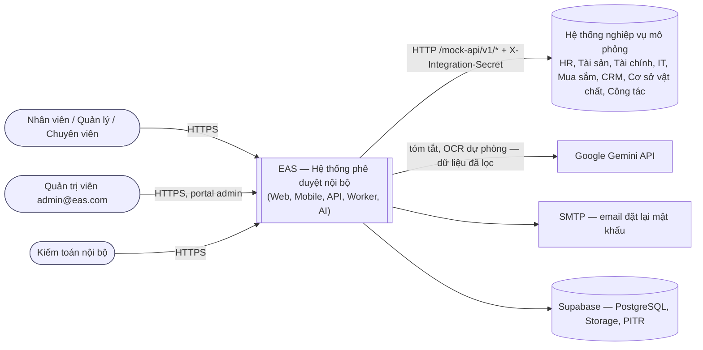
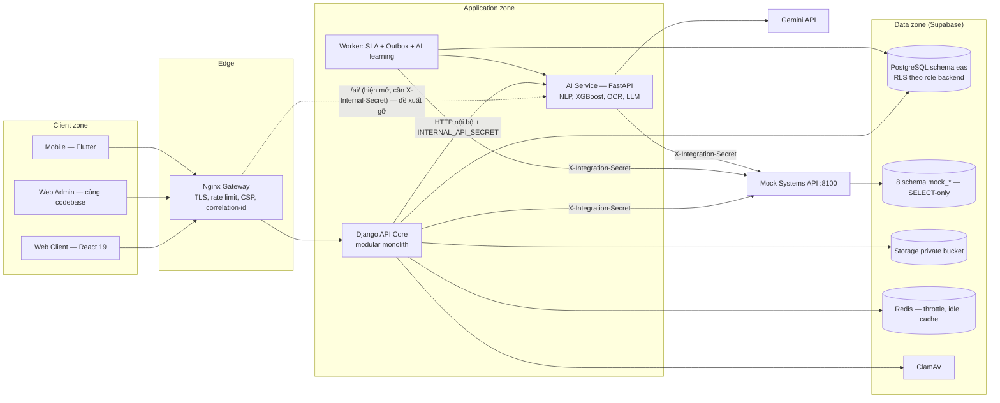
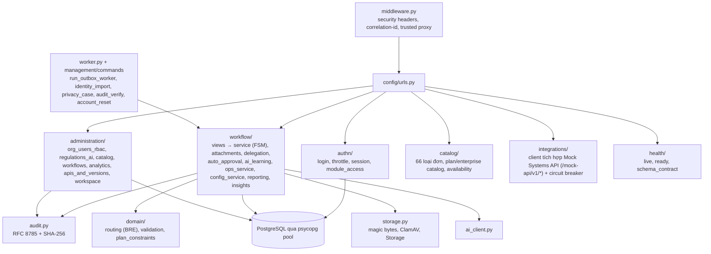
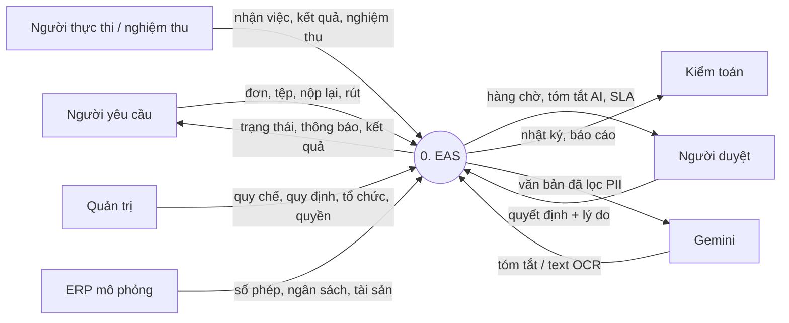

# 06 — Kiến trúc, thành phần, luồng dữ liệu và an ninh (DOCX 2.3.1, 2.3.4, 1.4)

> Sơ đồ trong phạm vi: AR-01, AR-02, AR-03, DFD-00, DFD-01, SEC-01, và DP-01 (có ảnh nhưng DOCX không chú thích).
> Trong thân báo cáo, cả 7 hình 2.14–2.18 và 2.22 đều là **ảnh lặp** của Hình 2.1/2.2. Ảnh thật của AR-02, DFD-01 và SEC-01 nằm ở phụ lục dưới chú thích ER-xx. AR-01, AR-03 và DFD-00 **không có ảnh**, nên được vẽ mới ở đây theo code.

## 1. Đối chiếu công nghệ (1.4 và 2.3.1)

| Tầng / thành phần | DOCX | Thực tế (bằng chứng) | Phán quyết |
|---|---|---|---|
| Web | React 18 + Vite, Axios interceptor | React **19.3.0**, Vite **8.3.4** (`web_client/package.json`). Gọi API bằng `fetch` (`web_client/src/api.js`). `web_admin` dùng lại mã `web_client` với `portal="admin"` (`web_admin/src/main.jsx`) | LỆCH NHẸ. Sửa phiên bản; ghi rõ "một codebase, hai portal" |
| Mobile | Flutter, FCM, sinh trắc học, phê duyệt nhanh | `mobile_app/lib` có 482 dòng: đăng nhập, danh sách, chi tiết, thông báo, đổi mật khẩu. Không có FCM, sinh trắc học hay thao tác duyệt | THIẾU HIỆN THỰC → thu hẹp mô tả |
| Gateway | Nginx: rate limit, chống DDoS, Correlation ID | `api_gateway/nginx.conf`: login 5 request/phút, upload 10/phút, AI 20/phút, API 60/phút; `client_max_body_size 10m`; header bảo mật + CSP; `X-Correlation-ID`; chặn `/api/v1/internal/` từ bên ngoài; chặn `/docs`, `/redoc`, `/openapi.json` | KHỚP. "Chống DDoS" nên đổi thành "giới hạn tần suất" vì Nginx đơn lẻ không chống được DDoS thể tích |
| Backend | Django REST Framework, ORM | **Django 5.2.18 thuần**, không DRF. **SQL tham số hoá qua psycopg 3** (pool), không dùng ORM cho schema `eas`. Logic nghiệp vụ nằm ở cả service Python và trigger PostgreSQL (`api_core/requirements.txt`) | LỆCH NHẸ. Sửa DOCX. Cách này hợp lý vì toàn vẹn được cưỡng chế ở DB (FSM, SoD, append-only) |
| Tác vụ nền | Redis + Celery | **Không có Celery.** Một tiến trình `manage.py run_outbox_worker`: SLA + outbox + AI learning job, lease trong DB | LỆCH NHẸ. Giữ code (bớt một hạ tầng) |
| Cache / phiên | Redis session store | Redis 8.0.3 dùng cho throttle, idle key, cache. **Phiên là cookie ký** | LỆCH NHẸ |
| CSDL | PostgreSQL 15 Supabase, multi-schema, PgBouncer | Supabase PostgreSQL (Sydney); schema `eas` + 8 schema `mock_*`; pool psycopg phía app (`settings.py:80-100`); RLS theo role backend | KHỚP |
| Lưu tệp | Supabase Storage private | `api_core/storage.py`: bucket riêng tư, `x-upsert:false`, tên uuid | KHỚP |
| Quét mã độc | ClamAV | `clamav/clamav:1.4.3` trong `docker-compose.yml`; `INSTREAM` đồng bộ | KHỚP |
| AI | FastAPI; NLP, XGBoost, OCR, Gemini | `ai_service/main.py` + 7 router. Gemini 1.5 Flash cho tóm tắt và OCR dự phòng; PaddleOCR 3.x là OCR chính (`paddlepaddle 3.3.1`, `paddleocr 3.7.0`, nâng 05/11 để vá CVE) | KHỚP (chi tiết ở `11`) |
| Tìm kiếm | — | ~~`elasticsearch:8.10.2` trong compose~~, không có code dùng | **Đã xoá 05/11** khỏi `docker-compose.yml` |
| Thư viện thừa | — | ~~`@supabase/supabase-js` và `src/supabase.js`~~ | **Đã xoá 05/11** ở `web_client` và `web_admin` (AGENTS.md: trình duyệt không gọi Supabase) |

## 2. AR-01 — Ngữ cảnh hệ thống (C4 mức 1) *(không có ảnh, vẽ mới)*

## 3. AR-02 — Container logic (img_073, đang chú thích "PL-41 ER-13")

**Ảnh.**
- Client zone: Web Client (HTTPS + CSRF), Web Admin / Controlled CLI (signed CLI).
- Application zone: Django API Core *modular monolith*; Scheduler/Worker dùng chung domain code.
- Data zone: Session/cache, PostgreSQL schema `eas`, File Scanner, Private Object Storage.
- Control & recovery zone: Logs/Metrics/Alerts, Encrypted backup, External Audit Checkpoint.

**Đối soát.**

| Container trong ảnh | Thực tế | Kết quả |
|---|---|---|
| Django API modular monolith + worker chung code | Đúng (`api_core`, `run_outbox_worker`) | KHỚP. Mô tả "Microservices" trong text 2.3.1 không đúng: chỉ AI là dịch vụ tách riêng. Ghi lại là "modular monolith + 1 AI microservice" |
| External Audit Checkpoint | Không có | THIẾU HIỆN THỰC |
| *(thiếu trong ảnh)* AI Service (FastAPI, port 8001) | Có | Bổ sung |
| *(thiếu)* Mobile App | Có (tối giản) | Bổ sung |
| *(thiếu)* Nginx gateway | Có | Bổ sung giữa client zone và application zone |
| *(thiếu)* 8 schema ERP mô phỏng | Có | Bổ sung vào data zone |

## 4. AR-03 — Thành phần của API Core *(không có ảnh, vẽ mới theo thư mục `api_core/`)*

## 5. DP-01 — Topology triển khai production đề xuất (img_069, đang chú thích "PL-37 ER-09")

**Ảnh.** DNS/TLS → Reverse Proxy/WAF → 2 instance Django API; Worker; *Singleton Scheduler with DB lease*; Scanner; PostgreSQL Primary → WAL → Standby / PITR; Versioned private object storage; Off-host encrypted backup; Observability.

**Đối soát.**
- Compose có các service: `web`, `web-admin`, `gateway`, `api`, `worker`, `redis`, `clamav`, `ai-service` (+ elasticsearch tuỳ chọn).
- Scheduler không tách riêng mà nằm trong worker. Lease nằm ở `outbox_event` và `ai_learning_job`, nên **chạy nhiều worker vẫn an toàn**.
- HA/PITR do Supabase đảm nhận.

**Phán quyết.** Ảnh có nhưng thiếu chú thích và thiếu mô tả. Thêm "Hình 2.x DP-01" vào mục 2.3.1 hoặc Chương 3, và ghi rõ: "đề xuất; môi trường hiện tại là Supabase + docker-compose".

## 6. DFD-00 — Luồng dữ liệu mức ngữ cảnh *(không có ảnh, vẽ mới)*

## 7. DFD-01 — Mức 1 (img_070, đang chú thích "PL-38 ER-10")

**Ảnh.** Các process 1.0 Identity & Access (D1), 2.0 Request & File (D2), 3.0 Workflow Decision (D3), 4.0 Execution & Acceptance (D3), 5.0 SLA & Notification (D4), 6.0 Audit, Report & Privacy (D5).

**Thiếu so với hệ thống:**
- process **7.0 AI Assist** (đọc D2, ghi `ai_policy_version` và quyết định tự duyệt vào D3);
- process **8.0 Quản trị quy chế & quy định** (`config_release`, `company_regulations`, `ai_learning_job`);
- kho **D6 ERP mô phỏng**.

**Phán quyết:** KHỚP phần đã vẽ; bổ sung 7.0, 8.0 và D6.

## 8. SEC-01 — Ranh giới tin cậy và bề mặt tấn công (img_066, đang chú thích "PL-34 ER-06")

| Ranh giới / kiểm soát trong ảnh | Hiện thực | Kết quả |
|---|---|---|
| Untrusted browser → HTTPS gateway | Nginx + HSTS (production) + CSP + `X-Frame-Options: DENY` | KHỚP |
| Uploaded file "Quarantine only" | Không có quarantine; quét đồng bộ rồi mới lưu | LỆCH (an toàn tương đương; xem `05` SD-02) |
| Least-privilege API role, Worker role | Role `eas_api`, `eas_worker`, `eas_privacy`, `eas_backup`; `anon`/`authenticated` bị thu hồi (migration 11 §2; AGENTS.md) | KHỚP |
| Secrets / Session | `.env` chỉ ở server; cookie HttpOnly + SameSite=Lax + Secure (production) | KHỚP |
| External audit checkpoint | Không có | THIẾU |
| Encrypted immutable backup | Supabase (ngoài phạm vi code) | Ghi rõ trách nhiệm nhà cung cấp |
| *(thiếu)* Ranh giới tới **Gemini (bên thứ ba)** | `ai_service/sanitizer.py` lọc dữ liệu trước khi gửi | **Phải bổ sung vào ảnh.** Đây là luồng dữ liệu cá nhân ra ngoài (Nghị định 13/2023, điều 25: chuyển dữ liệu ra nước ngoài) |
| *(thiếu)* API nội bộ `/api/v1/internal/*` | Nginx chặn từ ngoài; xác thực `INTERNAL_API_SECRET` | Bổ sung |
| Gateway `location /ai/` | **Đã gỡ 05/11** (kiểm toán S6) cùng Swagger AI và `/api/v1/mock/`. Trình duyệt gọi AI qua `api_core` (`/api/v1/ai/*`); AI service chỉ nghe trong mạng Docker và đòi `X-Internal-Secret` | KHỚP |
