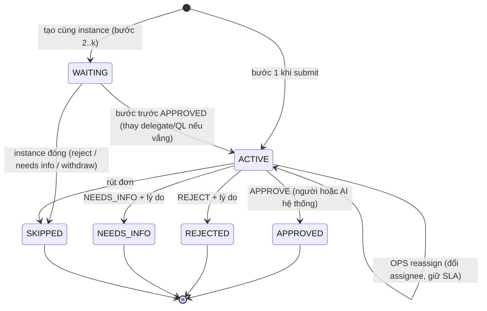
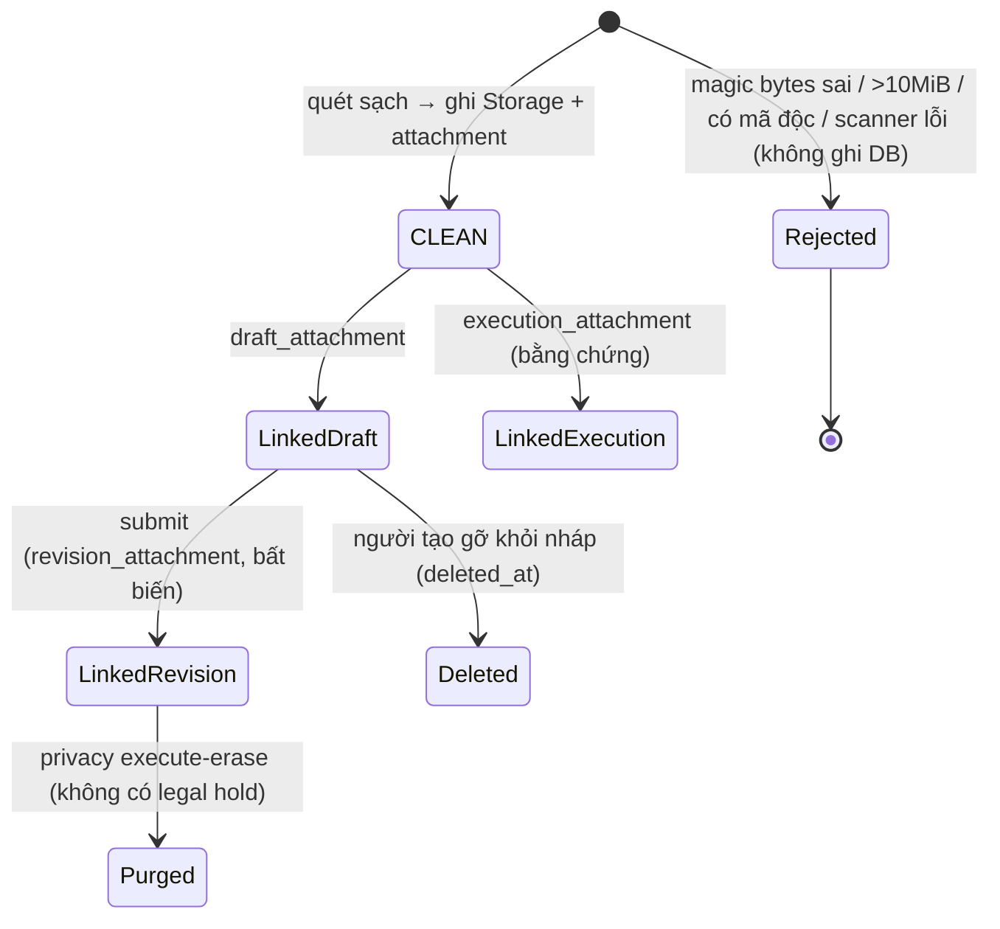
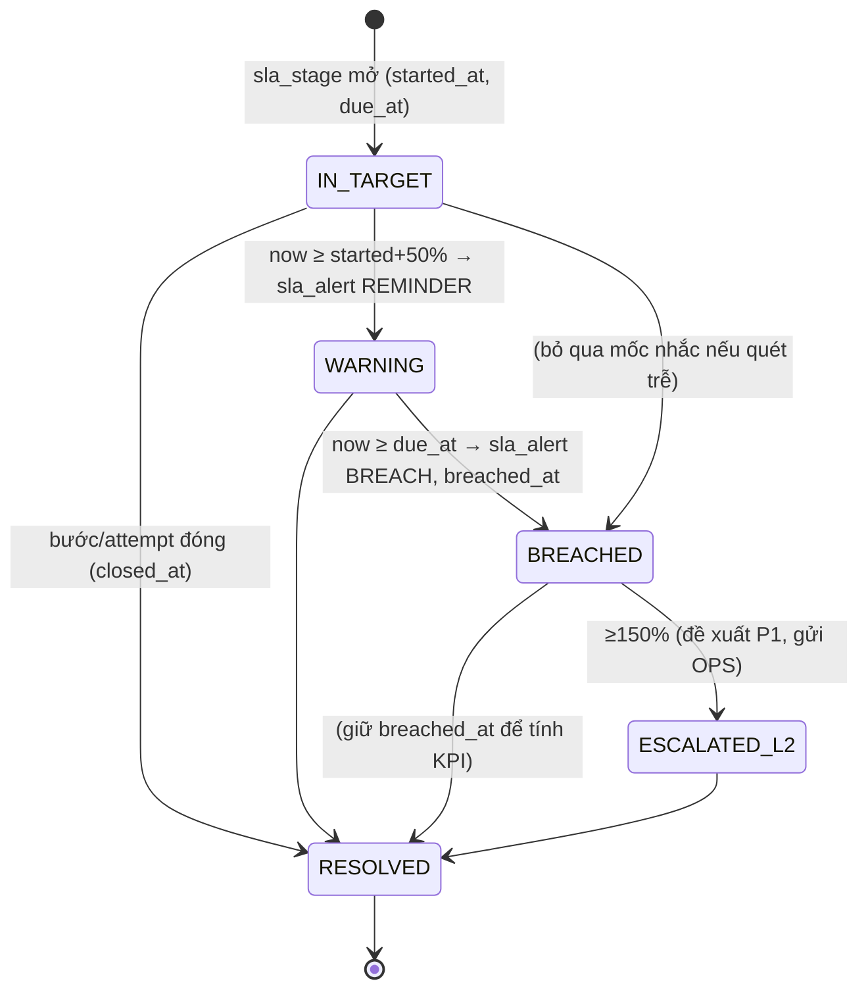
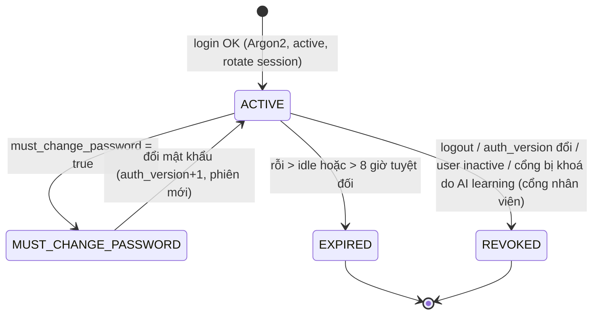
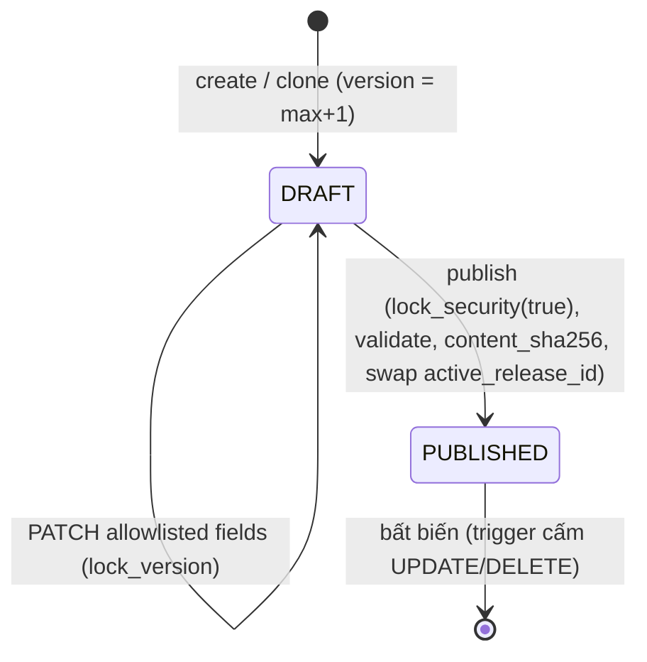
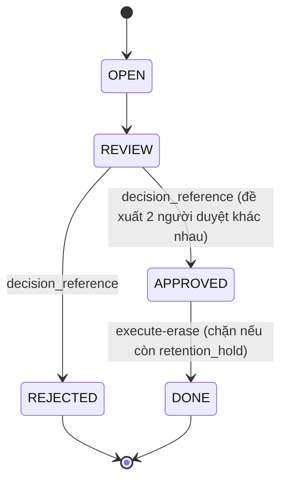
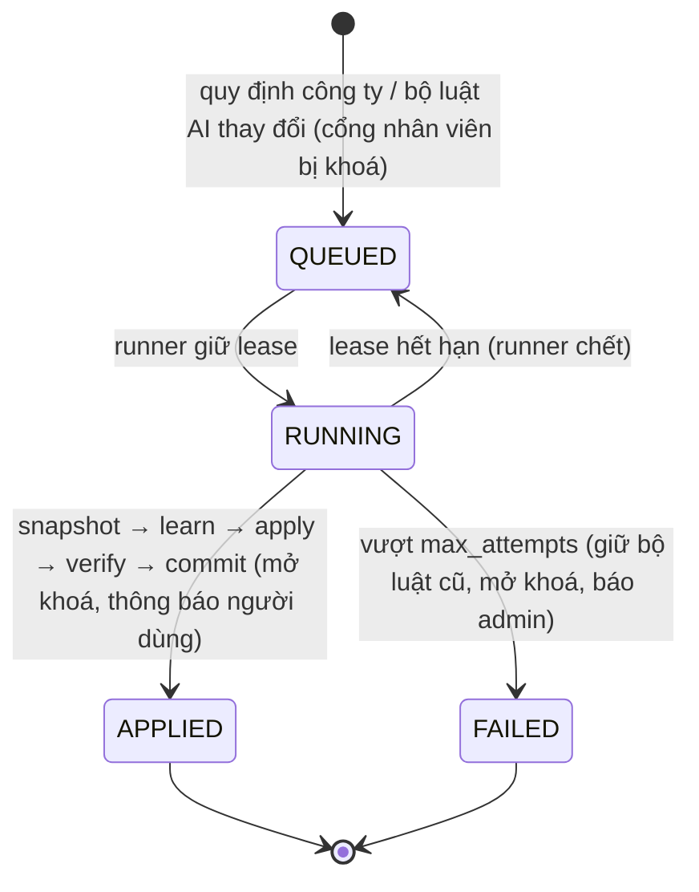

# 07 — Sơ đồ máy trạng thái (DOCX 2.3.2, 2.3.6 + Phụ lục D)

> DOCX đặt 8 mã ST-01…ST-08 cùng một sơ đồ vòng đời tệp đính kèm (text PL-29). Có ảnh thật cho **3 sơ đồ**, và cả 3 đều mang chú thích sai:
> - ST-02 ở img_063, chú thích "PL-31 ST-08";
> - ST-04 Execution attempt ở img_061, chú thích "PL-29 ST-04 tệp đính kèm";
> - ST-07 ở img_062, chú thích "PL-30 ST-05".
>
> Riêng mã **ST-04 bị dùng cho hai đối tượng**: text gán cho tệp đính kèm, ảnh gán cho execution attempt. Đề xuất đánh số lại:
>
> | Mã mới | Đối tượng | Nguồn sự thật |
> |---|---|---|
> | ST-01 | Hồ sơ yêu cầu (`request.status`) | trigger `guard_request` |
> | ST-02 | Phiên quy trình (`workflow_instance.state`) | CHECK + service |
> | ST-03 | Bước phê duyệt (`approval_step.state`) | trigger `guard_step` |
> | ST-04 | Lần thực thi (`execution_attempt.state` + `closure_kind`) | trigger attempt |
> | ST-05 | Tệp đính kèm (`attachment.scan_state` + `deleted_at`) | CHECK + `attachments.py` |
> | ST-06 | Chặng SLA (`sla_stage` + `sla_alert`) | worker |
> | ST-07 | Sự kiện outbox (`outbox_event.state`) | worker |
> | ST-08 | Phiên xác thực | `authn/service.py` |
> | ST-09 | Bản phát hành quy chế (`config_release.state`) | trigger release |
> | ST-10 | Hồ sơ quyền riêng tư (`privacy_case.status`) | CHECK |
> | ST-11 | Job học quy định AI (`ai_learning_job.status`) | migration 12 |
>
> ST-09 đến ST-11 là bổ sung: DOCX chưa có các sơ đồ này.

## ST-01 — Hồ sơ yêu cầu
DOCX không có ảnh; Hình 2.19 là ảnh lặp. Sơ đồ chuẩn hoá và bảng chuyển trạng thái ở **`02_QUY_TRINH_NGHIEP_VU.md` §3.3**.

Bất biến được trigger cưỡng chế (`schema.sql:795-826`):
- (i) trạng thái cuối không sửa được;
- (ii) mỗi lệnh ghi tăng `lock_version` đúng 1;
- (iii) A không vào được trạng thái thực thi; B không vào được trạng thái nghiệm thu;
- (iv) ngoài DRAFT/CANCELLED thì phải có `current_revision_id`;
- (v) READY_FOR_EXECUTION trở đi phải có `approved_at`.

## ST-02 — Phiên quy trình duyệt (img_063)
**Ảnh:** `[*] → ACTIVE` (submit/resubmit) → COMPLETED (duyệt cuối) | REJECTED | SUPERSEDED (needs info) | CANCELLED (rút đơn). Bất biến: mỗi request có tối đa 1 instance ACTIVE.

**Code:** CHECK `state IN (ACTIVE, COMPLETED, REJECTED, SUPERSEDED, CANCELLED)` (`schema.sql:188`); `_handle_approval_*`. **KHỚP.**

## ST-03 — Bước phê duyệt đa cấp *(Hình 2.21 là ảnh lặp; vẽ mới theo trigger `schema.sql:873-877`)*

Ràng buộc thời điểm (`step_state_times`):
- WAITING thì chưa có `activated_at`;
- ACTIVE thì có `activated_at`, chưa có `closed_at`;
- trạng thái cuối thì có `closed_at`.

Trạng thái cuối không sửa được. **ERD ER-07 (text) KHỚP danh sách trạng thái**, nhưng dùng `PENDING` thay cho `WAITING`. Sửa tên.

## ST-04 — Lần thực thi công việc (img_061)
**Ảnh:**
- `[*] → READY` khi duyệt cuối, rework hoặc reassign;
- `READY → RUNNING` khi claim;
- `RUNNING → SUBMITTED` khi nộp kết quả (lifecycle C);
- `RUNNING → FINISHED/SUCCESS` (lifecycle B);
- `RUNNING → FINISHED/REASSIGNED` (OPS);
- `SUBMITTED → FINISHED/ACCEPTED` hoặc `FINISHED/REWORK`.

Bất biến: rework hoặc reassign khi đang RUNNING luôn đóng attempt cũ và mở attempt READY mới.

**Code:**
- CHECK `state IN (READY, RUNNING, SUBMITTED, FINISHED)` và `closure_kind IN (SUCCESS, ACCEPTED, REWORK, REASSIGNED)`;
- `attempt_finished_result`; chỉ một attempt hiện hành mỗi instance (`one_current_attempt`);
- trigger chặn đổi executor khi RUNNING/SUBMITTED (`schema.sql:254-267, 547, 917-929`).

**KHỚP 100%.**

Chú thích phải đổi thành "ST-04 — Vòng đời lần thực thi". Text PL-29 (tệp đính kèm) chuyển sang ST-05.

## ST-05 — Tệp đính kèm *(text PL-29; không có ảnh)*

| Trạng thái theo text DOCX | Hệ thống | Phán quyết |
|---|---|---|
| QUEUED | Có trong CHECK nhưng **không dùng** (quét đồng bộ) | Ghi "dự phòng cho quét bất đồng bộ P2" |
| SCANNING | Không có | Bỏ (quét nằm trong một request) |
| CLEAN | Có | KHỚP |
| INFECTED | Có trong CHECK. Thực tế tệp nhiễm bị **từ chối trước khi lưu**, nên không có dòng INFECTED | Ghi đúng: "không lưu tệp nhiễm" |
| ERROR | Có trong CHECK, không dùng | idem QUEUED |
| ORPHANED (nháp không nộp sau 30 ngày) | Không có. Xoá mềm qua `deleted_at`; không có job dọn | THIẾU HIỆN THỰC (P2). Không thêm trạng thái mới, chỉ cần job đặt `deleted_at` và xoá object |

## ST-06 — Chặng theo dõi SLA *(Hình 2.23 là ảnh lặp)*

Text và Bảng 2.9 dùng các trạng thái IN_TARGET / WARNING / ESCALATED_L1 / ESCALATED_L2 / RESOLVED. Hệ thống **không lưu** trạng thái này. Nó suy ra từ dữ liệu:
- `sla_stage(started_at, due_at, closed_at, breached_at)`;
- `sla_alert(kind ∈ REMINDER, BREACH)`, append-only, mỗi chặng mỗi loại một bản ghi (`UNIQUE(stage_id, kind)`).

**Phán quyết:** giữ thiết kế "lưu sự kiện, suy diễn trạng thái". Thiết kế này tránh cập nhật đồng loạt theo thời gian. Vẽ ST-06 như một **projection**:

## ST-07 — Sự kiện hàng đợi outbox (img_062)
**Ảnh:**
- `PENDING → PROCESSING` khi worker giữ lease 60 giây;
- `PROCESSING → SENT` khi ghi notification và ACK;
- `PROCESSING → PENDING` khi lỗi tạm thời (lần 1–3) hoặc khi lease hết hạn trước ACK;
- `PROCESSING → DEAD` ở lần lỗi thứ 4;
- `DEAD → PENDING` khi OPS replay có lý do.

**Code:**
- CHECK `state IN (PENDING, PROCESSING, SENT, DEAD)` (`schema.sql:457`);
- `claim_outbox`, `fail_outbox` (DEAD khi `attempts ≥ 4`), `LEASE_EXHAUSTED` (`worker.py:69`);
- `replay_dead_outbox`.

**KHỚP.** Text ER-11 ghi `PROCESSED`; sửa thành `SENT`.

## ST-08 — Phiên xác thực *(text PL-31; không có ảnh)*

| Text DOCX | Hệ thống | Phán quyết |
|---|---|---|
| ACTIVE: phiên trong Redis gắn `user_id` + `auth_version` | Cookie ký `eas_session` chứa `user_id` + `auth_version`; Redis giữ dấu rỗi `eas:idle:{session_id}` | LỆCH NHẸ (nơi lưu) |
| EXPIRED: rỗi 8 giờ (TTL 28.800 giây) | Tuyệt đối 8 giờ (`SESSION_COOKIE_AGE=28800`) **và** rỗi `EAS_SESSION_IDLE_SECONDS` (ảnh SD-01: 30 phút) | Text nhầm "rỗi 8 giờ". Sửa: rỗi 30 phút, tuyệt đối 8 giờ |
| REVOKED: logout / đổi mật khẩu / admin khoá | Logout xoá cookie. Đổi mật khẩu và admin khoá làm **tăng `auth_version`**, nên mọi phiên cũ hết hiệu lực ở request kế tiếp | KHỚP về hành vi |

## ST-09 — Bản phát hành quy chế *(bổ sung)*

## ST-10 — Hồ sơ quyền riêng tư *(bổ sung, `schema.sql:510-521`)*

## ST-11 — Job học quy định AI *(bổ sung, migration 12)*

