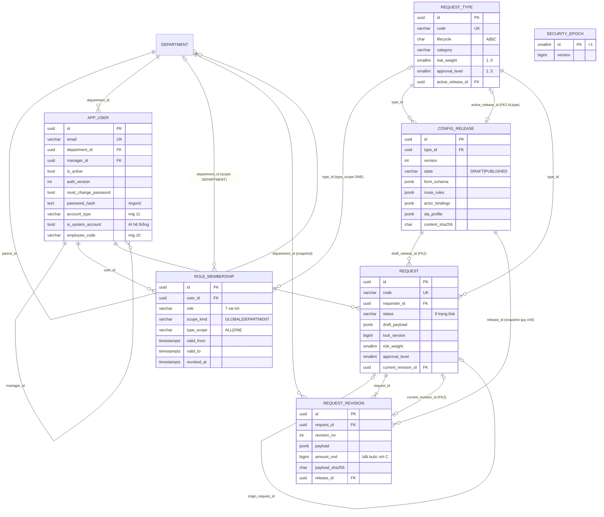
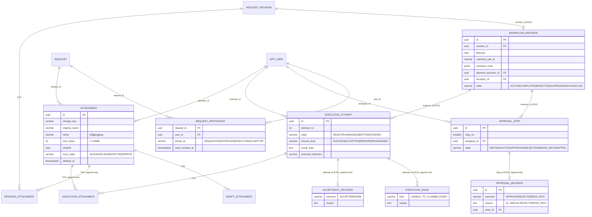
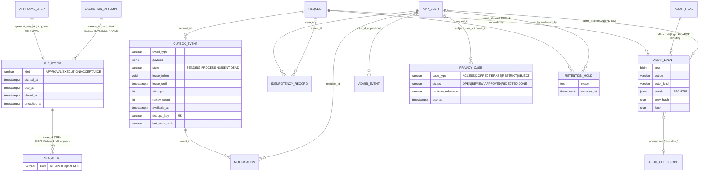
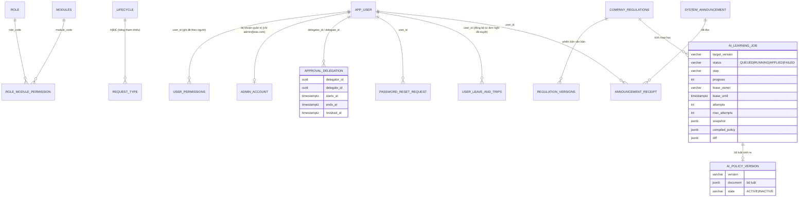

# 08 — Sơ đồ thực thể liên kết (DOCX 2.3.7 + Phụ lục E)

> **Hiện trạng DOCX.**
> - Hình 2.25–2.27 (ER-01/02/03) là ảnh lặp.
> - Phụ lục E có 10 chú thích ER-04…ER-13, nhưng chỉ **6 ảnh là ERD thật**: ER-01, ER-04, ER-05, ER-07, ER-08, ER-10, theo đánh số in trong ảnh. 3 ảnh là sơ đồ khác (SEC-01, DP-01, DFD-01) và 1 ảnh là AR-02.
> - **Đánh số ER trong ảnh khác đánh số trong text.** Ví dụ: text "ER-07 = Quy trình & phê duyệt", còn ảnh "ER-07 = Execution & acceptance".
>
> **Ký pháp trong ảnh** trộn hai kiểu: thuộc tính vẽ hình elip và quan hệ vẽ hình thoi (Chen), cùng bội số crow's foot (IE). Nên dùng **một** ký pháp; khuyến nghị IE/crow's foot với thuộc tính trong khung thực thể, như các sơ đồ Mermaid bên dưới. Lý do: 49 bảng vẽ kiểu Chen không đọc được.
>
> **Nguồn sự thật cho các sơ đồ dưới:**
> - `database/EAS_Supabase_SQL/00_eas_supabase_schema.sql` (30 bảng lõi);
> - `database/migrations/04–13`;
> - `supabase/migrations/20261103_admin_full_upgrade.sql`;
> - `information_schema` live (04/11/2026).
>
> Khoá ngoại **kép `(id, request_id)`** là điểm mạnh của thiết kế: bảng con không thể trỏ tới bản ghi cha thuộc **hồ sơ khác**. DOCX nhắc ở 1.4.3 nhưng ERD không thể hiện. Các sơ đồ dưới ghi chú `FK2`.

## 1. Đánh số chuẩn hoá đề xuất

| Mã | Miền | Bảng | Ảnh thật hiện có |
|---|---|---|---|
| ER-01 | Tổng thể miền 1: Danh tính, cấu hình, hồ sơ lõi | security_epoch, department, app_user, role_membership, request_group, request_menu_item, request_type, config_release, request, request_revision | img_065 (chú thích sai PL-33) |
| ER-02 | Tổng thể miền 2: Quy trình, thực thi, tệp | workflow_instance, request_participant, approval_step, approval_decision, execution_attempt, execution_issue, acceptance_decision, attachment, draft/revision/execution_attachment | không có |
| ER-03 | Tổng thể miền 3: SLA, sự kiện, kiểm toán, quyền riêng tư | sla_stage, sla_alert, sla_escalation_policy, business_holiday, outbox_event, notification, idempotency_record, audit_head, audit_event, admin_event, audit_checkpoint, privacy_case, privacy_case_approval, retention_hold | không có |
| ER-04 | Chi tiết Danh tính & tổ chức | | img_067 (chú thích sai PL-35) |
| ER-05 | Chi tiết Loại đơn, cấu hình, revision | | img_071 (chú thích sai PL-39) |
| ER-06 | Chi tiết Quy trình & phê duyệt | | không có |
| ER-07 | Chi tiết Thực thi & nghiệm thu | | img_064 (chú thích sai PL-32) |
| ER-08 | Chi tiết Tệp & liên kết bất biến | | img_072 (chú thích sai PL-40) |
| ER-09 | Chi tiết SLA, outbox, thông báo | | không có |
| ER-10 | Chi tiết Kiểm toán, idempotency, quyền riêng tư | | img_068 (chú thích sai PL-36) |
| ER-11 | **Bổ sung:** Quản trị & phân quyền module | role, lifecycle, role_module_permission, user_permissions, admin_account, modules | — |
| ER-12 | **Bổ sung:** AI & quy định công ty | ai_policy_version, ai_learning_job, ai_system_state, company_regulations, regulation_versions | — |
| ER-13 | **Bổ sung:** Vận hành & thông báo hệ thống | approval_delegation (đã gộp work_handover ở Migration 15), password_reset_request, system_announcement, announcement_receipt, user_leave_and_trips, mock_apis *(các bảng di sản system_versions_changelog, workflow_categories đã dời sang kho `eas_archive`)* | — |

## 2. Lệch tên cột giữa ảnh ERD và CSDL (áp dụng cho mọi ảnh)

| Ảnh | CSDL thật | Ghi chú |
|---|---|---|
| `request.owner_id` | `request.requester_id` | |
| `request.version` | `request.lock_version` | Text SD-19 viết `version_no` |
| `app_user.username` | `app_user.email` | Migration 05 đổi tên |
| `role_membership.role_code` | `role_membership.role` (+ `scope_kind`, `type_scope`, `revoked_at`) | Ảnh thiếu 3 cột phạm vi, mà đây là cốt lõi của Scoped RBAC |
| `role_membership.department_scope_id` | `role_membership.department_id` | |
| `department.manager_id` | *không có*; quản lý nằm ở `app_user.manager_id` | Ảnh ER-01/ER-04 vẽ quan hệ "Trưởng phòng" **không tồn tại** |
| `security_epoch.epoch` (PK) | `security_epoch.id = 1` + `version` | Bảng một dòng; **không có FK** tới `app_user` (ảnh vẽ quan hệ 1–N là sai) |
| `config_release.content_hash` | `content_sha256` | |
| `execution_attempt.closure` | `closure_kind` | |
| `execution_issue.issue_kind` | `kind` | |
| `attachment.uploaded_by` | `uploader_id` | |
| `audit_event.previous_hash`, `event_hash` | `prev_hash`, `hash` | |
| `audit_head.scope`, `last_seq` | khoá theo chuỗi `REQ:{id}` / `ADMIN` | |
| `outbox_event.state = PROCESSED` (text ER-11) | `SENT` | |
| `notification.label` (text ER-11) | — | Xem từ điển ở `09` |
| `approval_step.state = PENDING` (text ER-07) | `WAITING` | |
| `privacy_case —(Áp dụng lưu giữ)— request` (ảnh ER-10) | Quan hệ lưu giữ đi qua **`retention_hold.request_id`**; `privacy_case` chỉ nối `app_user` (subject, owner) | Ảnh thiếu thực thể `retention_hold` |

## 3. ER-01 — Danh tính, cấu hình và hồ sơ lõi

## 4. ER-02 — Quy trình, thực thi và tệp

## 5. ER-03 — SLA, sự kiện, kiểm toán và quyền riêng tư

## 6. ER-11 → ER-13 — Các bảng mở rộng sau migration 04–13 *(DOCX chưa có)*

> Các quan hệ COMPANY_REGULATIONS → AI_LEARNING_JOB → AI_POLICY_VERSION là **quan hệ logic** (liên kết qua `target_version`, `snapshot`). Chúng không phải FK.
>
> Live `app_user` vẫn còn cột **`username`** (di sản, song song với `email`) và có thêm `is_system_account`. Đề xuất: xoá `username` sau khi xác nhận không còn code đọc cột này, theo quy trình expand/contract.

**Cần xử lý ở CSDL live.** Migration 11 dự kiến chuyển `workflow_categories` và các view phụ thuộc sang `eas_deprecated`. Nhưng live vẫn có `eas.workflow_categories` (3 dòng) và các view `user_roles`, `v_request_templates_full`, `v_users_management` trong schema `eas`. Có hai khả năng:
- migration admin upgrade (`supabase/migrations/20261103_admin_full_upgrade.sql`) đã chạy lại sau migration 11; hoặc
- bảng đó được cố ý giữ lại.

**Cần DBA xác nhận** trước khi chạy `scheduled/2026-11-17_drop_eas_deprecated_after_11.sql`.

## 7. Nhận xét chất lượng thiết kế dữ liệu (theo kinh nghiệm)

| # | Điểm | Đánh giá |
|---|---|---|
| Q1 | FK kép `(id, request_id)` trên mọi bảng con | Rất tốt. Chặn lỗi chéo hồ sơ ngay ở DB |
| Q2 | Bảng quyết định / sự kiện append-only bằng trigger: `request_revision`, `approval_decision`, `acceptance_decision`, `execution_issue`, `revision_attachment`, `execution_attachment`, `sla_alert`, `audit_event`, `admin_event` (`schema.sql:1113`) | Đúng chuẩn kiểm toán |
| Q3 | Snapshot quy chế (`release_id`) và phòng ban (`department_id`) trong revision | Đúng. Thay đổi tổ chức sau này không làm sai hồ sơ cũ |
| Q4 | Bảng trùng chức năng từ admin upgrade (`users`, `departments`, `requests`, `roles` …) | Đã dọn ở migration 11. Phải chốt lịch xoá `eas_deprecated` |
| Q5 | `request.risk_weight`/`approval_level` và `request_revision.risk_weight`/`approval_level` | Lưu ở cả hai nơi là hợp lý: revision là bản chụp bất biến, request là giá trị hiện hành |
| Q6 | `audit_checkpoint`, `retention_hold`, `privacy_case` có bảng nhưng thiếu luồng ứng dụng | Xem `12` |
