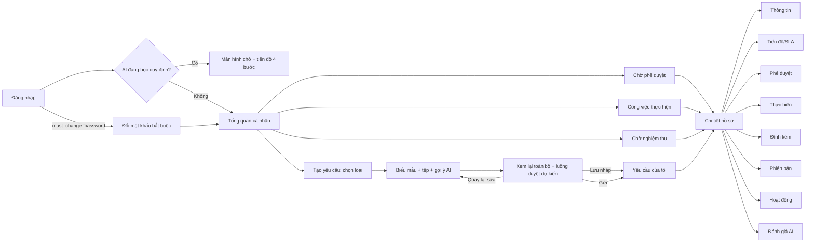

# 10 — Thiết kế giao diện người dùng (DOCX 2.4)

> **Hiện trạng DOCX.** Mục 2.4.1–2.4.6 **chỉ có tiêu đề**: không có wireframe, không có mô tả.
>
> Tệp này đặc tả theo giao diện **đang chạy**:
> - `web_client/src/App.jsx` và `components/*`;
> - `web_admin` dùng chung codebase, chạy với `portal="admin"`;
> - `mobile_app/lib/*`.
>
> Chi tiết từng nút và quyền nằm ở `docs/CHUC_NANG_UI_VA_PHAN_QUYEN.md` (408 dòng, cập nhật 03/11/2026); tệp này không chép lại.
>
> Tiêu chuẩn đối chiếu: Nielsen 10 heuristics, WCAG 2.1 mức AA, ISO 9241-110.

## 1. Kiến trúc giao diện

| Thành phần | Thực tế | Ghi vào DOCX |
|---|---|---|
| Hai cổng | **Cổng nhân viên** (port 5173) và **cổng quản trị** (port 8081). Cùng codebase React 19, khác `portal`. Cổng quản trị **chỉ** `admin@eas.com` vào được | 2.4.1 |
| Điều hướng | Menu theo **5 module nghiệp vụ** (Client Phase 1–3, `ClientRequestsHub.jsx`). Mục chỉ hiện khi người dùng vừa có vai trò vừa có quyền Xem module (`PermissionGuard.jsx`, `rolePolicy.js`, `auth/permissions/me`) | 2.4.1 |
| Hệ thiết kế | `design-system.css` (token màu, khoảng cách, chữ), `ui.jsx` / `ux.jsx` (thành phần dùng chung), `ToastCenter.jsx` | 2.4.1 |
| Gọi API | `fetch` qua `api.js`: kèm CSRF, xử lý 401/409, thông báo lỗi tiếng Việt có mã tra cứu | 2.4.1 |
| Làm mới dữ liệu | Polling khi tab đang hiển thị (`App.jsx:1516`). Không có WebSocket | 2.4.2 |

## 2. Ánh xạ mục DOCX 2.4.x với màn hình thực tế

| Mục DOCX | Màn hình / thành phần | Nội dung cần viết vào DOCX |
|---|---|---|
| 2.4.1 Web Portal cho nhân viên và quản trị | `App.jsx`, `AppHeader.jsx`, `ClientDashboard.jsx`, `AdminScreen.jsx`, `adminScreens.jsx` | Bố cục: thanh trên, menu trái thu gọn được trên di động (off-canvas), vùng nội dung. Hai cổng tách biệt. Màn hình khoá khi AI đang học quy định (`SystemUpdates.jsx`) |
| 2.4.2 Quản lý và theo dõi yêu cầu | `ClientRequestsHub.jsx`, `ClientRequests.jsx`, `RequestTypeMenu.jsx`, `RequestEditor.jsx`, `RoutePreview.jsx`, `RequestDetail.jsx`, `RequestProgress.jsx`, `FullHistory.jsx`, `formatters.js` | Chọn loại đơn (**12 nhóm lớn theo mục đích người gửi** `eas.request_group` với **61 mục chọn loại nhỏ** `eas.request_menu_item`, tìm kiếm, trường đặt sẵn `preset` bị khoá, loại bị khoá có ghi lý do). Biểu mẫu động theo `form_schema`, danh sách chọn nạp từ `/api/v1/integrations/options`, số tiền đọc thành chữ tiếng Việt trực tiếp (`CurrencyInput`). Đính kèm. **Màn hình xem lại trước khi gửi (Pre-submit Review)** và xem trước luồng duyệt. Danh sách theo tab trạng thái. Chi tiết hồ sơ có 8 tab |
| 2.4.3 Phê duyệt đa cấp | `RoleTasks.jsx`, `AssignedWorkDashboard.jsx`, `RequestDetail.jsx`, `AiAssist.jsx`, `DelegationSettings.jsx` | Hộp việc chờ duyệt (có cờ quá hạn SLA). Ba nút Duyệt / Từ chối / Bổ sung; hai nút sau bắt buộc lý do. Tóm tắt AI. Thu hồi AI tự duyệt trong 24 giờ. Ủy quyền |
| 2.4.4 Thực hiện và nghiệm thu | `AssignedWorkDashboard.jsx`, `RequestDetail.jsx` | Nhận việc / Báo vướng / Nộp kết quả (ghi chú ≥ 10 ký tự, mã tham chiếu, tệp). Chấp nhận / Làm lại (bắt buộc lý do) |
| 2.4.5 Dashboard và báo cáo | `DashboardOverview.jsx`, `TeamDashboard.jsx`, `AuditorWorkspace.jsx`, admin `analytics` | Thẻ KPI cá nhân (không đếm nháp), báo cáo phòng ban theo scope, KPI và hiệu suất SLA A/B/C ở cổng quản trị. Mẫu số bằng 0 hiển thị **N/A** (SD-16) |
| 2.4.6 Mobile | `mobile_app/lib/main.dart`, `eas_api.dart` | Đăng nhập, danh sách hồ sơ theo tab, chi tiết, thông báo, đổi mật khẩu. **Chưa có** duyệt, push, sinh trắc học → ghi đúng phạm vi |
| *(thiếu trong DOCX)* Cổng quản trị 9 mục | `AdminPages.jsx`, `UserManagementPage.jsx`, `RolePermissionMatrixPage.jsx`, `RegulationsManagementPage.jsx`, `AiEngineManagementPage.jsx`, `ApiAdministration.jsx`, `SystemVersionsPage.jsx`, `RequestWorkflowsPage.jsx`, `OrgChart.jsx` | Thêm mục **2.4.7 Cổng quản trị**: Tổng quan · Yêu cầu & Quy trình · Sơ đồ công ty · Người dùng · Phân quyền · Quy định · Quản trị AI · Quản lý API · Phiên bản hệ thống |

## 3. Luồng màn hình chính (thay cho wireframe còn thiếu)

Màn hình **RV (xem lại trước khi gửi)** là quyết định D7 (03/11/2026) và **đã được hoàn thiện ngày 05/11/2026** trong `RequestEditor.jsx` cùng các trang mới `ProfilePage.jsx`, `NotificationsPage.jsx` và bộ định dạng `web_client/src/utils/formatters.js` (ẩn toàn bộ UUID kỹ thuật, đọc số tiền thành chữ tiếng Việt trực tiếp).

## 4. Đánh giá UX/UI theo kinh nghiệm (đề xuất đưa vào DOCX 2.4 hoặc 3.x)

| # | Tiêu chí | Hiện trạng | Mức | Đề xuất |
|---|---|---|---|---|
| U1 | Hiển thị trạng thái hệ thống (Nielsen #1) | Tab Tiến độ: ai đang giữ việc, bước kế, hạn SLA. Huy hiệu "AI duyệt" | Tốt | — |
| U2 | Ngăn lỗi (#5) | Loại đơn bị khoá có lý do; xem trước luồng duyệt; 409 khi xung đột có hướng dẫn tải lại | Tốt | Thêm màn hình xem lại (D7) |
| U3 | Ngôn ngữ người dùng (#2) | Tiếng Việt. Một số mã kỹ thuật (`READY_FOR_EXECUTION`) có nhãn Việt hoá trong `domain.js` | Tốt | Kiểm không còn mã thô trên UI |
| U4 | Khả năng tiếp cận (WCAG 2.1 AA) | Có kiểm thử e2e cho design system (`web_client/e2e/design-system.test.mjs`) và responsive. Chưa có báo cáo axe hay đo tương phản | Chưa kiểm chứng | Chạy axe-core trên 10 màn hình chính; mục tiêu 0 lỗi mức serious |
| U5 | Gợi ý AI có thể gây hiểu nhầm | `AiAssist.jsx` chỉ ánh xạ 16 nhãn NLP về **3 mã** (`LEAVE`, `ACCESS`, `EQUIPMENT`). Payload rủi ro **gán cứng** lifecycle và trọng số (`EQUIPMENT` → B, trong khi live là **C**) (`AiAssist.jsx:11-27`) | **Cao** | Xem `11` §5: lấy lifecycle/trọng số từ catalog, ánh xạ đủ 58 loại hoặc ẩn gợi ý khi không ánh xạ được |
| U6 | Trang Quy định công ty cho nhân viên | Module "Quy định" cho quyền Xem nhưng cổng nhân viên chưa có trang đọc | Trung bình | Thêm trang chỉ đọc (phiên bản hiện hành + lịch sử) |
| U7 | Màn hình quản trị bị ẩn khỏi menu | Danh tính & phạm vi, Phiên bản cấu hình quy trình, Nhật ký kiểm toán còn trong code nhưng không có trên menu 9 mục | Cao (admin không đổi được luồng duyệt và SLA trên UI) | Đưa vào tab con của "Yêu cầu & Quy trình" và "Phân quyền" (phương án §12.2 của tài liệu UI) |
| U8 | Mobile | Chỉ đọc | — | Ghi đúng phạm vi. P1: nút Duyệt / Từ chối trên mobile, dùng lại API sẵn có |

## 5. Ma trận màn hình × vai trò (tóm tắt)

| Màn hình | REQ | APR | EXE | ACC | Admin |
|---|---|---|---|---|---|
| Tổng quan cá nhân | ✔ | ✔ | ✔ | ✔ | — |
| Tạo yêu cầu / Yêu cầu của tôi | ✔ | — | — | — | — |
| Chờ phê duyệt / Ủy quyền | — | ✔ | — | — | — |
| Công việc thực hiện | — | — | ✔ | — | — |
| Chờ nghiệm thu | — | — | — | ✔ | — |
| Tổng quan phòng ban | — | ✔ (scope) | — | — | — |
| Sơ đồ tổ chức / luồng / quy trình AI | ✔ | ✔ | ✔ | ✔ | ✔ |
| 9 mục cổng quản trị | — | — | — | — | ✔ |
