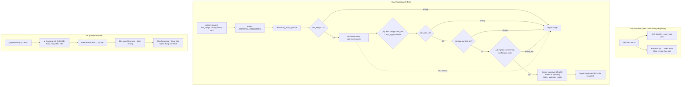

# 11 — Thiết kế, huấn luyện và vận hành AI (DOCX 1.3, Bảng 1.3, 1.4.5, 3.2.11)

> **Hiện trạng DOCX.** Mục 1.3 và Bảng 1.3 mô tả 7 mô hình; mục 1.4.5 mô tả microservice. **Chương 3 (gồm 3.2.11) chỉ có tiêu đề**, nên chưa có phần huấn luyện, đánh giá hay vận hành AI.
>
> Tệp này dựng lại phần đó theo **mẫu Model Card** (Mitchell và cộng sự, 2019) và các nguồn sau:
> - mã nguồn `ai_service/` (routers, training);
> - `ai_service/models/model_metadata.json`;
> - `api_core/workflow/{auto_approval, ai_learning, ai_policy}.py`;
> - `web_client/src/components/AiAssist.jsx`.

## 1. Kết luận của nhóm AI (đọc trước)

| # | Kết luận | Mức |
|---|---|---|
| K1 | **Quyết định tự duyệt không dùng mô hình học máy.** Điểm rủi ro đưa vào cổng tự duyệt là `request.risk_weight`: **trọng số tĩnh theo loại đơn** lấy từ catalog (`plan_catalog.resolve_five_level_metadata`, `service.py:454,1435`). Quy định công ty có thể nâng trọng số (`min_risk`) hoặc cấm tự duyệt (`policy.apply_policy`) | Rất quan trọng: DOCX phải viết lại 1.3.4 |
| K2 | Mô hình XGBoost chỉ được gọi từ màn hình gợi ý (`AiAssist.jsx` → `/api/v1/ai/risk-score`) để **tham khảo**. UI gửi đúng 4 trường (loại, lifecycle, trọng số, số tiền). **15/19 đặc trưng còn lại lấy giá trị mặc định** của API (ngân sách 500 triệu, có chứng từ, thâm niên 12 tháng, 0 đơn trước, …) (`routers/risk.py:150-210`). Điểm XGBoost hiển thị vì vậy **không phản ánh hồ sơ thật** | Cao |
| K3 | Độ chính xác công bố (NLP 98,7–100%; XGBoost 91–95%) đo trên **dữ liệu tổng hợp**. Nhãn rủi ro do **chính bộ sinh dữ liệu** gán bằng luật, cộng 5% nhiễu (`enterprise_bigdata_generator.py:715`). Mô hình chủ yếu **học lại luật của bộ sinh**; trần lý thuyết khoảng 95% do nhiễu. `model_metadata.json` tự ghi chú: *"These metrics do not estimate accuracy on real company requests"* | Cao: không được trình bày như độ chính xác thực tế |
| K4 | Bộ phân loại NLP có **16 nhãn**; catalog live có **58 loại đang hoạt động**. UI chỉ ánh xạ được về 3 mã `LEAVE` / `ACCESS` / `EQUIPMENT` (`AiAssist.jsx:11-18`) | Cao |
| K5 | Thiết kế an toàn đúng hướng: AI chỉ tự duyệt khi **lifecycle A và trọng số ≤ 2 và quy định không cấm**. Mọi quyết định của AI đi qua `decide_approval` (đủ guard SoD và audit) dưới tài khoản hệ thống không đăng nhập. Có **thu hồi trong 24 giờ**. AI lỗi thì chuyển người duyệt | Tốt: giữ |
| K6 | "Học quy định" (migration 12) là **biên dịch tất định** văn bản quy định thành luật (`min_risk`, `auto_approve:false`, ngưỡng tiền/ngày). Không dùng LLM, không tốn phí. Cổng nhân viên bị khoá trong lúc học | Tốt: giữ. Ghi đúng là "rule compilation", không phải "machine learning" |

## 2. Danh mục mô hình: DOCX Bảng 1.3 ↔ thực tế

| # | DOCX | Thực tế | Được dùng ở đâu | Phán quyết |
|---|---|---|---|---|
| 1 | TF-IDF + **Calibrated SGD**; dự đoán loại đơn và template; < 100ms | TF-IDF (n-gram 1–2) + **Logistic Regression** (`train_all_models.py:281-308`). 3 đầu ra: `request_type` (16 nhãn), `department` (7), `lifecycle_template` (A/B/C). Có fallback từ khoá khi chưa có mô hình (`classify.py:126`) | Gợi ý loại đơn trên form | LỆCH NHẸ (thuật toán) + THIẾU (nhãn không khớp catalog) |
| 2 | Master Risk, **14 đặc trưng** | XGBoost multi-class 1–5, **19 đặc trưng** (`feature_columns.json`), 1.000.000 mẫu, early stopping | Fallback khi không có mô hình miền | LỆCH NHẸ (số đặc trưng) |
| 3 | Finance | XGBoost, 250.000 mẫu, lớp 2–5 | `resolve_domain` theo loại | KHỚP |
| 4 | HR | XGBoost, 250.000 mẫu, lớp 1–5 | idem | KHỚP |
| 5 | IT | XGBoost, 250.000 mẫu, lớp 2–5 | idem | KHỚP |
| 6 | OCR: **Tesseract / TrOCR** | **PaddleOCR** (offline) + **Gemini 1.5 Flash Vision** dự phòng (`ocr.py:172-287`). Bóc trường hoá đơn bằng regex (`parse_invoice_fields`) | **Không có endpoint ở api_core, UI không gọi** | DOCX SAI (công nghệ) + THIẾU HIỆN THỰC (chưa nối) |
| 7 | Gemini 1.5 Flash tóm tắt | Đúng. Có cache theo SHA-256 nội dung; lọc dữ liệu qua `sanitizer.py` | Chi tiết hồ sơ, góc người duyệt | KHỚP |
| — | *(không có)* | **Auto-approve engine**: luật + trọng số (`routers/auto_approve.py`) | Worker sau khi submit | Bổ sung vào bảng |
| — | *(không có)* | **Policy engine**: bộ luật quy định công ty (`routers/policy.py`, `active_enterprise_policy.json` v1.10) | Cổng tự duyệt | Bổ sung |

**Artifact:** DOCX ghi "15 artifacts"; thư mục `ai_service/models/` có **16 tệp**:
- 4 tệp `nlp_*` (`.pkl`) + `nlp_labels.json`;
- 4 tệp `risk_model*.pkl` + 4 tệp `feature_col*.json`;
- `encoders.json`, `domain_model_registry.json`, `model_metadata.json`.

`config.py:49` còn trỏ tới `models/label_encoder.pkl` (**không tồn tại**). Cần xoá cấu hình thừa.

## 3. Dữ liệu huấn luyện

| Hạng mục | Thực tế | Rủi ro / khuyến nghị |
|---|---|---|
| Nguồn | 100% tổng hợp: `generate_enterprise_requests.py`, `enterprise_bigdata_generator.py` (seed cố định, đa tiến trình) | Ghi rõ "dữ liệu tổng hợp" ở mọi chỗ báo cáo số liệu |
| Kích thước | NLP 50.000 dòng; Master 1.000.000; mỗi miền 250.000 | — |
| Gán nhãn rủi ro | Luật trong bộ sinh (vượt ngân sách, chia nhỏ số tiền, thiếu chứng từ, tỷ lệ bị từ chối cao, ngoài giờ, sai mẫu…) + 5% nhiễu | Mô hình xấp xỉ luật. Feature importance khớp đúng luật: `is_over_budget` 0,33; `is_split_amount_suspect` 0,12 |
| Chia tập | `GroupShuffleSplit` theo **tiêu đề chuẩn hoá** (train 58%, val 21%, test 21%) | Tốt: chống lọt tiêu đề giữa các tập |
| Tái lập | Tệp dữ liệu lớn (`training/data/partitions/*.csv`) **không có trong repo**; chỉ có `eapproval_risk_10000.csv`. Tái lập bằng cách chạy lại bộ sinh với cùng seed | Ghi lệnh tái lập vào phụ lục; lưu hash của dữ liệu sinh ra |
| Dữ liệu thật | Live mới có 37 hồ sơ, 35 quyết định duyệt | Chưa đủ để huấn luyện hay hiệu chỉnh. Lập kế hoạch thu nhãn từ quyết định thật (§6) |
| Dữ liệu cá nhân | Tên người, phòng ban có trong dữ liệu sinh; không có dữ liệu thật | Đạt yêu cầu Nghị định 13/2023 cho giai đoạn huấn luyện |

## 4. Huấn luyện và đánh giá

**Quy trình.** `training/run_training_pipeline.py` → `train_all_models.py`. Lần chạy gần nhất `trained_at = 2026-10-31T20:53Z`, 386 giây, `pipeline_version = grouped-holdout-v1`, `random_state = 42`, XGBoost 4 luồng.

| Mô hình | Tập test | Accuracy | F1 macro | Ghi chú |
|---|---|---|---|---|
| NLP request_type (16 lớp) | 9.874 | 1,000 | 1,000 | Văn bản sinh từ mẫu; nhãn gần như suy ra trực tiếp từ từ khoá. **Không có ý nghĩa với văn bản thật** |
| NLP department (7 lớp) | 9.874 | 0,9994 | 0,9993 | idem |
| NLP lifecycle (A/B/C) | 9.874 | 0,9867 | 0,9810 | idem |
| Risk Master (1–5) | 209.126 | 0,9296 | 0,9407 | Gần trần nhiễu 5% |
| Risk Finance (2–5) | 62.161 | 0,9340 | 0,9359 | |
| Risk HR (1–5) | 44.610 | 0,9148 | 0,9389 | |
| Risk IT (2–5) | 49.450 | 0,9517 | 0,9538 | |
| *(cũ)* XGBoost 50.000 mẫu, 03/10/2026 | 7.500 | 0,9992 | 0,9993 | `training/data/evaluation_report.txt`: bản cũ **chia ngẫu nhiên**, nên lọt mẫu. **Không trích dẫn** |

**Còn thiếu so với chuẩn báo cáo mô hình** (bổ sung vào 3.2.11):
1. **Đường cơ sở (baseline)**: so với chính bộ luật sinh nhãn. Nếu luật đạt khoảng 95% thì XGBoost không thêm giá trị trên dữ liệu này.
2. **Hiệu chỉnh xác suất**: reliability diagram / ECE. Đây là điều kiện cần nếu dùng `confidence` để ra quyết định.
3. **Độ trễ đo thật** (p50/p95) cho classify, risk, summarize. DOCX ghi < 100ms / < 50ms / < 300ms nhưng chưa có số đo.
4. **Phân tích lỗi theo lớp** và ma trận nhầm lẫn cho rủi ro 3↔4 (ranh giới duyệt tay).
5. **Kiểm thử trên văn bản thật**: 100–200 tiêu đề do người viết, gán nhãn tay.

## 5. Luồng vận hành AI thực tế (thay cho mô tả 1.3.4)

## 6. Phương án đề xuất (theo thứ tự ưu tiên; không làm vượt phạm vi)

| # | Việc | Lý do | Mức |
|---|---|---|---|
| A1 | **Sửa DOCX** cho đúng K1–K4. Ghi rõ "trọng số rủi ro theo loại đơn + quy định công ty quyết định tự duyệt; mô hình học máy chỉ hỗ trợ tham khảo" | Tính trung thực của báo cáo; tránh bị phản biện | Bắt buộc |
| A2 | `AiAssist.jsx`: lấy `lifecycle` và `risk_weight` từ catalog của loại đang chọn, thay vì gán cứng. Ẩn điểm XGBoost nếu thiếu đặc trưng thật, hoặc ghi rõ "điểm minh hoạ trên dữ liệu mặc định" | Sửa lỗi hiển thị sai (`EQUIPMENT` đang là C nhưng gửi B) | Cao, sửa nhỏ |
| A3 | Ánh xạ 16 nhãn NLP sang mã catalog, hoặc huấn luyện lại NLP với nhãn là **58 mã catalog**: sinh câu mẫu theo `name`/`description` của từng loại | Gợi ý loại đơn mới có ích thật | Trung bình |
| A4 | Nếu muốn mô hình rủi ro tham gia quyết định: (1) tính đủ 19 đặc trưng từ dữ liệu thật ở `api_core` (ngân sách từ `mock_finance`, lịch sử từ `request`/`approval_decision`, thâm niên từ `mock_hr`); (2) lưu điểm, phiên bản mô hình và đặc trưng vào revision; (3) chỉ cho phép **tăng** mức kiểm soát (thêm cấp duyệt hoặc cấm tự duyệt), **không** cho tự duyệt dựa trên mô hình | COSO + khả năng tái lập khi kiểm toán | P1 |
| A5 | Nối OCR: endpoint `POST /api/v1/ai/ocr` qua api_core (kiểm magic bytes, quyền), điền sẵn và **đối chiếu** số tiền nhập tay. Không tự ghi đè | Thực hiện đúng mô tả UC-BIZ-02 | P1 |
| A6 | Theo dõi drift: ghi `confidence` và kết quả thực (người duyệt đồng ý hay thu hồi AI). Báo cáo hằng tháng tỷ lệ thu hồi AI tự duyệt; nếu > 5% thì tự tắt tự duyệt cho loại đó | Vòng phản hồi an toàn, chi phí thấp | P1 |
| A7 | Gemini: giữ cache và sanitizer; ghi vào DOCX luồng dữ liệu ra nước ngoài, mục đích, và cơ chế tắt. Khi thiếu API key, hệ thống tự chuyển sang **tóm tắt trích xuất cục bộ** (`summarize._local_extractive_summarize`), nên không phát sinh lỗi nghiệp vụ. Cân nhắc model mới hơn khi 1.5 Flash ngừng hỗ trợ | Nghị định 13/2023; vòng đời phụ thuộc bên thứ ba | Trung bình |
| A8 | Mở rộng tự duyệt sang B/C ở trọng số 1–2 (quyết định D5 ngày 03/11/2026): sửa Gate 1 ở `routers/auto_approve.py` cùng `auto_approval.py`. Riêng **C vẫn cần nghiệm thu bởi người** | Theo quyết định chủ đầu tư; giữ four-eyes ở khâu nghiệm thu | Theo kế hoạch `2026-11-03_auto_assignment_lifecycle.md` |

## 7. Model Card tóm tắt (để chép vào phụ lục DOCX)

| Mục | Risk Master (XGBoost) | NLP Classifier |
|---|---|---|
| Mục đích dự kiến | Điểm rủi ro **tham khảo** 1–5 cho người duyệt | Gợi ý loại đơn, phòng ban, lifecycle |
| Không dùng cho | Tự động phê duyệt hay từ chối; xếp hạng nhân viên | Tự động chọn loại đơn khi người dùng chưa xác nhận |
| Dữ liệu | 1.000.000 bản ghi tổng hợp; nhãn theo luật + 5% nhiễu | 50.000 tiêu đề/mô tả tổng hợp, 16 loại |
| Chỉ số | Acc 0,930, F1 macro 0,941 (test nhóm theo tiêu đề, dữ liệu tổng hợp) | Acc 1,000 (dữ liệu tổng hợp) |
| Hạn chế | Học lại luật của bộ sinh; 15/19 đặc trưng chưa được cung cấp từ hệ thống thật; chưa hiệu chỉnh xác suất | Nhãn không khớp catalog 58 loại; chưa thử trên văn bản thật |
| Công bằng | Đặc trưng `user_role_enc`, `user_tenure_months` có thể bất lợi cho nhân viên mới. Không dùng để quyết định | Không áp dụng |
| Phiên bản | `grouped-holdout-v1`, 31/10/2026, seed 42 | idem |
